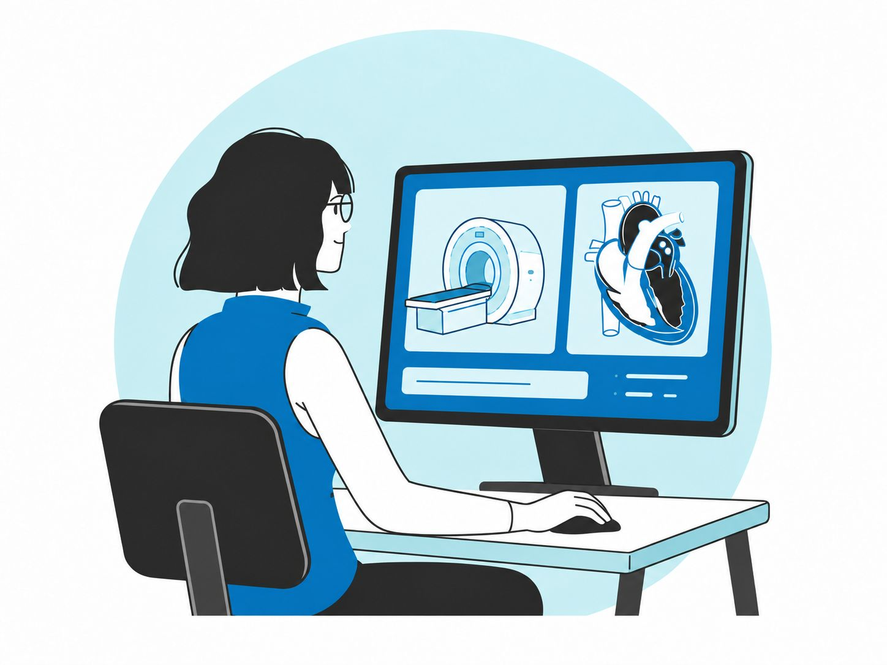

  <picture>
    <source media="(prefers-color-scheme: dark)" srcset="figures/stanford-medicine-white.svg">
    
  </picture>

<h1 align="right">BIOS 214</h1>

  <strong>Open-Source MRI Sequence Development</strong> 
  Simulation to Scanner 
  Stanford University · Autumn 2026

 

  

  <a href="https://cncastillo.github.io/teaching/bios-214/">Course website &amp; syllabus</a> ·
  <a href="https://cncastillo.github.io/bios-214/lecture/">Slides</a> ·
  <a href="https://cncastillo.github.io/bios-214/lab/">Activities</a>

  Instructors: Carlos Castillo-Passi &amp; Daniel Ennis

Design, simulate, and test MRI sequences with Julia, Pluto notebooks, and coding agents.

## Get started

1. Follow the [setup instructions](https://cncastillo.github.io/teaching/bios-214/#setup) to install Julia 1.10 and Pluto 1.0.4 or later, and clone this repository.
2. **Open the cloned folder as a project in your desktop coding agent** so it can read `AGENTS.md` and the course skill.
3. Ask your coding agent to open [Activity 0](lab/0/activity0.jl), and complete it before the first class.

The HTML activities show saved results. To edit code and run Julia-backed controls, open the `.jl` notebook in Pluto.

> [!WARNING]
> **Work in progress:** These course materials are under active development and may be incomplete or change.
