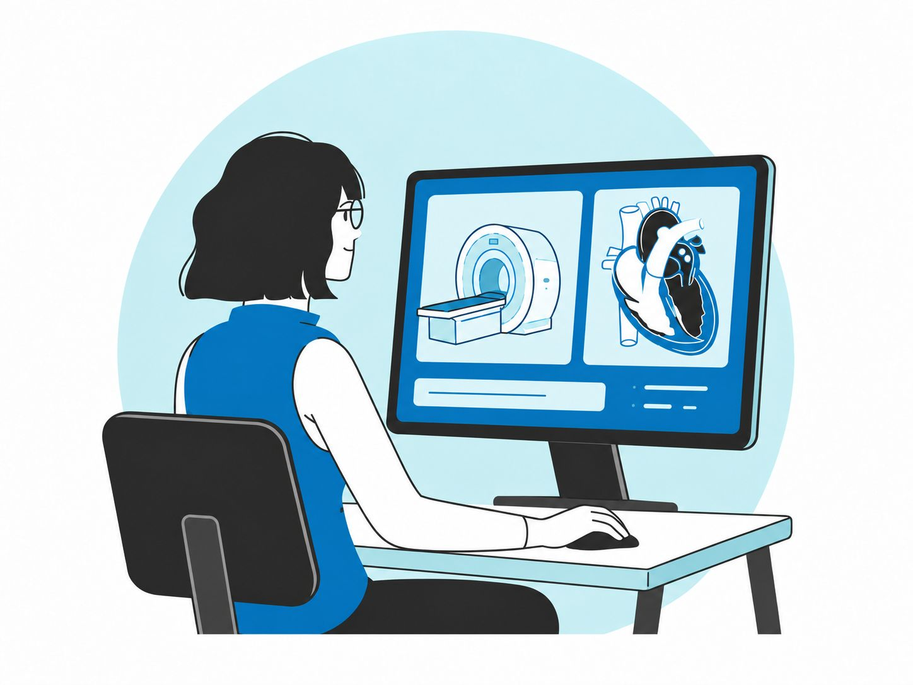
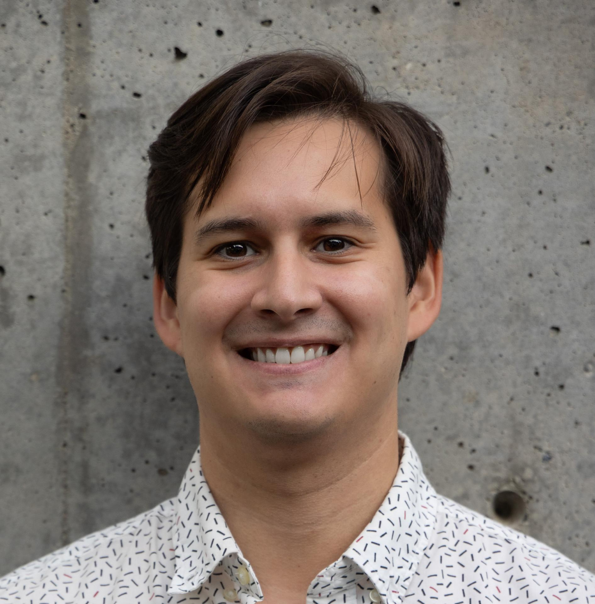
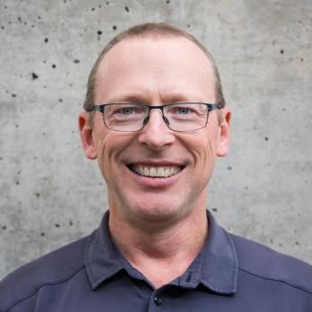
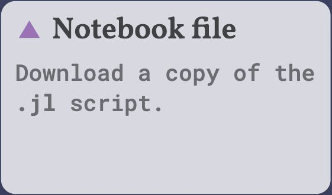
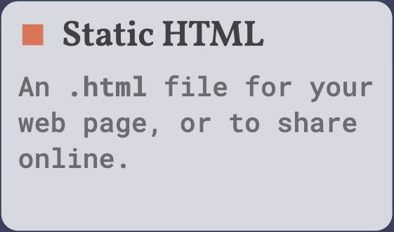
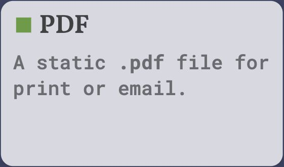
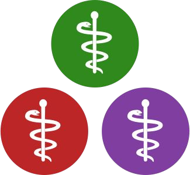

# You will take MRI experiments from simulation to the scanner {.smaller}

::: {.columns}
::: {.column width="60%"}
::: {.fragment}
- **Lectures (M/W/F):** 9:30–10:20 a.m.
:::
::: {.fragment}
- **Labs (M/W/F):** 10:30–11:50 a.m.
  - Scanner lab every Friday! (Cima.X)
:::

::: {.fragment}
- **Classroom:** CCSR 4107
  - **Days 1 and 3 (Nov 9 and 13):** Alway M218/218A
:::

::: {.fragment}
- All material will be made available online
  - Recorded lectures
  - Lecture slides
  - Lab activities
:::
:::
::: {.column .course-artwork width="40%"}
{height=260px fig-alt="MRI simulation and scanner course illustration"}

Course website

[{height=180px fig-alt="QR code for the BIOS 214 course website"}](https://cncastillo.github.io/teaching/bios-214/)
:::
:::

::: {.notes}
Course website: https://cncastillo.github.io/teaching/bios-214/
Illustration supplied in the source Google Slides deck.
Content and layout: first seven slides of https://docs.google.com/presentation/d/1CmxFTfhxNXH9JF6ht3hYEcbAJD-eaCRYvIQiXDOJZ4Y/edit
:::

# Teaching team {.smaller}

::: {.columns style="text-align: center;"}
::: {.column width="32%"}
{height=230px fig-alt="Carlos Castillo-Passi"}

Carlos Castillo-Passi, Ph.D. \
**Instructor**

::: {.affiliation}
Postdoctoral Scholar \
Radiology \
Stanford University
:::
:::
::: {.column width="32%"}
{height=230px fig-alt="Daniel B. Ennis"}

Daniel B. Ennis, Ph.D. \
**Instructor**

::: {.affiliation}
Professor of Radiology \
and (by courtesy) Bioengineering \
Stanford University
:::
:::
::: {.column width="32%"}
{height=230px fig-alt="Charles McGrath"}

Charles McGrath, Ph.D. \
**T.A.**

::: {.affiliation}
Postdoctoral Scholar \
Radiology \
Stanford University
:::
:::
:::

::: {.notes}
Portraits supplied in the source Google Slides deck.
:::

# AI writes code, you must understand and validate results {.smaller}

::: {.columns}
::: {.column width="48%"}
::: {.fragment fragment-index=0}
- Coding will use Pluto notebooks:
  - Reproducible environments
  - Reactive
  - Can run as scripts
:::

::: {.fragment fragment-index=1}
- **Open repository as a project**
  - Course skill
  - Prompts will be recorded (required), to:
    - Assess understanding
    - Ask students to predict results
    - Give feedback (both ways)
:::
:::
::: {.column .fragment width="52%" fragment-index=0}
<iframe class="activity-preview" title="Activity 0: Working with AI agents" data-external="1" src="../../lab/0/"></iframe>
:::
:::

# I must be able to **reproduce** your submitted results {.smaller}

::: {.columns}
::: {.column width="48%"}
::: {.fragment fragment-index=0}
- **Coding:**
  - Notebook `.jl` & `.html`
  - Rejected submissions (0 pts):
    - If I can’t reproduce the results
    - No agent prompts
:::

::: {.fragment fragment-index=1}
- **Scanner:**
  - Short report `.pdf`
    - What did you learn this week?
    - What differences did you observe between simulation and acquisition?
    - Explain those differences.
:::
:::
::: {.column .export-options .fragment width="52%" fragment-index=0}
{width=260px fig-alt="Pluto export: Notebook file, download a copy of the .jl script"}

{width=260px fig-alt="Pluto export: Static HTML, an .html file for sharing online"}

{width=260px fig-alt="Pluto export: PDF, a static .pdf file for print or email"}
:::
:::

::: {.notes}
The prompt history is stored in the notebook’s #> TOML metadata. Pluto’s HTML export includes the notebook source and a snapshot of the rendered prompt history.
https://plutojl.org/en/docs/export-html/
:::

# You need 45 of 54 points to pass

 

::: {style="width: 80%; margin-inline: auto;"}
| | Points |
|:--|--:|
| 9× **lecture** attendance check-ins (2 pts each) | 18 |
| 6× **coding lab** activities (3 pts each) | 18 |
| 3× **scanner lab** activities (6 pts each) | 18 |
| **Total** | **54** |
:::

# Contributing back earns additional points {.smaller}

::: {.columns}
::: {.column width="70%"}
::: {.fragment fragment-index=0}
- Useful **issue** report with a reproducible MWE (1 pt each)
:::

 

::: {.fragment fragment-index=1}
- **PR approved** through the project’s review process (3 pts each)
:::

 

::: {.fragment fragment-index=2}
- **Repo examples:** BIOS 214 activities, KomaMRI.jl, MRIReco.jl, BARTIO.jl, etc.
:::
:::
::: {.column .organization-logos .fragment width="30%" fragment-index=2}
[{height=160px fig-alt="MagneticResonanceImaging organization logo"}](https://github.com/MagneticResonanceImaging)

<small>[MagneticResonanceImaging](https://github.com/MagneticResonanceImaging)</small>

[{height=160px fig-alt="JuliaHealth organization logo"}](https://github.com/JuliaHealth)

<small>[JuliaHealth](https://github.com/JuliaHealth)</small>
:::
:::

::: {.notes}
Organization logos supplied in the source Google Slides deck.
:::
