# What is open-source software?

::: {.columns}
::: {.column width="56%"}
::: {.fragment}
- Distributes source code and makes it available for:
  - Use
  - Modification
  - Redistribution
:::

<br>

::: {.fragment}
- An **open-source license** grants these permissions
:::
:::
::: {.column .figure-centered width="44%"}
[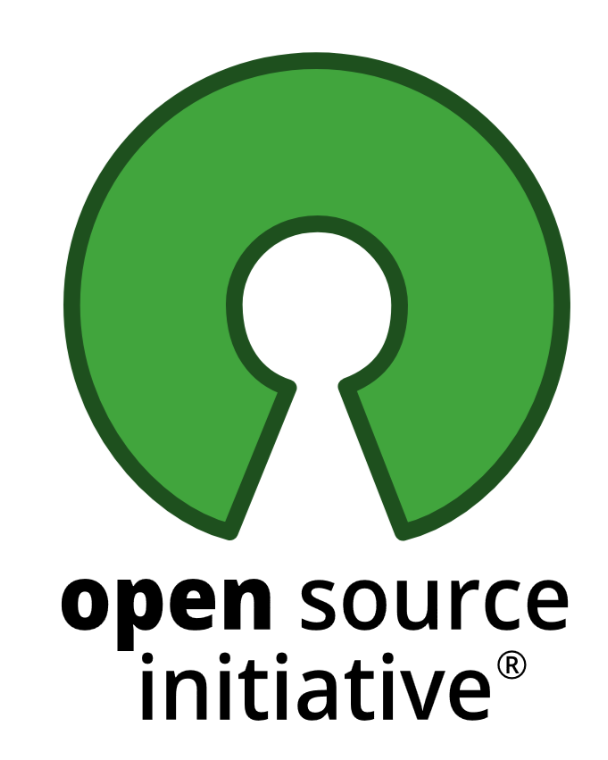{height=400px fig-alt="Open Source Initiative logo"}](https://opensource.org/osd)
:::
:::

# The printer that started open source (1980)

::: {.columns}
::: {.column width="43%"}
::: {.fragment}
- Working at MIT’s AI Lab
:::
::: {.fragment}
- The office printer frequently jammed
:::
::: {.fragment}
- Modified software to alert users
:::
::: {.fragment}
- New printer, source code unavailable
:::
:::
::: {.column width="57%"}
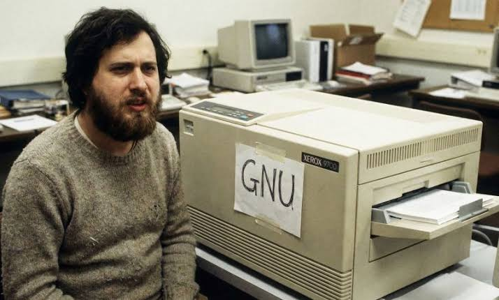{width=100% fig-alt="Richard Stallman beside a printer, as shown in the source lecture"}
:::
:::

# Richard Stallman and the free-software movement {.smaller}

::: {.columns}
::: {.column width="64%"}
::: {.fragment}
- **GNU Project:** a free operating system
:::
::: {.fragment}
- **Free Software Foundation**
:::
::: {.fragment}
- **GNU General Public License (GPL)**
:::

::: {.fragment}
> Either the users control the program or the program controls the users.

— Richard Stallman
:::
:::
::: {.column .figure-centered width="36%"}
{height=450px fig-alt="Richard Stallman"}
:::
:::

# Linus Torvalds created Linux in 1991 {.smaller}

::: {.columns}
::: {.column width="67%"}
::: {.fragment}
- Created **Linux** as a student hobby
:::
::: {.fragment}
- Created **Git** in 2005 to manage software development
:::

::: {.fragment .quotation}
> One of the things I really like about open source is it allows different people to work together.

> Talk is cheap. Show me the code.

— Linus Torvalds
:::
:::
::: {.column .figure-centered width="33%"}
{height=295px fig-alt="Linus Torvalds"}

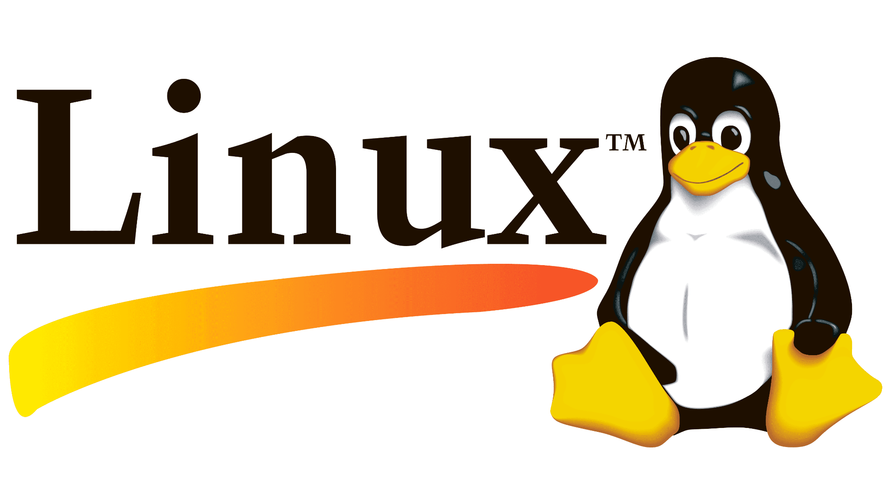{height=105px fig-alt="Linux and Tux"}
:::
:::

# Shared software becomes scientific infrastructure {.smaller}

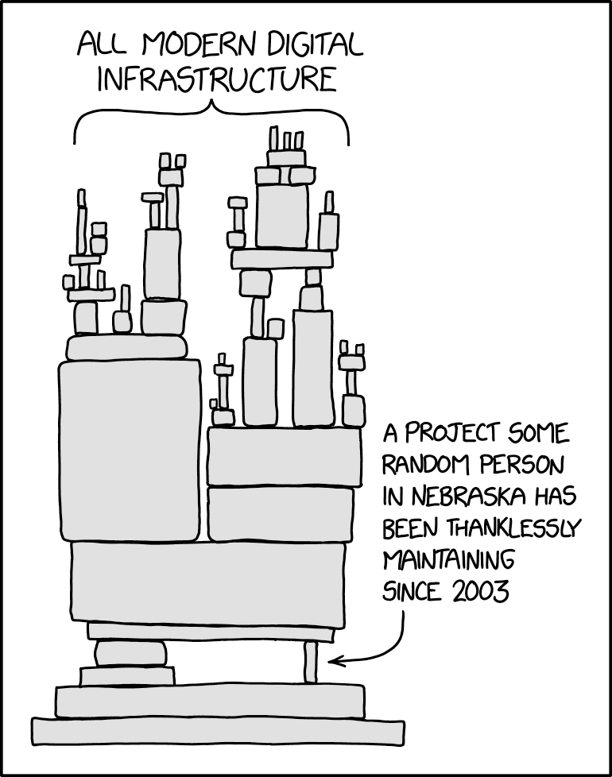{.r-stretch fig-alt="XKCD Dependency: modern digital infrastructure depends on a project maintained by one person"}

::: {.slide-note}
[Randall Munroe, XKCD 2347: “Dependency”](https://xkcd.com/2347/) · CC BY-NC 2.5
:::

# What does OSS have to do with science?

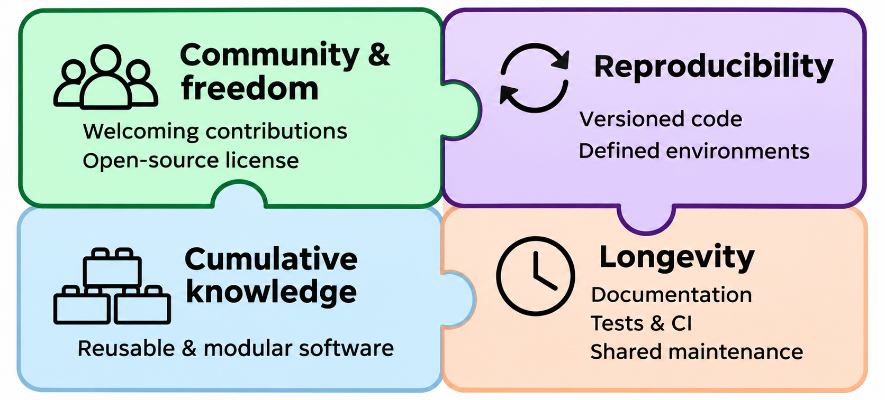{height=424px fig-align="center" fig-alt="Four connected principles: community and freedom, reproducibility, cumulative knowledge, and longevity"}

::: {.slide-note style="text-align: center;"}
License · Version control · Documentation · Dependencies · Tests and CI · Contribution guidelines
:::

# Journal of Open Source Software puts it boldly {.smaller}

::: {.columns}
::: {.column width="76%"}
> The project should demonstrate that it is a **reusable, non-throwaway research software project** that follows good open-source practices.

— [JOSS review criteria](https://joss.readthedocs.io/en/latest/review_criteria.html)
:::
::: {.column width="24%"}
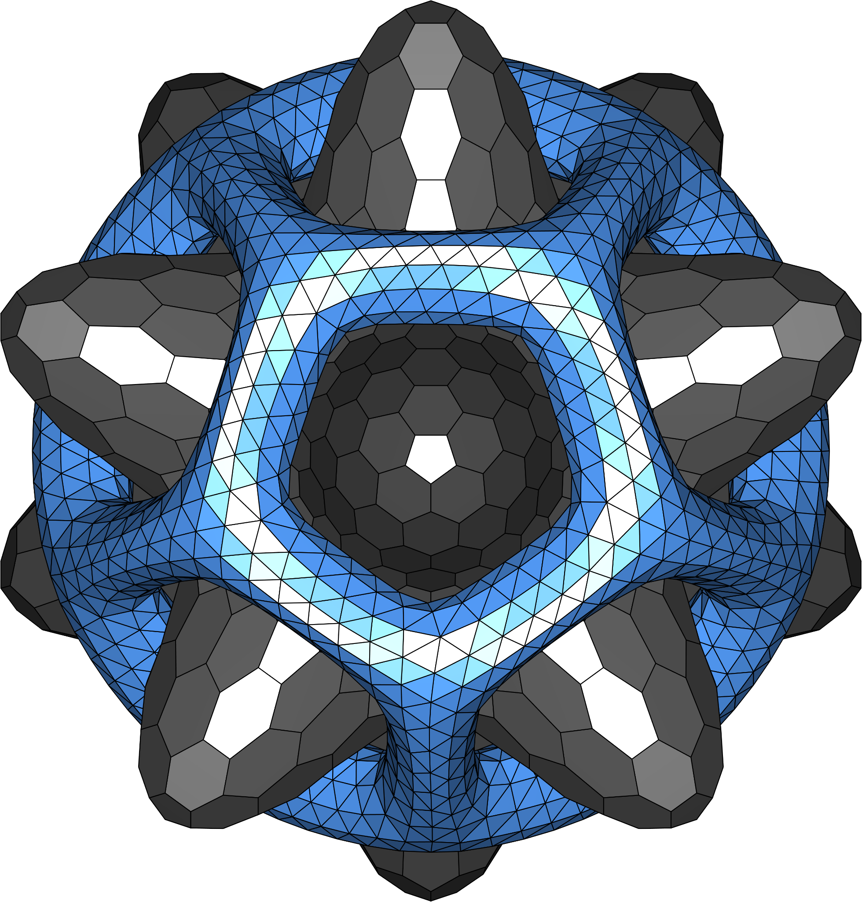{height=260px fig-alt="JOSS logo"}
:::
:::

# It has never been easier to contribute to OSS {.center}

# Agentic AI Foundation (December 9, 2025)

::: {style="text-align: center;"}
{height=90px fig-alt="Agentic AI Foundation"}

One new member organization joins every business day.

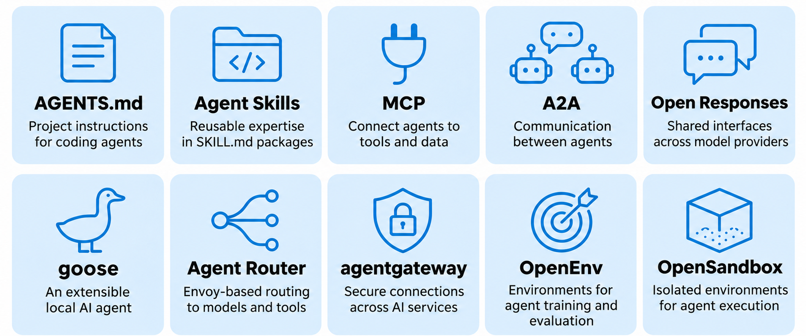{height=330px fig-alt="Agentic AI Foundation projects, including AGENTS.md, Agent Skills, MCP, and A2A"}
:::

# What is an agent?

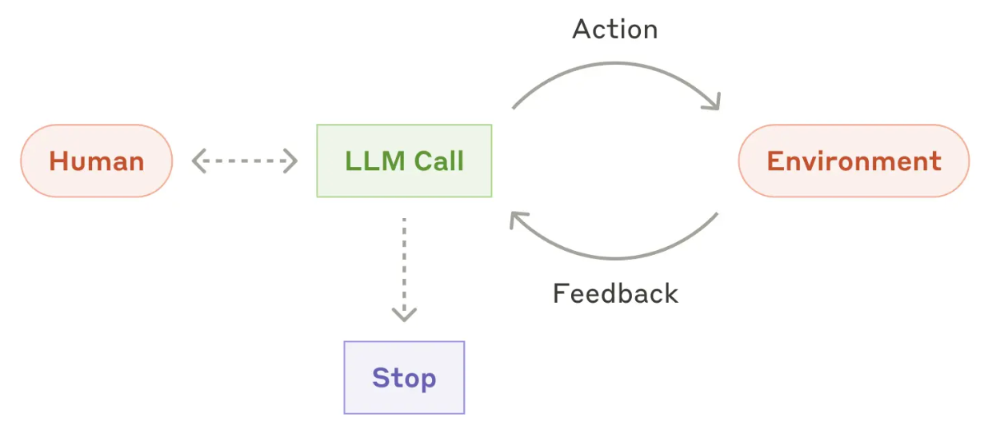{height=424px fig-align="center" fig-alt="An agent loops between an LLM call, actions in an environment, and feedback, with human input and a stopping condition"}

::: {.slide-note}
[Anthropic: Building effective agents](https://www.anthropic.com/research/building-effective-agents)
:::

# Currently, we have two types of LLMs

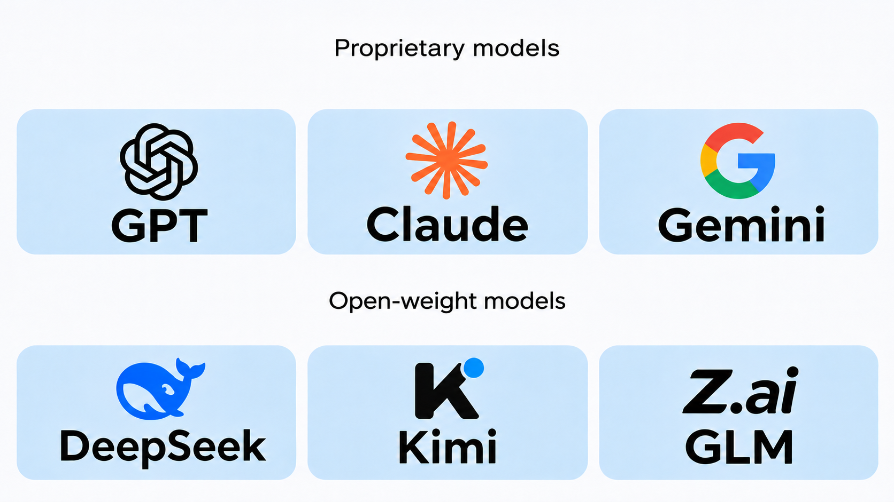{.r-stretch fig-alt="Proprietary models: GPT, Claude, Gemini. Open-weight models: DeepSeek, Kimi, GLM."}

::: {.slide-note style="text-align: center;"}
Open weights do not necessarily include the training data or training method.
:::

# AI pulls you towards the population mean

::: {.figure-centered}
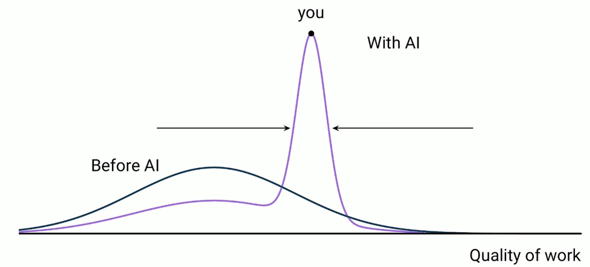{height=424px fig-alt="Schematic: AI concentrates the distribution of work around a common outcome"}

::: {.slide-note}
[Miles Cranmer: How to Avoid AI Brain Rot](https://www.youtube.com/watch?v=uXC7OuCas2Q)
:::
:::

# AI-generated talks can look the same

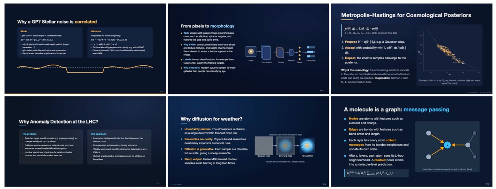{height=391px fig-align="center" fig-alt="Examples of AI-generated scientific presentation slides with similar layouts"}

::: {.slide-note}
[Miles Cranmer: How to Avoid AI Brain Rot](https://www.youtube.com/watch?v=uXC7OuCas2Q)
:::

# Remember: AI agents tend towards common answers {.smaller}

::: {style="text-align: center;"}
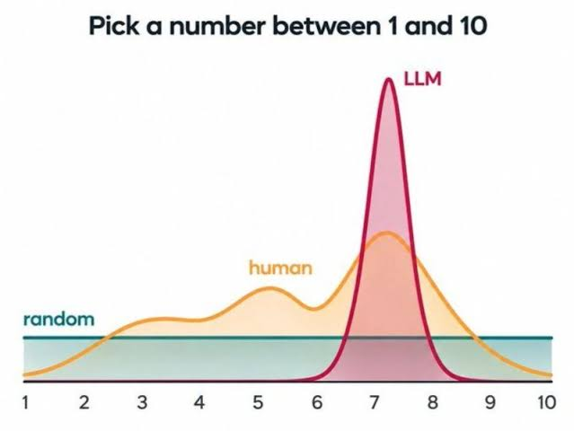{height=420px fig-alt="Illustrative chart comparing random, human, and LLM choices of a number between 1 and 10"}
:::

::: {.slide-note}
Illustration [shared by Tim Kellogg](https://bsky.app/profile/moultano.bsky.social/post/3mxu6nv4mdk2c).
:::

# AI can miss errors in its own work

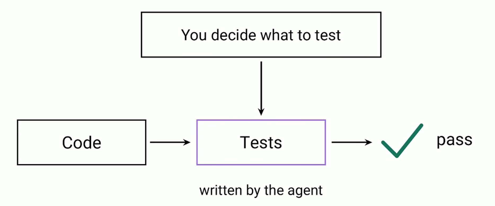{height=367px fig-align="center" fig-alt="Code and tests written by the same agent can pass while sharing the same wrong assumption"}

```julia
add(x, y) = x + y
@test add(2, 2) == 4
```

::: {.slide-note}
[Miles Cranmer: How to Avoid AI Brain Rot](https://www.youtube.com/watch?v=uXC7OuCas2Q)
:::

# You are responsible for AI-generated code {.center}

::: {.fragment}
> I don’t know; ChatGPT did it.

— An anonymous response to something that did not make sense
:::

# Use AI to accelerate yourself,<br>not replace yourself {.center}

# With AI, you can stop learning without noticing {.smaller}

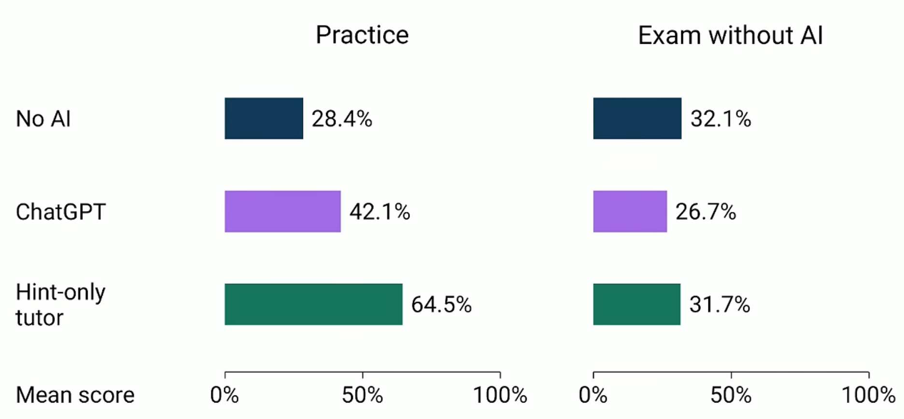{height=437px fig-align="center" fig-alt="Practice and unaided exam performance for students using no AI, ChatGPT, or a hint-only tutor"}

::: {.slide-note}
[Miles Cranmer: How to Avoid AI Brain Rot](https://www.youtube.com/watch?v=uXC7OuCas2Q), based on Bastani et al., PNAS (2025).
:::

# Use AI for explanations, not only solutions

::: {.figure-centered}
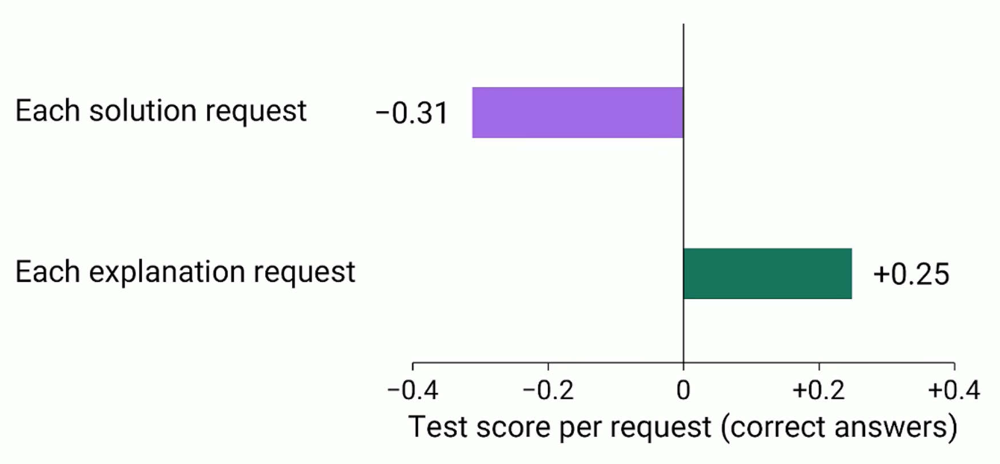{height=424px fig-alt="Learning outcomes associated with requesting solutions versus explanations"}

::: {.slide-note}
[Miles Cranmer: How to Avoid AI Brain Rot](https://www.youtube.com/watch?v=uXC7OuCas2Q), based on Lehman, Cornelius, and Sting (2025).
:::
:::

# Learning is like going to the gym now {.center}

# AI can be used as a teaching tool

::: {.figure-centered}
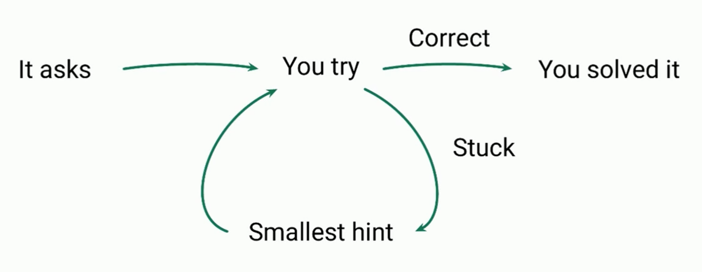{height=398px fig-alt="Tutoring loop: the agent asks, the student tries, and a small hint helps when the student gets stuck"}

::: {.slide-note}
[Miles Cranmer: How to Avoid AI Brain Rot](https://www.youtube.com/watch?v=uXC7OuCas2Q)
:::
:::

# Create interactive visualizations to help you understand {.smaller}

```{julia}
#| output: false
using KomaMRI
using KomaMRI.KomaMRIPlots.PlotlyBase

function bloch_sphere_trajectory(seq)
    positions = collect(range(-3e-3, 3e-3; length=9))
    n = length(positions)
    obj = Phantom(x=zeros(n), z=positions, T1=fill(Inf, n), T2=fill(Inf, n))
    times = [0.0]
    transverse = [zeros(ComplexF64, n)]
    longitudinal = [ones(n)]
    record = function (progress, blocks, data, params)
        push!(times, data.seqd.t[last(blocks.parts[progress.block])])
        push!(transverse, copy(data.Xt.xy))
        push!(longitudinal, copy(data.Xt.z))
    end
    simulate(obj, seq, Scanner(); verbose=false, callbacks=(record,), sim_params=Dict(
        "gpu" => false, "Nthreads" => 1, "precision" => "f64",
        "max_block_length" => 1, "max_rf_block_length" => 1,
        "Δt" => 10e-6, "Δt_rf" => 10e-6, "return_type" => "state",
    ))
    mx = real.(hcat(transverse...))
    my = imag.(hcat(transverse...))
    mz = hcat(longitudinal...)
    t_ms = 1e3 .* times
    colors = ["#2166ac", "#3e5cba", "#6051bb", "#8244b4", "#a1379f",
              "#b52e83", "#c22d62", "#c32c43", "#b2182b"]
    colorscale = [[t, c] for (t, c) in zip(range(0, 1; length=n), colors)]
    θ, φ = range(0, π; length=25), range(0, 2π; length=49)
    sphere = surface(
        x=[sin(a) * cos(b) for a in θ, b in φ],
        y=[sin(a) * sin(b) for a in θ, b in φ],
        z=[cos(a) for a in θ, b in φ],
        surfacecolor=zeros(length(θ), length(φ)),
        colorscale=[[0, "#94a3b8"], [1, "#94a3b8"]], opacity=0.12,
        showscale=false, hoverinfo="skip", showlegend=false,
    )
    function spin_traces(k)
        spin_data = GenericTrace[]
        first_point = searchsortedfirst(times, times[k] - 0.1 * times[end])
        trail_edges = round.(Int, range(first_point, k; length=5))
        for j in eachindex(positions)
            for segment in 1:4
                trail = trail_edges[segment]:trail_edges[segment + 1]
                push!(spin_data, scatter3d(
                    x=mx[j, trail], y=my[j, trail], z=mz[j, trail], mode="lines",
                    line=attr(color=colors[j], width=3), opacity=0.15 + 0.2 * (segment - 1),
                    name="z = $(round(1e3 * positions[j]; digits=2)) mm", legendgroup=string(j),
                    hoverinfo="name", showlegend=false,
                ))
            end
            push!(spin_data, scatter3d(
                x=[0, mx[j, k]], y=[0, my[j, k]], z=[0, mz[j, k]],
                mode="lines+markers", line=attr(color=colors[j], width=6),
                marker=attr(color=fill(1e3 * positions[j], 2), colorscale=colorscale,
                    cmin=-3, cmax=3, showscale=j == n, size=[0, 4],
                    colorbar=attr(title=attr(text="z-position (mm)", side="right"),
                        tickvals=[-3, 0, 3], thickness=12, len=0.7, outlinewidth=0),
                    line=attr(color="#64748b", width=1)),
                legendgroup=string(j), showlegend=false, hoverinfo="skip",
            ))
        end
        spin_data
    end
    traces = [sphere; spin_traces(length(times))]
    indices = unique(round.(Int, range(1, length(times); length=min(100, length(times)))))
    frames = [frame(name=string(k), data=spin_traces(k),
        traces=collect(1:(length(traces) - 1))) for k in indices]
    immediate = attr(mode="immediate", transition=attr(duration=0),
        frame=attr(duration=0, redraw=true))
    axis_style = attr(range=[-1.1, 1.1], showbackground=false,
        showgrid=true, gridcolor="#94a3b8", gridwidth=1,
        showline=true, linecolor="#64748b", zerolinecolor="#64748b",
        ticks="outside", tickcolor="#64748b", tickfont=attr(color="#334155"))
    layout = Layout(
        height=430, margin=attr(l=0, r=70, t=0, b=70),
        paper_bgcolor="rgba(0,0,0,0)", plot_bgcolor="rgba(0,0,0,0)",
        font=attr(family="Arial, sans-serif", color="#475569"),
        showlegend=false,
        scene=attr(aspectmode="cube", uirevision="compact-labels",
            xaxis=merge(axis_style, attr(title="Mₓ")),
            yaxis=merge(axis_style, attr(title="Mᵧ")),
            zaxis=merge(axis_style, attr(title="M𝓏")),
            camera=attr(eye=attr(x=1.15, y=1.15, z=0.7))),
        sliders=[attr(active=length(indices)-1, x=0, len=1, y=0, pad=attr(t=0, b=0),
            font=attr(color="rgba(0,0,0,0)"),
            currentvalue=attr(prefix="Time: ", suffix=" ms", font=attr(color="#475569")),
            steps=[attr(label=string(round(t_ms[k]; digits=2)), method="animate",
                args=[[string(k)], immediate]) for k in indices])],
        uirevision="bloch-sphere",
    )
    Plot(traces, layout, frames; config=PlotConfig(displaylogo=false, displayModeBar=false))
end


example_seq = PulseDesigner.build_sinc_pulse(π / 2;
    duration=2e-3, slice_thickness=5e-3,
    sys=Scanner(limits=HardwareLimits(Gmax=20e-3)))
bloch_plot = bloch_sphere_trajectory(example_seq)
bloch_plot.layout.height = 450
bloch_plot.layout.width = 800
```

::: {.columns}
::: {.column width="34%"}
```julia
seq = PulseDesigner.build_sinc_pulse(
    π / 2;
    duration=2e-3,
    slice_thickness=5e-3,
)
bloch_sphere_trajectory(seq)
```
:::
::: {.column width="66%"}

```{julia}
#| output: asis
post_script = """
const plot = document.getElementById('$(bloch_plot.divid)');
let dragging = false;
plot.addEventListener('mousedown', event => {
  dragging = event.target.closest('.slider-container') !== null;
}, true);
function releaseSlider() {
  if (!dragging) return;
  dragging = false;
  plot.dispatchEvent(new MouseEvent('mouseup', {bubbles: false, buttons: 0}));
}
window.addEventListener('mouseup', releaseSlider, true);
window.addEventListener('blur', releaseSlider);
window.addEventListener('mousemove', event => { if (event.buttons === 0) releaseSlider(); }, true);
"""
print("```{=html}\n")
PlotlyBase.to_html(stdout, bloch_plot; autoplay=false, full_html=false)
print("<script>", post_script, "</script>\n```\n")
```

::: {.slide-note}
Bloch sphere · Activity 0
:::

:::
:::

# AGENTS.md: Tell the AI how to behave {.smaller}

::: {.columns}
::: {.column width="42%"}
::: {.fragment}
- Loaded at the start of a session
:::
::: {.fragment}
- Persistent instructions:
  - Global
  - Per project
:::
:::
::: {.column width="58%"}
::: {.source-pane}
```markdown
# Behavioral guidelines

## Think before coding
- State assumptions explicitly.
- Surface uncertainty and tradeoffs.
- Ask when the request is unclear.

## Simplicity first
- Write the minimum code that solves the problem.
- Do not add speculative features or abstractions.

## Surgical changes
- Touch only what the task requires.
- Preserve unrelated work.

## Goal-driven execution
- Define a verifiable goal.
- Check the result before claiming success.
```
:::
:::
:::

# SKILL.md: Domain knowledge on demand {.smaller}

::: {.columns}
::: {.column width="43%"}
::: {.fragment data-fragment-index="0"}
- Provides a workflow when needed
  - Description helps the agent select it
  - Useful for repeated tasks, such as `.dat` → `.mrd`
:::

::: {.fragment data-fragment-index="1"}
- **The course skill:**
  - Helps with code
  - Promotes understanding of MRI sequence design
:::
:::
::: {.column width="57%"}
::: {.source-pane .fragment data-fragment-index="1"}
````markdown
---
name: bios214-pluto-student-code
description: Help BIOS 214 students with Julia Pluto notebooks and record their feedback on course activities or lectures. Use for code generation, debugging, visualizations, concept help, Live Docs lookups, exports, and instructor feedback.
---

# BIOS 214 notebooks

AI may generate complete code, debug implementations, produce visualizations, and explain concepts. Help students understand what their code represents, the assumptions and choices behind it, and how to interpret and validate results. Handle routine Julia implementation details for them.

## Before editing

- Read the instructor-authored Markdown instructions and existing code as exercise context, not as a student's request for a worked solution.
- If the request includes opening or controlling KomaMRI's UI, also follow [the KomaUI skill](../koma-ui/SKILL.md).
- Do not require the student to supply an algorithm before helping. Implement clear requests; if a necessary goal or input is missing, ask one focused question. State important assumptions when proceeding.
- If the student's proposed MRI reasoning is incomplete or incorrect, use the learning checkpoints below before supplying the correction. You may suggest and implement an approach without requiring the student to invent the algorithm.

## Open the notebook

- Reuse an existing Pluto session and authenticated browser tab only after checking that the notebook path belongs to this repository. For Activity 0, the notebook is `lab/0/activity0.jl`.
- If a matching session is not running, start it from the repository root in a persistent interactive terminal with `julia +1.10 run_pluto.jl lab/0/activity0.jl`, substituting the requested notebook path. Keep the process running and its output available; do not redirect startup output to a log.
- Open the exact URL printed by that process in the agent app's in-app browser (for example, Codex or Claude). Pluto chooses another available port if its preferred port is occupied. Preserve the printed host, port, path, and secret token; do not guess `localhost:1234`, copy a URL from another session, or invent a notebook ID. Verify the opened notebook's path before editing.
- If the URL is lost, recover it from that terminal's output or reuse the matching authenticated tab. If neither is available, restart only the Pluto process you started, once, and use its new printed URL. Leave other Julia sessions alone. If the app has no in-app browser, provide the actual URL and explain that limitation.

## Course references

- The same repository contains Lecture N at `lecture/N/slidesN.qmd`, with supporting images in `lecture/N/figures/`. Paths are relative to the repository root.
- For conceptual help or MRI design choices, search the lecture sources for the relevant topic and read the applicable slide text, speaker notes, and figures. Read only what is needed; skip embedded logo data and theme styles. Prefer the `.qmd` source over generated HTML when looking up content.
- In chat, reference the lecture number and exact slide heading, linking to `https://cncastillo.github.io/bios-214/lecture/N/`. Add a slide anchor only when verified in the source or rendered deck; do not invent slide numbers or anchors.
- Do not cite "To be uploaded soon!" placeholders as teaching content. If the topic is not covered, say so and use an authoritative external source, distinguishing that explanation from the course material.

## Learning through prediction and evidence

- Focus learning on MRI physics, experimental design, interpretation, and validation; handle routine Julia implementation for the student. For a substantive MRI experiment, ask one focused question that elicits a prediction and a brief reason before revealing the result or interpretation. Wait for the student's attempt; do not answer your own question in the same message. Use reasoning they have already supplied instead of asking again.
- Help the student test their prediction with a simulation, interactive visualization, or meaningful comparison. Use discrepancies between their prediction and reliable evidence to create cognitive conflict; do not manufacture disagreement or deliberately introduce errors.
- Before treating an unexpected result as evidence against the student's explanation, check the implementation, simulation assumptions, and relevant reference or independent check. Ground explanations in course material and authoritative sources; an AI-generated demonstration may itself be wrong.
- When the prediction and observation disagree, ask the student to explain the discrepancy before providing your interpretation. Offer a targeted hint and another attempt when useful. If they remain stuck or ask for an explanation, provide it rather than prolonging the quiz.
- Help the student revise their explanation and test it on a related case. If their original reasoning was correct, explore a useful boundary condition rather than inventing a misconception.
- Keep checkpoints brief and relevant, not a fixed ritual for every edit. Do not quiz students or delay routine setup, syntax fixes, API lookups, formatting, Live Docs, or exports. Answer direct requests for explanations, then invite a short prediction or application when useful.

## Edit the notebook

- Add or modify only Julia code cells needed for the student's request, plus the prompt history below. Do not add or rewrite Markdown cells, exercise text, explanations, reflections, or a solution narrative in the Pluto interface. Keep code comments minimal and only when requested or needed to make the student's code understandable.
- Preserve instructor-authored Markdown instructions and code scaffolding, existing cell IDs, and the student's unrelated code. Prefer an existing empty code cell; add a code cell only when needed.
- Reuse existing package functionality and keep implementations minimal. For a bug, reproduce and understand the failure before changing the code.
- If editing the `.jl` file directly, follow its Pluto format: give each new cell a unique ID (Pluto itself uses `UUIDs.uuid1()`), start it with `# ╔═╡ <id>`, and include the same ID in `Cell order` at the intended display position. Use `# ╠═<id>` for visible code; `# ╟─<id>` means folded code, not Markdown. Let Pluto maintain its generated package metadata and `@bind` fallback code; do not edit those by hand.
- For a new notebook, create only the requested code cells and valid Pluto structure. Have the instructor provide any exercise prose separately.

## Live Docs and exports

- For a documentation request, open Pluto's **Live docs**, search the requested Julia name (for example, `sum`), and leave the result visible. Do not add a cell for the documentation.
- For an export request, use Pluto's **Export...** menu: **Notebook file** for `.jl`, **Static HTML** for `.html`, or **PDF** for `.pdf`. The repository notebook is already a `.jl` file; use the menu when a downloadable copy is wanted.
- These requests do not change notebook code; record the student's prompt in the history below.

## Prompt history

- Record each student-to-agent prompt about this notebook in one `[pluto_student_history]` TOML metadata table in the notebook header, using Pluto's `#>` comments. Do not record instructor-authored Markdown instructions or agent replies there. Use consecutive zero-padded numeric keys; each new value is a three-element array `[recorded_at_utc, prompt, model]`. Pluto may reorder the lines when saving, so the keys preserve chronology. Ordinary header comments are discarded by Pluto.
- Include feedback the student intends for the instructor about an activity, lecture, or the course, even when no code change is requested. Record the student's original message once in the current notebook's history, using the same metadata format and redaction rules; do not paraphrase it or add a separate feedback system. If no notebook is identified, ask which notebook should hold the feedback. Recording makes it available when the notebook is shared or submitted; do not email, post, or claim the instructor has received or read it.
- Record the model used for each prompt, including the reasoning effort when exposed by your runtime or session (for example, `"GPT-6.1 Sol xhigh"`). Keep the model in each entry so a notebook can contain prompts handled by different models; switching models must not change earlier entries. If the model is unavailable, use `"Model not recorded"`; do not guess it from the agent app's name. Preserve existing two-element entries without inventing model information for them.
- Preserve earlier entries, escape prompt text as valid TOML, and redact credentials and sensitive personal details. Record a prompt even if the student has not yet described a solution. The metadata remains readable in the `.jl` file and can be displayed by the notebook's Prompt history section.
- Keep the prompt history silent: do not tell the student that their prompt was recorded unless they ask.

## Check and hand back

- Run or inspect the affected cells in Pluto and check for errors. Compare behavior with the student's prediction and use a relevant independent check when practical, such as an analytical case, hardware constraint, or convergence comparison. Successful execution alone does not establish physical correctness. Do not claim a result is correct without checking it.
- In chat, report what was checked and the important assumptions and choices represented in code. Follow the learning checkpoints before supplying an MRI interpretation. Explain implementation details only when they affect understanding or correctness. Do not mention the skill unless asked.

````
:::
:::
:::

# Computer use and the in-app browser: try it out! {.smaller}

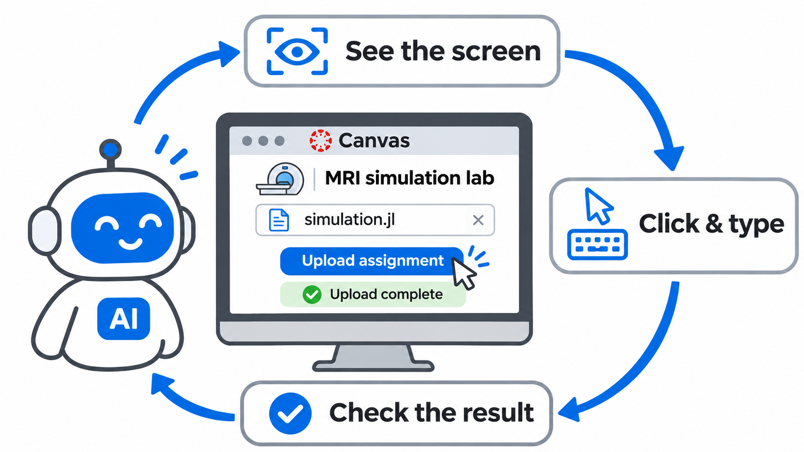{height=473px fig-align="center" fig-alt="An agent sees the screen, clicks and types, and checks the result"}

# Learning the tools will help you surpass the mean {.smaller}

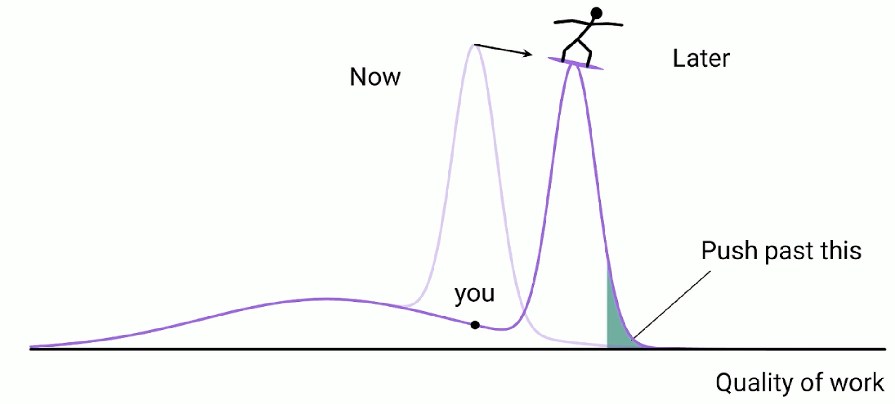{height=437px fig-align="center" fig-alt="Schematic: learn the tools to push beyond the current concentration of AI-assisted outcomes"}

::: {.slide-note}
[Miles Cranmer: How to Avoid AI Brain Rot](https://www.youtube.com/watch?v=uXC7OuCas2Q)
:::

# AI agents design and validate virtually before real-world testing {.smaller}

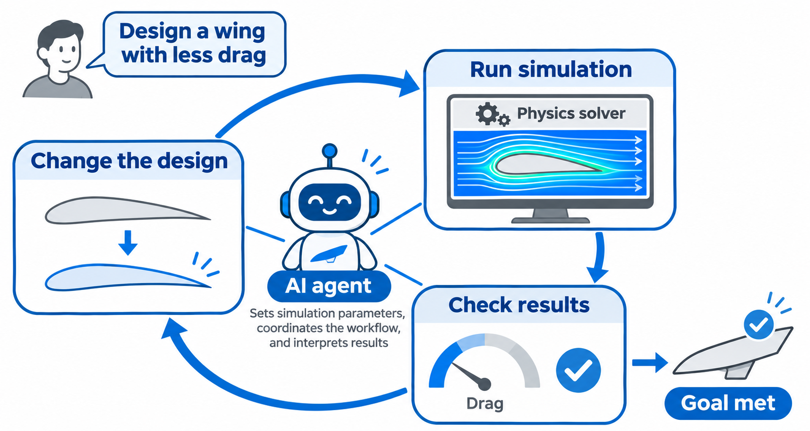{.r-stretch fig-alt="An AI agent iterates on a wing design, runs a physics simulation, checks drag, and validates the goal"}

# If simulations are realistic enough, they become really useful {.smaller}

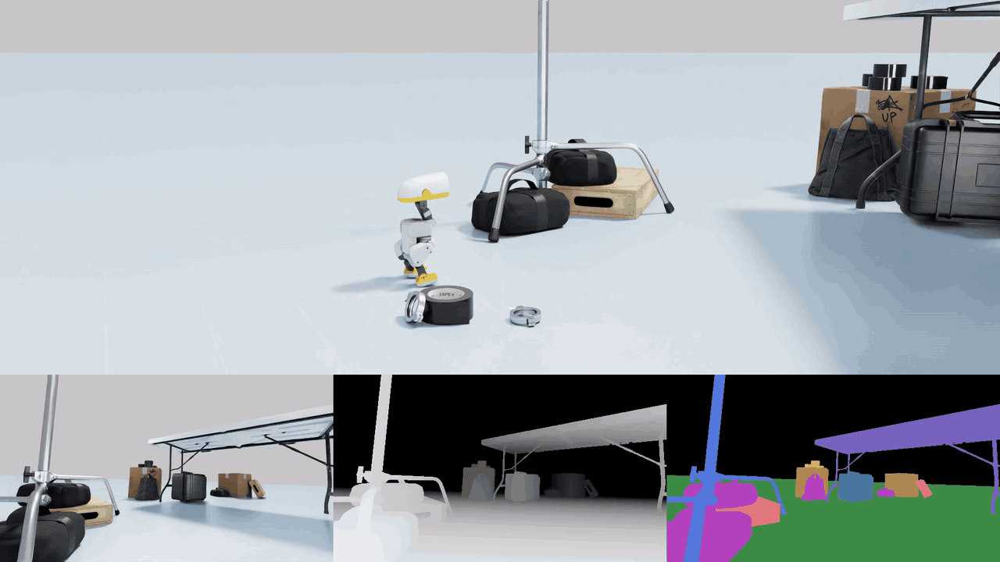{.r-stretch fig-alt="Microduck robot behavior trained and tested in simulation"}

::: {.slide-note}
[NVIDIA: Using AI agents to teach Microduck to walk in simulation](https://developer.nvidia.com/blog/using-ai-agents-to-teach-robots-like-microduck-to-walk-in-simulation/)
:::

# In this class, we focus on MRI sequence design {.smaller}

Sequences specify how fields vary in space and time during image acquisition.

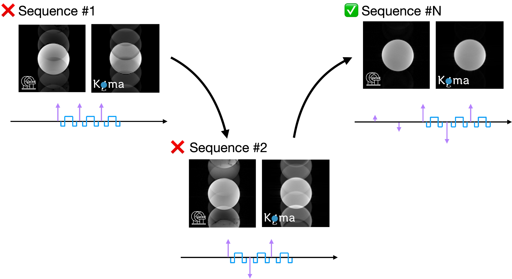{.r-stretch fig-alt="Iterating on an MRI sequence using simulated images before selecting the desired design"}

# {height=75px} {#komamri-pulseq-in-mrd-out .smaller}

::: {.columns}
::: {.column .figure-centered width="53%"}
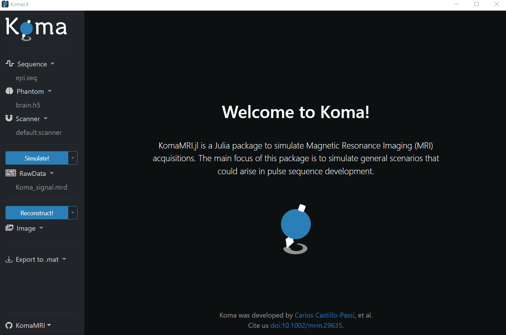{width=100% fig-alt="Animated KomaMRI UI demonstration from the project README"}
:::
::: {.column width="47%"}
::: {.fragment}
💻 Julia and Python
:::
::: {.fragment}
🔓 Open source (MIT license)
:::
::: {.fragment}
⚡ Fast and accurate Bloch simulations
:::
::: {.fragment}
∂ Differentiable (LLVM/MLIR)
:::
::: {.fragment}
🖥️ Vendor-agnostic GPU support: NVIDIA, AMD, Apple Silicon, and Intel
:::
::: {.fragment}
🌐 Multi-GPU, multi-node support
:::
::: {.fragment}
🫀 Includes motion and flow
:::
::: {.fragment}
🤖 Agent-ready
:::
:::
:::

# Koma’s inputs and outputs powered by OSS {#komas-inputs-and-outputs}

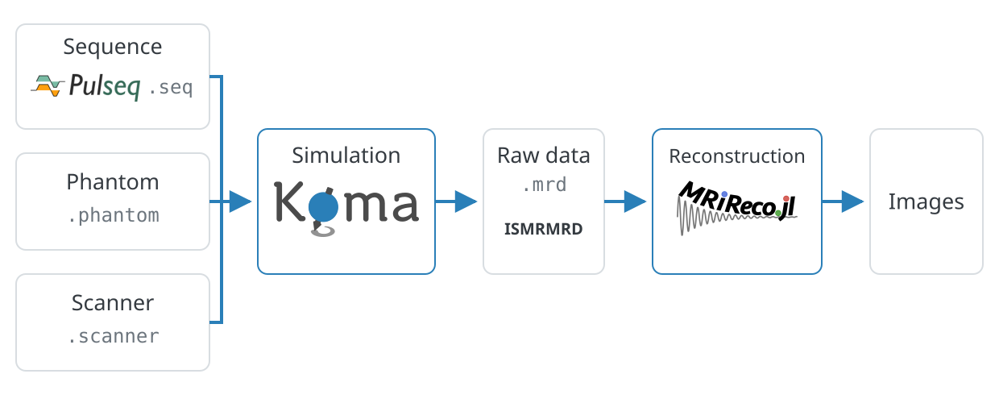{height=427px fig-align="center" fig-alt="Sequence in Pulseq format, phantom, and scanner parameters feed KomaMRI simulation, producing raw data in ISMRMRD format that MRIReco reconstructs into images"}

# Koma simulations can become really complex {.smaller}

::: {.columns}
::: {.column .figure-centered width="44%"}
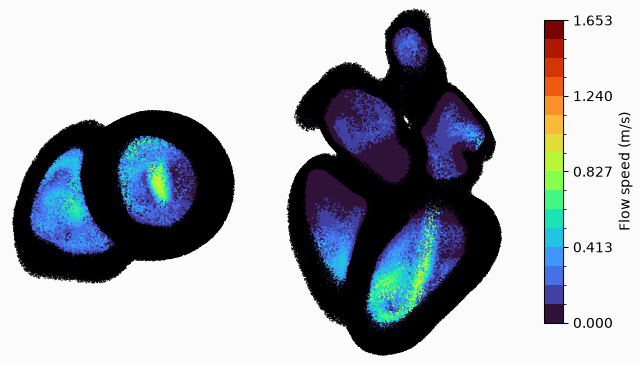{height=350px fig-alt="Animated cardiac geometry and flow used in a KomaMRI simulation"}

::: {.slide-note}
CFD baseline: Aaron Brown, Marsden Lab
:::
:::
::: {.column .figure-centered width="56%"}
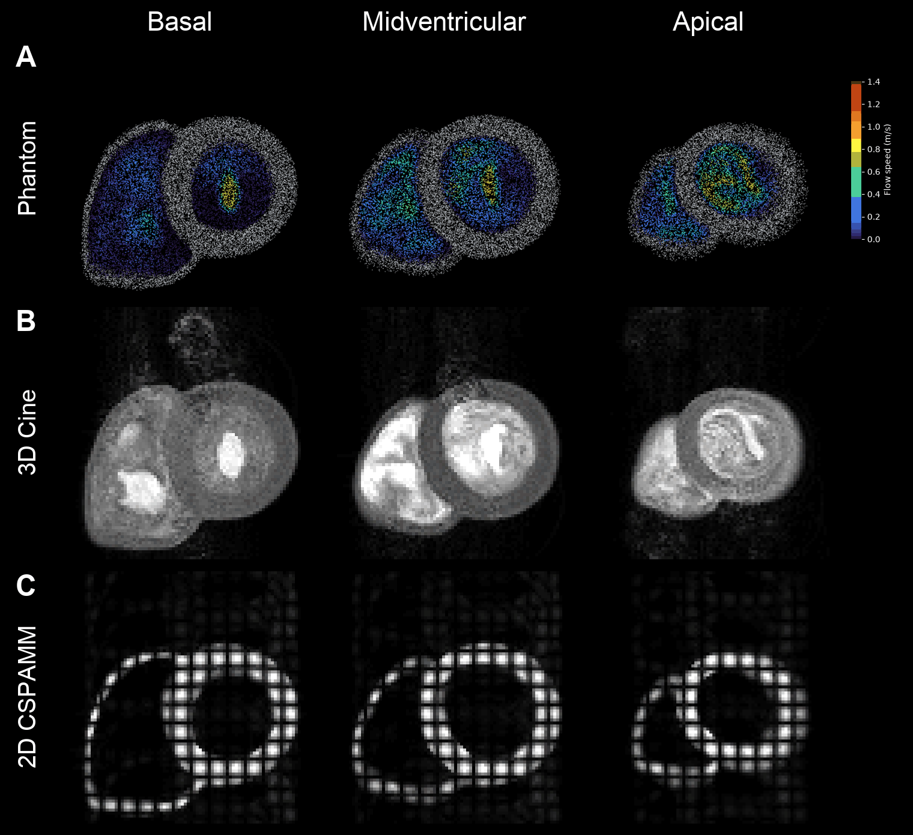{height=465px fig-alt="Animated cardiac simulation and comparison of magnitude, velocity, and flow results"}
:::
:::

::: {.slide-note}
McGrath et al. · *KomaMRIPhantoms* · ISMRM abstract #00049 (submitted)
:::

# … and really fast

We can simulate phantoms with **one billion spins**.

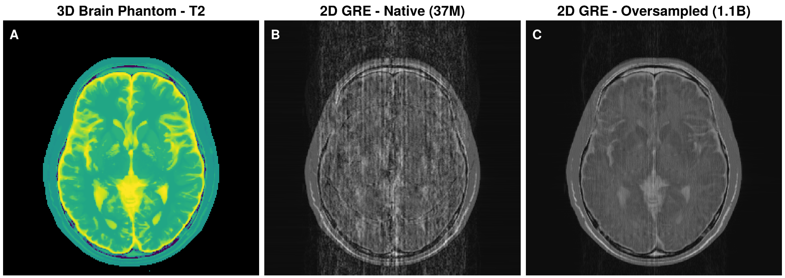{height=364px fig-align="center" fig-alt="Three-dimensional brain T2 phantom, native GRE reconstruction, and an oversampled reconstruction with 1.1 billion spins"}

::: {.slide-note}
McGrath et al. · *KomaMRIPhantoms* · ISMRM abstract #00049 (submitted)
:::

# Koma’s agentic UI is a great companion while scanning {.smaller}

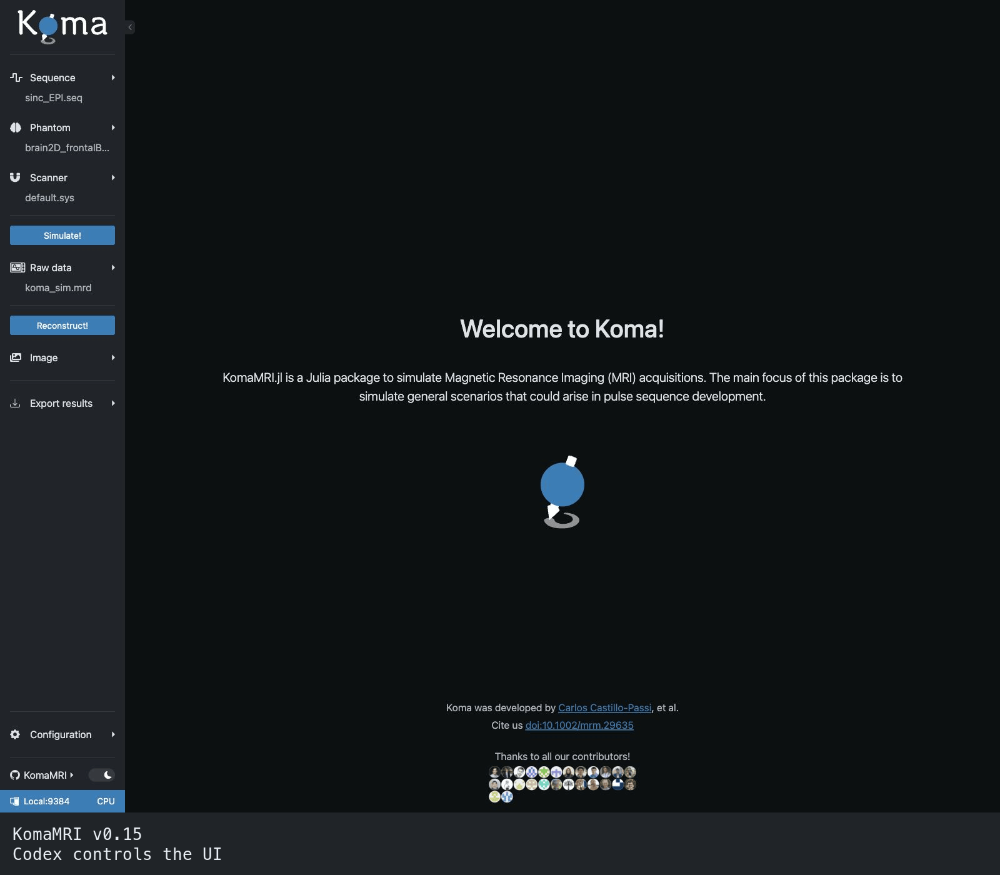{.r-stretch fig-alt="Codex controls KomaMRI: loads a sinc EPI sequence, inspects k-space and brain T1, simulates, and reconstructs"}

::: {.slide-note}
[`koma-ui` course skill](https://github.com/cncastillo/bios-214/blob/master/.agents/skills/koma-ui/SKILL.md)
:::

# Explore MRI experiments in Koma’s live UI {style="padding-bottom: 40px; box-sizing: border-box;"}

```{julia}
#| output: false
koma_sequence = read_seq(joinpath(pkgdir(KomaMRI), "examples", "1.sequences", "epi_ramp.seq"))
koma_demo = KomaUI(; browser=true, return_window=true,
    darkmode=true, seq=koma_sequence, obj=brain_phantom2D(),
    sim=Dict("gpu" => false), verbose=false)
```

```{julia}
#| output: asis
url = ui_status(koma_demo).url
print("""<div class="koma-live-viewport r-stretch"><iframe title="Live KomaMRI UI" data-external="1" data-src="$url"></iframe></div>""")
```
