```{julia}
#| output: false
using KomaMRI
using KomaMRI.KomaMRIPlots.PlotlyBase
import MRISequenceBuildingBlocks as SBB
using SpecialFunctions: besselj1

lecture_scanner = Scanner(limits=HardwareLimits(Gmax=20e-3))

function excitation_data(seq, positions)
    n = length(positions)
    obj = Phantom(x=zeros(n), z=positions, T1=fill(Inf, n), T2=fill(Inf, n))
    times = [0.0]
    magnetization = [hcat(zeros(n), zeros(n), ones(n))]
    record = function (progress, blocks, data, params)
        push!(times, data.seqd.t[last(blocks.parts[progress.block])])
        push!(magnetization, hcat(real.(data.Xt.xy), imag.(data.Xt.xy), copy(data.Xt.z)))
    end
    simulate(obj, seq, lecture_scanner; verbose=false, callbacks=(record,),
        sim_params=Dict("gpu"=>false, "Nthreads"=>1, "precision"=>"f64",
            "max_block_length"=>1, "max_rf_block_length"=>1,
            "Δt"=>5e-6, "Δt_rf"=>5e-6, "return_type"=>"state"))
    samples = KomaMRI.KomaMRIBase.evaluate_sequence_at(seq, times)
    fields = [hcat(fill(real(samples.B1[k]), n), fill(imag(samples.B1[k]), n),
        samples.Gz[k] .* positions) for k in eachindex(times)]
    field_scale = maximum(maximum(sqrt.(sum(abs2, b; dims=2))) for b in fields)
    Dict{String,Any}("t"=>1e3 .* times, "z"=>1e3 .* positions,
        "m"=>[[collect(row) for row in eachrow(m)] for m in magnetization],
        "b"=>[[collect(row ./ field_scale) for row in eachrow(b)] for b in fields])
end

function show_excitation(id, seq, positions)
    data = excitation_data(seq, positions)
    wave = plot_seq(seq; height=520, width=590, slider=false, show_rf_frame=false)
    for trace in wave.data
        get(trace, :name, "") == "|B1|_AM" && (trace.name = "B<sub>1,x</sub>")
        get(trace, :visible, true) == "legendonly" && (trace.showlegend = false)
    end
    wave.layout.margin = attr(l=55, r=10, t=35, b=45)
    wave.layout.font = attr(size=17)
    wave.config = PlotConfig(displayModeBar=false, displaylogo=false, responsive=true)
    data["wave"] = wave
    print("""```{=html}
      <div class="excitation-demo r-stretch" id="$id" aria-label="Sequence and magnetization">
      <script type="application/json">$(PlotlyBase.JSON.json(data))</script></div>\n```\n""")
end

block_seq = PulseDesigner.build_block_pulse(π/2; duration=1e-3, sys=lecture_scanner)
slice_thickness = 5e-3
slice_seq = PulseDesigner.build_sinc_pulse(π/2; duration=2e-3, time_bw_product=4,
    slice_thickness=slice_thickness, phase_offset=0.0, apodization=0.46, sys=lecture_scanner)
```

# Bloch equations govern MRI signal generation {.bloch-overview}

<!--
Source: https://docs.google.com/presentation/d/1KCkaJ1_Johr88TKaMsrKc8-K1uPR3injqlcplbG8iIE/edit

Author outline (not a presentation slide):
- Bloch equations (rotational component)
- 1D slice-selective excitation
- 1D slice-selection Gz rewinder
- Concept of RF center
- Off-center excitation
- RF rotating frame
- RF discretization problems

Equation notation: vectors use \boldsymbol, matrices use \mathbf (bold serif),
and differentials use \mathrm{d}.
-->

Changes in magnetization come from magnetic field torque plus relaxation.

$$
\frac{\mathrm{d}\boldsymbol{M}}{\mathrm{d}t}
=
\textcolor{blue}{\boxed{\textcolor{black}{\gamma\,\boldsymbol{M}\times\boldsymbol{B}}}}
+
\textcolor{red}{\boxed{\textcolor{black}{
-\frac{M_x\boldsymbol{\hat{x}}+M_y\boldsymbol{\hat{y}}}{T_2}
-\frac{(M_z-M_0)\boldsymbol{\hat{z}}}{T_1}}}}
$$

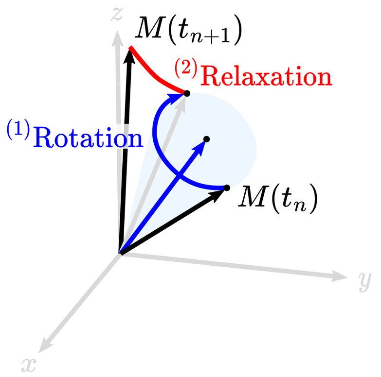{.r-stretch fig-align="center" fig-alt="A magnetization vector evolves through a blue rotation step followed by a red relaxation step"}

::: {.bloch-reference}
Operator splitting: [Graf et al., *J Magn Reson* (2021)](https://doi.org/10.1016/j.jmr.2021.107011) · Diagram: [Castillo-Passi et al., *Magn Reson Med* (2023), Fig. 2](https://doi.org/10.1002/mrm.29635)
:::

::: {.notes}
The blue term describes rotation; the red terms describe transverse relaxation and longitudinal recovery. Operator splitting applies these effects in separate steps.

The T2 term reduces transverse magnetization toward zero. The T1 term reduces the deviation Mz - M0 toward zero, so Mz can increase or decrease toward equilibrium. The opposite deviation M0 - Mz also decays; replacing Mz - M0 by M0 - Mz in the magnetization equation requires changing the sign of that term.

Use bold vectors, bold serif matrices, and upright differentials consistently throughout the lecture.
:::

# In this lecture, we will focus on step one

::: {.columns .v-center}
::: {.column width="52%"}
$$
\frac{\mathrm{d}\boldsymbol{M}}{\mathrm{d}t}
=
\textcolor{blue}{\boxed{\textcolor{black}{\gamma\,\boldsymbol{M}\times\boldsymbol{B}}}}
$$

$\boldsymbol{M}$: Magnetization

$\boldsymbol{B}$: Effective magnetic field
:::
::: {.column width="48%"}
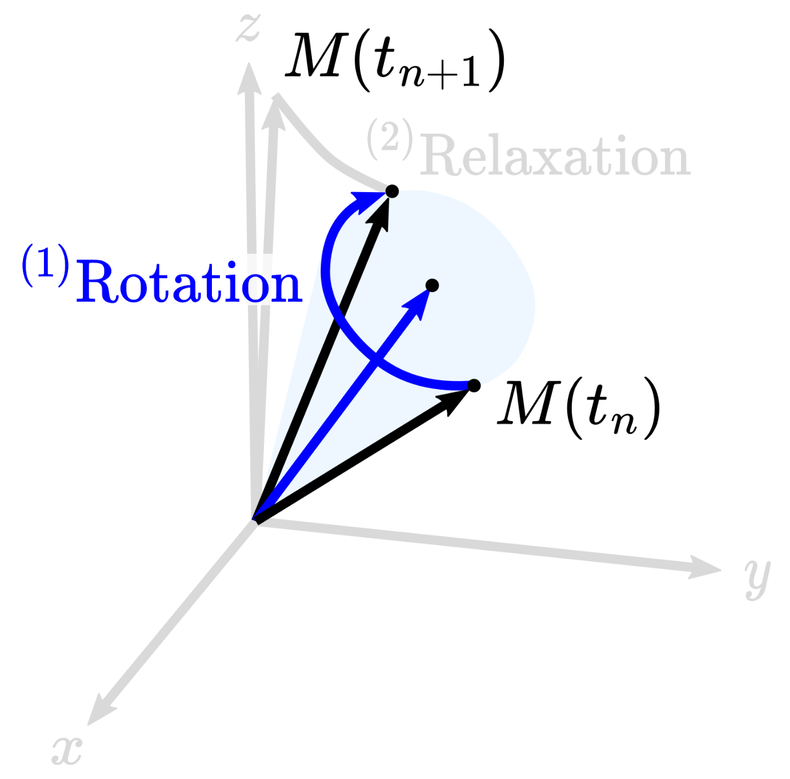{height=440px fig-align="center" fig-alt="The rotation step is highlighted in blue while the relaxation step is faded out"}
:::
:::

::: {.notes}
Diagram: adapted from [Castillo-Passi et al., *Magn Reson Med* (2023), Fig. 2](https://doi.org/10.1002/mrm.29635)
:::

# Let’s step back from the math for a moment {.center .transition-slide}

# Spins get excited when you talk at their frequency

::: {.columns .resonance-columns}
::: {.column .figure-centered width="44%"}
::: {.columns .v-center style="display:flex;align-items:center;gap:16px"}
::: {.column width="52%"}
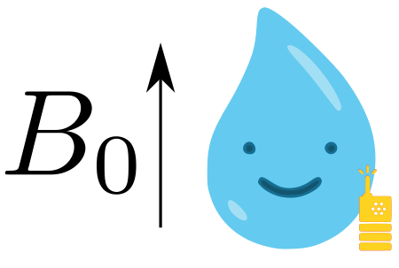{width="100%" fig-alt="A spin in B0 holds a tiny radio tuned to its Larmor frequency"}
:::
::: {.column .field-equation width="48%"}
$$\omega=\gamma B_0$$
:::
:::

::: {.radio-detail .fragment data-fragment-index="1"}
{height=150px fig-alt="A close-up of the spin's tiny yellow radio"}

Tiny radio
:::
:::
::: {.column .figure-centered .fragment width="56%" data-fragment-index="2"}
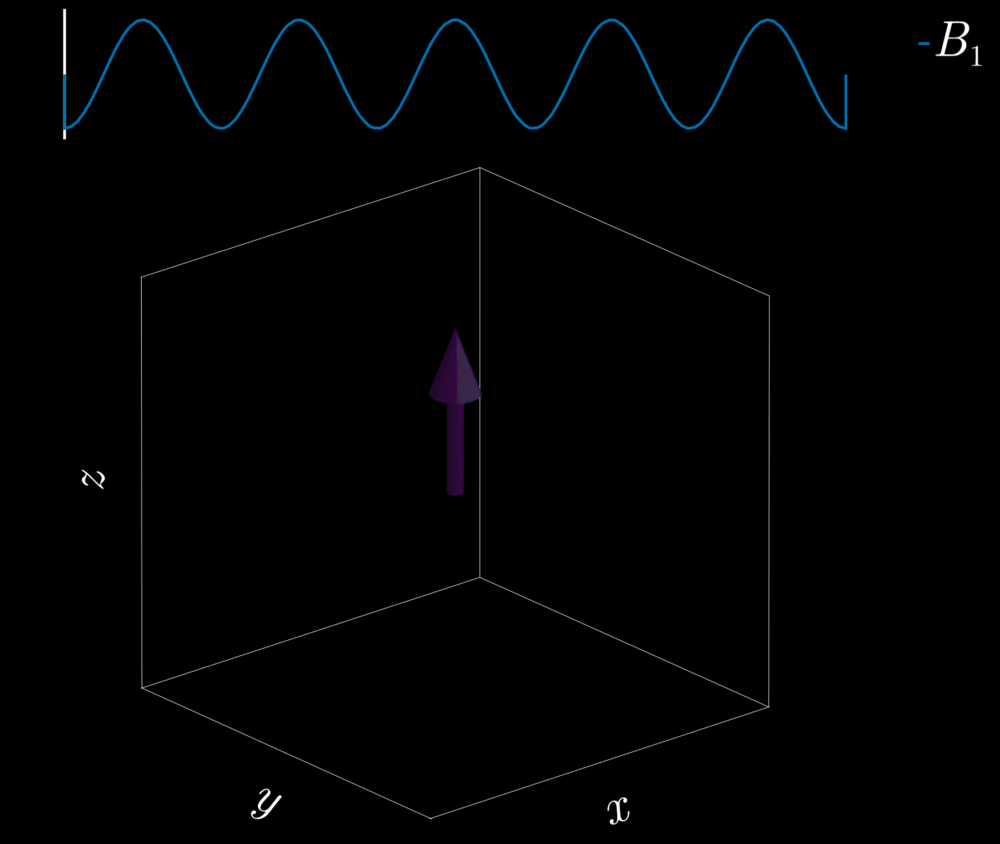{height=440px fig-alt="An RF waveform excites a single spin in the laboratory frame"}
:::
:::

::: {.notes}
The illustration uses angular frequency omega and the gyromagnetic ratio in rad/s/T, consistent with the equations elsewhere in the lecture.
:::

# The scanner is able to control the magnetic fields

```{=html}
<div class="field-demo r-stretch" data-frame="lab">
  <div class="field-plot" role="img" aria-label="Three-dimensional magnetic fields at spin positions in the x-z plane; the RF field rotates around z"></div>
</div>
```

::: {.notes}
The green contribution is longitudinal and depends on position. The purple RF field rotates in the transverse plane. Blue is their vector sum. The common B0 field is omitted from the arrow lengths to make the much smaller controllable fields visible; this is a schematic, not a field-strength comparison with B0. Grid coordinates span −3 to +3 mm in x and z.
:::

# Seeing everything rotating is not very useful {.center .transition-slide}

# Let’s look at the problem differently {.center .transition-slide}

# Effective magnetic field in the rotating frame

::: {.columns .v-center}
::: {.column .figure-centered width="46%"}
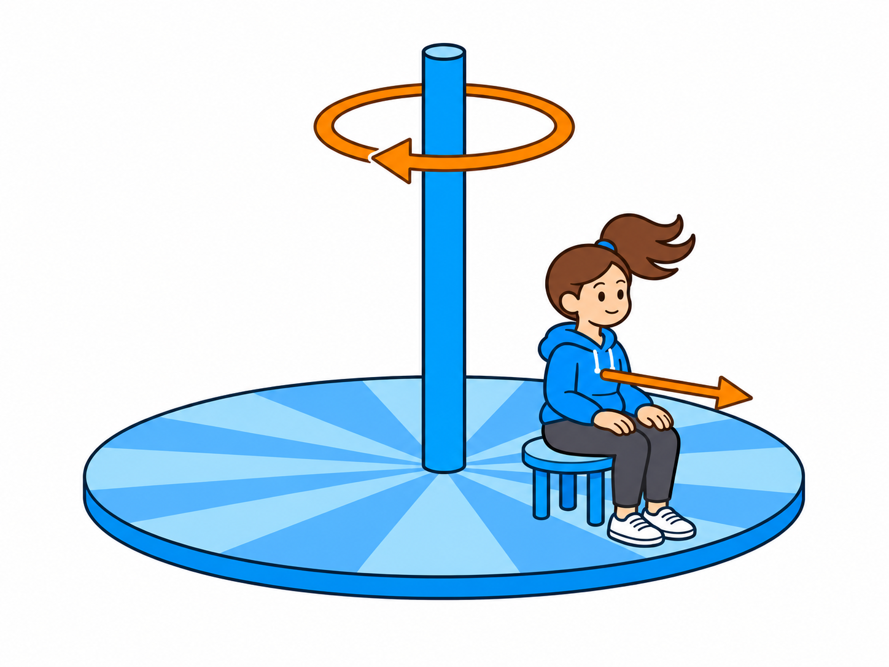{height=400px fig-alt="A girl on a rotating playground platform illustrates changing to a rotating reference frame"}

[Fictitious force]{style="color:#d87926"}
:::
::: {.column .figure-centered .fragment width="54%"}
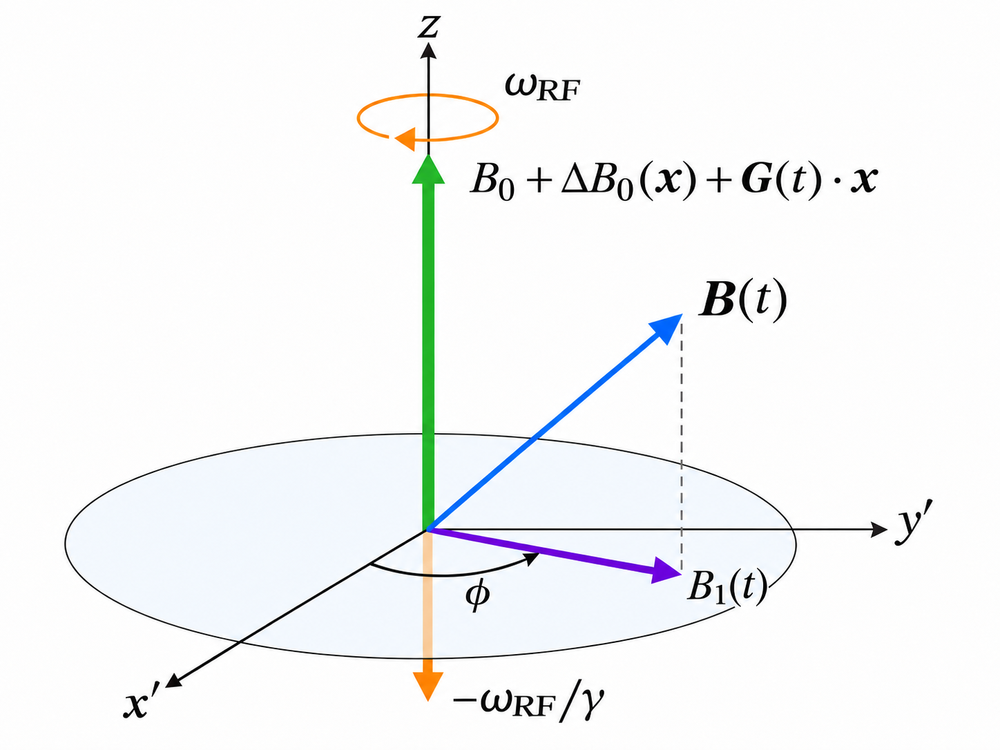{height=410px fig-alt="Effective magnetic field combines the RF field, longitudinal field, and fictitious rotating-frame field"}

[Fictitious field]{style="color:#d87926"}
:::
:::

# After that, magnetic fields appear “static” {#after-transformation-magnetic-fields-appear-static}

```{=html}
<div class="field-demo r-stretch" data-frame="rotating">
  <div class="field-plot" role="img" aria-label="Three-dimensional effective fields in the RF rotating frame at spin positions in the x-z plane"></div>
</div>
```

::: {.notes}
For an RF pulse with constant phase and amplitude, its transverse field is stationary in a frame rotating with it. Gradients can still vary in time, as can the RF envelope. The longitudinal effective field shown here is Gz z, with ΔB0 = ΔωRF = 0.
:::

# The rotating frame removes B₀ from the equations {#removing-the-larmor-component-gives-the-effective-field}

::: {.columns .v-center}
::: {.column .figure-centered width="45%"}
{height=390px fig-alt="RF and longitudinal components of the effective magnetic field"}
:::
::: {.column .field-equation .fragment width="55%"}
$$
\omega_{\mathrm{RF}}=\omega_0+\Delta\omega_{\mathrm{RF}},
\qquad \omega_0=\gamma B_0
$$

$$
\textcolor{#2a7fb8}{\boldsymbol{B}}(\boldsymbol{x},t)=
\begin{bmatrix}
\textcolor{#9b58cf}{B_{1x}(t)}\\
\textcolor{#9b58cf}{B_{1y}(t)}\\
\textcolor{#238b59}{\Delta B_0(\boldsymbol{x})+\boldsymbol{G}(t)\cdot\boldsymbol{x}}
-\textcolor{#d87926}{\Delta\omega_{\mathrm{RF}}/\gamma}
\end{bmatrix}
$$
:::
:::

# Magnetization rotates <u>left-handedly</u> around the effective field

::: {.figure-centered}
{height=400px fig-alt="Magnetization rotates around the effective magnetic field"}
:::

::: {.notes}
Diagram: adapted from [Castillo-Passi et al., *Magn Reson Med* (2023), Fig. 2](https://doi.org/10.1002/mrm.29635)
:::

# Every spin is tuned to the same Larmor frequency

::: {.columns .v-center .radio-columns}
::: {.column .figure-centered width="55%"}
::: {.encoding-illustration style="align-items: center;"}
::: {.encoding-radio}
{height=120px fig-align="center" fig-alt="A yellow antenna transmits an RF pulse at the Larmor frequency"}
:::
::: {.encoding-grid}
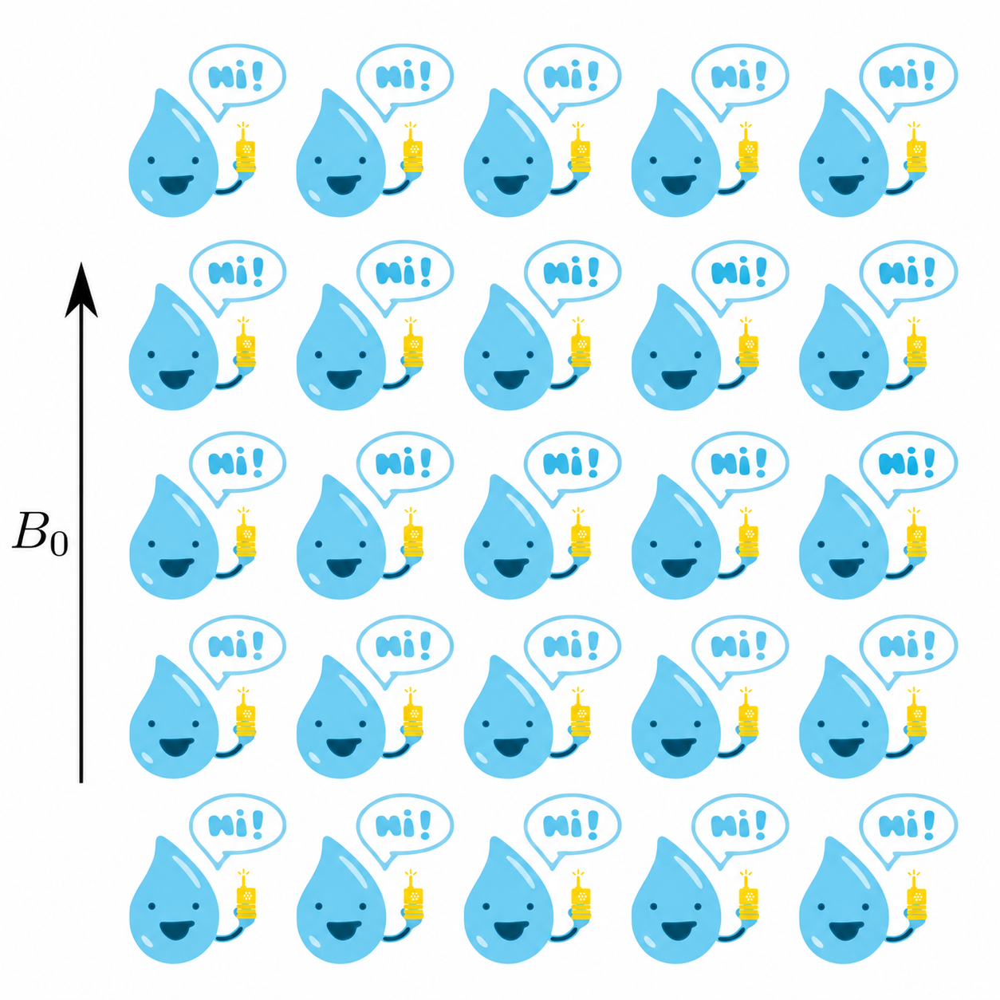{height=430px fig-alt="A five-by-five grid of blue droplet spins in a uniform B0 field, all holding yellow radios and saying Hi"}
:::
:::
:::
::: {.column .field-equation .fragment width="45%"}
$$
\textcolor{#2a7fb8}{\boldsymbol{B}}=
\begin{bmatrix}
\textcolor{#9b58cf}{B_{1x}}\\
\textcolor{#9b58cf}{B_{1y}}\\
0
\end{bmatrix}
$$

::: {.fragment}
What is the best waveform for $\textcolor{#9b58cf}{B_1}$?
:::

:::
:::

::: {.notes}
This simplified example neglects chemical shift and B0 inhomogeneity. Gamma in the slide equations is the angular gyromagnetic ratio, in rad s−1 T−1. KomaMRI's γ constant is in Hz/T.
:::

# Block pulses are used for non-selective excitation {#non-selective-excitation}

```{julia}
#| output: asis
show_excitation("block-excitation", block_seq, [0.0])
```

# Encoding position with frequency

::: {.columns .v-center .encoding-columns}
::: {.column .figure-centered width="55%"}
::: {.encoding-illustration}
::: {.encoding-radio}
{height=120px fig-alt="An antenna transmits an RF pulse at the Larmor frequency"}
:::
::: {.encoding-grid}
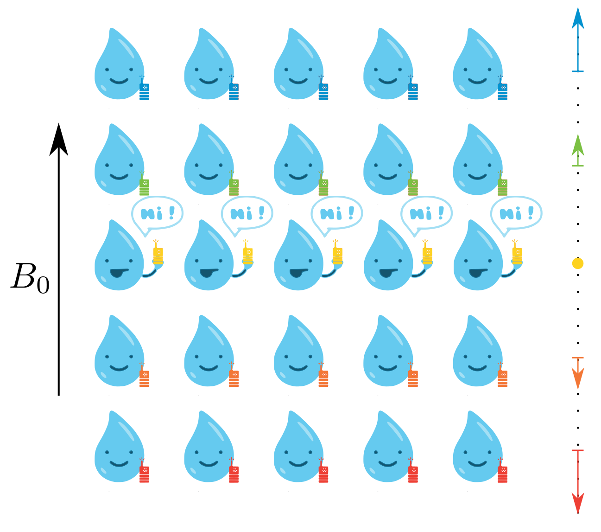{height=410px fig-alt="A gradient makes the resonance frequencies of a grid of spins vary with z-position"}
:::
:::
:::
::: {.column .field-equation width="45%"}
$$
\textcolor{#2a7fb8}{\boldsymbol{B}}=
\begin{bmatrix}
\textcolor{#9b58cf}{B_{1x}}\\
\textcolor{#9b58cf}{B_{1y}}\\
\textcolor{#238b59}{\boldsymbol{G}\cdot\boldsymbol{x}}
\end{bmatrix}
$$

$$\text{Bandwidth: }\Delta\omega=\gamma\,\textcolor{#238b59}{G_z}\,\Delta z$$

::: {.fragment}
But what $\textcolor{#9b58cf}{B_1}$ waveform should we choose?
:::
:::
:::

# A sinc pulse produces a slice-selective excitation profile {#unwindowed-sinc-pulse}

```{julia}
#| output: asis
unwindowed_slice_seq = PulseDesigner.build_sinc_pulse(π/2; duration=2e-3, time_bw_product=4,
    slice_thickness=slice_thickness, phase_offset=0.0, apodization=0.0, sys=lecture_scanner)
show_excitation("unwindowed-slice-excitation", unwindowed_slice_seq, collect(range(-5e-3, 5e-3; length=201)))
```

# A Hamming-windowed sinc pulse excites a smooth slice profile {#slice-selective-excitation}

```{julia}
#| output: asis
show_excitation("slice-excitation", slice_seq, collect(range(-5e-3, 5e-3; length=201)))
```

# How can we offset the slice excitation?

::: {.columns .offset-columns .r-stretch}
::: {.column .figure-centered width="50%"}
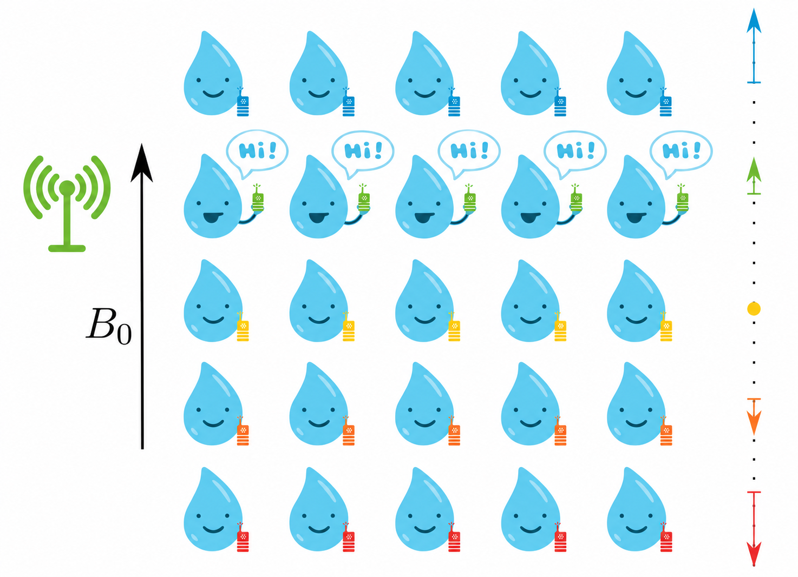{height=390px fig-alt="A green RF antenna excites the green-radio row of spins, which say Hi, while the yellow-radio row remains quiet"}
:::
::: {.column .field-equation width="50%"}
Add a frequency offset $\Delta\omega_{\mathrm{RF}}$ to the RF pulse

$$
\textcolor{#2a7fb8}{\boldsymbol{B}}=
\begin{bmatrix}
\textcolor{#9b58cf}{B_{1x}}\\
\textcolor{#9b58cf}{B_{1y}}\\
\textcolor{#238b59}{\boldsymbol{G}(t)\cdot\boldsymbol{x}}-\textcolor{#d87926}{\Delta\omega_{\mathrm{RF}}/\gamma}
\end{bmatrix}
$$

:::
:::

# Off-center slice excitation is hard to simulate using <u>phase modulation</u> {#off-center-slice-excitation}

```{julia}
#| output: asis
profile_positions = collect(range(-5e-3, 15e-3; length=201))
profile_offsets = collect(0:1:10)
slice_gradient = maximum(abs, get_samples(slice_seq[1]).gz.A)
function slice_profile(offset_mm, step; freq_in_phase=true, flip_angle=π/2, positions=profile_positions, apodization=0.46)
    seq = PulseDesigner.build_sinc_pulse(flip_angle; duration=2e-3,
        slice_thickness=slice_thickness, phase_offset=-π/2, apodization=apodization,
        freq_offset=γ * slice_gradient * offset_mm * 1e-3,
        sys=lecture_scanner)
    n = length(positions)
    obj = Phantom(x=zeros(n), z=positions, T1=fill(Inf, n), T2=fill(Inf, n))
    state = simulate(obj, seq, lecture_scanner; verbose=false, sim_params=Dict(
        "gpu"=>false, "Nthreads"=>1, "precision"=>"f64", "return_type"=>"state",
        "Δt"=>step, "Δt_rf"=>step, "freq_in_phase"=>freq_in_phase))
    abs.(state.xy)
end
profile_data = Dict("z"=>1e3 .* profile_positions, "offsets"=>profile_offsets,
    "fine"=>[slice_profile(z, 2e-6) for z in profile_offsets],
    "coarse"=>[slice_profile(z, 100e-6) for z in profile_offsets])
print("```{=html}\n")
print("""
<div class="offset-demo"><div class="offset-plot"></div>
  <script type="application/json">$(PlotlyBase.JSON.json(profile_data))</script>
</div>""")
print("\n```\n")
```

::: {.offset-equation}
$$\textcolor{#9b58cf}{\boldsymbol{B}_1(t)}=\left[\textcolor{#9b58cf}{B_{1x}(t)},\;\textcolor{#9b58cf}{B_{1y}(t)},\;0\right]^{\mathsf{T}}$$
:::

::: {.notes}
Compare Δt_rf = 2 μs and 100 μs with freq_in_phase=true. Moving the slice increases the RF modulation frequency in the on-resonance rotating frame. Sampling that oscillation too coarsely introduces numerical error. For a constant frequency offset, phi(t) = phi_0 - Delta omega_RF t. The fine curve is a finer discretization, not an analytic ground truth. Relaxation and B0 inhomogeneity are omitted here.
:::

# Let’s use the rotating frame defined by the RF frequency

::: {.columns .v-center .rf-frame-columns}
::: {.column width="45%"}
```{=html}
<div class="frame-demo" aria-label="Larmor and RF coordinate frames in the x-y plane, with red magnetization and z pointing out of the page"></div>
```
::: {.field-equation}
$$\textcolor{#d87926}{\psi(t)}=\int_0^t\textcolor{#d87926}{\Delta\omega_{\mathrm{RF}}(\tau)}\,\mathrm{d}\tau$$
:::
:::
::: {.column .field-equation width="55%"}
$$
\textcolor{#2a7fb8}{\boldsymbol{B}}=
\begin{bmatrix}
\textcolor{#9b58cf}{B_{1x}}\\
\textcolor{#9b58cf}{B_{1y}}\\
\textcolor{#238b59}{\Delta B_0+\boldsymbol{G}\cdot\boldsymbol{x}}
-\textcolor{#d87926}{\Delta\omega_{\mathrm{RF}}(t)/\gamma}
\end{bmatrix}
$$

To go back to the rotating frame:

$$\boldsymbol{M}(t)=R_z\!\left(-\psi(t)\right)\boldsymbol{M}^{\mathrm{RF}}(t)$$

:::
:::

::: {.notes}
M is the magnetization in the Larmor frame with axes x-prime and y-prime, and M^RF is its coordinates in the RF frame with axes x-double-prime and y-double-prime. Define psi(t) as the integral from 0 to t of Delta omega_RF(tau) d tau, with the frames coinciding at t = 0. The RF axes rotate by -psi relative to the Larmor axes, so the magnetization angle in the RF frame is its Larmor-frame angle plus psi. With standard right-handed Rz, M^RF = Rz(psi) M, or M = Rz(-psi) M^RF. The extra longitudinal effective field is -psi-dot/gamma = -Delta omega_RF/gamma. The diagram's positive psi arc runs from x-double-prime to x-prime. This slide's psi is the negative of Koma's internal seq.psi, apart from the choice of phase reference.
:::

# Using RF’s `Δf` in Koma <u>frequency modulates</u> the effective field {#using-df-in-koma-modulates-the-effective-field}

```{julia}
#| output: asis
frequency_profile_data = Dict("z"=>1e3 .* profile_positions, "offsets"=>profile_offsets,
    "fine"=>[slice_profile(z, 2e-6; freq_in_phase=false) for z in profile_offsets],
    "coarse"=>[slice_profile(z, 100e-6; freq_in_phase=false) for z in profile_offsets],
    "phase_coarse"=>profile_data["coarse"])
print("```{=html}\n")
print("""
<div class="offset-demo"><div class="offset-plot"></div>
  <script type="application/json">$(PlotlyBase.JSON.json(frequency_profile_data))</script>
</div>""")
print("\n```\n")
```

::: {.offset-equation}
$$
\textcolor{#2a7fb8}{\boldsymbol{B}}(\boldsymbol{x},t)=\left[
\textcolor{#9b58cf}{B_{1x}(t)},\;
\textcolor{#9b58cf}{B_{1y}(t)},\;
\textcolor{#238b59}{\boldsymbol{G}(t)\cdot\boldsymbol{x}}-
\textcolor{#d87926}{\Delta\omega_{\mathrm{RF}}/\gamma}
\right]^{\mathsf{T}}
$$
:::

::: {.notes}
Use the same windowed sinc pulse as the previous profile, but set freq_in_phase=false. The RF frequency offset stays in the longitudinal effective field instead of being sampled as a rapidly varying RF phase. This example uses a constant frequency offset: Delta omega_RF = 2 pi df, with df in Hz and gamma in rad/s/T. Compare the 2 microsecond and 100 microsecond profiles at the same slice offset.
:::

# That’s a lot of maths just to excite an image slice! {#thats-a-lot-of-detail-just-to-excite-an-image-slice}

::: {.figure-centered}
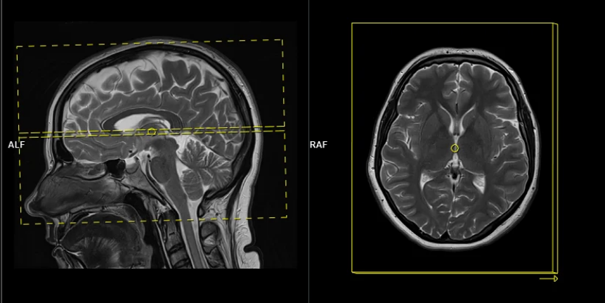{height=430px fig-alt="Sagittal MRI localizer with an axial slice prescribed through the brain, alongside the corresponding axial image"}
:::

::: {.slide-note}
Image: [MRI Master — brain planning](https://mrimaster.com/planning/)
:::

# … you can also create 2D excitation patterns {#you-can-also-create-2d-excitation-patterns}

::: {.columns .v-center .pattern-columns}
::: {.column .figure-centered width="50%"}
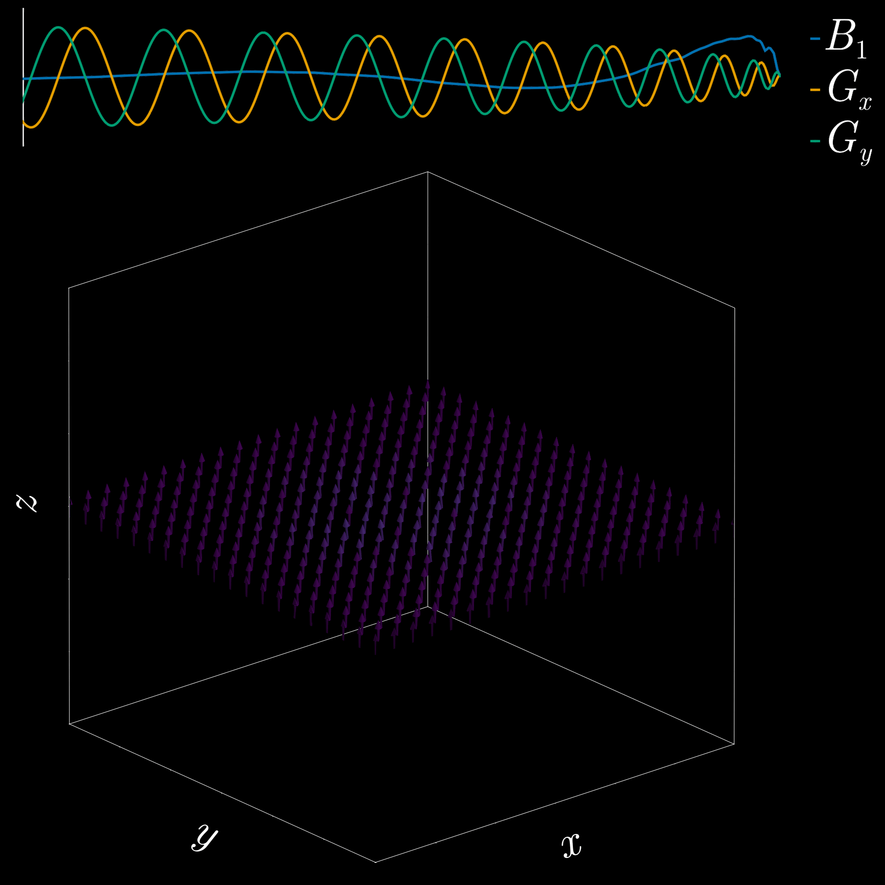{height=440px fig-alt="Animated two-dimensional RF excitation with a spatially varying magnetization pattern"}
:::
::: {.column .figure-centered width="50%"}
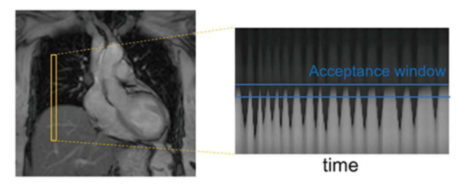{width="100%" fig-alt="A pencil-beam navigator across the liver–lung interface and the respiratory signal it measures"}

::: {.slide-note}
[Investigative Magnetic Resonance Imaging (2021), Fig. 7](https://doi.org/10.13104/imri.2021.25.4.209)
:::
:::
:::

# The small-tip approximation (STA) helps design complex excitation patterns {#the-small-tip-approximation-helps-design-complex-excitation-patterns}

::: {.columns .sta-columns}
::: {.column width="50%"}
::: {.offset-equation}
$$
\begin{gathered}
M_{xy}(\boldsymbol{x})\approx i\,\gamma M_0
\int_0^{T_{\mathrm{rf}}} \textcolor{#9b58cf}{B_1(\tau)}\,e^{i2\pi\boldsymbol{k}_{\mathrm{exc}}(\tau)\cdot\boldsymbol{x}}\,\mathrm{d}\tau
\\
\boldsymbol{k}_{\mathrm{exc}}(t)=\frac{\gamma}{2\pi}\int_{T_{\mathrm{rf}}}^{t}\textcolor{#238b59}{\boldsymbol{G}(\tau)}\,\mathrm{d}\tau
\end{gathered}
$$
:::
:::
::: {.column width="50%"}

```{julia}
#| output: asis
tip_angles = collect(5:5:90)
tip_positions = collect(range(-5e-3, 5e-3; length=201))
tip_apodization = 0.46
tip_seq = PulseDesigner.build_sinc_pulse(π/2; duration=2e-3,
    slice_thickness=slice_thickness, phase_offset=-π/2, apodization=tip_apodization, sys=lecture_scanner)
tip_t = collect(range(0, dur(tip_seq); length=ceil(Int, dur(tip_seq)/2e-6)+1))
tip_samples = KomaMRI.KomaMRIBase.evaluate_sequence_at(tip_seq, tip_t)
tip_dt = diff(tip_t)
tip_k = γ .* [0.0; cumsum(tip_dt .* (tip_samples.Gz[1:end-1] .+ tip_samples.Gz[2:end]) ./ 2)]
tip_k .-= tip_k[end]
tip_sta = map(tip_positions) do z
    integrand = tip_samples.B1 .* cis.(2π .* tip_k .* z)
    abs(2π * γ * im * sum(tip_dt .* (integrand[1:end-1] .+ integrand[2:end]) ./ 2))
end
tip_data = Dict("z"=>1e3 .* tip_positions, "angles"=>tip_angles,
    "bloch"=>[slice_profile(0, 2e-6; flip_angle=deg2rad(a), positions=tip_positions, apodization=tip_apodization) for a in tip_angles],
    "sta"=>[tip_sta .* (a/90) for a in tip_angles])
print("```{=html}\n")
print("""
<div class="sta-demo"><div class="offset-plot"></div>
  <script type="application/json">$(PlotlyBase.JSON.json(tip_data))</script>
</div>""")
print("\n```\n")
```
:::
:::

::: {.bloch-reference}
[Pauly, Nishimura, and Macovski, *J Magn Reson* (1989)](https://doi.org/10.1016/0022-2364(89)90265-5)
:::

::: {.notes}
The slide equations use gamma in rad/s/T, consistent with the earlier Bloch equations; excitation k-space is in cycles/m. The Julia code uses KomaMRI's gamma constant in Hz/T, so its corresponding prefactor is 2πγ and its k-space factor is γ. The approximation holds Mz at M0. Both curves use the same sinc pulse with Hamming apodization of 0.46; only its amplitude changes with the requested flip angle. The full curves are KomaMRI CPU Bloch simulations without relaxation. The small-tip curves are independent trapezoidal integrals of the emitted RF and gradient waveforms. At large angles the linear prediction can exceed M0, exposing the approximation's limitation.

[Pauly, Nishimura, and Macovski, A k-space analysis of small-tip-angle excitation (1989)](https://doi.org/10.1016/0022-2364(89)90265-5)
:::

# Pencil-beam nav. can be designed using STA {#pencil-beam-navigators-can-be-designed-with-the-small-tip-approximation}

```{julia}
#| output: asis
pencil_flip_angle = deg2rad(10)
pencil_seq = SBB.build_pencil_beam(pencil_flip_angle, 40e-3, 160e-3, 48, lecture_scanner; apodization=0.46)
pencil_positions = collect(range(-60e-3, 60e-3; length=81))
pencil_target = [[hypot(x,y) <= 20e-3 ? sin(pencil_flip_angle) : 0.0
    for x in pencil_positions] for y in pencil_positions]
pencil_obj = Phantom(x=[x for y in pencil_positions for x in pencil_positions],
    y=[y for y in pencil_positions for x in pencil_positions],
    T1=fill(Inf, 81^2), T2=fill(Inf, 81^2))
pencil_state = simulate(pencil_obj, pencil_seq, lecture_scanner; verbose=false,
    sim_params=Dict("gpu"=>false, "Nthreads"=>1, "precision"=>"f64",
        "Δt"=>2e-6, "Δt_rf"=>2e-6, "return_type"=>"state"))
pencil_image = reshape(abs.(pencil_state.xy), 81, 81)
pencil_excitation = pencil_seq[2]
pencil_rf_times = times(pencil_excitation.RF[1,1])[2:end-1]
pencil_t = sort!(unique([pencil_rf_times; times(pencil_excitation.GR[1,1]); times(pencil_excitation.GR[2,1])]))
pencil_gx, pencil_gy, _ = KomaMRI.KomaMRIBase.get_grads(pencil_excitation, pencil_t)
pencil_k = map((pencil_gx, pencil_gy)) do g
    k = γ .* [0.0; cumsum(diff(pencil_t) .* (g[1:end-1] .+ g[2:end]) ./ 2)]
    (k .- k[end])[searchsortedfirst.(Ref(pencil_t), pencil_rf_times)]
end
pencil_kmax = maximum(hypot.(pencil_k...))
pencil_kg = collect(range(-pencil_kmax, pencil_kmax; length=161))
pencil_spectrum = [[begin
    r = hypot(kx, ky); u = π * 40e-3 * r
    r > pencil_kmax ? 0.0 : abs(iszero(u) ? 1.0 : 2besselj1(u)/u)
end for kx in pencil_kg] for ky in pencil_kg]
pencil_data = Dict("position"=>1e3 .* pencil_positions,
    "target"=>pencil_target, "magnetization_max"=>max(sin(pencil_flip_angle), maximum(pencil_image)),
    "image"=>[collect(pencil_image[:,j]) for j in axes(pencil_image,2)],
    "kgrid"=>pencil_kg, "spectrum"=>pencil_spectrum, "kx"=>pencil_k[1], "ky"=>pencil_k[2])
print("```{=html}\n<div class=\"pencil-demo\" style=\"height:330px\"><script type=\"application/json\">$(PlotlyBase.JSON.json(pencil_data))</script></div>\n")
pencil_wave = plot_seq(pencil_seq; height=285, width=600, slider=false, show_rf_frame=false)
for trace in pencil_wave.data
    get(trace, :name, "") == "|B1|_AM" && (trace.name = "B₁")
    get(trace, :visible, true) == "legendonly" && (trace.showlegend = false)
end
pencil_wave.layout.margin = attr(l=55, r=10, t=30, b=35)
pencil_wave.layout.font = attr(size=17)
pencil_wave.config = PlotConfig(displayModeBar=false, displaylogo=false, responsive=true)
print("<div style=\"width:50%;margin:0 auto\">")
PlotlyBase.to_html(stdout, pencil_wave; autoplay=false, full_html=false, include_mathjax=missing)
print("</div>\n```\n")
```

::: {.slide-note}
[MRISequenceBuildingBlocks — `build_pencil_beam`](https://github.com/JuliaHealth/MRISequenceBuildingBlocks.jl/blob/main/src/excitation.jl)
:::

::: {.notes}
The left image is the target disk with transverse magnetization sin(10 degrees). The center image is the magnitude of its analytic spectrum over the sampled k-space support, with the actual excitation k-space trajectory overlaid in red. The right image is the KomaMRI Bloch simulation of the 10-degree pulse; target and simulation share the same grayscale limits. Hamming apodization of 0.46 is applied in build_pencil_beam to reduce ringing. The constructor applies trajectory density compensation to the RF waveform. The disk diameter is 40 mm. The simulation neglects relaxation and off-resonance.
:::

# How can we solve this ODE accurately?

::: {.columns .ode-columns}
::: {.column .field-equation width="40%"}
$$
\frac{\mathrm{d}\boldsymbol{M}}{\mathrm{d}t}
=\operatorname{bloch}(t,\boldsymbol{M})
$$

:::
::: {.column .figure-centered width="60%"}
Forward Euler (1st order, explicit)

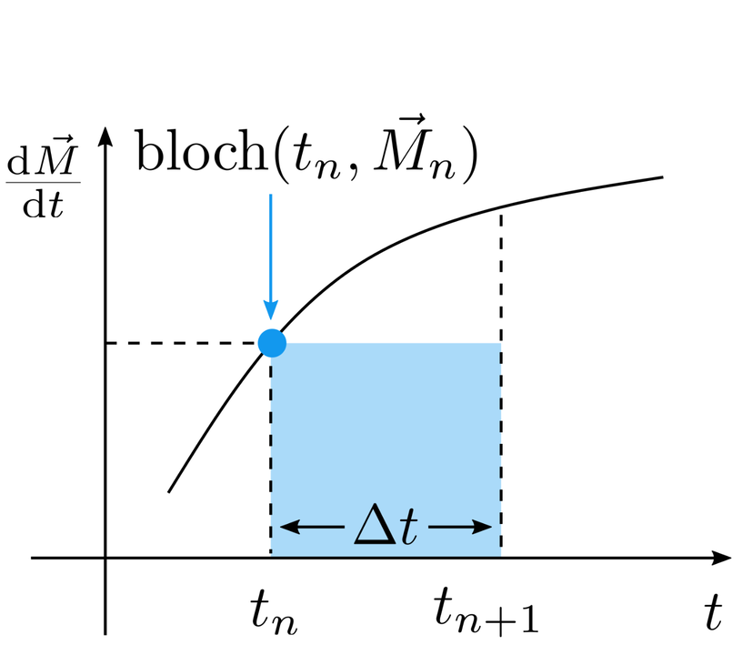{height=350px fig-alt="Forward Euler approximates the integral using the derivative at the start of a time step"}

::: {.field-equation}
$$
\boldsymbol{M}_{n+1}=\boldsymbol{M}_n
+\Delta t\,\operatorname{bloch}(t_n,\boldsymbol{M}_n)
$$
:::
:::
:::

# Higher-order methods can reduce error at the same simulation time step $\Delta t$ {#higher-order-methods-can-reduce-error-at-the-same-time-step}

```{julia}
#| output: asis
convergence_data = read("figures/magnus-convergence.json", String)
print("```{=html}\n<div class=\"magnus-convergence\" style=\"width:835px;height:480px;margin:0 auto\"><script type=\"application/json\">$convergence_data</script></div>\n```\n")
```

::: {.bloch-reference}
Float64 · [KomaMRI documentation: Magnus methods](https://juliahealth.org/KomaMRI.jl/stable/explanation/gen-8-magnus-methods)
:::

::: {.notes}
Compare the curves at the same simulation time step: the higher-order methods have lower error in this example. The plot uses the Float64 results from the documentation, for methods of orders 1, 2, 4, and 6. Higher-order methods do more work within each step. Mention Runge–Kutta methods such as RK4 as another option, without a derivation.
The default API is Bloch(), whose first-order RF rotation matches BlochMagnus1; the default label refers to this excitation integration method.
Source data: KomaMRI documentation, https://juliahealth.org/KomaMRI.jl/stable/explanation/gen-8-magnus-methods
:::

# Questions? {.center .transition-slide}

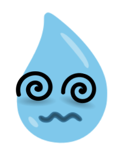{height=280px fig-alt="Dizzy droplet spin with spiral eyes"}

```{=html}
<script>
window.addEventListener('load', async () => {
  await window.komaPlotly;
  const color = {field:'#2a7fb8', rf:'#9b58cf', gradient:'#238b59', axis:'#89939c'};
  const config = {displayModeBar:false, responsive:true};
  document.querySelectorAll('.magnus-convergence').forEach(plot=>{
    const data=JSON.parse(plot.querySelector('script').textContent)
      .filter(trace=>trace.name.endsWith('Float64'))
      .map(trace=>({...trace,name:'Bloch'+trace.name.replace(' Float64','')+(trace.name.startsWith('Magnus1 ')?' (default)':''),line:{...trace.line,width:3}}));
    Plotly.newPlot(plot,data,{margin:{l:115,r:320,t:10,b:70,autoexpand:false},font:{size:22,color:'#343a40'},
      xaxis:{title:{text:'Simulation time step Δt (μs)',standoff:12},type:'log',autorange:'reversed',tickvals:[300,100,30,10,3,1]},
      yaxis:{title:{text:'Relative error (NRMSE)',standoff:15},type:'log',range:[-14.3,-.4],
        exponentformat:'power',showexponent:'all',dtick:2,automargin:false},
      legend:{x:1.04,xanchor:'left',y:1,font:{size:20}},
      paper_bgcolor:'rgba(0,0,0,0)',plot_bgcolor:'rgba(0,0,0,0)'},config);
  });
  const animation = {mode:'immediate', transition:{duration:0}, frame:{duration:0,redraw:true}};
  function nativeSlider(steps, prefix, suffix='', active=0) {
    return {steps, active, x:.05, len:.9, y:-.25, pad:{t:10},
      ticklen:0, minorticklen:0, font:{color:'rgba(0,0,0,0)'},
      currentvalue:{prefix,suffix,offset:0,font:{size:20,color:'#343a40'}},
      bordercolor:color.field, activebgcolor:color.field, transition:{duration:0}};
  }
  function arrowMesh(origins, vectors, stroke, name='', radius=.02, headRadius=.06, headLength=.16) {
    const mesh={type:'mesh3d',x:[],y:[],z:[],i:[],j:[],k:[],color:stroke,
      lighting:{ambient:1,diffuse:0,specular:0,fresnel:0},name,hoverinfo:'skip',showlegend:!!name};
    const vertex=p=>{const index=mesh.x.length;['x','y','z'].forEach((key,i)=>mesh[key].push(p[i]));return index;};
    const face=(a,b,c)=>{mesh.i.push(a);mesh.j.push(b);mesh.k.push(c);};
    vectors.forEach((v,index)=>{
      const length=Math.hypot(...v);
      if(!length)return;
      const origin=origins[index],n=v.map(a=>a/length),tip=origin.map((p,i)=>p+v[i]);
      const cross=Math.abs(n[2])<.9?[-n[1],n[0],0]:[0,-n[2],n[1]];
      const norm=Math.hypot(...cross),u=cross.map(a=>a/norm);
      const w=[n[1]*u[2]-n[2]*u[1],n[2]*u[0]-n[0]*u[2],n[0]*u[1]-n[1]*u[0]];
      const base=tip.map((p,i)=>p-Math.min(headLength,length*.7)*n[i]);
      const ring=(center,r)=>Array.from({length:12},(_,s)=>{
        const a=2*Math.PI*s/12;
        return vertex(center.map((p,i)=>p+r*(Math.cos(a)*u[i]+Math.sin(a)*w[i])));
      });
      const start=ring(origin,radius),end=ring(base,radius),head=ring(base,headRadius);
      const point=vertex(tip),startCenter=vertex(origin),headCenter=vertex(base);
      for(let s=0;s<12;s++){
        const next=(s+1)%12;
        face(start[s],start[next],end[next]);face(start[s],end[next],end[s]);
        face(startCenter,start[next],start[s]);face(headCenter,head[next],head[s]);
        face(head[s],head[next],point);
      }
    });
    return mesh;
  }
  document.querySelectorAll('.field-demo').forEach(async demo=>{
    const plot=demo.querySelector('.field-plot'),rotating=demo.dataset.frame==='rotating';
    const positions=[];
    for(let iz=0;iz<5;iz++)for(let ix=0;ix<5;ix++)positions.push([(ix-2)*1.5,0,(iz-2)*1.5]);
    let gz=1,b1=1;
    function vectors(time=0){
      const phase=rotating?0:-time*.0014,scale=1.1/Math.max(1,3*Math.abs(gz),b1);
      return ['gradient','rf','field'].map((component,j)=>arrowMesh(positions,positions.map(([x,y,z])=>{
        const rf=[scale*b1*Math.cos(phase),scale*b1*Math.sin(phase),0],bz=scale*gz*z;
        return j===0?[0,0,bz]:j===1?rf:(!b1||bz===0)?[0,0,0]:[rf[0],rf[1],bz];
      }),color[component]));
    }
    const controls=[['Gz',[-1,0,1],color.gradient,.58],['B₁',[0,1],color.rf,.38]].map(([name,values,stroke,y])=>({
      ...nativeSlider(values.map(value=>({label:value>0?'+':value<0?'−':'0',value:String(value),method:'skip',args:[]})),name+': ','',values.length-1),
      name,x:.8,len:.17,y,bordercolor:stroke,activebgcolor:stroke,currentvalue:{prefix:name+': ',font:{size:20,color:stroke}}
    }));
    const axis={showbackground:false,gridcolor:'#d8dde1',zerolinecolor:color.axis,showticklabels:false,ticks:''};
    const annotations=[{xref:'paper',yref:'paper',x:.8,y:.08,xanchor:'left',showarrow:false,
      text:rotating?'B: Effective field in<br>rotating frame':'B: Field in lab frame<br>(without B<sub>0</sub>)',font:{color:color.field,size:20}}];
    if(!rotating)annotations.push(
      {xref:'paper',yref:'paper',x:.69,y:.78,ax:0,ay:180,text:'',showarrow:true,arrowhead:3,arrowsize:1,arrowwidth:3,arrowcolor:'#343a40'},
      {xref:'paper',yref:'paper',x:.72,y:.6,text:'B<sub>0</sub>',showarrow:false,font:{size:26}});
    await Plotly.newPlot(plot,[{type:'scatter3d',mode:'markers',x:positions.map(p=>p[0]),y:positions.map(p=>p[1]),z:positions.map(p=>p[2]),
      marker:{color:'#343a40',size:3},hoverinfo:'skip',showlegend:false},...vectors()],
      {margin:{l:0,r:0,t:0,b:0},font:{size:20,color:'#343a40'},showlegend:false,uirevision:'field-grid',sliders:controls,annotations,
       scene:{domain:{x:[0,.75],y:[0,1]},xaxis:{...axis,title:'x',range:[-4.3,4.3]},
         yaxis:{...axis,title:'y',range:[-1.6,1.6]},zaxis:{...axis,title:'z',range:[-4.3,4.3]},
         aspectmode:'manual',aspectratio:{x:1.65,y:.7425,z:1.65},camera:{eye:{x:.8,y:-1.1,z:.5},projection:{type:'orthographic'}}},paper_bgcolor:'rgba(0,0,0,0)'},config);
    let busy=false,pending=false,last=0;
    async function draw(time=0){
      if(busy){pending=true;return;}busy=true;
      const values=vectors(time);
      await Plotly.restyle(plot,Object.fromEntries(['x','y','z','i','j','k'].map(key=>[key,values.map(v=>v[key])])),[1,2,3]);
      busy=false;if(pending){pending=false;draw(performance.now());}
    }
    plot.on('plotly_sliderchange',event=>{if(event.slider.name==='Gz')gz=+event.step.value;else b1=+event.step.value;draw(performance.now());});
    if(!rotating){
      function animate(t){if(t-last>100&&demo.closest('section').classList.contains('present')){last=t;draw(t);}requestAnimationFrame(animate);}
      requestAnimationFrame(animate);
    }
  });
  document.querySelectorAll('.excitation-demo').forEach(async plot=>{
    const d=JSON.parse(plot.querySelector('script').textContent),profile=d.z.length>1,wave=d.wave;
    const waveEnd=profile?.45:.3,bottom=0,top=1;
    const traces=wave.data,n=traces.length;
    traces.forEach(trace=>trace.legend='legend');
    const background={type:'rect',xref:'paper',yref:'paper',x0:0,x1:waveEnd,y0:bottom,y1:top,fillcolor:'#e5ecf6',line:{width:0},layer:'below'};
    const cursor=t=>({type:'line',xref:'x',yref:'paper',x0:t,x1:t,y0:bottom,y1:top,line:{color:'#c33',width:2}});
    const layout={...wave.layout,width:null,height:null,autosize:true,margin:profile?{l:75,r:20,t:45,b:105,autoexpand:false}:{l:55,r:25,t:65,b:75},updatemenus:[],uirevision:'excitation',
      font:{size:19,color:'#343a40'},legend:{orientation:'h',x:0,y:profile?1.08:1.13,font:{size:16}},legend2:{orientation:'h',x:.78,xanchor:'center',y:profile?1.08:1.13,font:{size:19}},
      xaxis:{...wave.layout.xaxis,domain:[0,waveEnd],anchor:'y',gridcolor:'#fff'},
      yaxis:{...wave.layout.yaxis,domain:[bottom,top],anchor:'x',gridcolor:'#fff'},
      shapes:[background,cursor(0)],paper_bgcolor:'rgba(0,0,0,0)',plot_bgcolor:'rgba(0,0,0,0)'};
    let snapshot;
    if(profile){
      snapshot=k=>{
        const magnitude=d.m[k].map(([x,y])=>Math.hypot(x,y));
        return [{y:magnitude},{y:d.m[k].map(([x,y],j)=>magnitude[j]<1e-3?null:Math.atan2(y,x)*180/Math.PI)}];
      };
      traces.push({type:'scatter',mode:'lines',x:d.z,y:snapshot(0)[0].y,xaxis:'x2',yaxis:'y2',legend:'legend2',name:'|Mxy|',line:{color:color.field,width:3}},
        {type:'scatter',mode:'lines',x:d.z,y:snapshot(0)[1].y,xaxis:'x3',yaxis:'y3',legend:'legend2',name:'Phase',line:{color:'#e0ad00',width:3}});
      Object.assign(layout,{xaxis2:{domain:[.56,1],anchor:'y2',showticklabels:false,range:[d.z[0],d.z.at(-1)]},
        yaxis2:{domain:[.4,1],anchor:'x2',title:{text:'|Mxy|',standoff:12},range:[0,1.05],automargin:true},
        xaxis3:{domain:[.56,1],anchor:'y3',title:{text:'z-position (mm)',standoff:5},range:[d.z[0],d.z.at(-1)]},
        yaxis3:{domain:[0,.25],anchor:'x3',title:{text:'Phase (°)',standoff:12},range:[-190,190],tickvals:[-180,0,180],automargin:true}});
    }else{
      const axis=arrowMesh([[0,0,0],[0,0,0],[0,0,0]],[[1.1,0,0],[0,1.1,0],[0,0,1.1]],color.axis,'',.004,.018,.05);
      traces.push(axis,{type:'scatter3d',mode:'text',x:[1.2,0,0],y:[0,1.2,0],z:[0,0,1.2],text:['x′','y′','z'],
        textfont:{size:18,color:color.axis},hoverinfo:'skip',showlegend:false});
      snapshot=k=>{
        const m=d.m[k][0],b=d.b[k][0],angle=Math.atan2(m[1],m[2]);
        const arc=Math.abs(b[0])>.01?Array.from({length:31},(_,i)=>[0,.8*Math.sin(angle-.25+i/30),.8*Math.cos(angle-.25+i/30)]):[];
        const tip=arc.at(-1),tangent=tip?[0,.07*Math.cos(angle+.75),-.07*Math.sin(angle+.75)]:[0,0,0];
        return [{...arrowMesh([[0,0,0]],[m],'#20252a','M(t)',.013,.04,.08),legend:'legend2'},
          {...arrowMesh([[0,0,0]],[b],color.field,'B(t)',.009,.03,.07),legend:'legend2'},
          {type:'scatter3d',mode:'lines',x:arc.map(p=>p[0]),y:arc.map(p=>p[1]),z:arc.map(p=>p[2]),line:{color:color.axis,width:3},showlegend:false,hoverinfo:'skip'},
          arrowMesh([tip?tip.map((p,i)=>p-tangent[i]):[0,0,0]],[tangent],color.axis,'',.003,.018,.05)];
      };
      traces.push(...snapshot(0));
      const axisStyle={visible:false,range:[-.55,1.25]};
      layout.legend2.x=.75;
      layout.scene={domain:{x:[.36,1],y:[0,1]},xaxis:axisStyle,yaxis:axisStyle,zaxis:axisStyle,
        aspectmode:'manual',aspectratio:{x:2.3,y:2.3,z:2.3},camera:{eye:{x:.866,y:-1.5,z:1},projection:{type:'orthographic'}}};
    }
    const indices=profile?[n,n+1]:[n+2,n+3,n+4,n+5];
    const frames=profile?[]:d.t.map((t,k)=>({name:String(k),data:snapshot(k),traces:indices,layout:{shapes:[background,cursor(t)]}}));
    layout.sliders=[nativeSlider(d.t.map((t,k)=>({label:t.toFixed(3),method:profile?'update':'animate',
      args:profile?[{y:snapshot(k).map(trace=>trace.y)},{'shapes[1].x0':t,'shapes[1].x1':t},indices]:[[String(k)],animation]})),'Time: ',' ms')];
    layout.sliders[0].y=profile?-.1:-.08;
    await Plotly.newPlot(plot,{data:traces,layout,frames,config});
  });
  document.querySelectorAll('.offset-demo').forEach(demo=>{
    const d=JSON.parse(demo.querySelector('script').textContent),plot=demo.querySelector('.offset-plot');
    const curves=k=>d.phase_coarse?[d.fine[k],d.coarse[k],d.phase_coarse[k]]:[d.fine[k],d.coarse[k]];
    const traces=[{x:d.z,y:d.fine[0],name:'Δt<sub>rf</sub> = 2 μs'+(d.phase_coarse?' · FM':''),line:{color:color.field,width:3}},
      {x:d.z,y:d.coarse[0],name:'Δt<sub>rf</sub> = 100 μs'+(d.phase_coarse?' · FM':''),line:{color:'#d87926',width:3,dash:'dash'}}];
    if(d.phase_coarse)traces.push({x:d.z,y:d.phase_coarse[0],name:'Δt<sub>rf</sub> = 100 μs · PM',line:{color:color.rf,width:3,dash:'dot'}});
    Plotly.newPlot(plot,traces,{margin:{l:75,r:20,t:35,b:90},font:{size:22,color:'#343a40'},
      xaxis:{title:{text:'z-position (mm)',standoff:5},range:[-5,15]},yaxis:{title:'|Mxy|',range:[0,1.05]},
      legend:{orientation:'h',x:.5,xanchor:'center',y:1.15,font:{size:18}},
      sliders:[nativeSlider(d.offsets.map((z,k)=>({label:String(z),method:'restyle',args:[{y:curves(k)}]})),'Slice offset: ',' mm')],
      paper_bgcolor:'rgba(0,0,0,0)',plot_bgcolor:'rgba(0,0,0,0)'},config);
  });
  document.querySelectorAll('.sta-demo').forEach(demo=>{
    const d=JSON.parse(demo.querySelector('script').textContent),plot=demo.querySelector('.offset-plot');
    Plotly.newPlot(plot,[{x:d.z,y:d.bloch[2],name:'Bloch sim',line:{color:color.field,width:3}},
      {x:d.z,y:d.sta[2],name:'Small-tip approximation',line:{color:'#d87926',width:3,dash:'dash'}}],
      {margin:{l:100,r:20,t:35,b:90},font:{size:22,color:'#343a40'},xaxis:{title:{text:'z-position (mm)',standoff:5},range:[-5,5]},
       yaxis:{title:{text:'|Mxy|',standoff:16},automargin:true,rangemode:'tozero'},
       legend:{orientation:'h',x:.5,xanchor:'center',y:1.14,font:{size:18}},
       sliders:[nativeSlider(d.angles.map((a,k)=>({label:String(a),method:'restyle',args:[{y:[d.bloch[k],d.sta[k]]}]})),'Flip angle: ','°',2)],
       paper_bgcolor:'rgba(0,0,0,0)',plot_bgcolor:'rgba(0,0,0,0)'},config);
  });
  document.querySelectorAll('.pencil-demo').forEach(plot=>{
    const d=JSON.parse(plot.querySelector('script').textContent);
    Plotly.newPlot(plot,[
      {type:'heatmap',x:d.position,y:d.position,z:d.target,colorscale:'Greys',zmin:0,zmax:d.magnetization_max,
       showscale:false,hovertemplate:'x: %{x:.1f} mm<br>y: %{y:.1f} mm<br>|Mxy|: %{z:.3f}<extra></extra>'},
      {type:'heatmap',x:d.kgrid,y:d.kgrid,z:d.spectrum,xaxis:'x2',yaxis:'y2',colorscale:'Greys',zmin:0,zmax:1,
       showscale:false,hovertemplate:'kx: %{x:.1f} cycles/m<br>ky: %{y:.1f} cycles/m<br>|F|: %{z:.3f}<extra></extra>'},
      {type:'heatmap',x:d.position,y:d.position,z:d.image,xaxis:'x3',yaxis:'y3',colorscale:'Greys',zmin:0,zmax:d.magnetization_max,
       showscale:false,hovertemplate:'x: %{x:.1f} mm<br>y: %{y:.1f} mm<br>|Mxy|: %{z:.3f}<extra></extra>'},
      {type:'scatter',mode:'lines',x:d.kx,y:d.ky,xaxis:'x2',yaxis:'y2',name:'k<sub>exc</sub>',line:{color:'#ff4d4d',width:1},showlegend:true,hoverinfo:'skip'}],
      {margin:{l:10,r:10,t:65,b:5},font:{size:20,color:'#343a40'},
       xaxis:{domain:[0,.28],range:[-60,60],constrain:'domain',visible:false},
       yaxis:{domain:[0,1],range:[-60,60],constrain:'domain',scaleanchor:'x',visible:false},
       xaxis2:{domain:[.36,.64],range:[d.kgrid[0],d.kgrid.at(-1)],constrain:'domain',visible:false},
       yaxis2:{domain:[0,1],anchor:'x2',range:[d.kgrid[0],d.kgrid.at(-1)],constrain:'domain',scaleanchor:'x2',visible:false},
       xaxis3:{domain:[.72,1],range:[-60,60],constrain:'domain',visible:false},
       yaxis3:{domain:[0,1],anchor:'x3',range:[-60,60],constrain:'domain',scaleanchor:'x3',visible:false},
       legend:{orientation:'h',x:.5,xanchor:'center',y:1,yanchor:'bottom',font:{size:18}},
       annotations:[{x:.5,y:1,xref:'x domain',yref:'y domain',xanchor:'center',yanchor:'bottom',yshift:38,text:'Target',showarrow:false},
         {x:.5,y:1,xref:'x2 domain',yref:'y2 domain',xanchor:'center',yanchor:'bottom',yshift:38,text:'Excitation k-space',showarrow:false},
         {x:.5,y:1,xref:'x3 domain',yref:'y3 domain',xanchor:'center',yanchor:'bottom',yshift:38,text:'Bloch simulation',showarrow:false}],
       paper_bgcolor:'rgba(0,0,0,0)',plot_bgcolor:'rgba(0,0,0,0)'},
      {displayModeBar:false,responsive:true});
  });
  document.querySelectorAll('.frame-demo').forEach(async plot=>{
    const psi=Math.PI/6,c=Math.cos(psi),s=-Math.sin(psi),m=[.8,.6];
    const arc=Array.from({length:31},(_,i)=>[.48*Math.cos(-psi+psi*i/30),.48*Math.sin(-psi+psi*i/30)]);
    const labels=[
      {x:1.17,y:0,text:'x′',font:{color:color.axis}},
      {x:0,y:1.17,text:'y′',font:{color:color.axis}},
      {x:-.12,y:.12,text:'z',font:{color:color.axis}},
      {x:1.17*c,y:1.17*s,text:'x″'},
      {x:-1.17*s,y:1.17*c,text:'y″'},
      {x:m[0]+.05,y:m[1]+.1,text:'M',font:{color:'#d62728'}},
      {x:.32*Math.cos(psi/2),y:-.32*Math.sin(psi/2),text:'ψ',font:{color:'#d87926'}}
    ].map(label=>({...label,showarrow:false}));
    const arrows=[
      [1.05,0,color.axis,2],[0,1.05,color.axis,2],
      [1.05*c,1.05*s,'#343a40',2],[ -1.05*s,1.05*c,'#343a40',2],
      [m[0],m[1],'#d62728',5]
    ].map(([x,y,stroke,width])=>({x,y,ax:0,ay:0,xref:'x',yref:'y',axref:'x',ayref:'y',
      text:'',showarrow:true,arrowhead:3,arrowsize:1,arrowwidth:width,arrowcolor:stroke}));
    await Plotly.newPlot(plot,[
      {type:'scatter',mode:'lines',x:arc.map(p=>p[0]),y:arc.map(p=>p[1]),line:{color:'#d87926',width:3},hoverinfo:'skip'},
      {type:'scatter',mode:'markers',x:[0,0],y:[0,0],marker:{symbol:['circle-open','circle'],size:[25,7],color:'#000',line:{color:'#000',width:3}},hoverinfo:'skip'}],
      {margin:{l:10,r:10,t:15,b:15},font:{size:20,color:'#343a40'},showlegend:false,
        xaxis:{visible:false,range:[-.25,1.3]},yaxis:{visible:false,range:[-.7,1.3],scaleanchor:'x',scaleratio:1},
        annotations:[...labels,...arrows],
        paper_bgcolor:'rgba(0,0,0,0)',plot_bgcolor:'rgba(0,0,0,0)'},config);
  });
  Reveal.on('slidechanged',event=>{
    event.currentSlide.querySelectorAll('.js-plotly-plot').forEach(plot=>Plotly.Plots.resize(plot));
  });
});
</script>
```
