```{julia}
#| output: false
using KomaMRI
using KomaMRI.KomaMRIPlots.PlotlyBase

scanner = Scanner(limits=HardwareLimits(RF_dead_time=0.0, RF_ring_down_time=0.0, ADC_dead_time=0.0))
const TE = 90e-3
const rf_duration = 5e-3
const demo_T1, demo_T2 = 0.45, 0.12

function rf_block(angle; phase=0.0, duration=rf_duration)
    PulseDesigner.build_block_pulse(angle; duration, phase_offset=phase, sys=scanner)
end
function acquire_for(duration)
    seq = Sequence(scanner)
    addblock!(seq, ADC(ceil(Int, duration/1e-3)+1, duration))
    seq
end
function gradient_block(amplitude, duration)
    seq = Sequence(scanner)
    addblock!(seq, ADC(ceil(Int, duration/1e-3)+1, duration); x=Grad(amplitude, duration))
    seq
end

# Save actual KomaMRI states at the simulation block boundaries. The browser
# only displays these states; it does not run a separate Bloch implementation.
function record_experiment(seq, obj; start=0.0, origin=rf_duration/2, te=TE)
    n = length(obj.x)
    shown = unique(round.(Int, range(1, n; length=min(n,61))))
    times = [0.0]
    states = [hcat(zeros(length(shown)), zeros(length(shown)), ones(length(shown)))]
    net = [[0.0,0.0,1.0]]
    record = function(progress, blocks, data, params)
        push!(times, data.seqd.t[last(blocks.parts[progress.block])])
        push!(states, hcat(real.(data.Xt.xy[shown]), imag.(data.Xt.xy[shown]), data.Xt.z[shown]))
        push!(net, [real(sum(data.Xt.xy)), imag(sum(data.Xt.xy)), sum(data.Xt.z)] ./ n)
    end
    simulate(obj, seq, scanner; verbose=false, callbacks=(record,),
        sim_params=Dict("gpu"=>false, "Nthreads"=>1, "precision"=>"f64",
            "Δt"=>1e-3, "Δt_rf"=>100e-6, "max_block_length"=>1,
            "max_rf_block_length"=>1, "return_type"=>"state"))
    keep = findall(>=(start), times)
    wave = plot_seq(seq; slider=false, show_rf_frame=false)
    for trace in wave.data
        get(trace, :visible, true) == "legendonly" && (trace.showlegend=false)
        get(trace, :name, "") == "|B1|_AM" && (trace.name="B₁,x")
    end
    Dict("t"=>1e3 .* (times[keep] .- origin),
        "m"=>[[collect(row) for row in eachrow(states[k])] for k in keep],
        "net"=>net[keep],
        "wave"=>wave, "origin_ms"=>1e3origin, "te_ms"=>1e3te)
end

function time_window(data, first, last; reset=false)
    out = copy(data)
    keep = findall(t -> first <= t <= last, data["t"])
    for key in ("t", "m", "net")
        out[key] = data[key][keep]
    end
    reset && (out["t"] = out["t"] .- out["t"][1])
    out
end

single = Phantom(x=[0.0], T1=[demo_T1], T2=[demo_T2])
relax_seq = rf_block(π/2) + acquire_for(0.6)
relax_data = record_experiment(relax_seq, single)
precess_seq = rf_block(π/6) + gradient_block(40e-6, 1/(γ*40e-6*3e-3))
precess_obj = Phantom(x=[3e-3], T1=[Inf], T2=[Inf])
precess_data = record_experiment(precess_seq, precess_obj; start=rf_duration)

# Sample position and Lorentzian off-resonance independently, rather than
# correlating frequency with position and shifting the gradient echo.
npositions, nfrequencies = 31, 501
positions = repeat(collect(range(-5e-3, 5e-3; length=npositions)); inner=nfrequencies)
omega = repeat(50 .* tan.(π .* (((1:nfrequencies) .- 0.5) ./ nfrequencies .- 0.5)); outer=npositions)
niso = length(positions)
ensemble = Phantom(x=positions, Δw=omega, T1=fill(demo_T1,niso), T2=fill(demo_T2,niso))
fid_seq = rf_block(π/2) + acquire_for(0.24)
fid_obj = Phantom(x=[0.0], Δw=[2π*5], T1=[demo_T1], T2=[demo_T2])
fid_data = record_experiment(fid_seq, fid_obj)

# RF centers are at t=0 and TE/2. Both echo experiments have the same TE.
se_seq = rf_block(π/2) + acquire_for(TE/2 - rf_duration) +
    rf_block(π; phase=π/2) + acquire_for(TE/2 - rf_duration/2) + acquire_for(TE/2)
se_data = record_experiment(se_seq, ensemble)
gradient_amplitude = 0.5e-3
ge_prephaser_duration = (TE - rf_duration/2)/2
ge_seq = rf_block(π/2) + gradient_block(-gradient_amplitude, ge_prephaser_duration) +
    gradient_block(gradient_amplitude, 2ge_prephaser_duration) + acquire_for(rf_duration/4)
gradient_ensemble = Phantom(x=positions, T1=fill(demo_T1,niso), T2=fill(demo_T2,niso))
ge_data = record_experiment(ge_seq, gradient_ensemble)

comparison_TE = 30e-3
se_comparison_seq = rf_block(π/2) + acquire_for(comparison_TE/2 - rf_duration) +
    rf_block(π; phase=π/2) + acquire_for(comparison_TE/2 - rf_duration/2) + acquire_for(comparison_TE/2)
se_comparison_data = record_experiment(se_comparison_seq, ensemble; te=comparison_TE)
comparison_prephaser_duration = (comparison_TE - rf_duration/2)/2
ge_comparison_seq = rf_block(π/2) + gradient_block(-gradient_amplitude, comparison_prephaser_duration) +
    gradient_block(gradient_amplitude, 2comparison_prephaser_duration) + acquire_for(rf_duration/4)
ge_comparison_data = record_experiment(ge_comparison_seq, ensemble; te=comparison_TE)

function demo_html(id, data; mode="ensemble")
    print("```{=html}\n<div id=\"$id\" class=\"bloch-demo r-stretch\" data-mode=\"$mode\">")
    print("<script type=\"application/json\">", PlotlyBase.JSON.json(data), "</script></div>\n```\n")
end

```


# <u>Left-handed</u> rotations around the <u>effective field</u>

<!-- Source: https://docs.google.com/presentation/d/1y_uOaK7ivvCFblEzcTOkpSaHLmcVK-_S6K3n8017prc/edit
Author outline (not presented): T1/T2; off-resonance; Hahn/spin echo; T2*; GE; diffusion; scanner lab. -->

```{julia}
#| output: asis
asset = PlotlyBase.JSON.json(read(KomaMRI.KomaMRIPlots.TIME_PLOTLY.local_path, String))
print("```{=html}\n<script>", KomaMRI.KomaMRIPlots.plotly_loader(asset), "</script>\n```\n")
```

::: {.figure-centered}
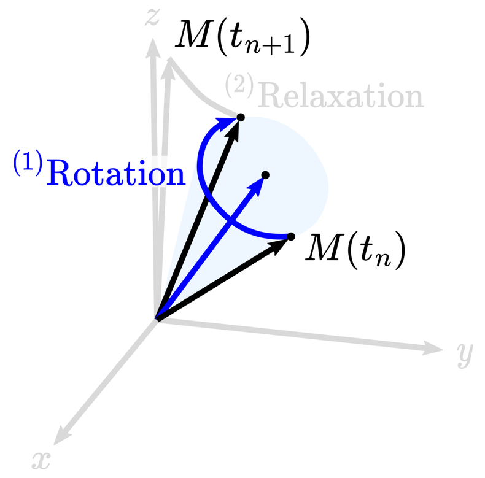{height=470px fig-alt="Rotation of magnetization about the effective field"}
:::

# Precession due to gradients generates rotations around z

::: {.columns .v-center}
::: {.column width="58%"}
```{julia}
#| output: asis
demo_html("gradient-precession", precess_data; mode="precession")
```
:::
::: {.column .field-components width="42%"}
$$\textcolor{#2a7fb8}{\boldsymbol{B}}=\begin{bmatrix}0\\0\\\Delta B_0(\boldsymbol{x})+\textcolor{#238b59}{\boldsymbol{G}(t)}\cdot\boldsymbol{x}\end{bmatrix}$$
:::
:::

# Coming back to the Bloch equations {#bloch-equations-govern-mri-signal-generation .bloch-overview}

$$
\frac{\mathrm{d}\boldsymbol{M}}{\mathrm{d}t}
=\textcolor{blue}{\boxed{\textcolor{black}{\gamma\,\boldsymbol{M}\times\boldsymbol{B}}}}
+\textcolor{red}{\boxed{\textcolor{black}{-\frac{M_x\hat{\boldsymbol{x}}+M_y\hat{\boldsymbol{y}}}{T_2}-\frac{(M_z-M_0)\hat{\boldsymbol{z}}}{T_1}}}}
$$

::: {.figure-centered}
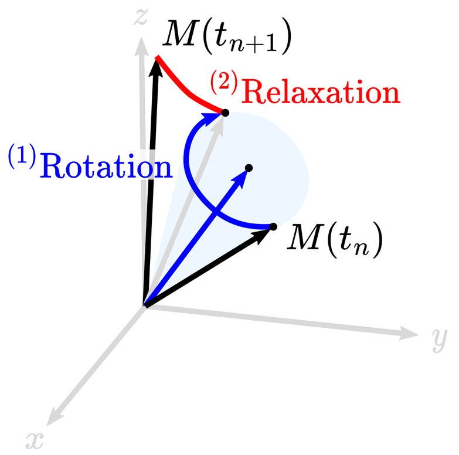{height=330px fig-alt="Rotation and relaxation are the two steps of an operator splitting method"}
:::

::: {.slide-note}
Operator splitting: [Graf et al., *J Magn Reson* (2021)](https://doi.org/10.1016/j.jmr.2021.107011) · Diagram: [Castillo-Passi et al., *Magn Reson Med* (2023), Fig. 2](https://doi.org/10.1002/mrm.29635)
:::

# In this lecture, we explain step two

::: {.columns .v-center}
::: {.column width="57%"}
$$\frac{\mathrm{d}\boldsymbol{M}}{\mathrm{d}t}=-\frac{M_x\hat{\boldsymbol{x}}+M_y\hat{\boldsymbol{y}}}{T_2}-\frac{(M_z-M_0)\hat{\boldsymbol{z}}}{T_1}$$

$\boldsymbol{M}$: Magnetization

$T_1$ and $T_2$: Relaxation parameters
:::
::: {.column .figure-centered width="43%"}
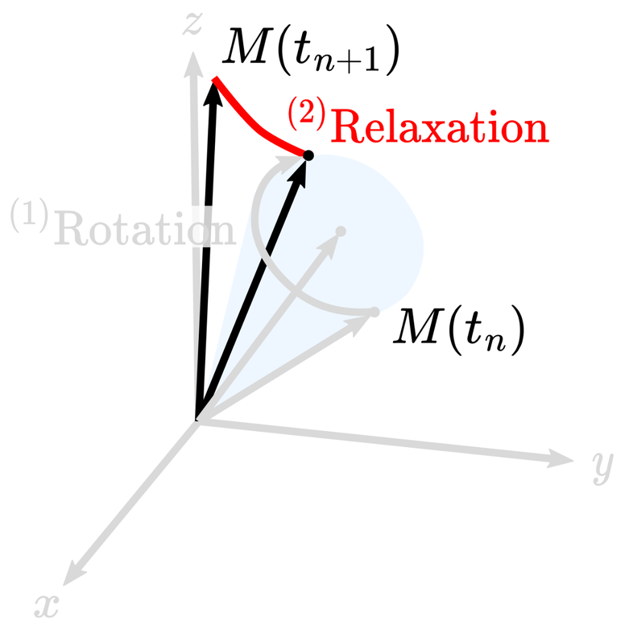{height=440px fig-alt="Relaxation reduces transverse magnetization and restores longitudinal equilibrium"}
:::
:::

# Excitation and relaxation {#if-we-combine-an-rf-pulse}

::: {.columns}
::: {.column width="50%"}
```{julia}
#| output: asis
demo_html("rf-excitation", time_window(relax_data, -2.5, 2.5; reset=true); mode="rotation")
```
:::
::: {.column width="50%"}
```{julia}
#| output: asis
demo_html("rf-and-relaxation", time_window(relax_data, 2.5, Inf; reset=true); mode="rotation")
```
:::
:::

# Relaxation sub-problem is easier

::: {.columns .v-center .relaxation-layout}
::: {.column width="62%"}
$$\begin{aligned}E_1&=e^{-\Delta t/T_1}\\E_2&=e^{-\Delta t/T_2}\end{aligned}$$

$$
\boldsymbol{M}_{n+1}=\begin{bmatrix}E_2&0&0\\0&E_2&0\\0&0&E_1\end{bmatrix}\boldsymbol{M}_n+
\begin{bmatrix}0\\0\\M_0(1-E_1)\end{bmatrix}
$$
:::
::: {.column .figure-centered width="38%"}
{height=340px fig-alt="Relaxation acts independently on transverse and longitudinal components"}

::: {.radio-group}
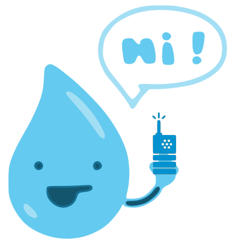{height=140px fig-alt="A water-drop spin sends a radio signal"}

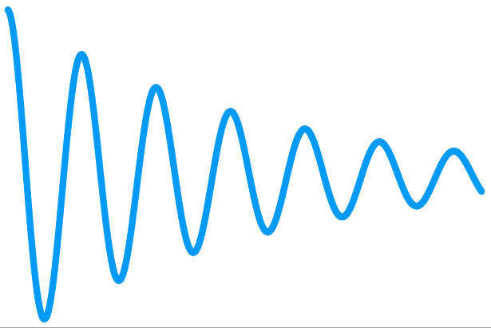{height=100px fig-alt="The emitted radio signal decays with time"}
:::
:::
:::

# A sequence with all effects! (FID)

::: {.columns}
::: {.column width="50%"}
```{julia}
#| output: asis
demo_html("fid-excitation", time_window(fid_data, -2.5, 2.5; reset=true); mode="rotation")
```
:::
::: {.column width="50%"}
```{julia}
#| output: asis
demo_html("free-induction-decay", time_window(fid_data, 2.5, Inf; reset=true); mode="rotation")
```
:::
:::

::: {.slide-note}
[Hahn, Nuclear Induction Due to Free Larmor Precession, *Phys Rev* (1950; received 1949)](https://doi.org/10.1103/PhysRev.77.297.2)
:::

# T1 and T2 recovery

$$M_{xy}(t)=M_0e^{-t/T_2},\qquad M_z(t)=M_0(1-e^{-t/T_1})$$

```{=html}
<div class="relaxation-curves r-stretch" aria-label="Transverse decay and longitudinal recovery with independent T1 and T2 sliders"></div>
```

# Erwin Hahn and the spin echo (1950)

::: {.columns .v-center}
::: {.column .source-bullets width="58%"}
- Foundation of modern MRI
- $90_x-\tau-180_y-\tau$ produces an echo
- Described it as an “irritating glitch.” He investigated it and realized it was a real physical phenomenon
:::
::: {.column .figure-centered width="42%"}
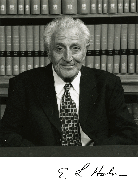{height=440px fig-alt="Erwin Hahn"}
:::
:::

::: {.slide-note}
[Hahn, Spin Echoes, *Phys Rev* (1950)](https://doi.org/10.1103/PhysRev.80.580)
:::

# {#hahn-and-bloch}

::: {.columns .v-center}
::: {.column width="53%"}
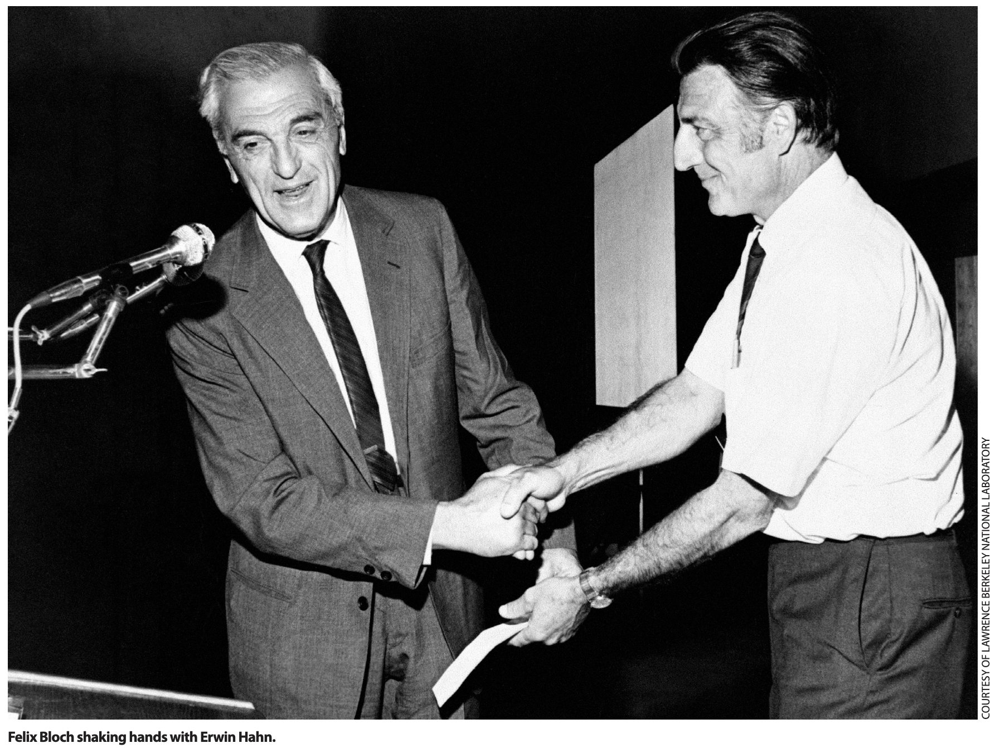{width=100% fig-alt="Felix Bloch shaking hands with Erwin Hahn; photograph courtesy of Lawrence Berkeley National Laboratory"}
:::
::: {.column width="47%"}
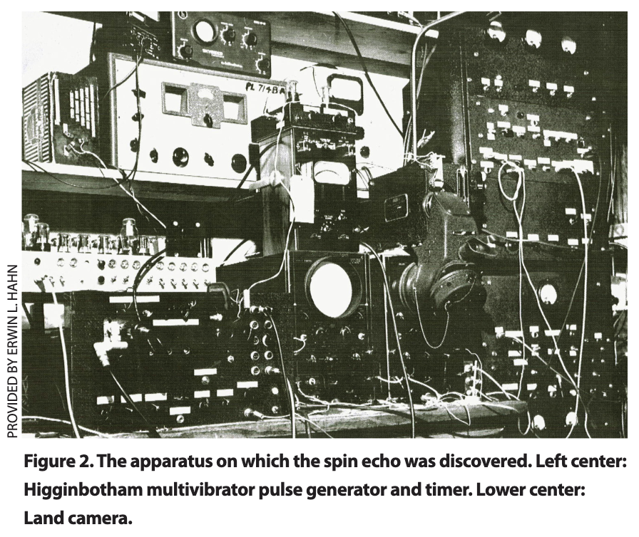{width=100% fig-alt="The apparatus on which the spin echo was discovered, provided by Erwin L. Hahn"}
:::
:::

# Why could spins precess at different speeds? {.hidden-title}

::: {.race-layout}
::: {.race-question .fragment}
Why could spins precess at different speeds?
:::

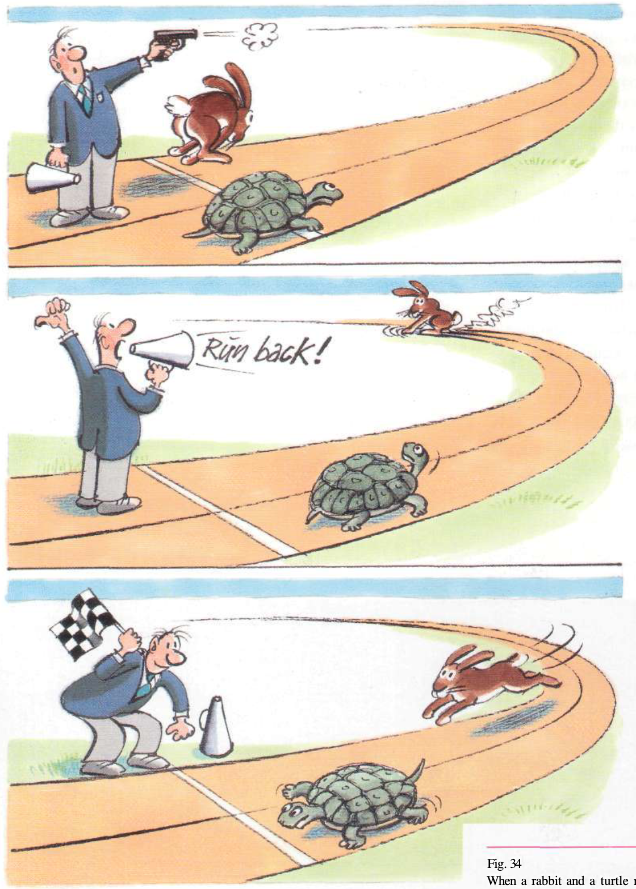{height=610px fig-alt="A rabbit and turtle travel at different speeds, turn around, and return together"}

::: {.slide-note}
Illustration: *MRI Made Easy*, Fig. 34
:::
:::

# The spin echo (SE)

```{julia}
#| output: asis
demo_html("spin-echo", se_data; mode="echo-magnetization")
```

::: {.slide-note}
[Hahn, Spin Echoes, *Phys Rev* (1950)](https://doi.org/10.1103/PhysRev.80.580)
:::

# The spin-echo signal

```{julia}
#| output: asis
demo_html("spin-echo-signal", se_data; mode="echo-signal")
```

# Where is $T_2^*$?

$$
\frac{\mathrm{d}\boldsymbol{M}}{\mathrm{d}t}=
\gamma\boldsymbol{M}\times\textcolor{#2a7fb8}{\boldsymbol{B}}
-\frac{M_x\hat{\boldsymbol{x}}+M_y\hat{\boldsymbol{y}}}{T_2}
-\frac{(M_z-M_0)\hat{\boldsymbol{z}}}{T_1}
$$

# Signal produced by a distribution of isochromats

::: {.columns .v-center}
::: {.column width="24%"}
What is the signal generated by this spin ensemble?
:::
::: {.column width="76%"}

```{=html}
<div class="isochromat-distribution" style="height:330px" aria-label="A distribution of colored isochromats with different transverse phases"></div>
```

::: {.fragment .figure-centered}
$$S=\int_{-\infty}^{\infty}p(\omega)e^{-i\omega t}\,\mathrm{d}\omega$$

Looks familiar?
:::
:::
:::

# Fourier transform of an exponential decay

$$\frac{1}{T_2^*}=\underbrace{\frac{1}{T_2}}_{\text{Irreversible}}+\underbrace{\frac{1}{T_2'}}_{\text{Reversible}}$$

$$e^{-|t|/T_2'}\quad\longrightarrow\quad p(\omega)=\frac{T_2'}{\pi\left[1+(T_2'\omega)^2\right]}$$

::: {.figure-centered .slide-note}
Lorentzian or Cauchy distribution
:::

```{=html}
<div class="lorentzian-pair" style="height:260px" aria-label="Exponential decay and its Lorentzian frequency distribution"></div>
```

# Inverse cumulative distribution

We can obtain random numbers distributed according to any distribution $p(\omega)$ by calculating the cumulative distribution

::: {.columns .v-center}
::: {.column width="58%"}
$$P(\omega)=\int_{-\infty}^{\omega}p(\omega)\,\mathrm{d}\omega$$

::: {.fragment}
$$\omega=\frac{1}{T_2'}\tan\!\left[\pi\left(u-\frac12\right)\right],\quad u\sim U(0,1)$$
:::
:::
::: {.column .figure-centered width="42%"}
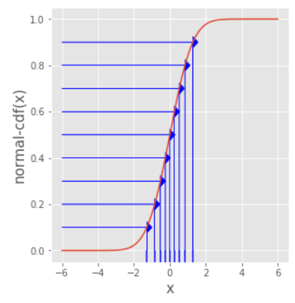{height=365px fig-alt="Map a uniform random sample through the inverse cumulative distribution"}
:::
:::

::: {.slide-note}
[Inverse CDF method](https://anhqle.github.io/explain-the-inverse-cdf-method/)
:::

# The gradient echo (GE)

```{julia}
#| output: asis
demo_html("gradient-echo", ge_data; mode="echo-magnetization")
```

# The gradient-echo signal

```{julia}
#| output: asis
demo_html("gradient-echo-signal", ge_data; mode="echo-signal")
```

# Comparing SE with GE

```{julia}
#| output: asis
demo_html("echo-comparison", Dict("se"=>se_comparison_data,"ge"=>ge_comparison_data); mode="comparison")
```

# Comparing SE and GE signals

```{julia}
#| output: asis
demo_html("echo-signal-comparison", Dict("se"=>se_comparison_data,"ge"=>ge_comparison_data); mode="comparison-signal")
```

::: {.notes}
Both experiments use the same off-resonance distribution, T1, T2, and TE of 30 ms. The preceding magnetization comparison has a shared time slider; this slide shows the complete signals. The spin echo refocuses static off-resonance, while the gradient echo refocuses the imposed gradient only.
:::

# Brownian motion (1827)

Robert Brown was the first to describe the jitter of pollen particles immersed in water

::: {.figure-centered}
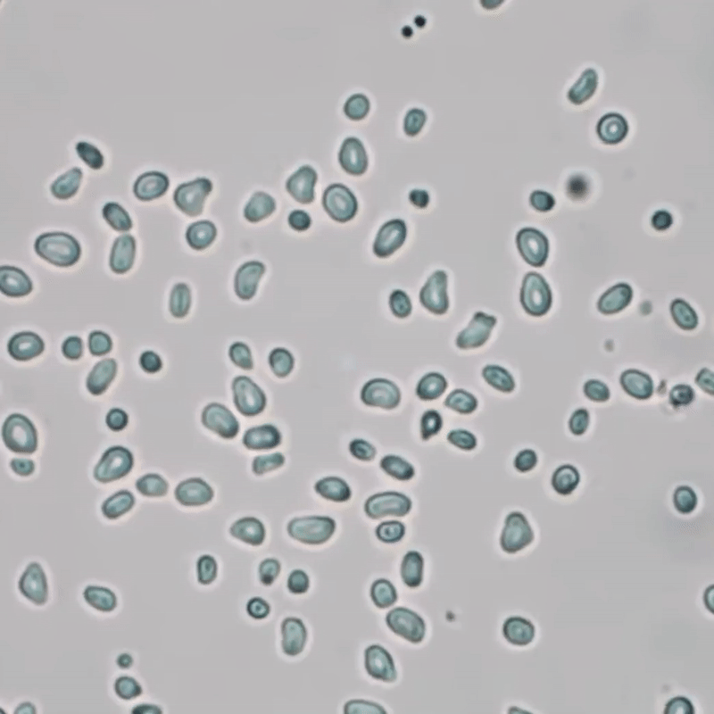{height=390px fig-alt="Brownian motion of particles in water"}

::: {.slide-note}
[Watch the microscope video](https://youtu.be/jLQ66ytMa9I)
:::
:::

# It was later discovered that this jitter is related to the <u>motion</u> of water molecules due to <u>temperature</u>

::: {.columns .v-center}
::: {.column .figure-centered width="48%"}
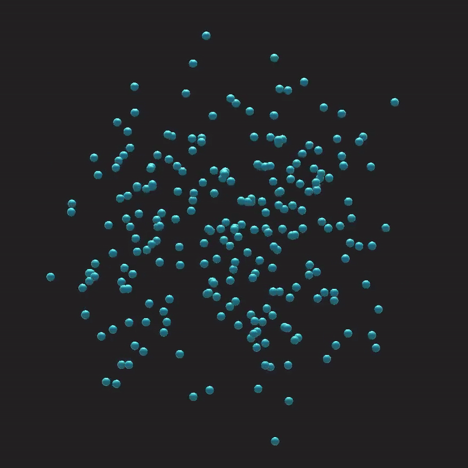{height=340px fig-alt="Random motion of water molecules and the resulting particle motion"}
:::
::: {.column .figure-centered width="52%"}
Einstein (1905)

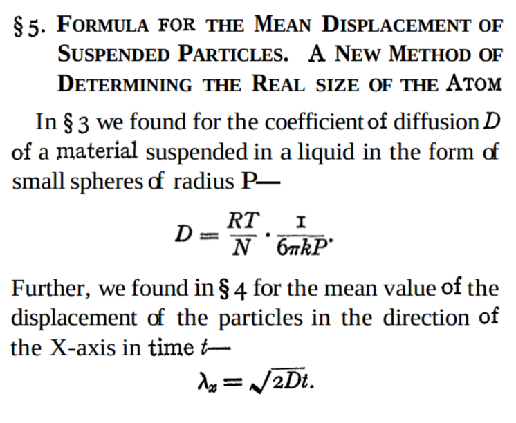{height=310px fig-alt="Einstein's 1905 paper connects thermal motion and diffusion"}
:::
:::

# Motion generates signal dephasing in the PGSE sequence

::: {.columns .v-center}
::: {.column .figure-centered width="68%"}
::: {.columns .v-center}
::: {.column width="25%"}
No motion
:::
::: {.column width="75%"}
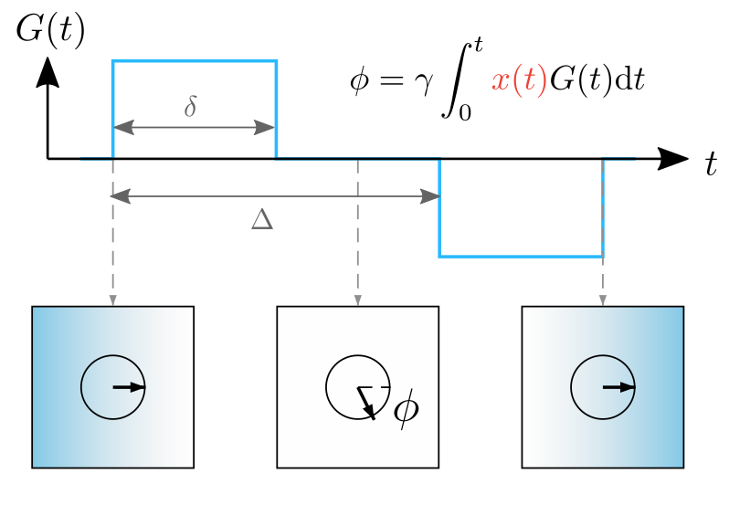{height=300px fig-alt="PGSE gradient waveform and phase evolution of a stationary spin"}
:::
:::

::: {.columns .v-center}
::: {.column width="25%"}
With motion
:::
::: {.column width="75%"}
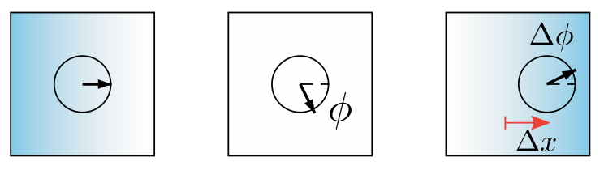{height=115px fig-alt="A moving spin accumulates a residual phase between the gradient lobes"}
:::
:::
:::
::: {.column .figure-centered width="32%"}

Short-gradient-pulse approximation (SGPA)

$$q=\frac{\gamma}{2\pi}\delta G$$

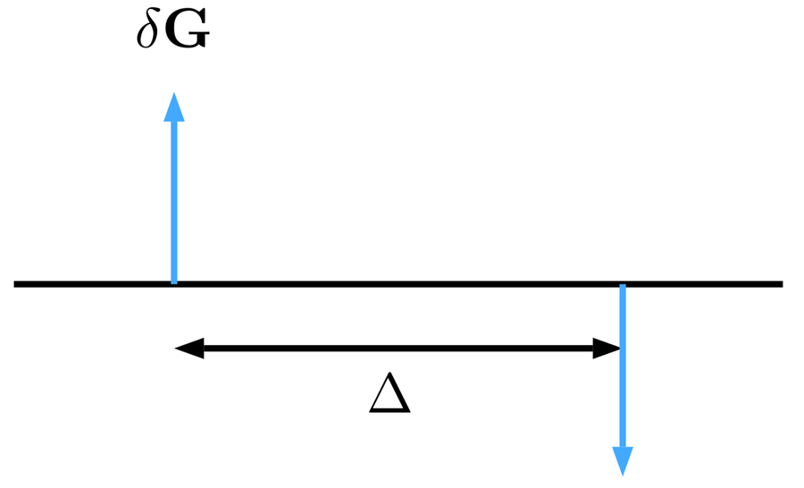{height=140px fig-alt="The short gradient pulse approximation replaces each gradient lobe with an impulse"}

$$e^{-i2\pi qr}$$
:::
:::

::: {.slide-note}
[Stejskal and Tanner, *J Chem Phys* (1965)](https://doi.org/10.1063/1.1695690)
:::

# Diffusion generates signal attenuation

::: {.columns .v-center}
::: {.column .figure-centered width="44%"}
{height=330px fig-alt="Random molecular displacements form a Gaussian propagator"}

$$\sigma_r=\sqrt{2D\Delta}$$
:::
::: {.column .figure-centered width="56%"}
$p(r)$ — Ensemble average propagator (EAP)

```{=html}
<div class="propagator-diagram" style="height:320px" aria-label="Displacements across a Gaussian propagator accumulate different phases, reducing the net signal"></div>
```

Free water has a Gaussian EAP
:::
:::

$$\text{Signal attenuation}\quad\longrightarrow\quad E(q)=\int_{-\infty}^{\infty}p(r)e^{-i2\pi qr}\,\mathrm{d}r$$

# $E(q)$ is the Fourier transform of $p(r)$

$$p(r)=\frac{1}{\sqrt{4\pi D\Delta}}e^{-r^2/(4D\Delta)}\quad\longrightarrow\quad E(q)=e^{-4\pi^2D\Delta q^2}$$

::: {.figure-centered}
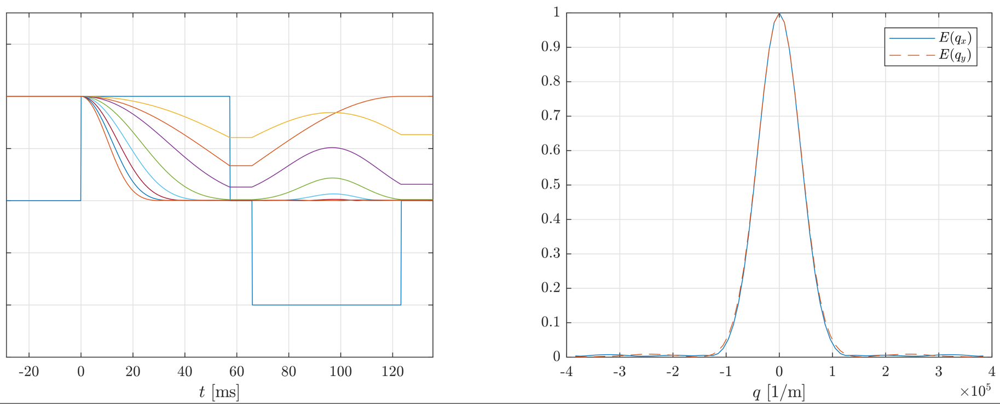{height=365px fig-alt="Signal evolution during diffusion encoding and the resulting Gaussian attenuation versus q"}
:::

::: {.slide-note}
For free water, $p(r)$ and $E(q)$ are Gaussian
:::

# The b-value is a simpler way of thinking about this

::: {.columns .v-center}
::: {.column width="55%"}
$$E(b)=e^{-bD}$$
:::
::: {.column width="45%"}
$D=3.0\times10^{-3}\;\mathrm{mm}^2/\mathrm{s}$ at $37^\circ\mathrm{C}$

$b=1000\;\mathrm{s}/\mathrm{mm}^2$
:::
:::

**Depends on the sequence**: this expression does not use SGPA, but assumes that $p(r)$ is Gaussian

::: {.columns .v-center}
::: {.column width="65%"}
$$b=\gamma^2G^2\delta^2\left(\Delta-\frac{\delta}{3}\right)$$
:::
::: {.column .figure-centered width="35%"}
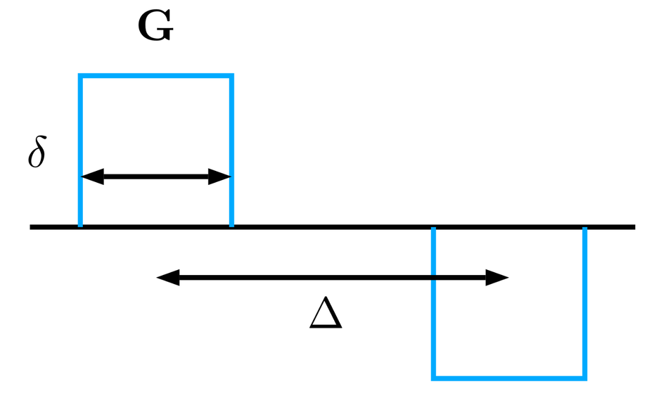{height=190px fig-alt="Rectangular PGSE gradients with duration delta and separation Delta"}
:::
:::

# Scanner laboratory: Test your 2D excitation pattern

::: {.columns .lab-columns}
::: {.column width="38%"}
- Today, 10:30–11:50 a.m. at the Cima.X scanner
- You will need to complete a report (PDF) and submit the exact `.seq` used on the scanner
- Each acquisition takes ~10 seconds
- If you have an updated `.seq`, send it to [Charles McGrath](mailto:cmmcg@stanford.edu)
:::
::: {.column width="62%"}
```{=html}
<iframe class="activity-frame" data-external="1" data-src="../../lab/3/activity3.html" title="Activity 3: Test your 2D excitation pattern"></iframe>
```
:::
:::

```{=html}
<script>
window.addEventListener('load', async () => {
  const Plotly = await window.komaPlotly;
  const C={blue:'#2a7fb8',green:'#238b59',purple:'#9b58cf',yellow:'#c6a400',gray:'#89939c',ink:'#343a40'};
  const config={displayModeBar:false,responsive:true};
  const base={font:{size:21,color:C.ink},paper_bgcolor:'rgba(0,0,0,0)',plot_bgcolor:'rgba(0,0,0,0)',
    margin:{l:65,r:25,t:35,b:75},legend:{orientation:'h',y:1.08,x:.5,xanchor:'center'}};
  const axis={showgrid:true,gridcolor:'#e8ebed',zerolinecolor:'#89939c',automargin:true};
  const animation={mode:'immediate',transition:{duration:0},frame:{duration:0,redraw:true}};
  function slider(steps,prefix,suffix='',active=0,x=.05,len=.9,y=0) {
    return {steps,active,x,len,y,pad:{t:30},ticklen:0,minorticklen:0,
      font:{color:'rgba(0,0,0,0)'},currentvalue:{prefix,suffix,offset:0,font:{size:20,color:C.ink}},
      bordercolor:C.blue,activebgcolor:C.blue,transition:{duration:0}};
  }
  function arrowMesh(v,color,name='',origin=[0,0,0],radius=.012,headRadius=.035,headLength=.09) {
    const p={type:'mesh3d',x:[],y:[],z:[],i:[],j:[],k:[],color,name,hoverinfo:'skip',showlegend:!!name,
      lighting:{ambient:1,diffuse:0,specular:0,fresnel:0}};
    const length=Math.hypot(...v); if(length<1e-9)return p;
    const n=v.map(a=>a/length),tip=origin.map((a,i)=>a+v[i]);
    const u0=Math.abs(n[2])<.9?[-n[1],n[0],0]:[0,-n[2],n[1]],un=Math.hypot(...u0),u=u0.map(a=>a/un);
    const w=[n[1]*u[2]-n[2]*u[1],n[2]*u[0]-n[0]*u[2],n[0]*u[1]-n[1]*u[0]];
    const add=a=>{const k=p.x.length;['x','y','z'].forEach((key,i)=>p[key].push(a[i]));return k;};
    const face=(a,b,c)=>{p.i.push(a);p.j.push(b);p.k.push(c);};
    const ring=(o,r)=>Array.from({length:8},(_,j)=>add(o.map((a,i)=>a+r*(Math.cos(j*Math.PI/4)*u[i]+Math.sin(j*Math.PI/4)*w[i]))));
    const end=tip.map((a,i)=>a-Math.min(headLength,.6*length)*n[i]);
    const a=ring(origin,radius),b=ring(end,radius),c=ring(end,headRadius),d=add(tip);
    for(let j=0;j<8;j++){const k=(j+1)%8;face(a[j],a[k],b[k]);face(a[j],b[k],b[j]);face(c[j],c[k],d);}
    return p;
  }
  function axes(scene='scene') {
    return [
      {type:'scatter3d',mode:'lines',x:[0,1.1,null,0,0,null,0,0],y:[0,0,null,0,1.1,null,0,0],z:[0,0,null,0,0,null,0,1.1],line:{color:C.gray,width:3},scene,showlegend:false,hoverinfo:'skip'},
      {type:'scatter3d',mode:'text',x:[1.2,0,-.08],y:[0,1.2,0],z:[0,0,1.05],text:['x′','y′','z'],textfont:{size:20,color:C.gray},scene,showlegend:false,hoverinfo:'skip'}];
  }
  function scene(domain,data,zoom=1) {
    const states=data.m.flat(),ranges=[0,1,2].map(i=>{
      if(i<2){const extent=Math.max(1.28,...states.map(v=>Math.abs(v[i])+.08));return[-extent,extent];}
      return[Math.min(0,...states.map(v=>v[i]))-.08,Math.max(1.1,...states.map(v=>v[i]))+.08];
    });
    const spans=ranges.map(([lo,hi])=>hi-lo),scale=2.3*zoom/Math.max(...spans);
    return {domain,xaxis:{visible:false,range:ranges[0]},yaxis:{visible:false,range:ranges[1]},zaxis:{visible:false,range:ranges[2]},
      aspectmode:'manual',aspectratio:{x:spans[0]*scale,y:spans[1]*scale,z:spans[2]*scale},
      camera:{eye:{x:1.6,y:-1.1,z:.7},projection:{type:'orthographic'}},
      bgcolor:'rgba(0,0,0,0)',uirevision:'view'};
  }
  const rainbow=['#6e40aa','#714bce','#4775de','#278bc3','#1aa59c','#3dbb65','#8cbd36','#c8ac24','#e9782d','#d94451'];
  function vectors(data,k,sceneName='scene',showLegend=true) {
    const m=data.m[k],out=m.map((v,j)=>({...arrowMesh(v,m.length===1?C.ink:rainbow[j%10]),scene:sceneName,
      ...(m.length>1?{name:'Isochromats',legendgroup:'isochromats',showlegend:showLegend&&j===0}:{})}));
    if(m.length>1)out.push({...arrowMesh([data.net[k][0],data.net[k][1],0],C.ink,'Net M<sub>xy</sub>',undefined,.025,.06,.12),scene:sceneName,
      legendgroup:'net-magnetization',showlegend:showLegend});
    else {out[0].name='M(t)';out[0].showlegend=showLegend;}
    return out;
  }
  function sequenceTraces(d) {
    const traces=d.wave.data.filter(t=>t.visible!=='legendonly' &&
      (t.name==='B₁,x'||t.name==='|B1|_AM'||(t.name==='Gx'&&t.y?.some(v=>Number.isFinite(v)&&Math.abs(v)>1e-9))))
      .map(t=>({...t,name:t.name==='Gx'?'Gx':'B₁',x:t.x.map(v=>v==null?v:v-d.origin_ms),xaxis:'x',yaxis:'y',showlegend:true}));
    const phase=d.wave.data.find(t=>t.name==='∠B1_AM');
    if(phase?.y.some(v=>Number.isFinite(v)&&Math.abs(v)>1e-6))traces.push({...phase,
      x:phase.x.map(v=>v==null?v:v-d.origin_ms),y:phase.y.map(v=>v==null?v:v*180/Math.PI),
      name:'RF phase (°)',visible:true,xaxis:'x',yaxis:'y3',showlegend:true,
      hovertemplate:'%{x:.2f} ms<br>%{y:.1f}°<extra>RF phase</extra>',line:{color:'#df7b22',width:2,dash:'dot'}});
    return traces;
  }
  const graphs=[];
  for(const el of document.querySelectorAll('.bloch-demo')) {
    const d=JSON.parse(el.querySelector('script').textContent),mode=el.dataset.mode;
    if(mode==='comparison'||mode==='comparison-signal'){await comparison(el,d,mode==='comparison-signal');graphs.push(el);continue;}
    if(mode==='rotation'||mode==='precession') {
      const a=axes();
      if(mode==='precession')a.push({type:'scatter3d',mode:'lines',
        x:d.m.map(m=>m[0][0]),y:d.m.map(m=>m[0][1]),z:d.m.map(m=>m[0][2]),
        line:{color:C.gray,width:3,dash:'dash'},showlegend:false,hoverinfo:'skip'});
      const initial=vectors(d,0),moving=initial.map((_,j)=>a.length+j);
      const frames=d.t.map((t,k)=>({name:String(k),traces:moving,data:vectors(d,k)}));
      const layout={...base,margin:{l:0,r:0,t:30,b:mode==='precession'?0:75},
        scene:scene({x:[0,1],y:[0,1]},d),legend:{orientation:'h',x:.5,xanchor:'center',y:1.02,font:{size:18}}};
      if(mode!=='precession')layout.sliders=[slider(d.t.map((t,k)=>({label:t.toFixed(1),method:'animate',args:[[String(k)],animation]})),'Time: ',' ms')];
      await Plotly.newPlot(el,{data:[...a,...initial],layout,frames,config});graphs.push(el);
      if(mode==='precession') {
        let playing=false;
        const visible=()=>el.closest('section')?.classList.contains('present');
        const play=async()=>{
          if(playing||!visible())return;playing=true;
          try {
            while(visible())await Plotly.animate(el,null,{mode:'immediate',transition:{duration:0},frame:{duration:12.5,redraw:true},fromcurrent:false});
          } catch {
            // Leaving the slide interrupts the animation promise.
          } finally {
            playing=false;
            if(visible())requestAnimationFrame(play);
          }
        };
        Reveal.on('slidechanged',()=>{if(visible())play();else Plotly.animate(el,[],{mode:'immediate'});});
        play();
      }
      continue;
    }
    const signalMode=mode==='echo-signal';
    const endTime=d.t[d.t.length-1];
    const data=sequenceTraces(d),hasPhase=data.some(t=>t.yaxis==='y3');
    const waveValues=data.filter(t=>t.yaxis==='y').flatMap(t=>t.y.filter(Number.isFinite));
    const waveMin=Math.min(0,...waveValues),waveMax=Math.max(0,...waveValues),wavePad=.05*(waveMax-waveMin);
    const waveRange=[waveMin-wavePad,waveMax+wavePad],phaseScale=100/waveMax;
    const layout={...base,margin:{l:55,r:30,t:45,b:120},
      xaxis:{...axis,domain:[0,signalMode?.43:.34],anchor:'y',title:{text:'Time (ms)',standoff:5},range:[-d.origin_ms,endTime]},
      yaxis:{...d.wave.layout.yaxis,domain:[0,1],anchor:'x',automargin:true,autorange:false,range:waveRange},
      yaxis3:{overlaying:'y',anchor:'x',side:'right',range:waveRange.map(v=>v*phaseScale),visible:hasPhase,tickvals:[0,90],tickfont:{color:'#df7b22',size:16},showgrid:false,zeroline:false},
      legend:{orientation:'h',x:0,y:1.1,font:{size:18}}};
    let moving=[];
    if(signalMode) {
      data.push({type:'scatter',mode:'lines',x:d.t,y:d.net.map(v=>Math.hypot(v[0],v[1])),xaxis:'x2',yaxis:'y2',name:'S(t)',legend:'legend2',line:{color:C.ink,width:3}});
      layout.xaxis2={...axis,domain:[.53,1],anchor:'y2',title:{text:'Time (ms)',standoff:5},range:[-d.origin_ms,endTime]};
      layout.yaxis2={...axis,domain:[0,1],anchor:'x2',title:{text:'S',standoff:12},range:[0,1.03]};
    } else {
      const a=axes(),start=data.length+a.length;
      data.push(...a,...vectors(d,0).map(t=>({...t,legend:'legend2'})));
      moving=vectors(d,0).map((_,j)=>start+j);
      layout.scene=scene({x:[.4,1],y:[0,1]},d,mode==='echo-magnetization'?1.4:1);
    }
    layout.legend2={orientation:'h',x:.72,y:1.1,font:{size:18}};
    const shapes=k=>[
      {type:'line',xref:'x',yref:'y domain',x0:d.te_ms,x1:d.te_ms,y0:0,y1:1,line:{color:C.gray,width:1.5,dash:'dot'}},
      ...(signalMode?[{type:'line',xref:'x2',yref:'y2 domain',x0:d.te_ms,x1:d.te_ms,y0:0,y1:1,line:{color:C.gray,width:1.5,dash:'dot'}}]:[]),
      {type:'line',xref:'x',yref:'y domain',x0:d.t[k],x1:d.t[k],y0:0,y1:1,line:{color:'#d33',width:2}},
      ...(signalMode?[{type:'line',xref:'x2',yref:'y2 domain',x0:d.t[k],x1:d.t[k],y0:0,y1:1,line:{color:'#d33',width:2}}]:[])];
    const frames=d.t.map((t,k)=>({name:String(k),traces:moving,
      data:signalMode?[]:vectors(d,k).map(t=>({...t,legend:'legend2'})),layout:{shapes:shapes(k)}}));
    layout.shapes=shapes(0);
    layout.annotations=[{text:'TE',xref:'x',yref:'paper',x:d.te_ms,y:1.02,showarrow:false,font:{color:C.gray,size:16}},
      ...(signalMode?[{text:'TE',xref:'x2',yref:'paper',x:d.te_ms,y:1.02,showarrow:false,font:{color:C.gray,size:16}}]:[])];
    layout.sliders=[slider(d.t.map((t,k)=>({label:t.toFixed(1),method:'animate',args:[[String(k)],animation]})),'Time: ',' ms')];
    layout.sliders[0].pad.t=75;
    await Plotly.newPlot(el,{data,layout,frames,config});graphs.push(el);
  }
  async function comparison(el,d,signalMode=false) {
    const se=d.se,ge=d.ge,end=Math.min(se.t.at(-1),ge.t.at(-1)),ts=Array.from({length:Math.round(end)+1},(_,i)=>i);
    const nearest=(ds,t)=>ds.t.reduce((best,x,i)=>Math.abs(x-t)<Math.abs(ds.t[best]-t)?i:best,0);
    const ks=ts.map(t=>nearest(se,t)),kg=ts.map(t=>nearest(ge,t));
    let data,frames=[];
    const layout={...base,margin:{l:signalMode?65:0,r:20,t:40,b:signalMode?65:120},
      legend:{orientation:'h',x:.5,xanchor:'center',y:1.08,font:{size:18}}};
    if(signalMode) {
      data=[{type:'scatter',mode:'lines',x:se.t,y:se.net.map(v=>Math.hypot(v[0],v[1])),name:'SE',line:{color:C.blue,width:3}},
        {type:'scatter',mode:'lines',x:ge.t,y:ge.net.map(v=>Math.hypot(v[0],v[1])),name:'GE',line:{color:'#df7b22',width:3,dash:'dash'}}];
      layout.xaxis={...axis,domain:[0,1],anchor:'y',title:{text:'Time (ms)',standoff:5},range:[0,end]};
      layout.yaxis={...axis,domain:[0,1],anchor:'x',range:[0,1.03],title:{text:'S'}};
      layout.annotations=[{text:'TE',x:se.te_ms,y:1,xref:'x',yref:'paper',yanchor:'bottom',showarrow:false,font:{size:17,color:C.gray}}];
      layout.shapes=[{type:'line',xref:'x',yref:'y domain',x0:se.te_ms,x1:se.te_ms,y0:0,y1:1,line:{color:C.gray,width:1.5,dash:'dot'}}];
    } else {
      const a=axes(),b=axes('scene2'),va=vectors(se,ks[0]),vb=vectors(ge,kg[0],'scene2',false);
      data=[...a,...va,...b,...vb];
      const ia=a.length,ib=a.length+va.length+b.length;
      const moving=[...va.map((_,i)=>ia+i),...vb.map((_,i)=>ib+i)];
      frames=ts.map((t,k)=>({name:String(k),traces:moving,data:[...vectors(se,ks[k]),...vectors(ge,kg[k],'scene2',false)]}));
      const view={m:[...se.m,...ge.m]};
      layout.scene=scene({x:[0,.48],y:[0,1]},view);
      layout.scene2=scene({x:[.52,1],y:[0,1]},view);
      layout.annotations=[{text:'Spin echo',x:.24,y:1.08,xref:'paper',yref:'paper',showarrow:false},{text:'Gradient echo',x:.77,y:1.08,xref:'paper',yref:'paper',showarrow:false}];
      layout.legend.y=1.02;
      layout.sliders=[slider(ts.map((t,k)=>({label:String(t),method:'animate',args:[[String(k)],animation]})),'Time: ',' ms')];
      layout.sliders[0].pad.t=75;
    }
    await Plotly.newPlot(el,{data,layout,frames,config});
  }
  const linspace=(a,b,n)=>Array.from({length:n},(_,i)=>a+(b-a)*i/(n-1));
  for(const el of document.querySelectorAll('.relaxation-curves')) {
    const t=linspace(0,1600,161),values=[50,100,120,150,200,300,450,600,800,1000];
    const traces=[{type:'scatter',mode:'lines',x:t,y:t.map(x=>Math.exp(-x/120)),name:'M<sub>xy</sub>',line:{color:C.purple,width:3}},
      {type:'scatter',mode:'lines',x:t,y:t.map(x=>1-Math.exp(-x/450)),xaxis:'x2',yaxis:'y2',name:'Mz',line:{color:C.blue,width:3}}];
    const steps=(which)=>values.map(v=>({label:String(v),method:'restyle',args:[{y:[t.map(x=>which?1-Math.exp(-x/v):Math.exp(-x/v))]},[which]]}));
    await Plotly.newPlot(el,traces,{...base,margin:{l:65,r:25,t:30,b:110},
      xaxis:{...axis,domain:[0,.44],anchor:'y',title:{text:'Time (ms)'}},yaxis:{...axis,range:[0,1.05],domain:[0,1],anchor:'x',title:{text:'M<sub>xy</sub>'}},
      xaxis2:{...axis,domain:[.56,1],anchor:'y2',title:{text:'Time (ms)'}},yaxis2:{...axis,range:[0,1.05],domain:[0,1],anchor:'x2',title:{text:'M<sub>z</sub>'}},
      sliders:[slider(steps(0),'T₂: ',' ms',2,0,.44,-.25),slider(steps(1),'T₁: ',' ms',6,.56,.44,-.25)]},config);graphs.push(el);
  }
  for(const el of document.querySelectorAll('.isochromat-distribution,.lorentzian-pair,.propagator-diagram')) {
    const phasor=(x,y,angle,color,length=17)=>({x,y,xref:'x',yref:'y',
      xshift:length*Math.cos(angle),yshift:length*Math.sin(angle),
      ax:-length*Math.cos(angle),ay:length*Math.sin(angle),
      text:'',showarrow:true,arrowhead:3,arrowsize:1,arrowwidth:2.5,arrowcolor:color});
    if(el.classList.contains('isochromat-distribution')) {
      const x=[],y=[],annotations=[],counts=[1,2,3,4,3,2,1],colors=['#e53935','#ef8a00','#c3b800','#22ba52','#00b8c8','#4184d7','#4734d8'];
      counts.forEach((count,j)=>{for(let row=0;row<count;row++){
        x.push(j-3);y.push(row+.65);
        annotations.push(phasor(j-3,row+.65,Math.PI/2-(j-3)*Math.PI/4,colors[j]));
      }});
      annotations.push({text:'p(ω)',x:-3.45,y:3.75,showarrow:false,font:{size:26}},
        {text:'ω',x:3.8,y:0,showarrow:false,font:{size:26}});
      await Plotly.newPlot(el,[{type:'scatter',mode:'markers',x,y,
        marker:{symbol:'circle',size:48,color:'#f5f5f5',line:{color:'#777',width:1}},
        hoverinfo:'skip',showlegend:false}],{...base,margin:{l:15,r:25,t:15,b:15},
        xaxis:{visible:false,range:[-3.8,4]},yaxis:{visible:false,range:[-.1,4.2]},
        annotations,shapes:[{type:'line',x0:-3.65,x1:3.65,y0:0,y1:0,line:{color:C.gray,width:2}},
          {type:'line',x0:-3.65,x1:-3.65,y0:0,y1:3.6,line:{color:C.gray,width:2}}]},config);
      graphs.push(el);continue;
    }
    if(el.classList.contains('propagator-diagram')) {
      const x=linspace(-3,3,201),gaussian=x=>.72*Math.exp(-x*x/1.4),px=[-2,-1,0,1,2],py=px.map(x=>gaussian(x)+.22);
      const annotations=px.map((x,j)=>phasor(x,py[j],-Math.PI*x/6,C.ink,16));
      annotations.push({text:'e<sup>−i2πqr</sup>',x:1.65,y:1.03,showarrow:false,font:{size:24}},
        {text:'r',x:2.95,y:-.02,showarrow:false,font:{size:24}});
      annotations.push(...linspace(-Math.PI/2,Math.PI/2,33).map(angle=>phasor(4.2,.43,angle,C.ink,32)),
        {...phasor(4.2,.43,0,'#e00000',20),arrowwidth:3.5});
      await Plotly.newPlot(el,[{type:'scatter',mode:'lines',x,y:x.map(gaussian),line:{color:'#6788b5',width:10},showlegend:false,hoverinfo:'skip'},
        {type:'scatter',mode:'markers',x:px,y:py,marker:{symbol:'circle',size:53,color:'white',line:{color:C.ink,width:2}},showlegend:false,hoverinfo:'skip'},
        {type:'scatter',mode:'markers',x:[4.2],y:[.43],marker:{symbol:'circle',size:74,color:'white',line:{color:C.ink,width:2}},showlegend:false,hoverinfo:'skip'}],
        {...base,margin:{l:5,r:10,t:5,b:10},xaxis:{visible:false,range:[-3.1,5.2]},yaxis:{visible:false,range:[-.05,1.2]},annotations,
          shapes:[{type:'line',x0:-3,x1:2.9,y0:0,y1:0,line:{color:C.gray,width:1}}]},config);
      graphs.push(el);continue;
    }
    const w=linspace(-150,150,301),T=.05,t=linspace(0,.18,301);
    const data=[{type:'scatter',mode:'lines',x:t,y:t.map(x=>Math.exp(-x/T)),line:{color:C.blue,width:3},showlegend:false},
      {type:'scatter',mode:'lines',x:w,y:w.map(x=>T/(Math.PI*(1+(T*x)**2))),xaxis:'x2',yaxis:'y2',line:{color:C.green,width:3},showlegend:false}];
    const layout={...base,margin:{l:65,r:25,t:15,b:60},xaxis:{...axis,title:{text:'Time (s)'},domain:[0,.44],range:[0,.18]},
      yaxis:{...axis,title:{text:'e<sup>−t/T₂′</sup>'}},xaxis2:{...axis,title:{text:'ω (rad/s)'},domain:[.57,1],anchor:'y2'},yaxis2:{...axis,title:{text:'p(ω)'},anchor:'x2'}};
    await Plotly.newPlot(el,data,layout,config);graphs.push(el);
  }
  // Reveal scales the slide canvas. Resize only when a plot becomes visible,
  // preserving each plot's native slider state and the chosen 3D camera.
  function resizeCurrent(){requestAnimationFrame(()=>{
    const current=window.Reveal?.getCurrentSlide();
    graphs.filter(g=>current?.contains(g)).forEach(g=>{
      if(g.classList.contains('bloch-demo')){
        const slide=current.getBoundingClientRect(),scale=slide.height/current.clientHeight;
        const top=(g.getBoundingClientRect().top-slide.top)/scale;
        g.style.height=Math.min(g.closest('.column')?580:565,current.clientHeight-top-70)+'px';
      }
      Plotly.relayout(g,{autosize:false,width:g.clientWidth,height:g.clientHeight});
    });
  });}
  if(window.Reveal){Reveal.on('slidechanged',resizeCurrent);Reveal.on('ready',resizeCurrent);}
  window.addEventListener('resize',resizeCurrent);
  resizeCurrent();
});

</script>
```
