```{julia}
#| output: false
include("../common.jl")

scanner = Scanner(limits=HardwareLimits(RF_dead_time=0.0, RF_ring_down_time=0.0, ADC_dead_time=0.0))
const TE = 90e-3
const rf_duration = 1e-3
const demo_T1, demo_T2 = 0.45, 0.12

rf_block(angle; phase=0.0, duration=rf_duration) =
    PulseDesigner.build_block_pulse(angle; duration, phase_offset=phase, sys=scanner)

function acquire_for(duration)
    seq = Sequence(scanner)
    addblock!(seq, ADC(ceil(Int, duration / 1e-3) + 1, duration))
    seq
end

function gradient_block(amplitude, duration)
    seq = Sequence(scanner)
    addblock!(seq, ADC(ceil(Int, duration / 1e-3) + 1, duration); x=Grad(amplitude, duration))
    seq
end

# Save actual KomaMRI states at the simulation block boundaries. The browser
# only displays these states; it does not run a separate Bloch implementation.
function record_experiment(seq, obj; start=0.0, origin=rf_duration / 2, te=TE, dt_rf=10e-6)
    n = length(obj.x)
    shown = unique(round.(Int, range(1, n; length=min(n, 61))))
    rec = record_states(obj, seq, scanner; Δt=1e-3, Δt_rf=dt_rf, shown, record_net=true)
    keep = findall(>=(start), rec.times)
    wave = clean_seq_plot(seq)
    Dict{String,Any}(
        "t" => 1e3 .* (rec.times[keep] .- origin),
        "m" => rows.(rec.states[keep]),
        "net" => rec.net[keep],
        "wave" => wave, "origin_ms" => 1e3 * origin, "te_ms" => 1e3 * te,
    )
end

function time_window(data, first, last; reset=false)
    out = copy(data)
    keep = findall(t -> first <= t <= last, data["t"])
    for key in ("t", "m", "net")
        out[key] = data[key][keep]
    end
    reset && (out["t"] = out["t"] .- out["t"][1])
    out
end

_num(v) = v isa Number && isfinite(v)

function rf_intervals(d)
    rf = only(filter(t -> get(t, :name, "") == "B₁", d["wave"].data))
    origin = d["origin_ms"]
    intervals, start_t = Tuple{Float64,Float64}[], nothing
    for i in eachindex(rf.x)
        x, y = rf.x[i], rf.y[i]
        if _num(x) && _num(y) && abs(y) > 1e-9
            isnothing(start_t) && (start_t = x - origin)
        elseif !isnothing(start_t)
            push!(intervals, (start_t, rf.x[i-1] - origin))
            start_t = nothing
        end
    end
    intervals
end

function after_excitation(d)
    t_end = rf_intervals(d)[1][2]
    merge(d, Dict("t" => d["t"] .- t_end, "origin_ms" => d["origin_ms"] + t_end, "te_ms" => d["te_ms"] - t_end))
end

rf_shade_shapes(d; xref="x", yref="y domain") = [
    attr(type="rect", xref=xref, yref=yref, x0=a, x1=b, y0=0, y1=1,
        fillcolor="rgba(155,88,207,0.15)", line=attr(width=0), layer="below")
    for (a, b) in rf_intervals(d)
]

function echo_signal_plot(raw_d)
    d = after_excitation(raw_d)
    origin, te_ms, t_end = d["origin_ms"], d["te_ms"], last(d["t"])
    traces = GenericTrace[]
    wave_vals = Float64[0.0]
    for tr in d["wave"].data
        nm = get(tr, :name, "")
        get(tr, :visible, true) == "legendonly" && continue
        if nm == "B₁" || (nm == "Gx" && any(v -> _num(v) && abs(v) > 1e-9, tr.y))
            col = nm == "B₁" ? "#ab63fa" : "#636efa"
            push!(traces, scatter(x=[_num(v) ? v - origin : nothing for v in tr.x], y=[_num(v) ? v : nothing for v in tr.y],
                name=nm, xaxis="x", yaxis="y", showlegend=true,
                line=attr(color=col, width=2), marker=attr(color=col)))
            append!(wave_vals, Float64[v for v in tr.y if _num(v)])
        end
    end
    has_phase = false
    for tr in d["wave"].data
        if get(tr, :name, "") == "∠B1_AM" && any(v -> _num(v) && abs(v) > 1e-6, tr.y)
            has_phase = true
            push!(traces, scatter(x=[_num(v) ? v - origin : nothing for v in tr.x],
                y=[_num(v) ? v * 180 / π : nothing for v in tr.y],
                name="RF phase (°)", xaxis="x", yaxis="y3", showlegend=true,
                hovertemplate="%{x:.2f} ms<br>%{y:.1f}°<extra>RF phase</extra>",
                line=attr(color="#df7b22", width=2, dash="dot")))
        end
    end
    wmin, wmax = minimum(wave_vals), maximum(wave_vals)
    wpad = 0.05 * (wmax - wmin)
    wrange = [wmin < 0 ? wmin - wpad : 0.0, wmax + wpad]
    sig = [hypot(v[1], v[2]) for v in d["net"]]
    push!(traces, scatter(x=d["t"], y=sig, xaxis="x2", yaxis="y2", name="S(t)", legend="legend2",
        line=attr(color=BIOS_COLORS.ink, width=3)))
    shapes = Any[
        rf_shade_shapes(d; xref="x2", yref="y2 domain")...,
        attr(type="line", xref="x", yref="y domain", x0=te_ms, x1=te_ms, y0=0, y1=1,
            line=attr(color=BIOS_COLORS.gray, width=1.5, dash="dot")),
        attr(type="line", xref="x2", yref="y2 domain", x0=te_ms, x1=te_ms, y0=0, y1=1,
            line=attr(color=BIOS_COLORS.gray, width=1.5, dash="dot")),
    ]
    Plot(traces, bios_layout(; height=540, font_size=21, margin=attr(l=55, r=30, t=45, b=75),
        xaxis=bios_axis(domain=[0, 0.43], anchor="y", title=attr(text="Time (ms)", standoff=5),
            range=[-origin, t_end], linewidth=1.2),
        yaxis=bios_axis(domain=[0, 1], anchor="x", autorange=false, range=wrange, linewidth=1.2),
        yaxis3=attr(overlaying="y", anchor="x", side="right", range=wrange .* (100 / wmax),
            visible=has_phase, tickvals=[0, 90], tickfont=attr(color="#df7b22", size=16),
            showgrid=false, zeroline=false),
        xaxis2=bios_axis(domain=[0.53, 1], anchor="y2", title=attr(text="Time (ms)", standoff=5), range=[-origin, t_end]),
        yaxis2=bios_axis(domain=[0, 1], anchor="x2", title=attr(text="S", standoff=12), range=[0, 1.03]),
        legend=attr(orientation="h", x=0, y=1.1, font=attr(size=18)),
        legend2=attr(orientation="h", x=0.72, y=1.1, font=attr(size=18)),
        shapes,
        annotations=[
            attr(text="TE", xref="x", yref="paper", x=te_ms, y=0.98, xshift=7, xanchor="left", yanchor="top", showarrow=false, font=attr(color=BIOS_COLORS.gray, size=16)),
            attr(text="TE", xref="x2", yref="paper", x=te_ms, y=0.98, xshift=7, xanchor="left", yanchor="top", showarrow=false, font=attr(color=BIOS_COLORS.gray, size=16)),
        ]); config=bios_config())
end

phasor_arrow(x, y, angle, col; len=17, width=2.5) = attr(
    x=x, y=y, xref="x", yref="y",
    xshift=len * cos(angle), yshift=len * sin(angle),
    ax=-len * cos(angle), ay=len * sin(angle),
    text="", showarrow=true, arrowhead=3, arrowsize=1, arrowwidth=width, arrowcolor=col)

single = Phantom(x=[0.0], T1=[demo_T1], T2=[demo_T2])
relax_seq = rf_block(π/2) + acquire_for(0.6)
relax_data = record_experiment(relax_seq, single)
precess_seq = rf_block(π/6) + gradient_block(40e-6, 1 / (γ * 40e-6 * 3e-3))
precess_obj = Phantom(x=[3e-3], T1=[Inf], T2=[Inf])
precess_data = record_experiment(precess_seq, precess_obj; start=rf_duration)

# Sample position and Lorentzian off-resonance independently, rather than
# correlating frequency with position and shifting the gradient echo.
npositions, nfrequencies = 31, 501
positions = repeat(collect(range(-5e-3, 5e-3; length=npositions)); inner=nfrequencies)
lorentzian_width = 50.0
omega = repeat(lorentzian_width .* tan.(π .* (((1:nfrequencies) .- 0.5) ./ nfrequencies .- 0.5)); outer=npositions)
niso = length(positions)
ensemble = Phantom(x=positions, Δw=omega, T1=fill(demo_T1, niso), T2=fill(demo_T2, niso))
fid_seq = rf_block(π/2) + acquire_for(0.24)
fid_obj = Phantom(x=zeros(3), Δw=2π .* [0, 20, -20], T1=fill(40e-3, 3), T2=fill(20e-3, 3))
fid_data = record_experiment(fid_seq, fid_obj)
fid_data["colors"] = ["#6e40aa", "#d62728", "#278bc3"]

# RF centers are at t=0 and TE/2. Both echo experiments have the same TE.
se_seq = rf_block(π/2) + acquire_for(TE/2 - rf_duration) +
    rf_block(π; phase=π/2) + acquire_for(TE/2 - rf_duration/2) + acquire_for(TE/2)
se_ensemble = ensemble[abs.(ensemble.Δw) .<= 2π * 100]
se_data = record_experiment(se_seq, se_ensemble; origin=rf_duration/2)
gradient_amplitude = 0.5e-3
ge_pre = (TE - rf_duration/2) / 2
ge_seq = rf_block(π/2) + gradient_block(-gradient_amplitude, ge_pre) +
    gradient_block(gradient_amplitude, 2ge_pre) + acquire_for(rf_duration/4)
gradient_ensemble = Phantom(x=positions, T1=fill(demo_T1, niso), T2=fill(demo_T2, niso))
ge_data = record_experiment(ge_seq, gradient_ensemble; origin=rf_duration/2)

comparison_TE = 30e-3
comparison_ensemble = ensemble[abs.(ensemble.Δw) .<= 2π * 100]
comparison_lobe = comparison_TE/2 - rf_duration
# Equal gradient areas before and after the 180° pulse cancel at TE.
se_comparison_seq = rf_block(π/2) + gradient_block(-gradient_amplitude, comparison_lobe) +
    rf_block(π; phase=π/2) + acquire_for(rf_duration/2) +
    gradient_block(-gradient_amplitude, comparison_lobe) + gradient_block(-gradient_amplitude, comparison_TE/2)
se_comparison_data = record_experiment(se_comparison_seq, comparison_ensemble; origin=rf_duration/2, te=comparison_TE)
comparison_pre = (comparison_TE - rf_duration/2) / 2
ge_comparison_seq = rf_block(π/2) + gradient_block(-gradient_amplitude, comparison_pre) +
    gradient_block(gradient_amplitude, comparison_pre) +
    gradient_block(gradient_amplitude, comparison_pre) + acquire_for(rf_duration/4)
ge_comparison_data = record_experiment(ge_comparison_seq, comparison_ensemble; origin=rf_duration/2, te=comparison_TE)

demo_html(id, data; mode="ensemble") = Base.HTML(
    "<div id=\"$id\" class=\"bloch-demo\" data-mode=\"$mode\">" *
    "<script type=\"application/json\">" * PlotlyBase.JSON.json(data) * "</script></div>"
)
```

# <u>Left-handed</u> rotations around the <u>effective field</u>

<!-- Source: https://docs.google.com/presentation/d/1y_uOaK7ivvCFblEzcTOkpSaHLmcVK-_S6K3n8017prc/edit
Author outline (not presented): T1/T2; off-resonance; Hahn/spin echo; T2*; GE; diffusion; scanner lab. -->

::: {.figure-centered}
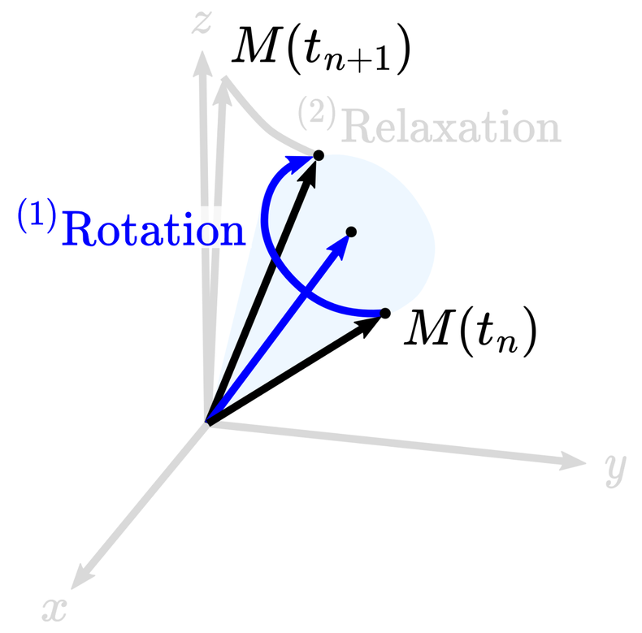{height=470px fig-alt="Rotation of magnetization about the effective field"}
:::

# Precession due to gradients generates rotations around z

::: {.columns .v-center}
::: {.column width="58%"}
```{julia}
demo_html("gradient-precession", precess_data; mode="precession")
```
:::
::: {.column .field-components width="42%"}
$$\textcolor{#2a7fb8}{\boldsymbol{B}}=\begin{bmatrix}0\\0\\\Delta B_0(\boldsymbol{x})+\textcolor{#238b59}{\boldsymbol{G}(t)}\cdot\boldsymbol{x}\end{bmatrix}$$
:::
:::

# Coming back to the Bloch equations {#bloch-equations-govern-mri-signal-generation .bloch-overview}

$$
\frac{\mathrm{d}\boldsymbol{M}}{\mathrm{d}t}
=\textcolor{blue}{\boxed{\textcolor{black}{\gamma\,\boldsymbol{M}\times\boldsymbol{B}}}}
+\textcolor{red}{\boxed{\textcolor{black}{-\frac{M_x\hat{\boldsymbol{x}}+M_y\hat{\boldsymbol{y}}}{T_2}-\frac{(M_z-M_0)\hat{\boldsymbol{z}}}{T_1}}}}
$$

::: {.figure-centered}
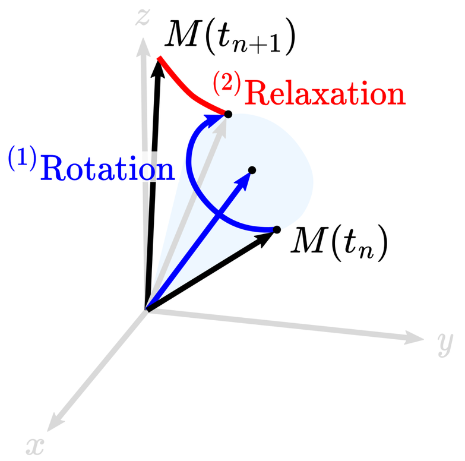{height=330px fig-alt="Rotation and relaxation are the two steps of an operator splitting method"}
:::

::: {.slide-note}
Operator splitting: [Graf et al., *J Magn Reson* (2021)](https://doi.org/10.1016/j.jmr.2021.107011) · Diagram: [Castillo-Passi et al., *Magn Reson Med* (2023), Fig. 2](https://doi.org/10.1002/mrm.29635)
:::

# In this lecture, we explain step two

::: {.columns .v-center}
::: {.column width="57%"}
$$\frac{\mathrm{d}\boldsymbol{M}}{\mathrm{d}t}=-\frac{M_x\hat{\boldsymbol{x}}+M_y\hat{\boldsymbol{y}}}{T_2}-\frac{(M_z-M_0)\hat{\boldsymbol{z}}}{T_1}$$

$\boldsymbol{M}$: Magnetization

$T_1$ and $T_2$: Relaxation parameters
:::
::: {.column .figure-centered width="43%"}
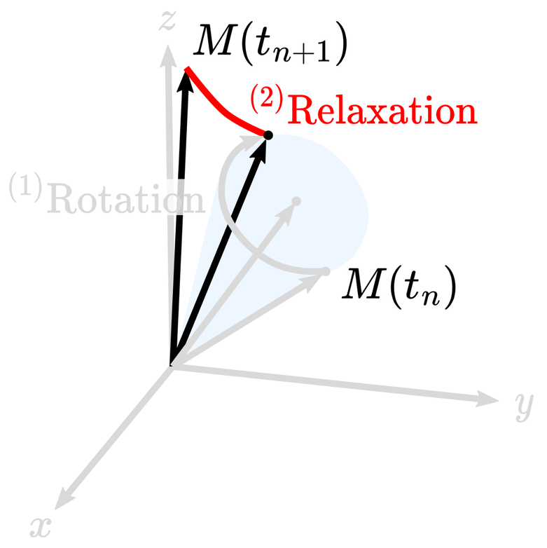{height=440px fig-alt="Relaxation reduces transverse magnetization and restores longitudinal equilibrium"}
:::
:::

# Excitation and relaxation {#if-we-combine-an-rf-pulse}

::: {.columns}
::: {.column width="50%"}
```{julia}
demo_html("rf-excitation", time_window(relax_data, -rf_duration*500, rf_duration*500; reset=true); mode="rotation")
```
:::
::: {.column width="50%"}
```{julia}
demo_html("rf-and-relaxation", time_window(relax_data, rf_duration*500, Inf; reset=true); mode="rotation")
```
:::
:::

# Relaxation sub-problem is easier

::: {.columns .v-center .relaxation-layout}
::: {.column width="62%"}
$$\begin{aligned}E_1&=e^{-\Delta t/T_1}\\E_2&=e^{-\Delta t/T_2}\end{aligned}$$

$$
\boldsymbol{M}_{n+1}=\begin{bmatrix}E_2&0&0\\0&E_2&0\\0&0&E_1\end{bmatrix}\boldsymbol{M}_n+
\begin{bmatrix}0\\0\\M_0(1-E_1)\end{bmatrix}
$$
:::
::: {.column .figure-centered width="38%"}
{height=340px fig-alt="Relaxation acts independently on transverse and longitudinal components"}

::: {.radio-group}
{height=140px fig-alt="A water-drop spin sends a radio signal"}

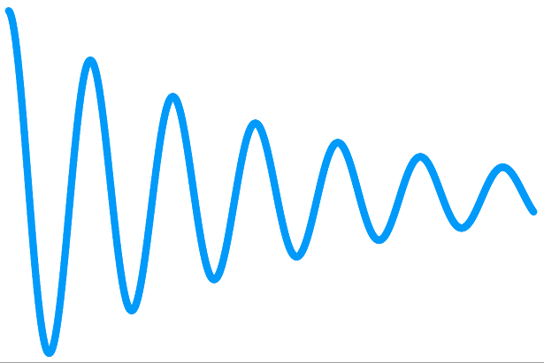{height=100px fig-alt="The emitted radio signal decays with time"}
:::
:::
:::

# A sequence with all effects! (FID)

::: {.columns}
::: {.column width="50%"}
```{julia}
demo_html("fid-excitation", time_window(fid_data, -rf_duration*500, rf_duration*500; reset=true); mode="rotation")
```
:::
::: {.column width="50%"}
```{julia}
demo_html("free-induction-decay", time_window(fid_data, rf_duration*500, rf_duration*500 + 60; reset=true); mode="rotation")
```
:::
:::

::: {.slide-note}
[Hahn, Nuclear Induction Due to Free Larmor Precession, *Phys Rev* (1950; received 1949)](https://doi.org/10.1103/PhysRev.77.297.2)
:::

# T~1~ and T~2~ recovery {#t1-and-t2-recovery}

$$M_{xy}(t)=M_0e^{-t/T_2},\qquad M_z(t)=M_0(1-e^{-t/T_1})$$

```{julia}
t_rel = collect(range(0.0, 1600.0; length=161))
rel_vals = [50, 100, 120, 150, 200, 300, 450, 600, 800, 1000]
rel_steps(which) = [attr(label=string(v), method="restyle",
    args=[attr(y=[which == 1 ? (1 .- exp.(-t_rel ./ v)) : exp.(-t_rel ./ v)]), [which]]) for v in rel_vals]
Plot([
    scatter(x=t_rel, y=exp.(-t_rel ./ 120), name="M<sub>xy</sub>", line=attr(color=BIOS_COLORS.purple, width=3)),
    scatter(x=t_rel, y=1 .- exp.(-t_rel ./ 450), xaxis="x2", yaxis="y2", name="M<sub>z</sub>", line=attr(color=BIOS_COLORS.blue, width=3)),
], bios_layout(; height=410, font_size=21, margin=attr(l=65, r=25, t=65, b=110),
    legend=attr(orientation="h", x=0.5, xanchor="center", y=1.08, yanchor="bottom"),
    xaxis=bios_axis(domain=[0, 0.44], anchor="y", title=attr(text="Time (ms)")),
    yaxis=bios_axis(range=[0, 1.05], domain=[0, 1], anchor="x", title=attr(text="M<sub>xy</sub>")),
    xaxis2=bios_axis(domain=[0.56, 1], anchor="y2", title=attr(text="Time (ms)")),
    yaxis2=bios_axis(range=[0, 1.05], domain=[0, 1], anchor="x2", title=attr(text="M<sub>z</sub>")),
    sliders=[
        bios_slider(rel_steps(0), "T₂: "; suffix=" ms", active=2, x=0.0, len=0.44, y=-0.25, pad_t=30),
        bios_slider(rel_steps(1), "T₁: "; suffix=" ms", active=6, x=0.56, len=0.44, y=-0.25, pad_t=30),
    ]); config=bios_config())
```

# Erwin Hahn and the spin echo (1950)

::: {.columns .v-center}
::: {.column .source-bullets width="58%"}
- Foundation of modern MRI
- $90_x-\tau-180_y-\tau$ produces an echo
- Described it as an “irritating glitch.” He investigated it and realized it was a real physical phenomenon
:::
::: {.column .figure-centered width="42%"}
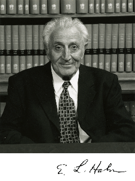{height=440px fig-alt="Erwin Hahn"}
:::
:::

::: {.slide-note}
[Hahn, Spin Echoes, *Phys Rev* (1950)](https://doi.org/10.1103/PhysRev.80.580)
:::

# {#hahn-and-bloch}

::: {.columns .v-center}
::: {.column width="53%"}
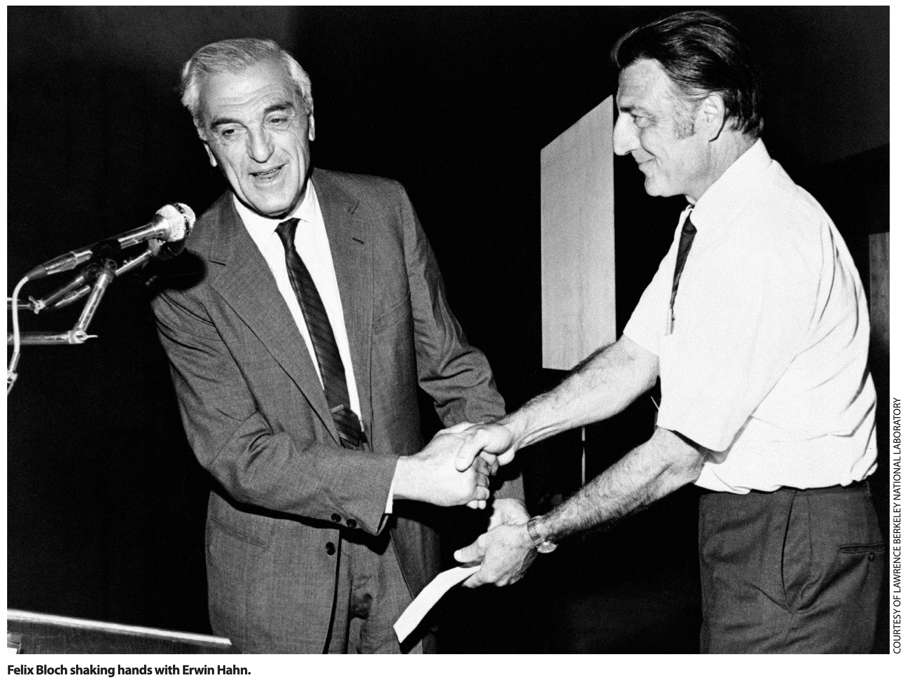{width=100% fig-alt="Felix Bloch shaking hands with Erwin Hahn; photograph courtesy of Lawrence Berkeley National Laboratory"}
:::
::: {.column width="47%"}
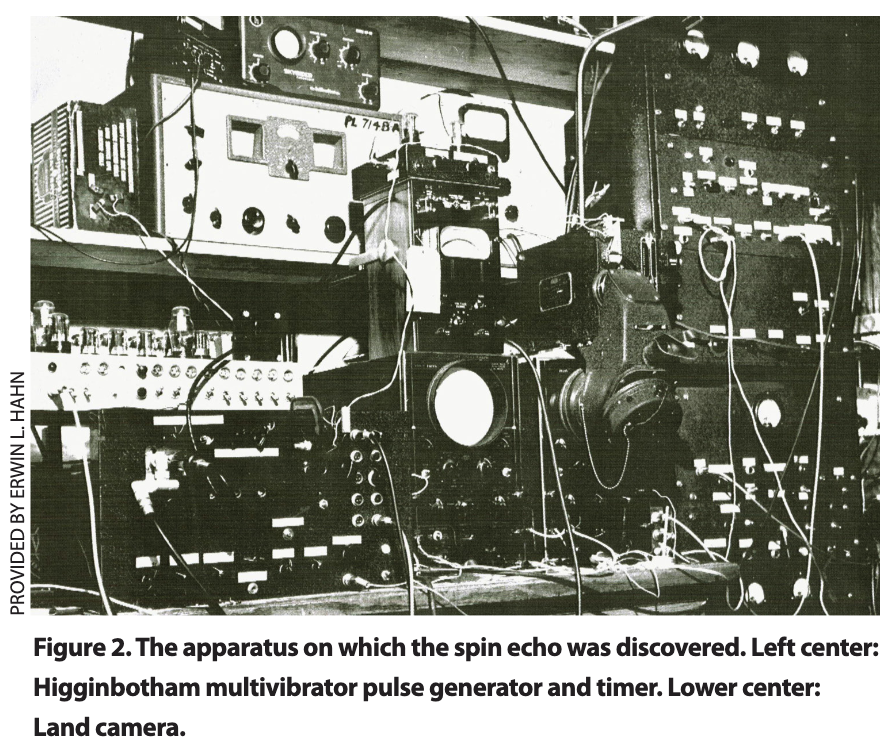{width=100% fig-alt="The apparatus on which the spin echo was discovered, provided by Erwin L. Hahn"}
:::
:::

# Why could spins precess at different speeds? {.hidden-title}

::: {.race-layout}
::: {.race-question .fragment}
Why could spins precess at different speeds?
:::

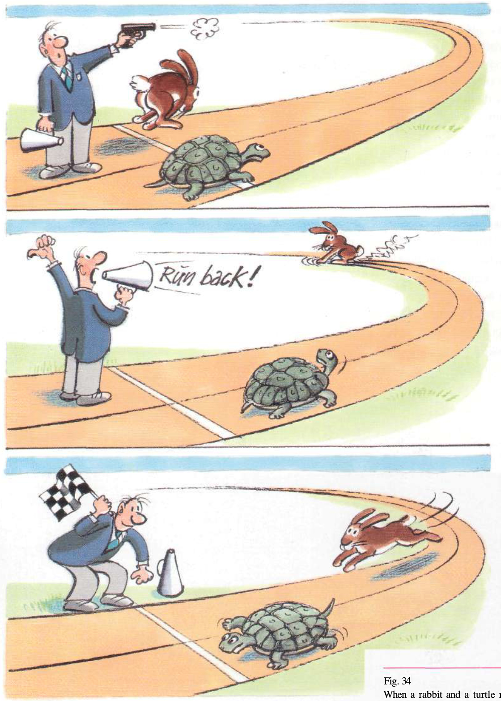{height=610px fig-alt="A rabbit and turtle travel at different speeds, turn around, and return together"}

::: {.slide-note}
Illustration: *MRI Made Easy*, Fig. 34
:::
:::

# The spin echo (SE)

```{julia}
demo_html("spin-echo", se_data; mode="echo-magnetization")
```

::: {.slide-note}
[Hahn, Spin Echoes, *Phys Rev* (1950)](https://doi.org/10.1103/PhysRev.80.580)
:::

# The spin-echo signal

```{julia}
echo_signal_plot(se_data)
```

# Where is $T_2^*$?

::: {.v-center .r-stretch style="justify-content: center;"}
$$
\frac{\mathrm{d}\boldsymbol{M}}{\mathrm{d}t}=
\gamma\boldsymbol{M}\times\textcolor{#2a7fb8}{\boldsymbol{B}}
-\frac{M_x\hat{\boldsymbol{x}}+M_y\hat{\boldsymbol{y}}}{T_2}
-\frac{(M_z-M_0)\hat{\boldsymbol{z}}}{T_1}
$$
:::

# Signal produced by a distribution of isochromats

::: {.columns .v-center}
::: {.column width="24%"}
What is the signal generated by this spin ensemble?
:::
::: {.column width="76%"}

```{julia}
iso_counts = [1, 2, 3, 4, 3, 2, 1]
iso_colors = ["#e53935", "#ef8a00", "#c3b800", "#22ba52", "#00b8c8", "#4184d7", "#4734d8"]
iso_x, iso_y, iso_ann = Float64[], Float64[], Any[]
for (j, cnt) in enumerate(iso_counts), row in 0:cnt-1
    push!(iso_x, j - 4); push!(iso_y, row + 0.65)
    push!(iso_ann, phasor_arrow(j - 4, row + 0.65, π/2 - (j - 4) * π/4, iso_colors[j]))
end
push!(iso_ann,
    attr(text="p(ω)", x=-3.45, y=3.75, showarrow=false, font=attr(size=26)),
    attr(text="ω", x=3.8, y=0, showarrow=false, font=attr(size=26)))
Plot([scatter(mode="markers", x=iso_x, y=iso_y, hoverinfo="skip", showlegend=false,
    marker=attr(symbol="circle", size=48, color="#f5f5f5", line=attr(color="#777", width=1)))],
    bios_layout(; height=330, font_size=21, margin=attr(l=15, r=25, t=15, b=15),
        xaxis=attr(visible=false, range=[-3.8, 4]), yaxis=attr(visible=false, range=[-0.1, 4.2]),
        annotations=iso_ann, shapes=[
            attr(type="line", x0=-3.65, x1=3.65, y0=0, y1=0, line=attr(color=BIOS_COLORS.gray, width=2)),
            attr(type="line", x0=-3.65, x1=-3.65, y0=0, y1=3.6, line=attr(color=BIOS_COLORS.gray, width=2)),
        ]); config=bios_config())
```

::: {.fragment .figure-centered}
$$S=\int_{-\infty}^{\infty}p(\omega)e^{-i\omega t}\,\mathrm{d}\omega$$

Looks familiar?
:::
:::
:::

# Fourier transform of an exponential decay

$$\frac{1}{T_2^*}=\underbrace{\frac{1}{T_2}}_{\text{Irreversible}}+\underbrace{\frac{1}{T_2'}}_{\text{Reversible}}$$

$$e^{-|t|/T_2'}\quad\longrightarrow\quad p(\omega)=\frac{T_2'}{\pi\left[1+(T_2'\omega)^2\right]}$$

::: {.figure-centered .slide-note}
Lorentzian or Cauchy distribution
:::

```{julia}
lor_T = 0.05
lor_t = collect(range(0.0, 0.18; length=301))
lor_w = collect(range(-150.0, 150.0; length=301))
Plot([
    scatter(x=lor_t, y=exp.(-lor_t ./ lor_T), line=attr(color=BIOS_COLORS.blue, width=3), showlegend=false),
    scatter(x=lor_w, y=lor_T ./ (π .* (1 .+ (lor_T .* lor_w) .^ 2)), xaxis="x2", yaxis="y2",
        line=attr(color=BIOS_COLORS.green, width=3), showlegend=false),
], bios_layout(; height=260, font_size=21, margin=attr(l=65, r=25, t=15, b=60),
    xaxis=bios_axis(title=attr(text="Time (s)"), domain=[0, 0.44], range=[0, 0.18]),
    yaxis=bios_axis(title=attr(text="e<sup>−t/T₂′</sup>")),
    xaxis2=bios_axis(title=attr(text="ω (rad/s)"), domain=[0.57, 1], anchor="y2"),
    yaxis2=bios_axis(title=attr(text="p(ω)"), anchor="x2")); config=bios_config())
```

# Inverse cumulative distribution

We can obtain random numbers distributed according to any distribution $p(\omega)$ by calculating the cumulative distribution

::: {.columns .v-center}
::: {.column width="58%"}
$$P(\omega)=\int_{-\infty}^{\omega}p(\omega)\,\mathrm{d}\omega$$

::: {.fragment}
$$\omega=\frac{1}{T_2'}\tan\!\left[\pi\left(u-\frac12\right)\right],\quad u\sim U(0,1)$$
:::
:::
::: {.column .figure-centered width="42%"}
```{julia}
cdf_T = 0.05
cdf_w = collect(range(-150.0, 150.0; length=601))
cdf_u = collect(range(0.1, 0.9; length=9))
cdf_q = tan.(π .* (cdf_u .- 0.5)) ./ cdf_T
cdf_shapes = reduce(vcat, [[
    attr(type="line", x0=-150, x1=q, y0=u, y1=u, line=attr(color=BIOS_COLORS.purple, width=1.5)),
    attr(type="line", x0=q, x1=q, y0=0, y1=u, line=attr(color=BIOS_COLORS.purple, width=1.5, dash="dot")),
] for (q, u) in zip(cdf_q, cdf_u)])
Plot([
    scatter(x=cdf_w, y=0.5 .+ atan.(cdf_T .* cdf_w) ./ π, line=attr(color=BIOS_COLORS.blue, width=3),
        showlegend=false, hovertemplate="ω = %{x:.1f} rad/s<br>P(ω) = %{y:.3f}<extra></extra>"),
    scatter(mode="markers", x=cdf_q, y=cdf_u, marker=attr(color=BIOS_COLORS.purple, size=6),
        showlegend=false, hovertemplate="u = %{y:.1f}<br>ω = %{x:.1f} rad/s<extra></extra>"),
], bios_layout(; height=420, font_size=21, margin=attr(l=70, r=15, t=10, b=65), shapes=cdf_shapes,
    xaxis=bios_axis(title=attr(text="ω (rad/s)"), range=[-150, 150], tickvals=[-100, 0, 100]),
    yaxis=bios_axis(title=attr(text="P(ω)"), range=[0, 1], dtick=0.2)); config=bios_config())
```
:::
:::

::: {.slide-note}
[Inverse CDF method](https://anhqle.github.io/explain-the-inverse-cdf-method/)
:::

# The gradient echo (GE)

```{julia}
demo_html("gradient-echo", ge_data; mode="echo-magnetization")
```

# The gradient-echo signal

```{julia}
echo_signal_plot(ge_data)
```

# Comparing SE with GE

```{julia}
demo_html("echo-comparison", Dict("se"=>se_comparison_data, "ge"=>ge_comparison_data); mode="comparison")
```

# Comparing SE and GE signals

```{julia}
se_post = after_excitation(se_comparison_data)
ge_post = after_excitation(ge_comparison_data)
t_end_cmp = min(last(se_post["t"]), last(ge_post["t"]))
t_env = collect(range(0.0, t_end_cmp; length=ceil(Int, t_end_cmp) + 1))
amp0(ds) = begin
    i = argmin(abs.(ds["t"]))
    hypot(ds["net"][i][1], ds["net"][i][2])
end
T2_ms, T2star_ms = 1e3 * demo_T2, 1e3 / (inv(demo_T2) + lorentzian_width)

Plot([
    scatter(x=se_post["t"], y=[hypot(v[1], v[2]) for v in se_post["net"]], name="SE",
        line=attr(color=BIOS_COLORS.blue, width=3)),
    scatter(x=ge_post["t"], y=[hypot(v[1], v[2]) for v in ge_post["net"]], name="GE",
        line=attr(color="#df7b22", width=3, dash="dash")),
    scatter(x=t_env, y=amp0(se_post) .* exp.(-t_env ./ T2_ms), name="exp(−t/T<sub>2</sub>)",
        line=attr(color=BIOS_COLORS.ink, width=2, dash="dot")),
    scatter(x=t_env, y=amp0(ge_post) .* exp.(-t_env ./ T2star_ms), name="exp(−t/T<sub>2</sub><sup>*</sup>)",
        line=attr(color=BIOS_COLORS.gray, width=2, dash="dot")),
], bios_layout(; height=540, font_size=21, margin=attr(l=65, r=20, t=40, b=65),
    legend=attr(orientation="h", x=0.5, xanchor="center", y=1.08, font=attr(size=18)),
    xaxis=bios_axis(title=attr(text="Time (ms)", standoff=5), range=[se_post["t"][1], t_end_cmp]),
    yaxis=bios_axis(title=attr(text="S"), range=[0, 1.03]),
    shapes=vcat(rf_shade_shapes(se_post),
        [attr(type="line", xref="x", yref="y domain", x0=se_post["te_ms"], x1=se_post["te_ms"],
            y0=0, y1=1, line=attr(color=BIOS_COLORS.gray, width=1.5, dash="dot"))]),
    annotations=[attr(text="TE", x=se_post["te_ms"], y=0.98, xref="x", yref="paper",
        yanchor="top", showarrow=false, font=attr(size=17, color=BIOS_COLORS.gray))]); config=bios_config())
```

::: {.notes}
Both experiments use the same spatial and off-resonance distributions, T1, T2, 1 ms RF pulses, and TE of 30 ms. Equal same-polarity gradient areas around the 180° pulse refocus the spatial phase in SE; opposite gradient areas refocus it in GE. The spin echo also refocuses static off-resonance. Time is zero at the end of excitation. Both exponential references start at the same post-excitation net signal, with 1/T2* = 1/T2 + 50 s⁻¹.
:::

# Brownian motion (1827)

Robert Brown was the first to describe the jitter of pollen particles immersed in water

::: {.figure-centered}
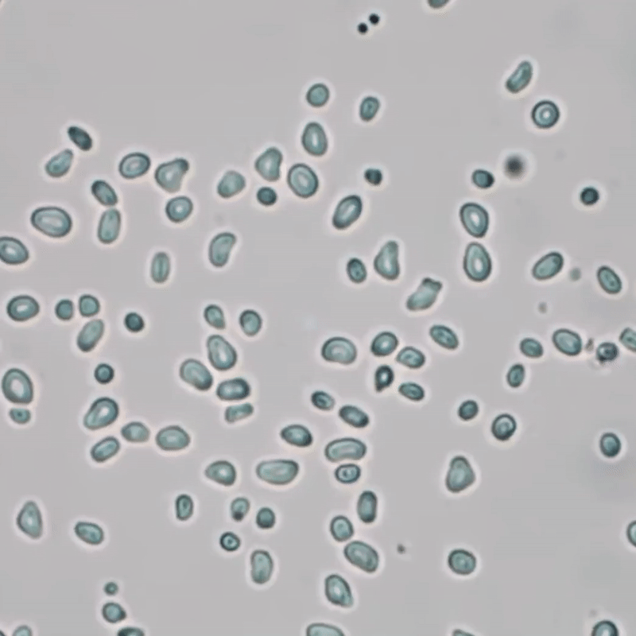{height=390px fig-alt="Brownian motion of particles in water"}

::: {.slide-note}
[Watch the microscope video](https://youtu.be/jLQ66ytMa9I)
:::
:::

# It was later discovered that this jitter is related to the <u>motion</u> of water molecules due to <u>temperature</u>

::: {.columns .v-center}
::: {.column .figure-centered width="48%"}
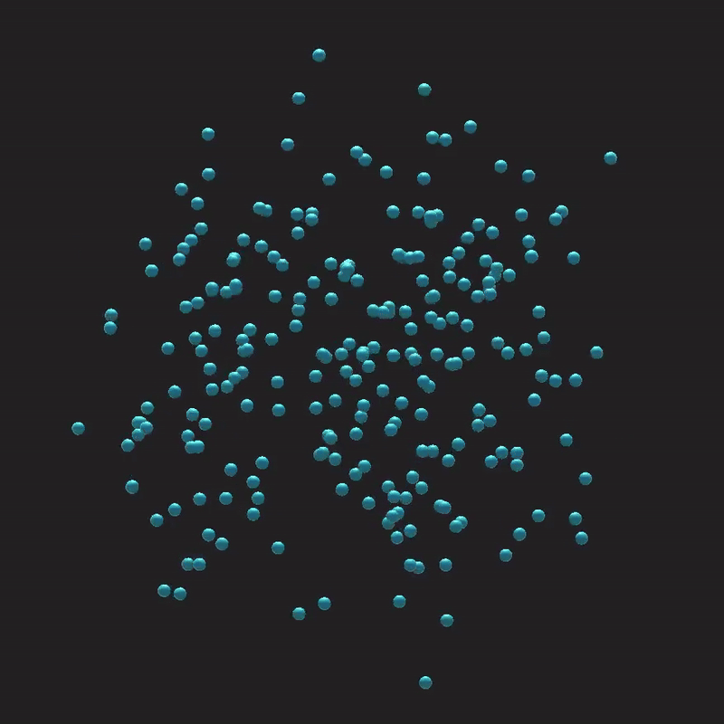{height=340px fig-alt="Random motion of water molecules and the resulting particle motion"}
:::
::: {.column .figure-centered width="52%"}
Einstein (1905)

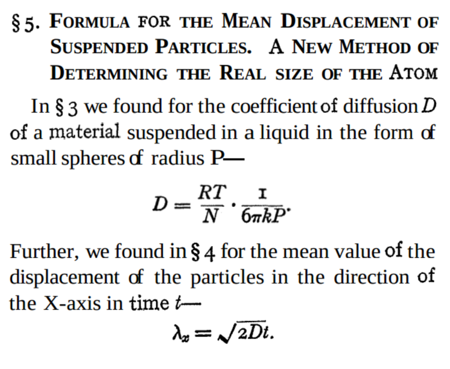{height=310px fig-alt="Einstein's 1905 paper connects thermal motion and diffusion"}
:::
:::

# Motion generates signal dephasing in the PGSE sequence

::: {.columns .v-center}
::: {.column .figure-centered width="68%"}
::: {.columns .v-center}
::: {.column width="25%"}
No motion
:::
::: {.column width="75%"}
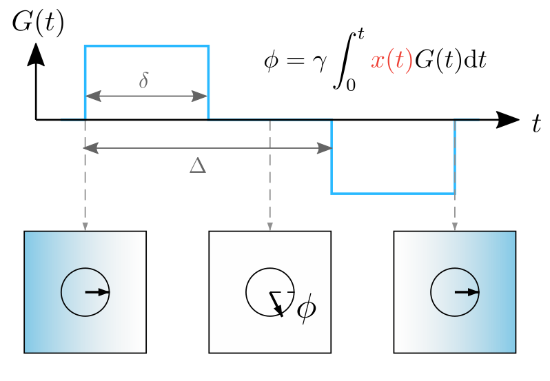{height=300px fig-alt="PGSE gradient waveform and phase evolution of a stationary spin"}
:::
:::

::: {.columns .v-center}
::: {.column width="25%"}
With motion
:::
::: {.column width="75%"}
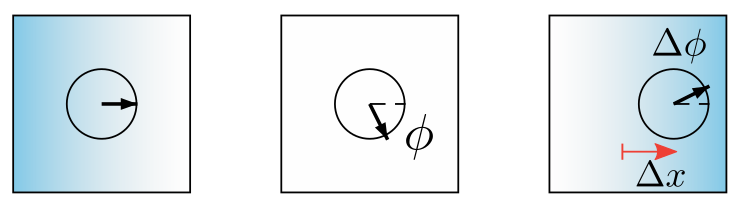{height=115px fig-alt="A moving spin accumulates a residual phase between the gradient lobes"}
:::
:::
:::
::: {.column .figure-centered width="32%"}

Short-gradient-pulse approximation (SGPA)

$$q=\frac{\gamma}{2\pi}\delta G$$

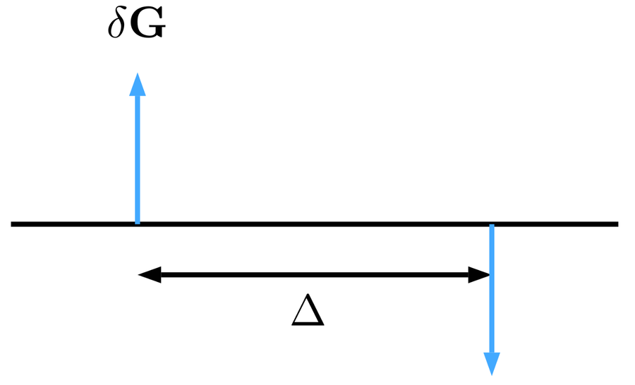{height=140px fig-alt="The short gradient pulse approximation replaces each gradient lobe with an impulse"}

$$e^{-i2\pi qr}$$
:::
:::

::: {.slide-note}
[Stejskal and Tanner, *J Chem Phys* (1965)](https://doi.org/10.1063/1.1695690)
:::

# Diffusion generates signal attenuation

::: {.columns .v-center}
::: {.column .figure-centered width="44%"}
{height=330px fig-alt="Random molecular displacements form a Gaussian propagator"}

$$\sigma_r=\sqrt{2D\Delta}$$
:::
::: {.column .figure-centered width="56%"}
$p(r)$ — Ensemble average propagator (EAP)

```{julia}
prop_x = collect(range(-3.0, 3.0; length=201))
gauss(x) = 0.72 * exp(-x^2 / 1.4)
px = [-2.0, -1.0, 0.0, 1.0, 2.0]
py = gauss.(px) .+ 0.22
prop_ann = Any[phasor_arrow(x, y, -π * x / 6, BIOS_COLORS.ink; len=16) for (x, y) in zip(px, py)]
push!(prop_ann,
    attr(text="e<sup>−i2πqr</sup>", x=1.65, y=1.03, showarrow=false, font=attr(size=24)),
    attr(text="r", x=2.95, y=-0.02, showarrow=false, font=attr(size=24)))
append!(prop_ann, [phasor_arrow(4.2, 0.43, a, BIOS_COLORS.ink; len=32) for a in range(-π/2, π/2; length=33)])
push!(prop_ann, phasor_arrow(4.2, 0.43, 0.0, "#e00000"; len=20, width=3.5))
Plot([
    scatter(mode="lines", x=prop_x, y=gauss.(prop_x), line=attr(color="#6788b5", width=10), showlegend=false, hoverinfo="skip"),
    scatter(mode="markers", x=px, y=py, marker=attr(symbol="circle", size=53, color="white", line=attr(color=BIOS_COLORS.ink, width=2)), showlegend=false, hoverinfo="skip"),
    scatter(mode="markers", x=[4.2], y=[0.43], marker=attr(symbol="circle", size=74, color="white", line=attr(color=BIOS_COLORS.ink, width=2)), showlegend=false, hoverinfo="skip"),
], bios_layout(; height=320, font_size=21, margin=attr(l=5, r=10, t=5, b=10),
    xaxis=attr(visible=false, range=[-3.1, 5.2]), yaxis=attr(visible=false, range=[-0.05, 1.2]),
    annotations=prop_ann,
    shapes=[attr(type="line", x0=-3, x1=2.9, y0=0, y1=0, line=attr(color=BIOS_COLORS.gray, width=1))]); config=bios_config())
```

Free water has a Gaussian EAP
:::
:::

$$\text{Signal attenuation}\quad\longrightarrow\quad E(q)=\int_{-\infty}^{\infty}p(r)e^{-i2\pi qr}\,\mathrm{d}r$$

# $E(q)$ is the Fourier transform of $p(r)$

$$p(r)=\frac{1}{\sqrt{4\pi D\Delta}}e^{-r^2/(4D\Delta)}\quad\longrightarrow\quad E(q)=e^{-4\pi^2D\Delta q^2}$$

::: {.figure-centered}
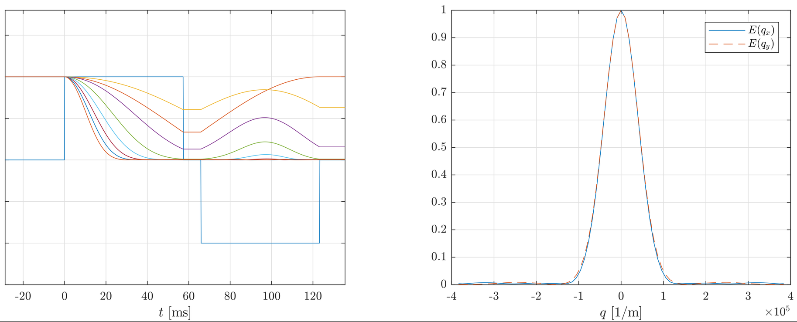{height=365px fig-alt="Signal evolution during diffusion encoding and the resulting Gaussian attenuation versus q"}
:::

::: {.slide-note}
For free water, $p(r)$ and $E(q)$ are Gaussian
:::

# The b-value is a simpler way of thinking about this

::: {.columns .v-center}
::: {.column width="55%"}
$$E(b)=e^{-bD}$$
:::
::: {.column width="45%"}
$$D=3.0\times10^{-3}\;\mathrm{mm}^2/\mathrm{s}\quad\text{at }37^\circ\mathrm{C}$$

$$b=1000\;\mathrm{s}/\mathrm{mm}^2$$
:::
:::

**Depends on the sequence**: this expression does not use SGPA, but assumes that $p(r)$ is Gaussian

::: {.columns .v-center}
::: {.column width="65%"}
$$b=\gamma^2G^2\delta^2\left(\Delta-\frac{\delta}{3}\right)$$
:::
::: {.column .figure-centered width="35%"}
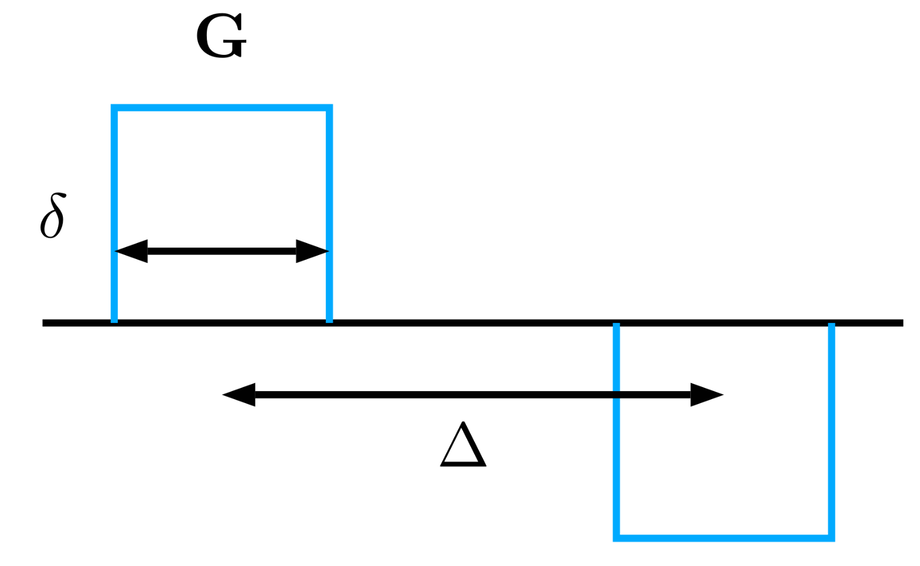{height=190px fig-alt="Rectangular PGSE gradients with duration delta and separation Delta"}
:::
:::

# Scanner laboratory: Test your 2D excitation pattern

::: {.columns .lab-columns}
::: {.column width="38%"}
- Today, 10:30–11:50 a.m. at the Cima.X scanner
- You will need to complete a report (PDF) and submit the exact `.seq` used on the scanner
- Each acquisition takes ~10 seconds
- If you have an updated `.seq`, send it to [Charles McGrath](mailto:cmmcg@stanford.edu)
:::
::: {.column width="62%"}
```{=html}
<iframe class="activity-frame" data-external="1" data-src="../../lab/3/activity3.html" title="Activity 3: Test your 2D excitation pattern"></iframe>
```
:::
:::

```{=html}
<script>
BIOS214.onReady(async Plotly => {
  const {C, config, axis, baseLayout, slider, arrowMesh, onResize} = BIOS214;
  const animation = {mode: 'immediate', transition: {duration: 0}, frame: {duration: 0, redraw: true}};
  const rainbow = ['#6e40aa', '#714bce', '#4775de', '#278bc3', '#1aa59c', '#3dbb65', '#8cbd36', '#c8ac24', '#e9782d', '#d94451'];
  const vec = (v, col, name = '', r = 0.012, hr = 0.035, hl = 0.09) =>
    arrowMesh([[0, 0, 0]], [v], col, {name, radius: r, headRadius: hr, headLength: hl, sides: 8, caps: false});
  const axes3d = (scene = 'scene') => [
    {type: 'scatter3d', mode: 'lines', x: [0, 1.1, null, 0, 0, null, 0, 0], y: [0, 0, null, 0, 1.1, null, 0, 0],
      z: [0, 0, null, 0, 0, null, 0, 1.1], line: {color: C.gray, width: 3}, scene, showlegend: false, hoverinfo: 'skip'},
    {type: 'scatter3d', mode: 'text', x: [1.2, 0], y: [0, 1.2], z: [0, 0], text: ['x′', 'y′'],
      textfont: {size: 20, color: C.gray}, scene, showlegend: false, hoverinfo: 'skip'}];
  const scene3d = (domain, data, zoom = 1) => {
    const states = data.m.flat(), ranges = [0, 1, 2].map(i =>
      i < 2 ? (e => [-e, e])(Math.max(1.28, ...states.map(v => Math.abs(v[i]) + 0.08)))
        : [Math.min(0, ...states.map(v => v[i])) - 0.08, Math.max(1.1, ...states.map(v => v[i])) + 0.08]);
    const spans = ranges.map(([lo, hi]) => hi - lo), sc = 2.3 * zoom / Math.max(...spans);
    return {domain, xaxis: {visible: false, range: ranges[0]}, yaxis: {visible: false, range: ranges[1]}, zaxis: {visible: false, range: ranges[2]},
      aspectmode: 'manual', aspectratio: {x: spans[0] * sc, y: spans[1] * sc, z: spans[2] * sc},
      camera: {eye: {x: 1.6, y: 1.6, z: 0.9}, projection: {type: 'orthographic'}},
      annotations: [{x: 0, y: 0, z: 1.05, text: 'z', showarrow: false, xshift: -20, font: {size: 20, color: C.gray}}],
      bgcolor: 'rgba(0,0,0,0)', uirevision: 'view'};
  };
  const vectors = (d, k, sc = 'scene', showLegend = true) => {
    const m = d.m[k], out = m.map((v, j) => ({...vec(v, m.length === 1 ? C.ink : (d.colors?.[j] ?? rainbow[j % 10])),
      scene: sc, ...(m.length > 1 ? {name: 'Isochromats', legendgroup: 'isochromats', showlegend: showLegend && j === 0} : {})}));
    if (m.length > 1) out.push({...vec([d.net[k][0], d.net[k][1], 0], C.ink, 'Net M<sub>xy</sub>', 0.025, 0.06, 0.12),
      scene: sc, legendgroup: 'net-magnetization', showlegend: showLegend});
    else { out[0].name = 'M(t)'; out[0].showlegend = showLegend; }
    return out;
  };
  const sequenceTraces = d => {
    const traces = d.wave.data.filter(t => t.visible !== 'legendonly' &&
      (t.name === 'B₁' || (t.name === 'Gx' && t.y?.some(v => Number.isFinite(v) && Math.abs(v) > 1e-9))))
      .map(t => ({...t, x: t.x.map(v => v == null ? v : v - d.origin_ms), xaxis: 'x', yaxis: 'y', showlegend: true}));
    const phase = d.wave.data.find(t => t.name === '∠B1_AM');
    if (phase?.y.some(v => Number.isFinite(v) && Math.abs(v) > 1e-6)) traces.push({...phase,
      x: phase.x.map(v => v == null ? v : v - d.origin_ms), y: phase.y.map(v => v == null ? v : v * 180 / Math.PI),
      name: 'RF phase (°)', visible: true, xaxis: 'x', yaxis: 'y3', showlegend: true,
      hovertemplate: '%{x:.2f} ms<br>%{y:.1f}°<extra>RF phase</extra>', line: {color: '#df7b22', width: 2, dash: 'dot'}});
    return traces;
  };
  const tSlider = (ts, fmt, padT = 30) => [slider(ts.map((t, k) => ({label: t.toFixed(fmt), method: 'animate', args: [[String(k)], animation]})),
    'Time: ', ' ms', 0, {y: 0, pad: {t: padT}})];

  const demos = [...document.querySelectorAll('.bloch-demo')];
  for (const el of demos) {
    const mode = el.dataset.mode, d = JSON.parse(el.querySelector('script').textContent);
    if (mode === 'comparison') {
      const {se, ge} = d, end = Math.min(se.te_ms, ge.te_ms);
      const ts = [...new Set([...se.t, ...ge.t].filter(t => t <= end).map(t => +t.toFixed(6)))].sort((a, b) => a - b);
      const nearest = (ds, t) => ds.t.reduce((best, x, i) => Math.abs(x - t) < Math.abs(ds.t[best] - t) ? i : best, 0);
      const ks = ts.map(t => nearest(se, t)), kg = ts.map(t => nearest(ge, t));
      const a = axes3d(), b = axes3d('scene2'), va = vectors(se, ks[0]), vb = vectors(ge, kg[0], 'scene2', false);
      const moving = [...va.map((_, i) => a.length + i), ...vb.map((_, i) => a.length + va.length + b.length + i)];
      const frames = ts.map((_, k) => ({name: String(k), traces: moving, data: [...vectors(se, ks[k]), ...vectors(ge, kg[k], 'scene2', false)]}));
      const view = {m: [...se.m, ...ge.m]}, s1 = scene3d({x: [0, 0.48], y: [0, 1]}, view, 1.4), s2 = scene3d({x: [0.52, 1], y: [0, 1]}, view, 1.4);
      s1.annotations[0].yshift = -25; s2.annotations[0].yshift = -25;
      await Plotly.newPlot(el, {data: [...a, ...va, ...b, ...vb], frames, config, layout: baseLayout({
        font: {size: 21, color: C.ink}, margin: {l: 0, r: 20, t: 40, b: 120}, scene: s1, scene2: s2,
        legend: {orientation: 'h', x: 0.5, xanchor: 'center', y: 1.02, font: {size: 18}},
        annotations: [{text: 'Spin echo', x: 0.24, y: 1.08, xref: 'paper', yref: 'paper', showarrow: false},
          {text: 'Gradient echo', x: 0.77, y: 1.08, xref: 'paper', yref: 'paper', showarrow: false}],
        sliders: tSlider(ts, 2, 25)})});
    } else if (mode === 'rotation' || mode === 'precession') {
      const a = axes3d();
      if (mode === 'precession') a.push({type: 'scatter3d', mode: 'lines', x: d.m.map(m => m[0][0]),
        y: d.m.map(m => m[0][1]), z: d.m.map(m => m[0][2]), line: {color: C.gray, width: 3, dash: 'dash'}, showlegend: false, hoverinfo: 'skip'});
      const trails = k => {
        if (mode !== 'rotation') return [];
        const n = d.m[0].length, pts = d.m.slice(0, k + 1);
        return Array.from({length: n}, (_, j) => ({
          type: 'scatter3d', mode: 'lines',
          x: pts.map(s => s[j][0]), y: pts.map(s => s[j][1]), z: pts.map(s => s[j][2]),
          line: {color: n === 1 ? C.gray : (d.colors?.[j] ?? rainbow[j % 10]), width: 4},
          opacity: n === 1 ? 0.55 : 0.45, showlegend: false, hoverinfo: 'skip'
        }));
      };
      const frameData = k => [...trails(k), ...vectors(d, k)];
      const init = frameData(0), moving = init.map((_, j) => a.length + j);
      const frames = d.t.map((_, k) => ({name: String(k), traces: moving, data: frameData(k)}));
      const layout = baseLayout({font: {size: 21, color: C.ink}, margin: {l: 0, r: 0, t: 30, b: mode === 'precession' ? 0 : 75},
        scene: scene3d({x: [0, 1], y: [0, 1]}, d), legend: {orientation: 'h', x: 0.5, xanchor: 'center', y: 1.02, font: {size: 18}},
        ...(mode === 'precession' ? {} : {sliders: tSlider(d.t, 1, 30)})});
      await Plotly.newPlot(el, {data: [...a, ...init], layout, frames, config});
      if (mode === 'precession') {
        let playing = false;
        const visible = () => el.closest('section')?.classList.contains('present');
        const play = async () => {
          if (playing || !visible()) return; playing = true;
          try { while (visible()) await Plotly.animate(el, null, {mode: 'immediate', transition: {duration: 0}, frame: {duration: 12.5, redraw: true}, fromcurrent: false}); }
          catch {} finally { playing = false; if (visible()) requestAnimationFrame(play); }
        };
        Reveal.on('slidechanged', () => { if (visible()) play(); else Plotly.animate(el, [], {mode: 'immediate'}); });
        play();
      }
    } else {
      const data = sequenceTraces(d), hasPhase = data.some(t => t.yaxis === 'y3'), endTime = d.t.at(-1);
      const vals = data.filter(t => t.yaxis === 'y').flatMap(t => t.y.filter(Number.isFinite));
      const wmin = Math.min(0, ...vals), wmax = Math.max(0, ...vals), pad = 0.05 * (wmax - wmin);
      const wrange = [wmin < 0 ? wmin - pad : 0, wmax + pad], a = axes3d(), start = data.length + a.length;
      const v0 = vectors(d, 0).map(t => ({...t, legend: 'legend2'})), moving = v0.map((_, j) => start + j);
      data.push(...a, ...v0);
      const shapes = k => [
        {type: 'line', xref: 'x', yref: 'y domain', x0: d.te_ms, x1: d.te_ms, y0: 0, y1: 1, line: {color: C.gray, width: 1.5, dash: 'dot'}},
        {type: 'line', xref: 'x', yref: 'y domain', x0: d.t[k], x1: d.t[k], y0: 0, y1: 1, line: {color: '#d33', width: 2}}];
      const frames = d.t.map((_, k) => ({name: String(k), traces: moving, data: vectors(d, k).map(t => ({...t, legend: 'legend2'})), layout: {shapes: shapes(k)}}));
      await Plotly.newPlot(el, {data, frames, config, layout: baseLayout({
        font: {size: 21, color: C.ink}, margin: {l: 55, r: 30, t: 45, b: 120}, shapes: shapes(0),
        xaxis: {...axis, domain: [0, 0.34], anchor: 'y', title: {text: 'Time (ms)', standoff: 5}, range: [-d.origin_ms, endTime], linewidth: 1.2},
        yaxis: {...d.wave.layout.yaxis, ...axis, domain: [0, 1], anchor: 'x', autorange: false, range: wrange, linewidth: 1.2},
        yaxis3: {overlaying: 'y', anchor: 'x', side: 'right', range: wrange.map(v => v * 100 / wmax), visible: hasPhase, tickvals: [0, 90], tickfont: {color: '#df7b22', size: 16}, showgrid: false, zeroline: false},
        scene: scene3d({x: [0.4, 1], y: [0, 1]}, d, 1.4),
        legend: {orientation: 'h', x: 0, y: 1.1, font: {size: 18}}, legend2: {orientation: 'h', x: 0.72, y: 1.1, font: {size: 18}},
        annotations: [{text: 'TE', xref: 'x', yref: 'paper', x: d.te_ms, y: 0.98, xshift: 7, xanchor: 'left', yanchor: 'top', showarrow: false, font: {color: C.gray, size: 16}}],
        sliders: tSlider(d.t, 1, 75)})});
    }
  }

  onResize(slide => demos.filter(g => slide.contains(g)).forEach(g => {
    const rect = slide.getBoundingClientRect(), scale = rect.height / slide.clientHeight;
    const top = (g.getBoundingClientRect().top - rect.top) / scale;
    g.style.height = Math.min(g.closest('.column') ? 580 : 565, slide.clientHeight - top - 70) + 'px';
    Plotly.relayout(g, {autosize: false, width: g.clientWidth, height: g.clientHeight});
  }));
});
</script>
```
