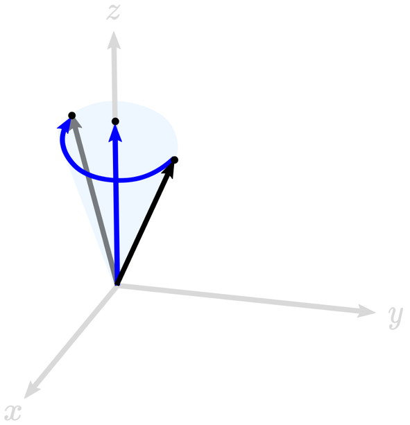
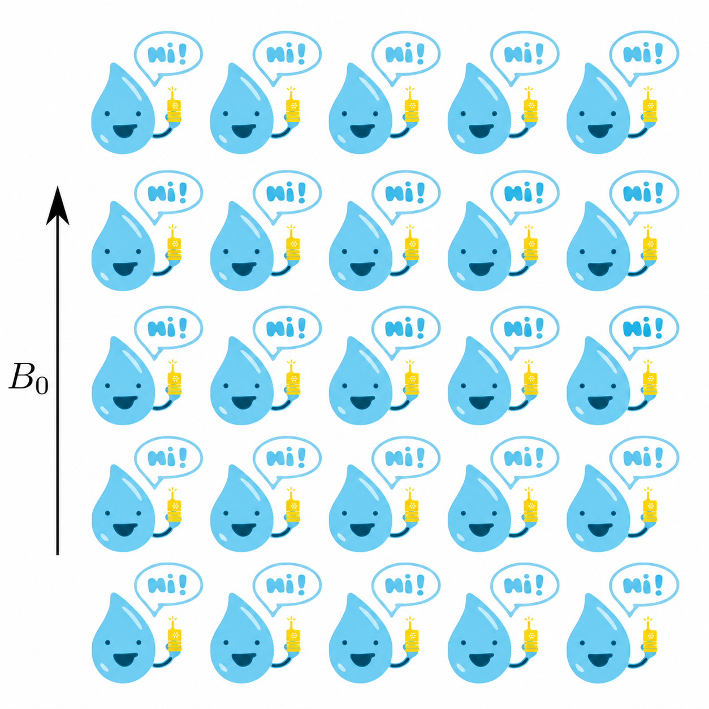
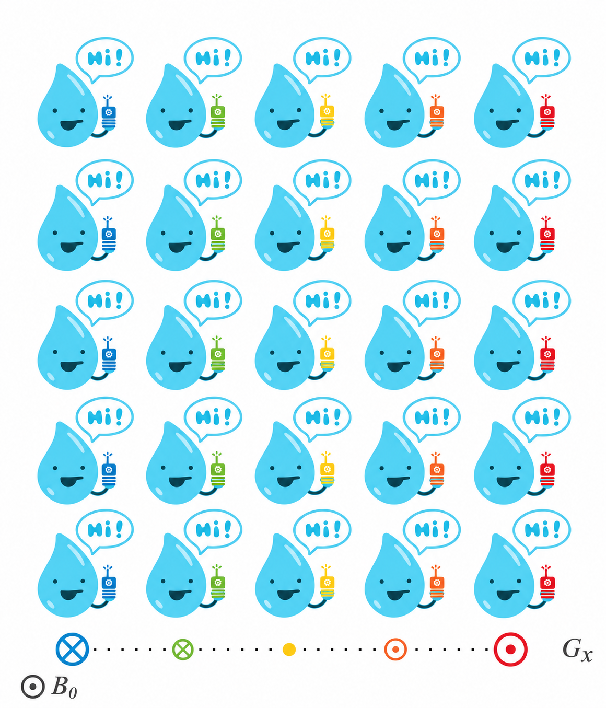
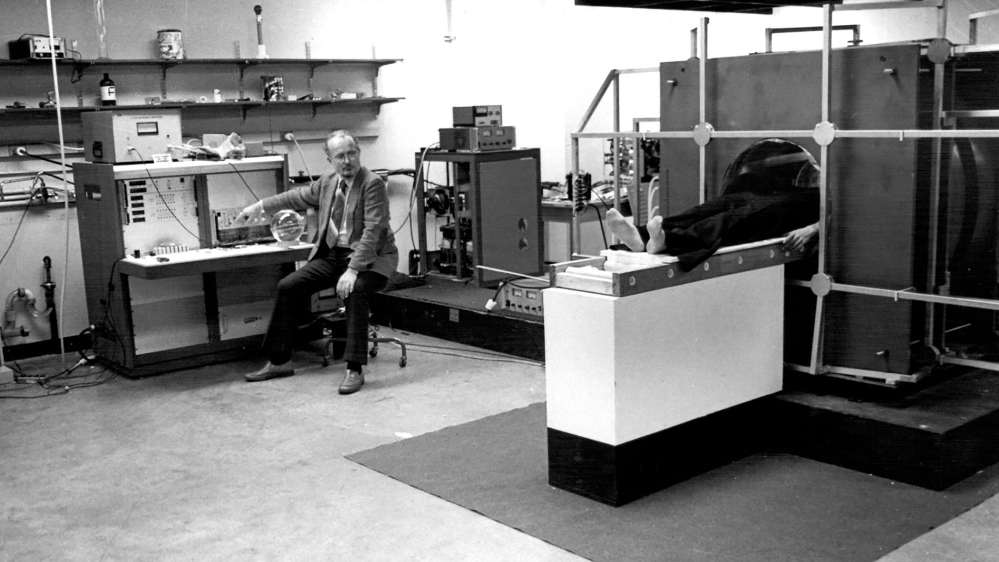
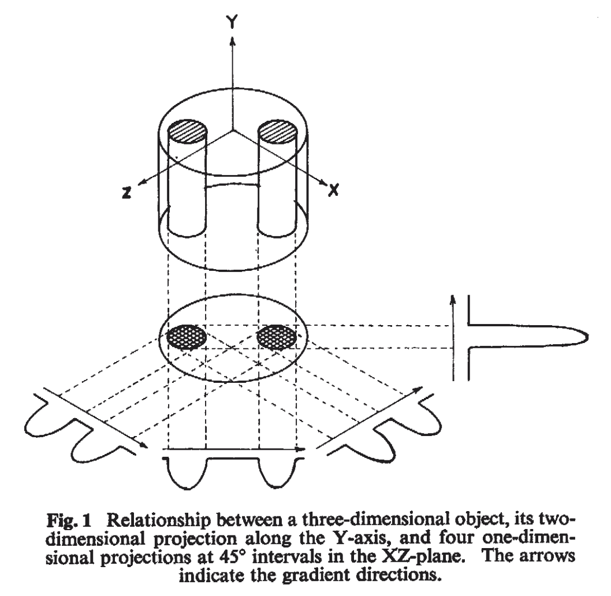
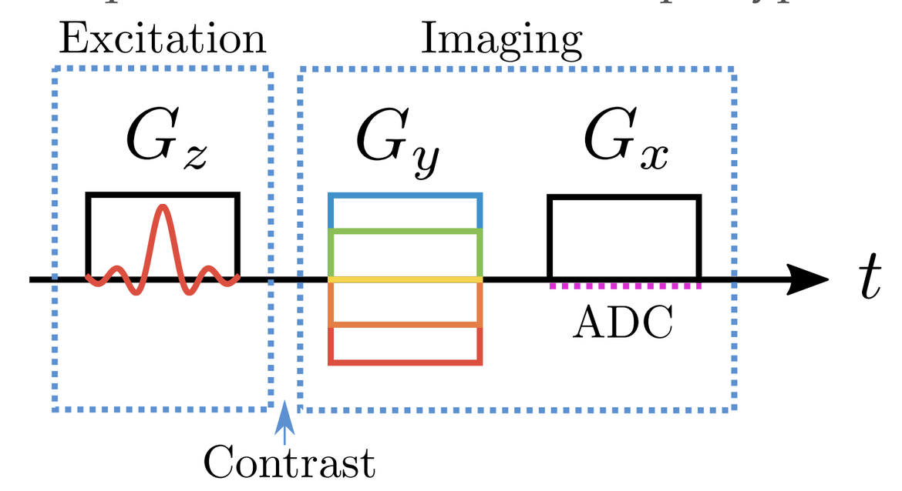
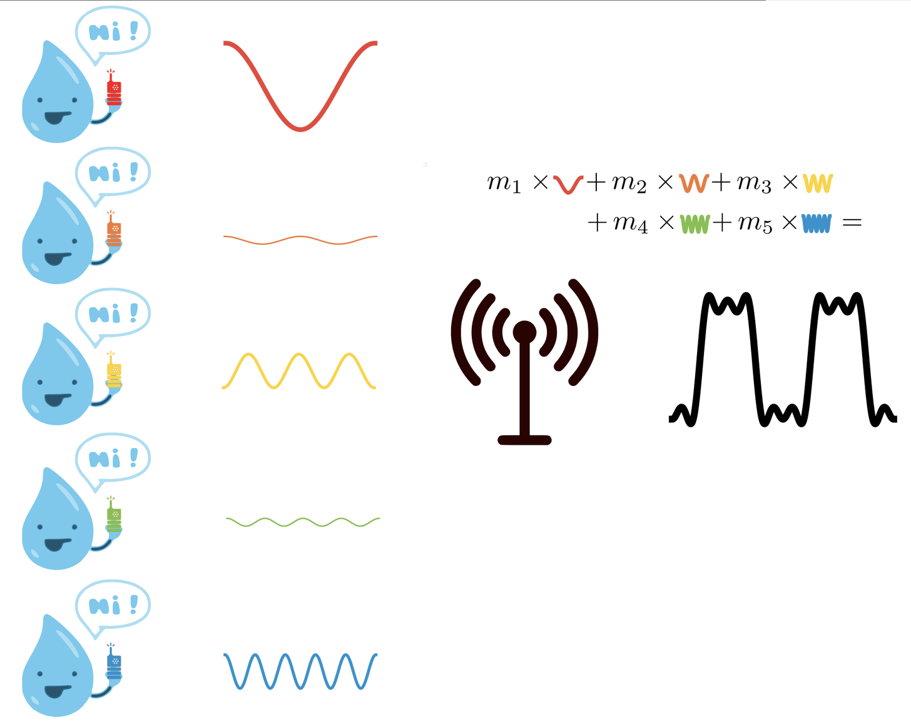
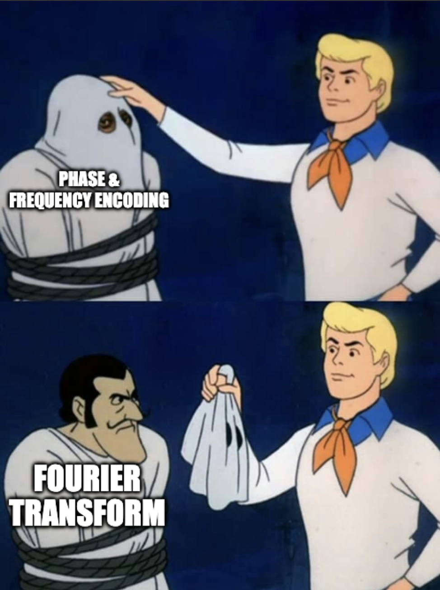
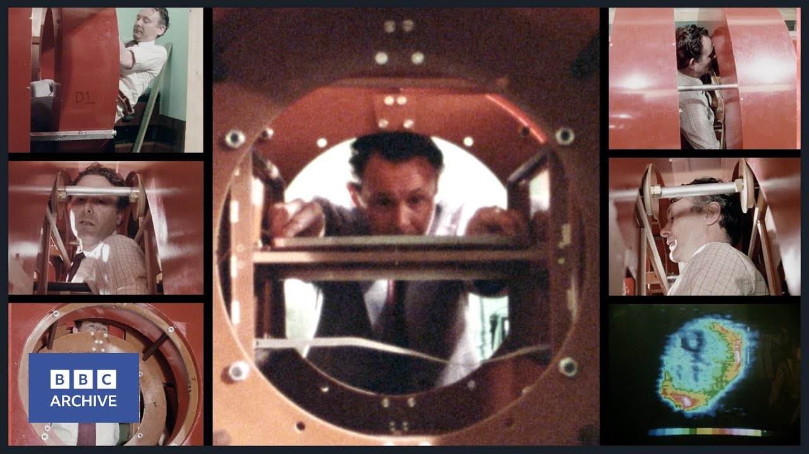

```{julia}
#| output: false
include("../common.jl")
using FFTW

scanner = Scanner(limits=HardwareLimits(Gmax=20e-3, Smax=40.0, RF_dead_time=0.0, RF_ring_down_time=0.0, ADC_dead_time=0.0))
rf_duration = 1e-3
rf_block(angle; phase=0.0) = PulseDesigner.build_block_pulse(angle; duration=rf_duration, phase_offset=phase, sys=scanner)

function gradient_block(amplitude, duration)
    seq = Sequence(scanner)
    g = iszero(amplitude) ? Grad(0.0, duration) :
        PulseDesigner.make_trapezoid(; amplitude=γ * amplitude, duration, sys=scanner)
    addblock!(seq, ADC(ceil(Int, duration / 1e-3) + 1, duration); x=g)
    seq
end

function record_echo(seq, obj; te=30e-3)
    rec = record_states(obj, seq, scanner; Δt=0.5e-3, Δt_rf=20e-6, shown=[1], record_net=true)
    keep = findall(t -> t <= 1.5te + rf_duration / 2 + 1e-9, rec.times)
    (; t = 1e3 .* (rec.times[keep] .- rf_duration), amp = [hypot(v[1], v[2]) for v in rec.net[keep]])
end

# Position and off-resonance are sampled independently in both echo experiments.
np, nf = 21, 151
frequencies = 50 .* tan.(π .* (((1:nf) .- 0.5) ./ nf .- 0.5))
frequencies = frequencies[abs.(frequencies) .<= 2π * 100]
positions = repeat(collect(range(-5e-3, 5e-3; length=np)); inner=length(frequencies))
omega = repeat(frequencies; outer=np)
ensemble = Phantom(x=positions, Δw=omega, T1=fill(0.45, length(positions)), T2=fill(0.12, length(positions)))
echo_time, gradient_amplitude = 30e-3, 0.5e-3
lobe = echo_time / 2 - rf_duration
ramp_comp = PulseDesigner.make_trapezoid(; amplitude=γ * gradient_amplitude, duration=lobe, sys=scanner).rise / 2
se_seq = rf_block(π/2) + gradient_block(-gradient_amplitude, lobe) + rf_block(π; phase=π/2) +
    gradient_block(0.0, rf_duration/2 + ramp_comp) + gradient_block(-gradient_amplitude, lobe + echo_time/2)
pre = (echo_time - rf_duration/2) / 2
ge_seq = rf_block(π/2) + gradient_block(-gradient_amplitude, pre) + gradient_block(0.0, ramp_comp) +
    gradient_block(gradient_amplitude, pre + echo_time/2)
se_echo, ge_echo = record_echo(se_seq, ensemble), record_echo(ge_seq, ensemble)

# One actual KomaMRI acquisition per Cartesian line. Independent excitations
# isolate spatial encoding from saturation and relaxation in the Fourier demos.
N, fov, dwell = 96, 0.24, 5e-6
dk = 1 / fov
coordinates = (collect(0:N-1) .- N ÷ 2) .* (fov / N)
x_mm = 1e3 .* coordinates
kaxis = collect(-N÷2:N÷2-1) .* dk
density = load_brain_96x96()
xx, yy, rho = repeat(coordinates; inner=N), repeat(coordinates; outer=N), vec(density)
inside = rho .> 0
brain = Phantom(x=xx[inside], y=yy[inside], ρ=rho[inside], T1=fill(Inf, count(inside)), T2=fill(Inf, count(inside)))
excitation = PulseDesigner.build_sinc_pulse(π/4; duration=rf_duration, time_bw_product=4.0,
    slice_thickness=10e-3, apodization=0.5, use=Excitation(), sys=scanner)

line_seq(ky; nx=N, tr=nothing) = cartesian_line(ky, scanner; excitation, nx, fov, dwell, tr)

function sequence_data(seq)
    rule = KomaMRI.KomaMRIBase.MomentSamplingRule(MaxStepSizeRule(1, 20e-6))
    sampled = discretize(seq; sampling_rule=rule)
    trajectory, adc = get_kspace(seq; sampling_rule=MaxStepSizeRule(1, 20e-6))
    Dict{String,Any}("wave" => plot_seq(seq; slider=false, show_rf_frame=false),
        "t" => 1e3 .* sampled.t[2:end], "k" => rows(trajectory[:, 1:2]),
        "adc" => rows(adc[:, 1:2]), "duration" => 1e3 * dur(seq))
end

single_line = sequence_data(line_seq(-24dk))
single_line["start_time"] = 1e3 * dur(excitation)
line_indices = [-48, -24, 0, 24, 47]
multi_seq = reduce(+, (line_seq(ky * dk; tr=12e-3) for ky in line_indices))
multiple_lines = sequence_data(multi_seq)
multiple_lines["line_indices"] = line_indices

K = zeros(ComplexF64, N, N)
for (row, ky) in enumerate(kaxis)
    signal = simulate(brain, line_seq(ky), scanner; verbose=false,
        sim_params=Dict("gpu"=>false, "Nthreads"=>4, "precision"=>"f64", "return_type"=>"mat",
            "Δt"=>20e-6, "Δt_rf"=>20e-6))
    K[row, :] .= vec(signal)
end

reconstruct(k) = abs.(fftshift(ifft(ifftshift(k))))
scale = maximum(reconstruct(K))
brain_image = reconstruct(K) ./ scale
klog(k) = log10.(1 .+ 1000 .* abs.(k) ./ maximum(abs.(K)))

function image_pair_plot(k, img; question=false, sliders=Any[], shapes=Any[], height=565, zmax=1.0)
    has_slider = !isempty(sliders)
    anns = Any[]
    if !has_slider
        push!(anns, attr(xref="paper", yref="paper", x=0.52, y=0.5, ax=-50, ay=0, text="",
            showarrow=true, arrowhead=3, arrowwidth=2.5, arrowcolor=BIOS_COLORS.ink))
    end
    if question
        push!(anns, attr(text="?", x=0.5, y=0.61, xref="paper", yref="paper", showarrow=false,
            font=attr(size=44, color=BIOS_COLORS.ink)))
    end
    bw = [[0, "#000000"], [1, "#ffffff"]]
    bios_plot([
        bios_heatmap(rows(k); x=kaxis, y=kaxis, colorscale=bw, zmin=0, zmax=3.001, showscale=false,
            hovertemplate="kₓ=%{x:.1f}<br>kᵧ=%{y:.1f}<extra></extra>"),
        bios_heatmap(rows(img); x=x_mm, y=x_mm, colorscale=bw, zmin=0, zmax=zmax, showscale=false,
            xaxis="x2", yaxis="y2", hovertemplate="x=%{x:.1f}<br>y=%{y:.1f}<extra></extra>"),
    ]; height, showlegend=false, annotations=anns, shapes, sliders,
        margin=attr(l=70, r=30, t=has_slider ? 75 : 45, b=has_slider ? 105 : 60),
        xaxis=bios_image_axis(domain=[0, 0.43], anchor="y", title="", constrain="domain"),
        yaxis=bios_image_axis(domain=[0, 1], anchor="x", title="", scaleanchor="x", scaleratio=1),
        xaxis2=bios_image_axis(domain=[0.57, 1], anchor="y2", title="", range=[-120, 120], constrain="domain"),
        yaxis2=bios_image_axis(domain=[0, 1], anchor="x2", title="", range=[-120, 120], constrain="domain", scaleanchor="x2", scaleratio=1))
end

lecture_data = Dict(
    "single" => single_line, "multiple" => multiple_lines,
    "brain" => Dict("x" => x_mm, "kaxis" => kaxis, "dk" => dk, "density" => rows(density)),
)
```

# <u>Left-handed</u> rotations around the <u>effective field</u> {.compact .nostretch}

{.rotation-figure}

# Comparing SE with GE

```{julia}
env_t = collect(range(0.0, 44.5; length=201))
te_ms = 29.5
post_amp(d) = d.amp[argmin(abs.(d.t))]
bios_plot([
    scatter(x=se_echo.t, y=se_echo.amp, name="SE", line=attr(color=BIOS_COLORS.blue, width=3)),
    scatter(x=ge_echo.t, y=ge_echo.amp, name="GE", line=attr(color=BIOS_COLORS.orange, width=3, dash="dash")),
    scatter(x=env_t, y=post_amp(se_echo) .* exp.(-env_t ./ 120), name="exp(−t/T<sub>2</sub>)",
        line=attr(color=BIOS_COLORS.ink, width=2, dash="dot")),
    scatter(x=env_t, y=post_amp(ge_echo) .* exp.(-env_t ./ (1000 / (1 / 0.12 + 50))), name="exp(−t/T<sub>2</sub><sup>*</sup>)",
        line=attr(color=BIOS_COLORS.gray, width=2, dash="dot")),
]; height=565, margin=attr(l=75, r=30, t=50, b=65),
    xaxis=bios_axis(title="Time after excitation (ms)", range=[-1, 44.5]),
    yaxis=bios_axis(title="|S| / S₀", range=[0, 1.03]),
    legend=attr(orientation="h", x=0.5, xanchor="center", y=1.1, font=attr(size=19)),
    shapes=[
        attr(type="rect", xref="x", yref="y domain", x0=-1, x1=0, y0=0, y1=1, line=attr(width=0), fillcolor="rgba(155,88,207,.15)", layer="below"),
        attr(type="rect", xref="x", yref="y domain", x0=14, x1=15, y0=0, y1=1, line=attr(width=0), fillcolor="rgba(155,88,207,.15)", layer="below"),
        attr(type="line", xref="x", yref="y domain", x0=te_ms, x1=te_ms, y0=0, y1=1, line=attr(color=BIOS_COLORS.gray, width=1.5, dash="dot")),
    ],
    annotations=[attr(text="TE", xref="x", yref="paper", x=te_ms, y=0.98, xshift=7, xanchor="left", yanchor="top",
        showarrow=false, font=attr(size=18, color=BIOS_COLORS.gray))])
```

# All spins in a slice are excited, how can we differentiate them? {.compact}

::: {.columns .art-columns}
::: {.column width="61%"}
{.drop-grid}
:::
::: {.column width="39%"}
{.tower}

Sends RF pulse at Larmor frequency

$$
\boldsymbol{B}(t_0)=
\begin{bmatrix}B_{1x}\\B_{1y}\\G_z z-\Delta\omega_{\mathrm{RF}}/\gamma\end{bmatrix}
$$
:::
:::

::: notes
B(t_0) =  (B1x, B1y, Gz z - domega_Rf/gamma)
:::

# We can use frequency to encode spatial coordinates {.compact}

::: {.columns .art-columns .field-columns}
::: {.column width="62%"}
{.drop-grid}
:::
::: {.column width="38%"}
$$\boldsymbol{B}(t_1)=
\begin{bmatrix}0\\0\\G_x x\end{bmatrix}$$

:::
:::

::: notes
Change bandwidth for acquisition bandwidth definition

Also B(t_1) =  show RF stuff = 0, G_x . x
:::

# Paul Lauterbur (1973) {.compact}

::: {.history-subtitle}
Introducing magnetic field gradients in the magnetic field for spatial 2D encoding.
:::

::: {.columns .history-columns}
::: {.column width="50%"}
{.history-photo}

Stony Brook laboratory, New York, 1977
:::
::: {.column width="50%"}
{.history-diagram}

Zeugmatography
:::
:::

::: {.credit}
Lauterbur, [*Image Formation by Induced Local Interactions: Examples Employing Nuclear Magnetic Resonance*, Nature (1973)](https://doi.org/10.1038/242190a0)
:::

# That works for x; what about y? {.center .transition-slide}

# We can use phase to encode spatial coordinates {.compact}

::: {.columns .art-columns .field-columns}
::: {.column width="65%"}
{.drop-grid}
:::
::: {.column width="35%"}
$$\boldsymbol{B}(t_{1/2})=
\begin{bmatrix}0\\0\\G_y y\end{bmatrix}$$
:::
:::

::: notes
Also B(t_1/2) =  show RF stuff = 0, G_y . y
:::

# If we frequency encode after phase encoding we can differentiate the signals! {#read-frequency-after-encoding-phase .compact}

::: {.encoding-layout}
::: {}
{.encoding-sketch}
:::
::: {}
{.drop-grid}
:::
::: {.encoding-receiver}
{.tower}

Now we listen
:::
:::

::: notes
Sequence:

B(t_0)=(B1x, B1y, Gz z - domega_Rf/gamma) -> B(t_1/2)=(0,0,Gy y) -> B(t_1) =(0,0,Gx x)

Make antenna that listents black
:::

# The acquired signal is a superposition of complex sinusoids {.compact}

::: {}
{.superposition-figure}
:::

# A spin’s accumulated phase depends on the gradient waveforms {#accumulated-phase-depends-on-gradient-waveforms .compact}

::: {.columns .equation-columns}
::: {.column .phase-diagram width="36%"}
Magnetization looked<br>from the “top”

::: {.complex-circle}
```{=html}
<svg viewBox="0 0 300 240" role="img" aria-label="Complex magnetization with angle minus phi">
  <circle cx="126" cy="132" r="86" fill="none" stroke="black" stroke-width="3.5"/>
  <path d="M126 132 H212" fill="none" stroke="gray" stroke-width="1.5" stroke-dasharray="3 2"/>
  <path d="M126 132 L177 81" fill="none" stroke="black" stroke-width="4"/>
  <path d="M187 71 L156 118 L147 103 L138 100 Z" fill="black"/>
  <g fill="black" font-family="KaTeX_Math, serif" font-style="italic" font-size="50">
    <text x="91" y="91">m</text>
    <text x="224" y="115">−ϕ</text>
  </g>
</svg>
```
:::

::: {.complex-formula}
$$m\,\mathrm e^{-\mathrm i\phi}$$
:::
:::
::: {.column .phase-equation width="64%"}
$$S(\boldsymbol{x},t)=m(\boldsymbol{x})\,\mathrm e^{-\mathrm i\gamma\,\boldsymbol{x}\cdot\int_0^t\boldsymbol{G}(\tau)\,\mathrm d\tau}$$

::: {.fragment}
Why is the exponential negative?
:::
:::
:::

::: notes
Change for e and i to use serif in image
:::

# The signal equation {#the-signal-equation-is-a-fourier-transform}

::: {.columns .equation-columns}
::: {.column width="37%"}
{.fourier-meme}
:::
::: {.column width="63%"}
$$\boldsymbol{k}(t)=\frac{\gamma}{2\pi}\int_0^t\boldsymbol{G}(\tau)\,\mathrm d\tau$$

$$S(t)=\int_V m(\boldsymbol{x})\,\mathrm e^{-\mathrm i2\pi\boldsymbol{k}(t)\cdot\boldsymbol{x}}\,\mathrm d\boldsymbol{x}$$
:::
:::

::: notes
Right put formulas of kspace first, then S integrated in V/volume (x vector) so S(t) = …
:::

# Peter Mansfield (1973) {.compact}

::: {.history-subtitle}
Discovery of magnetic resonance imaging.
:::

::: {}
{.mansfield-photo}
:::

::: {.mansfield-footer}
Nottingham, 1978 · Photograph: BBC *Tomorrow’s World*, 1978

Mansfield & Grannell, [*NMR “diffraction” in solids?*, J. Phys. C (1973)](https://doi.org/10.1088/0022-3719/6/22/007)
:::

::: notes
Update location and year of pictures for lauterbur, nottingham , not sure when that bbc archive was taken
:::

# Nobel prize worthy contributions

::: {.columns .history-columns .nobel-columns}
::: {.column width="35%"}
{.bloch-photo}

Felix Bloch · **1952**
:::
::: {.column width="65%"}
{.nobel-photo}

Peter Mansfield and Paul Lauterbur · **2003**
:::
:::

::: notes
Add years they won nobel prizes
:::

# Must watch for those curious about MRI history!

::: {.archive-layout}
::: {.archive-logo}

:::
::: {.archive-banner}

:::
::: {}
{.archive-card}
:::
::: {}
{.archive-card}
:::
:::

::: {.archive-link}
[https://www.ismrm.org/historical-archives/](https://www.ismrm.org/historical-archives/)
:::

# K-space trajectory: One line {.trajectory-slide}

$$\boldsymbol{k}(t)=\frac{\gamma}{2\pi}\int_0^t\boldsymbol{G}(\tau)\,\mathrm d\tau$$

```{=html}
<div id="trajectory-one" class="demo"></div>
```

# Phase is accumulated while gradients are on {#phase-is-being-accumulated-while-gradients-are-on .compact}

::: {.columns .maze-columns}
::: {.column width="38%"}
{.maze-figure}
:::
::: {.column width="62%"}
```{julia}
k_pts = single_line["k"]
adc_pts = single_line["adc"]
ext = 20 * ceil(1.05 * maximum(abs(v) for p in k_pts for v in p) / 20)
bios_plot([
    scatter(mode="lines", x=first.(k_pts), y=last.(k_pts), line=attr(color="lightgray", width=2),
        showlegend=false, hoverinfo="skip"),
    scatter(mode="markers", x=first.(adc_pts), y=last.(adc_pts), marker=attr(color=BIOS_COLORS.blue, size=5),
        showlegend=false, hoverinfo="skip"),
    scatter(mode="markers", x=[k_pts[end][1]], y=[k_pts[end][2]], marker=attr(color=BIOS_COLORS.red, size=12),
        showlegend=false, hovertemplate="kₓ=%{x:.1f}<br>kᵧ=%{y:.1f}<extra>1/m</extra>"),
]; height=500, margin=attr(l=75, r=25, t=40, b=45), showlegend=false,
    xaxis=bios_axis(range=[-ext, ext], title="kₓ (1/m)", tickangle=0, dtick=200, constrain="domain"),
    yaxis=bios_axis(range=[-ext, ext], title="kᵧ (1/m)", constrain="domain", scaleanchor="x", scaleratio=1))
```
:::
:::

::: notes
Use latex Gx Gy white background
:::

# K-space trajectory: Multiple lines

```{=html}
<div id="trajectory-multiple" class="demo"></div>
```

# Each k-space sample measures a spatial pattern {.compact .pattern-slide}

$$\mathrm e^{\mathrm i2\pi\boldsymbol{k}\cdot\boldsymbol{x}}$$

```{=html}
<div id="spatial-pattern" class="demo"></div>
```

::: notes
You can use brain image in next slide
:::

# Which operation needs to be done here?

```{julia}
image_pair_plot(klog(K), brain_image; question=true)
```

# The inverse Fourier transform!

::: {.ift-operator}
$$\mathcal F^{-1}$$
:::

```{julia}
image_pair_plot(klog(K), brain_image)
```

::: notes
Formula mathcal F (inverse fourier transform)
:::

# k-space extent determines spatial resolution {.sizing-slide}

```{julia}
res_widths = [12, 24, 32, 48, 64, 96]
res_frames = map(res_widths) do w
    masked = zeros(ComplexF64, N, N)
    idx = N÷2 - w÷2 + 1 : N÷2 + w÷2
    masked[idx, idx] .= K[idx, idx]
    (w, klog(masked), reconstruct(masked) ./ scale)
end
res_steps = [attr(label=string(w), method="restyle", args=[attr(z=[rows(k), rows(img)])])
    for (w, k, img) in res_frames]
image_pair_plot(res_frames[end][2], res_frames[end][3]; height=470,
    sliders=[bios_slider(res_steps, ""; active=5, x=0.06, len=0.88, y=-0.21, pad_t=20)])
```

$$\Delta x=\frac{1}{2k_{\max}}$$

# k-space spacing determines field of view {.sizing-slide}

```{julia}
fov_factors = [1, 2, 3, 4]
fov_box(f) = attr(type="rect", xref="x2", yref="y2", x0=-120, x1=120, y0=-120 / f, y1=120 / f,
    line=attr(color="#66c4ef", width=2, dash="dash"), fillcolor="rgba(0,0,0,0)")
fov_frames = map(fov_factors) do f
    masked = copy(K)
    masked[mod.(-N÷2:N÷2-1, f) .!= 0, :] .= 0
    img = f .* reconstruct(masked) ./ scale
    (f, klog(masked), img, maximum(img))
end
fov_steps = [attr(label=string(f), method="update",
    args=[attr(z=[rows(k), rows(img)], zmax=[3.001, zmax]), attr(shapes=[fov_box(f)])])
    for (f, k, img, zmax) in fov_frames]
image_pair_plot(fov_frames[1][2], fov_frames[1][3]; height=470, zmax=fov_frames[1][4],
    shapes=[fov_box(1)],
    sliders=[bios_slider(fov_steps, ""; active=0, x=0.06, len=0.88, y=-0.21, pad_t=20)])
```

$$\mathrm{FOV}=\frac{1}{\Delta k}$$

# Why does the sampling frequency matter?

```{julia}
rates = [0.75, 1.0, 1.25, 1.5, 2.0, 2.5, 3.0, 4.0, 6.0, 8.0]
dense_t = collect(range(0.0, 4.0; length=1001))
orig_y = sin.(2π .* dense_t)
sample_step(fs) = begin
    ts = collect(0:floor(Int, 4fs)) ./ fs
    fa = 1 - round(1 / fs) * fs
    (ts, sin.(2π .* ts), sin.(2π * fa .* dense_t))
end
s_steps = [begin
    ts, ys, alias = sample_step(fs)
    attr(label=string(fs), method="restyle", args=[attr(x=[dense_t, ts], y=[alias, ys]), [1, 2]])
end for fs in rates]
ts0, ys0, alias0 = sample_step(rates[end])
bios_plot([
    scatter(x=dense_t, y=orig_y, name="Original sinusoid", line=attr(color=BIOS_COLORS.gray, width=3)),
    scatter(x=dense_t, y=alias0, name="Wave fitting the samples", line=attr(color=BIOS_COLORS.orange, width=3, dash="dash")),
    scatter(x=ts0, y=ys0, mode="markers", name="Samples", marker=attr(color=BIOS_COLORS.blue, size=11)),
]; height=565, margin=attr(l=70, r=30, t=85, b=100),
    xaxis=bios_axis(title="Time (s)", range=[0, 4]),
    yaxis=bios_axis(title="Signal", range=[-1.2, 1.2]),
    legend=attr(orientation="h", x=0.5, xanchor="center", y=1.07, yanchor="bottom", font=attr(size=18)),
    sliders=[bios_slider(s_steps, ""; active=9, x=0.06, len=0.88, y=-0.21, pad_t=20)])
```

# Nyquist–Shannon sampling theorem

::: {.columns .nyquist-columns}
::: {.column width="50%"}
1D signal definition:

$$\omega_s>2\omega_{\max}$$
:::
::: {.column width="50%"}
MRI equivalent:

$$\Delta k=\frac{1}{\mathrm{FOV}}$$
:::
:::

# Higher phase-encoding resolution takes more repetitions {.compact}

$$T_{\mathrm{scan}}=\mathrm{TR}\times N_y$$

```{julia}
TR = 10e-3
scan_seq = line_seq(-16dk; nx=32, tr=TR) + line_seq(-15dk; nx=32, tr=TR)
scan_p = clean_seq_plot(scan_seq)
rf_centers = only(filter(t -> get(t, :name, "") == "RF_center", scan_p.data)).x
b1_y = only(filter(t -> get(t, :name, "") == "B₁", scan_p.data)).y
half_b1 = maximum(v for v in b1_y if v isa Number && isfinite(v)) / 2
bios_plot(scan_p.data; height=390, font_size=20, template=scan_p.layout.template,
    margin=attr(l=65, r=25, t=65, b=60),
    xaxis=bios_axis(title="Time (ms)", range=[0, 1e3 * dur(scan_seq)]),
    yaxis=bios_axis(range=[-22, 28]),
    legend=attr(orientation="h", x=0, y=1.18, font=attr(size=18)),
    annotations=[
        attr(xref="x", yref="y", x=rf_centers[2], y=half_b1, axref="x", ayref="y", ax=rf_centers[1], ay=half_b1,
            text="", showarrow=true, arrowhead=2, startarrowhead=2, arrowside="end+start",
            arrowcolor=BIOS_COLORS.ink, arrowwidth=3),
        attr(xref="x", yref="y", x=(rf_centers[1] + rf_centers[2]) / 2, y=half_b1, yshift=12, yanchor="bottom",
            text="TR", showarrow=false, font=attr(size=22, color=BIOS_COLORS.ink)),
    ])
```

# Questions? {#questions .center .transition-slide}

{height=180px fig-alt="Dizzy droplet spin with spiral eyes"}

```{julia}
embed_json("lecture-data", lecture_data)
```

```{=html}
<script>
BIOS214.onReady(async Plotly => {
  const D = JSON.parse(document.getElementById('lecture-data').textContent);
  const {C, palette, config, axis, imageAxis, baseLayout, slider} = BIOS214;

  function waveform(d, domain = [0, 0.43], colored = false) {
    const traces = [];
    for (const name of ['Gx', 'Gy', 'Gz', '|B1|_AM', 'ADC']) {
      const t = d.wave.data.find(t => t.name === name); if (!t) continue;
      if (name === 'Gy') {
        for (let j = 0; j < (colored ? 5 : 1); j++) traces.unshift({...t,
          x: colored ? t.x.map(x => x !== null && x >= j * 12 && x < j * 12 + 12 ? x : null) : t.x,
          mode: 'lines', line: {width: 0}, fill: 'tozeroy', fillcolor: colored ? palette[j] : C.orange, opacity: 0.3,
          xaxis: 'x', yaxis: 'y', showlegend: false, visible: true, legendgroup: 'Gy', hoverinfo: 'skip'});
      }
      traces.push({...t, name: name === '|B1|_AM' ? 'B₁' : name, xaxis: 'x', yaxis: 'y', showlegend: true, visible: true, legendgroup: name});
    }
    return {data: traces, layout: {template: d.wave.layout.template,
      xaxis: {...axis, domain, anchor: 'y', range: [0, d.duration], title: 'Time (ms)'},
      yaxis: {...axis, domain: [0.1, 1], anchor: 'x', range: [-22, 28]}, annotations: []}};
  }

  async function mountTrajectory(id, d, multiple = false) {
    const el = document.getElementById(id); if (!el) return;
    const first = d.start_time === undefined ? 0 : d.t.findIndex(t => t >= d.start_time - 1e-6);
    const indices = [...new Set([...Array.from({length: 150}, (_, i) => first + Math.round(i * (d.t.length - 1 - first) / 149)), d.t.length - 1])];
    const extent = 20 * Math.ceil(1.05 * Math.max(...d.k.flat().map(Math.abs)) / 20);
    const centers = d.wave.data.find(t => t.name === 'RF_center').x;
    const steps = indices.map((k, i) => ({label: d.t[k].toFixed(2), value: String(i), method: 'skip', args: []}));
    const spec = idx => {
      const step = indices[idx], q = waveform(d, [0, 0.43], multiple), elapsed = d.t[step];
      if (!multiple) q.layout.yaxis.domain = [0, 1];
      const pathX = [], pathY = [];
      for (let i = 0; i <= step; i++) {
        if (i && centers.some(t => t >= d.t[i - 1] && t < d.t[i])) { pathX.push(null); pathY.push(null); }
        pathX.push(d.k[i][0]); pathY.push(d.k[i][1]);
      }
      const paths = [{type: 'scatter', mode: 'lines', x: pathX, y: pathY, line: {color: 'lightgray', width: 2},
        showlegend: false, xaxis: 'x2', yaxis: 'y4', hoverinfo: 'skip'}];
      if (multiple) {
        for (let j = 0; j < 5; j++) {
          const sub = d.adc.filter((_, i) => Math.floor(i / 96) === j);
          paths.push({type: 'scatter', mode: 'lines+markers', x: sub.map(k => k[0]), y: sub.map(k => k[1]),
            line: {color: palette[j], width: 2}, marker: {color: palette[j], size: 4}, showlegend: false, xaxis: 'x2', yaxis: 'y4', hoverinfo: 'skip'});
        }
      } else {
        paths.push({type: 'scatter', mode: 'markers', x: d.adc.map(k => k[0]), y: d.adc.map(k => k[1]),
          marker: {color: C.orange, size: 5}, showlegend: false, xaxis: 'x2', yaxis: 'y4', hoverinfo: 'skip'});
      }
      paths.push({type: 'scatter', mode: 'markers', x: [d.k[step][0]], y: [d.k[step][1]], marker: {color: C.red, size: 12},
        showlegend: false, xaxis: 'x2', yaxis: 'y4', hovertemplate: 'kₓ=%{x:.1f}<br>kᵧ=%{y:.1f}<extra>1/m</extra>'});
      return {data: [...q.data, ...paths], layout: baseLayout({...q.layout, hovermode: 'closest',
        xaxis2: {...axis, domain: [0.58, 1], anchor: 'y4', range: [-extent, extent], title: 'kₓ (1/m)', tickangle: 0, dtick: 200, constrain: 'domain'},
        yaxis4: {...axis, domain: multiple ? [0.12, 1] : [0, 1], anchor: 'x2', range: [-extent, extent], title: 'kᵧ (1/m)', constrain: 'domain', scaleanchor: 'x2', scaleratio: 1},
        shapes: [{type: 'line', xref: 'x', yref: 'paper', x0: elapsed, x1: elapsed, y0: multiple ? 0.12 : 0, y1: 1, line: {color: C.red, width: 2}}],
        legend: {orientation: 'h', x: 0, y: multiple ? 1.22 : 1.12, font: {size: 16}},
        margin: {l: 75, r: 25, t: multiple ? 72 : 40, b: multiple ? 90 : 70},
        sliders: [slider(steps, 'Time: ', ' ms', idx, {x: 0.06, len: 0.88, y: -0.21, pad: {t: 20}})]})};
    };
    const init = spec(0);
    await Plotly.newPlot(el, init.data, init.layout, config);
    el.on('plotly_sliderchange', e => { const p = spec(Number(e.step.value)); Plotly.react(el, p.data, p.layout, config); });
  }
  await mountTrajectory('trajectory-one', D.single, false);
  await mountTrajectory('trajectory-multiple', D.multiple, true);

  const B = D.brain, maxRho = Math.max(...B.density.flat());
  const phaseScale = [[0, 'rgb(51,255,255)'], [1/6, 'rgb(51,51,255)'], [1/3, 'rgb(255,51,255)'],
    [0.5, 'rgb(255,51,51)'], [2/3, 'rgb(255,255,51)'], [5/6, 'rgb(51,255,51)'], [1, 'rgb(51,255,255)']];
  const gridX = [], gridY = [], central = B.kaxis.filter(k => Math.abs(k) <= 12 * B.dk + 1e-6);
  central.forEach(y => central.forEach(x => { gridX.push(x); gridY.push(y); }));
  const phaseImage = (kx, ky) => B.density.map((row, j) => row.map((a, i) => {
    const h = (((kx * B.x[i] + ky * B.x[j]) / 1000) % 1 + 1) % 1, s = h * 6, c = 0.8, x = c * (1 - Math.abs(s % 2 - 1));
    const rgb = s < 1 ? [c, x, 0] : s < 2 ? [x, c, 0] : s < 3 ? [0, c, x] : s < 4 ? [0, x, c] : s < 5 ? [x, 0, c] : [c, 0, x];
    return [...rgb.map(v => Math.round(255 * (v + 0.2) * a / maxRho)), 255];
  }));
  const patternSpec = (kx, ky) => ({
    data: [
      {type: 'image', z: phaseImage(kx, ky), colormodel: 'rgba', x0: B.x[0], y0: B.x[0], dx: 2.5, dy: 2.5,
        xaxis: 'x', yaxis: 'y', hovertemplate: 'x=%{x:.1f}<br>y=%{y:.1f}<extra></extra>'},
      {type: 'scatter', mode: 'markers', x: gridX, y: gridY, marker: {color: '#86acc8', size: 5},
        xaxis: 'x2', yaxis: 'y2', hovertemplate: 'kₓ=%{x:.1f}<br>kᵧ=%{y:.1f}<extra>1/m</extra>', showlegend: false},
      {type: 'scatter', mode: 'markers', x: [kx], y: [ky], marker: {color: C.orange, size: 12},
        xaxis: 'x2', yaxis: 'y2', showlegend: false},
      {type: 'scatter', mode: 'markers', x: [0, 0], y: [0, 0], xaxis: 'x', yaxis: 'y', showlegend: false, hoverinfo: 'skip',
        marker: {size: 0, opacity: 0, color: [-Math.PI, Math.PI], cmin: -Math.PI, cmax: Math.PI, colorscale: phaseScale, showscale: true,
          colorbar: {x: 0.45, y: 0.5, len: 0.85, thickness: 14, outlinewidth: 0, title: {text: 'Phase', side: 'top'},
            tickvals: [-Math.PI, -Math.PI/2, 0, Math.PI/2, Math.PI], ticktext: ['−π', '−π/2', '0', 'π/2', 'π'], tickfont: {size: 16}}}}
    ],
    layout: baseLayout({margin: {l: 65, r: 25, t: 25, b: 60}, hovermode: 'closest',
      xaxis: {...imageAxis, domain: [0, 0.43], anchor: 'y', title: 'x (mm)', range: [-120, 120], constrain: 'domain'},
      yaxis: {...imageAxis, domain: [0, 1], anchor: 'x', title: 'y (mm)', range: [-120, 120], scaleanchor: 'x', scaleratio: 1},
      xaxis2: {...imageAxis, domain: [0.57, 1], anchor: 'y2', title: 'kₓ (1/m)', range: [-55, 55], constrain: 'domain'},
      yaxis2: {...imageAxis, domain: [0, 1], anchor: 'x2', title: 'kᵧ (1/m)', range: [-55, 55], constrain: 'domain', scaleanchor: 'x2', scaleratio: 1}})
  });
  const patternEl = document.getElementById('spatial-pattern');
  if (patternEl) {
    const init = patternSpec(0, 0);
    await Plotly.newPlot(patternEl, init.data, init.layout, config);
    patternEl.on('plotly_click', e => {
      const p = e.points[0];
      if (p.curveNumber === 1 || p.curveNumber === 2) {
        const next = patternSpec(p.x, p.y);
        Plotly.react(patternEl, next.data, next.layout, config);
      }
    });
  }
  window.lecture4Ready = true;
});
</script>
```
