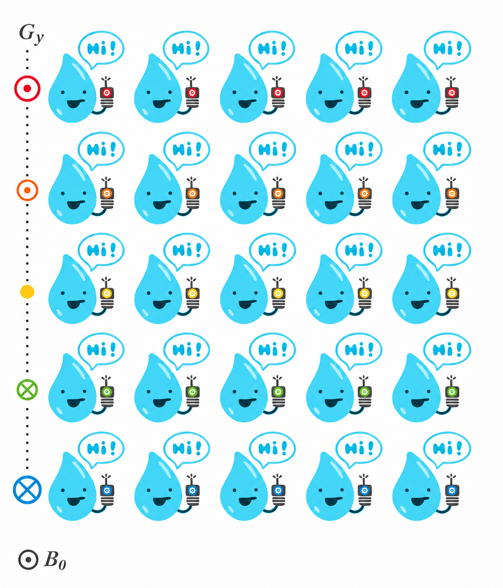
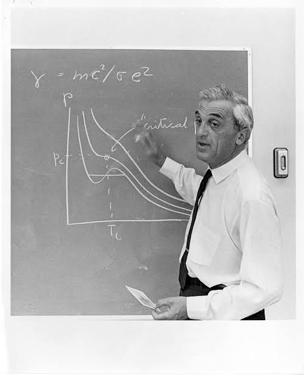
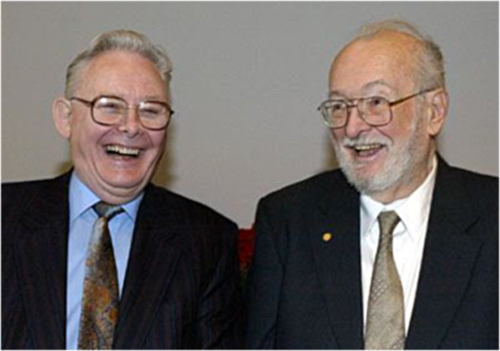
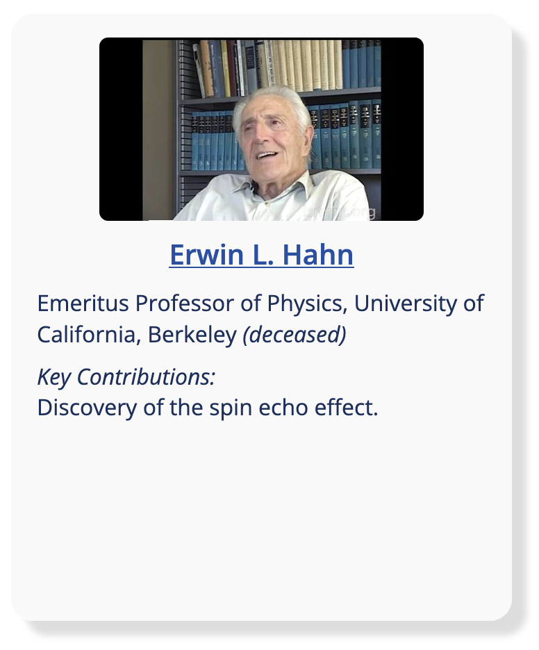
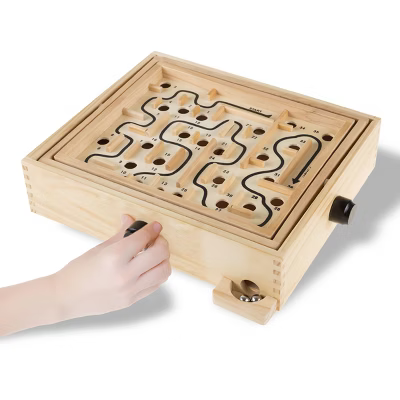

```{julia}
#| output: false
using KomaMRI
using KomaMRI.KomaMRIPlots.PlotlyBase
using FFTW

scanner = Scanner(limits=HardwareLimits(Gmax=20e-3, Smax=40.0, RF_dead_time=0.0, RF_ring_down_time=0.0, ADC_dead_time=0.0))
rf_duration = 1e-3
rf_block(angle; phase=0.0) = PulseDesigner.build_block_pulse(angle; duration=rf_duration, phase_offset=phase, sys=scanner)

function gradient_block(amplitude, duration)
    seq = Sequence(scanner)
    gradient = iszero(amplitude) ? Grad(0.0, duration) :
        PulseDesigner.make_trapezoid(; amplitude=γ*amplitude, duration, sys=scanner)
    addblock!(seq, ADC(ceil(Int, duration/1e-3)+1, duration); x=gradient)
    seq
end

function record_experiment(seq, obj; te=30e-3)
    n = length(obj.x)
    times = [0.0]
    net = [[0.0,0.0,1.0]]
    record = function(progress, blocks, data, params)
        push!(times, data.seqd.t[last(blocks.parts[progress.block])])
        push!(net, [real(sum(data.Xt.xy)), imag(sum(data.Xt.xy)), sum(data.Xt.z)] ./ n)
    end
    simulate(obj, seq, scanner; verbose=false, callbacks=(record,),
        sim_params=Dict("gpu"=>false, "Nthreads"=>1, "precision"=>"f64", "Δt"=>0.5e-3,
            "Δt_rf"=>20e-6, "max_block_length"=>1, "max_rf_block_length"=>1, "return_type"=>"state"))
    keep = findall(t -> t <= 1.5te + rf_duration/2 + 1e-9, times)
    Dict("t"=>1e3 .* (times[keep] .- rf_duration/2),
        "net"=>net[keep], "te"=>1e3te)
end

# Position and off-resonance are sampled independently in both echo experiments.
np, nf = 21, 151
frequencies = 50 .* tan.(π .* (((1:nf) .- 0.5) ./ nf .- 0.5))
frequencies = frequencies[abs.(frequencies) .<= 2π*100]
positions = repeat(collect(range(-5e-3, 5e-3; length=np)); inner=length(frequencies))
omega = repeat(frequencies; outer=np)
ensemble = Phantom(x=positions, Δw=omega, T1=fill(0.45,length(positions)), T2=fill(0.12,length(positions)))
echo_time, gradient_amplitude = 30e-3, 0.5e-3
lobe = echo_time/2 - rf_duration
ramp_compensation = PulseDesigner.make_trapezoid(; amplitude=γ*gradient_amplitude, duration=lobe, sys=scanner).rise/2
se_seq = rf_block(π/2) + gradient_block(-gradient_amplitude,lobe) + rf_block(π; phase=π/2) +
    gradient_block(0.0,rf_duration/2+ramp_compensation) + gradient_block(-gradient_amplitude,lobe+echo_time/2)
pre = (echo_time-rf_duration/2)/2
ge_seq = rf_block(π/2) + gradient_block(-gradient_amplitude,pre) + gradient_block(0.0,ramp_compensation) +
    gradient_block(gradient_amplitude,pre+echo_time/2)
echo_data = Dict("se"=>record_experiment(se_seq,ensemble), "ge"=>record_experiment(ge_seq,ensemble))

# One actual KomaMRI acquisition per Cartesian line. Independent excitations
# isolate spatial encoding from saturation and relaxation in the Fourier demos.
N, fov, dwell = 96, 0.24, 5e-6
dk = 1/fov
coordinates = (collect(0:N-1) .- N÷2) .* (fov/N)
pixels = permutedims(reshape(Float64.(read(joinpath(pwd(),"figures","brain-density-96x96.raw"))) ./ 255,N,N))
density = reverse(pixels; dims=1)
xx = repeat(coordinates; inner=N)
yy = repeat(coordinates; outer=N)
rho = vec(density)
inside = rho .> 0
brain = Phantom(x=xx[inside], y=yy[inside], ρ=rho[inside], T1=fill(Inf,count(inside)), T2=fill(Inf,count(inside)))
excitation = PulseDesigner.build_sinc_pulse(π/4; duration=rf_duration, time_bw_product=4.0,
    slice_thickness=10e-3, apodization=0.5, use=Excitation(), sys=scanner)
pre_duration = 0.25e-3

function cartesian_line(ky; nx=N, field_of_view=fov, adc_dwell=dwell, tr=nothing)
    step = 1/field_of_view
    readout = PulseDesigner.make_trapezoid(; flat_area=(nx-1)*step, flat_time=(nx-1)*adc_dwell, sys=scanner)
    seq = deepcopy(excitation)
    pre_area = -nx/2*step - γ*readout.A*readout.rise/2
    pre_x = PulseDesigner.make_trapezoid(; area=pre_area, sys=scanner)
    pre_y = PulseDesigner.make_trapezoid(; area=ky, sys=scanner)
    encoding_duration = max(dur(pre_x), dur(pre_y)) + pre_duration
    # ADC endpoints are exactly -Nx/2*Δk through (Nx/2-1)*Δk.
    addblock!(seq; x=PulseDesigner.make_trapezoid(; area=pre_area, duration=encoding_duration, sys=scanner),
        y=PulseDesigner.make_trapezoid(; area=ky, duration=encoding_duration, sys=scanner))
    addblock!(seq, ADC(nx,(nx-1)*adc_dwell,readout.rise); x=readout)
    if !isnothing(tr)
        addblock!(seq, Delay(tr-dur(seq)))
    end
    seq
end

function sequence_data(seq)
    rule = KomaMRI.KomaMRIBase.MomentSamplingRule(MaxStepSizeRule(1,20e-6))
    sampled = discretize(seq; sampling_rule=rule)
    trajectory, adc = get_kspace(seq; sampling_rule=MaxStepSizeRule(1,20e-6))
    Dict("wave"=>plot_seq(seq;slider=false,show_rf_frame=false),
        "t"=>1e3 .* sampled.t[2:end], "k"=>[collect(row) for row in eachrow(trajectory[:,1:2])],
        "adc"=>[collect(row) for row in eachrow(adc[:,1:2])],
        "duration"=>1e3dur(seq))
end

single_line = sequence_data(cartesian_line(-24dk))
single_line["start_time"] = 1e3dur(excitation)
line_indices = [-48,-24,0,24,47]
multi_seq = Sequence(scanner)
for ky in line_indices .* dk
    global multi_seq += cartesian_line(ky; tr=12e-3)
end
multiple_lines = sequence_data(multi_seq)
multiple_lines["line_indices"] = line_indices

K = zeros(ComplexF64,N,N)
for (row,ky) in enumerate((-N÷2:N÷2-1).*dk)
    seq = cartesian_line(ky)
    signal = simulate(brain,seq,scanner;verbose=false,
        sim_params=Dict("gpu"=>false,"Nthreads"=>4,"precision"=>"f64", "return_type"=>"mat",
            "Δt"=>20e-6,"Δt_rf"=>20e-6))
    K[row,:] .= vec(signal)
end

reconstruct(k) = abs.(fftshift(ifft(ifftshift(k))))
rows(a) = [collect(row) for row in eachrow(a)]
scale = maximum(reconstruct(K))
image = reconstruct(K) ./ scale
klog(k) = log10.(1 .+ 1000 .* abs.(k) ./ maximum(abs.(K)))
resolution = []
for width in [12,24,32,48,64,96]
    masked = zeros(ComplexF64,N,N)
    indices = N÷2-width÷2+1:N÷2+width÷2
    masked[indices,indices] .= K[indices,indices]
    push!(resolution,Dict("n"=>width,"k"=>rows(klog(masked)),"image"=>rows(reconstruct(masked)./scale)))
end
fields_of_view = []
for factor in [1,2,3,4]
    masked = copy(K)
    masked[mod.(-N÷2:N÷2-1,factor) .!= 0,:] .= 0
    push!(fields_of_view,Dict("factor"=>factor,"k"=>rows(klog(masked)),
        "image"=>rows(factor .* reconstruct(masked)./scale)))
end

TR = 10e-3
scan_seq = cartesian_line(-16dk;nx=32,tr=TR) + cartesian_line(-15dk;nx=32,tr=TR)
scan_time = sequence_data(scan_seq)
scan_time["tr"] = 1e3TR

lecture_data = Dict("echo"=>echo_data,"single"=>single_line,"multiple"=>multiple_lines,
    "brain"=>Dict("n"=>N,"fov"=>fov,"dk"=>dk,"x"=>1e3coordinates,"kaxis"=>(-N÷2:N÷2-1).*dk,
        "density"=>rows(density),"image"=>rows(image),"k"=>rows(klog(K)),
        "resolution"=>resolution,"fov_variants"=>fields_of_view),"scan"=>scan_time)

function demo_html(id; class="demo")
    print("```{=html}\n<div id=\"$id\" class=\"$class\"></div>\n```\n")
end

```


# <u>Left-handed</u> rotations around the <u>effective field</u> {.compact .nostretch}

{.rotation-figure}


# Comparing SE with GE

```{julia}
#| output: asis
demo_html("echo-comparison")
```


# All spins in a slice are excited, how can we differentiate them? {.compact}

::: {.columns .art-columns}
::: {.column width="61%"}
{.drop-grid}
:::
::: {.column width="39%"}
{.tower}

Sends RF pulse at Larmor frequency

$$
\boldsymbol{B}(t_0)=
\begin{bmatrix}B_{1x}\\B_{1y}\\G_z z-\Delta\omega_{\mathrm{RF}}/\gamma\end{bmatrix}
$$
:::
:::

::: notes
B(t_0) =  (B1x, B1y, Gz z - domega_Rf/gamma)
:::

# We can use frequency to encode spatial coordinates {.compact}

::: {.columns .art-columns .field-columns}
::: {.column width="62%"}
{.drop-grid}
:::
::: {.column width="38%"}
$$\boldsymbol{B}(t_1)=
\begin{bmatrix}0\\0\\G_x x\end{bmatrix}$$

:::
:::

::: notes
Change bandwidth for acquisition bandwidth definition


Also B(t_1) =  show RF stuff = 0, G_x . x
:::

# Paul Lauterbur (1973) {.compact}

::: {.history-subtitle}
Introducing magnetic field gradients in the magnetic field for spatial 2D encoding.
:::

::: {.columns .history-columns}
::: {.column width="50%"}
{.history-photo}

Stony Brook laboratory, New York, 1977
:::
::: {.column width="50%"}
{.history-diagram}

Zeugmatography
:::
:::

::: {.credit}
Lauterbur, [*Image Formation by Induced Local Interactions: Examples Employing Nuclear Magnetic Resonance*, Nature (1973)](https://doi.org/10.1038/242190a0)
:::


# That works for x; what about y? {.center .transition-slide}


# We can use phase to encode spatial coordinates {.compact}

::: {.columns .art-columns .field-columns}
::: {.column width="65%"}
{.drop-grid}
:::
::: {.column width="35%"}
$$\boldsymbol{B}(t_{1/2})=
\begin{bmatrix}0\\0\\G_y y\end{bmatrix}$$
:::
:::

::: notes
Also B(t_1/2) =  show RF stuff = 0, G_y . y
:::

# If we frequency encode after phase encoding we can differentiate the signals! {#read-frequency-after-encoding-phase .compact}

::: {.encoding-layout}
::: {}
{.encoding-sketch}
:::
::: {}
{.drop-grid}
:::
::: {.encoding-receiver}
{.tower}

Now we listen
:::
:::

::: notes
Sequence:

B(t_0)=(B1x, B1y, Gz z - domega_Rf/gamma) -> B(t_1/2)=(0,0,Gy y) -> B(t_1) =(0,0,Gx x)


Make antenna that listents black
:::

# The acquired signal is a superposition of complex sinusoids {.compact}

::: {}
{.superposition-figure}
:::

# A spin’s accumulated phase depends on the gradient waveforms {#accumulated-phase-depends-on-gradient-waveforms .compact}

::: {.columns .equation-columns}
::: {.column .phase-diagram width="36%"}
Magnetization looked<br>from the “top”

::: {.complex-circle}
```{=html}
<svg viewBox="0 0 300 240" role="img" aria-label="Complex magnetization with angle minus phi">
  <circle cx="126" cy="132" r="86" fill="none" stroke="black" stroke-width="3.5"/>
  <path d="M126 132 H212" fill="none" stroke="gray" stroke-width="1.5" stroke-dasharray="3 2"/>
  <path d="M126 132 L177 81" fill="none" stroke="black" stroke-width="4"/>
  <path d="M187 71 L156 118 L147 103 L138 100 Z" fill="black"/>
  <g fill="black" font-family="KaTeX_Math, serif" font-style="italic" font-size="50">
    <text x="91" y="91">m</text>
    <text x="224" y="115">−ϕ</text>
  </g>
</svg>
```
:::

::: {.complex-formula}
$$m\,\mathrm e^{-\mathrm i\phi}$$
:::
:::
::: {.column .phase-equation width="64%"}
$$S(\boldsymbol{x},t)=m(\boldsymbol{x})\,\mathrm e^{-\mathrm i\gamma\,\boldsymbol{x}\cdot\int_0^t\boldsymbol{G}(\tau)\,\mathrm d\tau}$$

::: {.fragment}
Why is the exponential negative?
:::
:::
:::

::: notes
Change for e and i to use serif in image
:::

# The signal equation {#the-signal-equation-is-a-fourier-transform}

::: {.columns .equation-columns}
::: {.column width="37%"}
{.fourier-meme}
:::
::: {.column width="63%"}
$$\boldsymbol{k}(t)=\frac{\gamma}{2\pi}\int_0^t\boldsymbol{G}(\tau)\,\mathrm d\tau$$

$$S(t)=\int_V m(\boldsymbol{x})\,\mathrm e^{-\mathrm i2\pi\boldsymbol{k}(t)\cdot\boldsymbol{x}}\,\mathrm d\boldsymbol{x}$$


:::
:::

::: notes
Right put formulas of kspace first, then S integrated in V/volume (x vector) so S(t) = …
:::

# Peter Mansfield (1973) {.compact}

::: {.history-subtitle}
Discovery of magnetic resonance imaging.
:::

::: {}
{.mansfield-photo}
:::

::: {.mansfield-footer}
Nottingham, 1978 · Photograph: BBC *Tomorrow’s World*, 1978

Mansfield & Grannell, [*NMR “diffraction” in solids?*, J. Phys. C (1973)](https://doi.org/10.1088/0022-3719/6/22/007)
:::

::: notes
Update location and year of pictures for lauterbur, nottingham , not sure when that bbc archive was taken
:::

# Nobel prize worthy contributions

::: {.columns .history-columns .nobel-columns}
::: {.column width="35%"}
{.bloch-photo}

Felix Bloch · **1952**
:::
::: {.column width="65%"}
{.nobel-photo}

Peter Mansfield and Paul Lauterbur · **2003**
:::
:::

::: notes
Add years they won nobel prizes
:::

# Must watch for those curious about MRI history!

::: {.archive-layout}
::: {.archive-logo}

:::
::: {.archive-banner}

:::
::: {}
{.archive-card}
:::
::: {}
{.archive-card}
:::
:::

::: {.archive-link}
[https://www.ismrm.org/historical-archives/](https://www.ismrm.org/historical-archives/)
:::

# K-space trajectory: One line {.trajectory-slide}

$$\boldsymbol{k}(t)=\frac{\gamma}{2\pi}\int_0^t\boldsymbol{G}(\tau)\,\mathrm d\tau$$

```{julia}
#| output: asis
demo_html("trajectory-one")
```


# Phase is accumulated while gradients are on {#phase-is-being-accumulated-while-gradients-are-on .compact}

::: {.columns .maze-columns}
::: {.column width="38%"}
{.maze-figure}
:::
::: {.column width="62%"}
```{julia}
#| output: asis
demo_html("trajectory-maze"; class="demo maze-demo")
```
:::
:::

::: notes
Use latex Gx Gy white background
:::

# K-space trajectory: Multiple lines

```{julia}
#| output: asis
demo_html("trajectory-multiple")
```


# Each k-space sample measures a spatial pattern {.compact .pattern-slide}

$$\mathrm e^{\mathrm i2\pi\boldsymbol{k}\cdot\boldsymbol{x}}$$

```{julia}
#| output: asis
demo_html("spatial-pattern")
```

::: notes
You can use brain image in next slide
:::

# Which operation needs to be done here?

```{julia}
#| output: asis
demo_html("fourier-question")
```


# The inverse Fourier transform!

::: {.ift-operator}
$$\mathcal F^{-1}$$
:::

```{julia}
#| output: asis
demo_html("fourier-reconstruction")
```

::: notes
Formula mathcal F (inverse fourier transform)
:::

# k-space extent determines spatial resolution {.sizing-slide}

```{julia}
#| output: asis
demo_html("resolution-demo")
```

$$\Delta x=\frac{1}{2k_{\max}}$$


# k-space spacing determines field of view {.sizing-slide}

```{julia}
#| output: asis
demo_html("fov-demo")
```

$$\mathrm{FOV}=\frac{1}{\Delta k}$$


# Why does the sampling frequency matter?

```{julia}
#| output: asis
demo_html("sampling-demo")
```


# Nyquist–Shannon sampling theorem

::: {.columns .nyquist-columns}
::: {.column width="50%"}
1D signal definition:

$$\omega_s>2\omega_{\max}$$
:::
::: {.column width="50%"}
MRI equivalent:

$$\Delta k=\frac{1}{\mathrm{FOV}}$$
:::
:::

# Higher phase-encoding resolution takes more repetitions {.compact}

$$T_{\mathrm{scan}}=\mathrm{TR}\times N_y$$

```{julia}
#| output: asis
demo_html("scan-time-demo"; class="demo scan-demo")
```


# Questions? {#questions .center .transition-slide}

{height=280px fig-alt="Dizzy droplet spin with spiral eyes"}


```{julia}
#| output: asis
asset = PlotlyBase.JSON.json(read(KomaMRI.KomaMRIPlots.TIME_PLOTLY.local_path,String))
print("```{=html}\n<script>",KomaMRI.KomaMRIPlots.plotly_loader(asset),"</script>\n```\n")
```

```{julia}
#| output: asis
print("```{=html}\n<script id=\"lecture-data\" type=\"application/json\">",PlotlyBase.JSON.json(lecture_data),"</script>\n```\n")
```

```{=html}
<script>
window.addEventListener('load', async () => {
  const Plotly = await window.komaPlotly;
  const D = JSON.parse(document.getElementById('lecture-data').textContent);
  const C={blue:'#2a7fb8',orange:'#e9782d',gray:'#89939c',ink:'#343a40'};
  const palette=['#636EFA','#EF553B','#00CC96','#AB63FA','#19D3F3'];
  const config={displayModeBar:false,responsive:true};
  const axis={showgrid:true,gridcolor:'#e8ebed',zeroline:true,zerolinecolor:'#89939c',
    showline:true,linecolor:'#89939c',mirror:true,ticks:'outside',automargin:true};
  const imageAxis={...axis,showticklabels:false,ticks:'',showgrid:false,zeroline:false};
  const base={font:{size:20,color:C.ink},paper_bgcolor:'rgba(0,0,0,0)',plot_bgcolor:'rgba(0,0,0,0)',
    margin:{l:68,r:30,t:55,b:95},legend:{orientation:'h',x:.5,xanchor:'center',y:1.12},hovermode:'closest'};
  const graphs=[];
  const note=(text,x=.5,y=1.1,extra={})=>({text,x,y,xref:'paper',yref:'paper',showarrow:false,font:{size:22,color:C.ink},...extra});
  const selectSlider=(labels,prefix,active=0,suffix='')=>({
    active,x:.06,len:.88,y:-.21,pad:{t:20},ticklen:0,minorticklen:0,font:{color:'rgba(0,0,0,0)'},
    currentvalue:{visible:prefix!=='',prefix,suffix,font:{size:20,color:C.ink}},transition:{duration:0},bordercolor:C.blue,activebgcolor:C.blue,
    steps:labels.map((label,i)=>({label:String(label),value:String(i),method:'skip',args:[]}))});
  async function plot(id,data,layout) {
    const el=document.getElementById(id); if(!el)return null;
    await Plotly.newPlot(el,data,{...base,...layout},config); graphs.push(el); return el;
  }
  async function interactive(id,labels,prefix,build,active=0,suffix='') {
    const spec=i=>{const p=build(i);return {data:p.data,layout:{...base,...p.layout,sliders:[selectSlider(labels,prefix,i,suffix)]}};};
    const initial=spec(active),el=await plot(id,initial.data,initial.layout); if(!el)return;
    el.on('plotly_sliderchange',e=>{const p=spec(Number(e.step.value));Plotly.react(el,p.data,p.layout,config);});
  }

  const se=D.echo.se,ge=D.echo.ge;
  const amplitude=d=>d.net.map(v=>Math.hypot(v[0],v[1]));
  const time=d=>d.t.map(t=>t-.5);
  const post=d=>{const i=d.t.reduce((best,t,j)=>Math.abs(t-.5)<Math.abs(d.t[best]-.5)?j:best,0);return amplitude(d)[i];};
  const envelopeTimes=Array.from({length:201},(_,i)=>44.5*i/200),te=29.5;
  await plot('echo-comparison',[
    {x:time(se),y:amplitude(se),name:'SE',line:{color:C.blue,width:3}},
    {x:time(ge),y:amplitude(ge),name:'GE',line:{color:C.orange,width:3,dash:'dash'}},
    {x:envelopeTimes,y:envelopeTimes.map(t=>post(se)*Math.exp(-t/120)),name:'exp(−t/T<sub>2</sub>)',line:{color:C.ink,width:2,dash:'dot'}},
    {x:envelopeTimes,y:envelopeTimes.map(t=>post(ge)*Math.exp(-t/(1000/(1/.12+50)))),name:'exp(−t/T<sub>2</sub><sup>*</sup>)',line:{color:C.gray,width:2,dash:'dot'}}],{
      xaxis:{...axis,title:'Time after excitation (ms)',range:[-1,44.5]},
      yaxis:{...axis,title:'|S| / S₀',range:[0,1.03]},margin:{l:75,r:30,t:50,b:65},
      legend:{orientation:'h',x:.5,xanchor:'center',y:1.1,font:{size:19}},
      shapes:[{type:'rect',xref:'x',yref:'y domain',x0:-1,x1:0,y0:0,y1:1,line:{width:0},fillcolor:'rgba(155,88,207,.15)',layer:'below'},
        {type:'rect',xref:'x',yref:'y domain',x0:14,x1:15,y0:0,y1:1,line:{width:0},fillcolor:'rgba(155,88,207,.15)',layer:'below'},
        {type:'line',xref:'x',yref:'y domain',x0:te,x1:te,y0:0,y1:1,line:{color:C.gray,width:1.5,dash:'dot'}}],
      annotations:[{text:'TE',xref:'x',yref:'paper',x:te,y:.98,xshift:7,xanchor:'left',yanchor:'top',showarrow:false,font:{size:18,color:C.gray}}]
    });

  function waveform(d,domain=[0,.43],colored=false) {
    const traces=[];
    for(const name of ['Gx','Gy','Gz','|B1|_AM','ADC']) {
      const t=d.wave.data.find(t=>t.name===name);if(!t)continue;
      if(name==='Gy') {
        for(let j=0;j<(colored?5:1);j++)traces.unshift({...t,
          x:colored?t.x.map(x=>x!==null&&x>=j*12&&x<j*12+12?x:null):t.x,
          mode:'lines',line:{width:0},fill:'tozeroy',fillcolor:colored?palette[j]:C.orange,opacity:.3,
          xaxis:'x',yaxis:'y',showlegend:false,visible:true,legendgroup:'Gy',hoverinfo:'skip'});
      }
      traces.push({...t,name:name==='|B1|_AM'?'B₁':name,
        xaxis:'x',yaxis:'y',showlegend:true,visible:true,legendgroup:name});
    }
    return {data:traces,layout:{template:d.wave.layout.template,
      xaxis:{...axis,domain,anchor:'y',range:[0,d.duration],title:'Time (ms)'},
      yaxis:{...axis,domain:[.1,1],anchor:'x',range:[-22,28]},annotations:[]}};
  }
  function trajectorySpec(d,step,{maze=false,multiple=false}={}) {
    const single=!maze&&!multiple;
    const q=maze?{data:[],layout:{}}:waveform(d,[0,.43],multiple);
    if(single)q.layout.yaxis.domain=[0,1];
    const elapsed=d.t[step];
    const extent=20*Math.ceil(1.05*Math.max(...d.k.flat().map(Math.abs))/20);
    const xd=maze?[0,1]:[.58,1];
    const paths=[];
    if(multiple) {
      for(let j=0;j<5;j++) {
        const subset=d.adc.filter((_,i)=>Math.floor(i/96)===j);
        paths.push({type:'scatter',mode:'lines+markers',x:subset.map(k=>k[0]),y:subset.map(k=>k[1]),
          line:{color:palette[j],width:2},marker:{color:palette[j],size:4},showlegend:false,xaxis:'x2',yaxis:'y4',hoverinfo:'skip'});
      }
    } else paths.push({type:'scatter',mode:'markers',x:d.adc.map(k=>k[0]),y:d.adc.map(k=>k[1]),
      marker:{color:maze?C.blue:C.orange,size:5},showlegend:false,xaxis:'x2',yaxis:'y4',hoverinfo:'skip'});
    const pathX=[],pathY=[],centers=d.wave.data.find(t=>t.name==='RF_center').x;
    for(let i=0;i<=step;i++){
      if(i&&centers.some(t=>t>=d.t[i-1]&&t<d.t[i])){pathX.push(null);pathY.push(null);}
      pathX.push(d.k[i][0]);pathY.push(d.k[i][1]);
    }
    paths.unshift({type:'scatter',mode:'lines',x:pathX,y:pathY,
      line:{color:'lightgray',width:2},showlegend:false,xaxis:'x2',yaxis:'y4',hoverinfo:'skip'});
    paths.push({type:'scatter',mode:'markers',x:[d.k[step][0]],y:[d.k[step][1]],marker:{color:'#db4654',size:12},
      showlegend:false,xaxis:'x2',yaxis:'y4',hovertemplate:'kₓ=%{x:.1f}<br>kᵧ=%{y:.1f}<extra>1/m</extra>'});
    return {data:[...q.data,...paths],layout:{...q.layout,
      xaxis2:{...axis,domain:xd,anchor:'y4',range:[-extent,extent],title:'kₓ (1/m)',tickangle:0,dtick:200,constrain:'domain'},
      yaxis4:{...axis,domain:single?[0,1]:[.12,1],anchor:'x2',range:[-extent,extent],title:'kᵧ (1/m)',constrain:'domain',scaleanchor:'x2',scaleratio:1},
      annotations:[],
      shapes:maze?[]:[{type:'line',xref:'x',yref:'paper',x0:elapsed,x1:elapsed,y0:single?0:.12,y1:1,line:{color:'#db4654',width:2}}],
      legend:{orientation:'h',x:0,y:single?1.12:1.22,font:{size:16}},margin:{l:75,r:25,t:single?40:72,b:single?70:90}}};
  }
  async function trajectory(id,d,options={}) {
    const first=d.start_time===undefined?0:d.t.findIndex(t=>t>=d.start_time-1e-6);
    const indices=Array.from(new Set([...Array.from({length:150},(_,i)=>first+Math.round(i*(d.t.length-1-first)/149)),d.t.length-1]));
    await interactive(id,indices.map(k=>d.t[k].toFixed(2)),'Time: ',i=>trajectorySpec(d,indices[i],options),0,' ms');
  }
  await trajectory('trajectory-one',D.single);
  const maze=trajectorySpec(D.single,D.single.t.length-1,{maze:true});
  maze.layout.margin.b=45;
  await plot('trajectory-maze',maze.data,maze.layout);
  await trajectory('trajectory-multiple',D.multiple,{multiple:true});

  const B=D.brain;
  const phaseScale=[[0,'rgb(51,255,255)'],[1/6,'rgb(51,51,255)'],[1/3,'rgb(255,51,255)'],
    [.5,'rgb(255,51,51)'],[2/3,'rgb(255,255,51)'],[5/6,'rgb(51,255,51)'],[1,'rgb(51,255,255)']];
  const imageTrace=(z,axisName='x2',yaxis='y2')=>({type:'heatmap',z,x:B.x,y:B.x,colorscale:[[0,'#000000'],[1,'#ffffff']],zmin:0,zmax:1,
    showscale:false,xaxis:axisName,yaxis,hovertemplate:'x=%{x:.1f}<br>y=%{y:.1f}<extra></extra>'});
  const kTrace=z=>({type:'heatmap',z,x:B.kaxis,y:B.kaxis,colorscale:[[0,'#000000'],[1,'#ffffff']],zmin:0,zmax:3.001,showscale:false,
    hovertemplate:'kₓ=%{x:.1f}<br>kᵧ=%{y:.1f}<extra></extra>'});
  function imagePair(k,img,{question=false,slider=false}={}) {
    return {data:[kTrace(k),imageTrace(img)],layout:{
      xaxis:{...imageAxis,domain:[0,.43],anchor:'y',title:'',constrain:'domain'},
      yaxis:{...imageAxis,domain:[0,1],anchor:'x',title:'',scaleanchor:'x',scaleratio:1},
      xaxis2:{...imageAxis,domain:[.57,1],anchor:'y2',title:'',range:[-120,120],constrain:'domain',visible:true},
      yaxis2:{...imageAxis,domain:[0,1],anchor:'x2',title:'',range:[-120,120],constrain:'domain',scaleanchor:'x2',scaleratio:1,visible:true},
      annotations:[...(!slider?[{xref:'paper',yref:'paper',x:.52,y:.5,ax:-50,ay:0,text:'',showarrow:true,arrowhead:3,arrowwidth:2.5,arrowcolor:C.ink}]:[]),
        ...(question?[note('?',.5,.61,{font:{size:44,color:C.ink}})]:[])],
      margin:{l:70,r:30,t:slider?75:45,b:slider?105:60},showlegend:false}};
  }
  let pair=imagePair(B.k,B.image,{question:true});await plot('fourier-question',pair.data,pair.layout);
  pair=imagePair(B.k,B.image);await plot('fourier-reconstruction',pair.data,pair.layout);
  await interactive('resolution-demo',B.resolution.map(d=>d.n),'',i=>{
    const d=B.resolution[i];return imagePair(d.k,d.image,{slider:true});
  },5);
  await interactive('fov-demo',B.fov_variants.map(d=>d.factor),'',i=>{
    const d=B.fov_variants[i],p=imagePair(d.k,d.image,{slider:true});
    p.data[1].zmax=Math.max(...d.image.flat());
    p.layout.shapes=[{type:'rect',xref:'x2',yref:'y2',x0:-120,x1:120,y0:-120/d.factor,y1:120/d.factor,
      line:{color:'#66c4ef',width:2,dash:'dash'},fillcolor:'rgba(0,0,0,0)'}];return p;
  },0);

  function phaseImage(kx,ky) {
    const value=B.density.flat(),maximum=Math.max(...value);
    return B.density.map((row,j)=>row.map((a,i)=>{
      const phase=2*Math.PI*(kx*B.x[i]/1000+ky*B.x[j]/1000),h=((phase/(2*Math.PI))%1+1)%1;
      const sector=h*6,c=.8,x=c*(1-Math.abs(sector%2-1));
      const rgb=sector<1?[c,x,0]:sector<2?[x,c,0]:sector<3?[0,c,x]:sector<4?[0,x,c]:sector<5?[x,0,c]:[c,0,x];
      return [...rgb.map(v=>Math.round(255*(v+.2)*a/maximum)),255];
    }));
  }
  const gridX=[],gridY=[],central=B.kaxis.filter(k=>Math.abs(k)<=12*B.dk+1e-6);central.forEach(y=>central.forEach(x=>{gridX.push(x);gridY.push(y);}));
  function patternSpec(kx,ky) {
    return {data:[{type:'image',z:phaseImage(kx,ky),colormodel:'rgba',x0:B.x[0],y0:B.x[0],dx:2.5,dy:2.5,
      xaxis:'x',yaxis:'y',hovertemplate:'x=%{x:.1f}<br>y=%{y:.1f}<extra></extra>'},
      {type:'scatter',mode:'markers',x:gridX,y:gridY,marker:{color:'#86acc8',size:5},xaxis:'x2',yaxis:'y2',
        hovertemplate:'kₓ=%{x:.1f}<br>kᵧ=%{y:.1f}<extra>1/m</extra>',showlegend:false},
      {type:'scatter',mode:'markers',x:[kx],y:[ky],marker:{color:C.orange,size:12},xaxis:'x2',yaxis:'y2',showlegend:false},
      {type:'scatter',mode:'markers',x:[0,0],y:[0,0],xaxis:'x',yaxis:'y',showlegend:false,hoverinfo:'skip',
        marker:{size:0,opacity:0,color:[-Math.PI,Math.PI],cmin:-Math.PI,cmax:Math.PI,colorscale:phaseScale,showscale:true,
          colorbar:{x:.45,y:.5,len:.85,thickness:14,outlinewidth:0,title:{text:'Phase',side:'top'},
            tickvals:[-Math.PI,-Math.PI/2,0,Math.PI/2,Math.PI],ticktext:['−π','−π/2','0','π/2','π'],tickfont:{size:16}}}}],layout:{
      xaxis:{...imageAxis,domain:[0,.43],anchor:'y',title:'x (mm)',range:[-120,120],constrain:'domain'},
      yaxis:{...imageAxis,domain:[0,1],anchor:'x',title:'y (mm)',range:[-120,120],scaleanchor:'x',scaleratio:1},
      xaxis2:{...imageAxis,domain:[.57,1],anchor:'y2',title:'kₓ (1/m)',range:[-55,55],constrain:'domain'},
      yaxis2:{...imageAxis,domain:[0,1],anchor:'x2',title:'kᵧ (1/m)',range:[-55,55],constrain:'domain',scaleanchor:'x2',scaleratio:1},
      annotations:[],margin:{l:65,r:25,t:25,b:60}}};
  }
  let pattern=patternSpec(0,0);const patternEl=await plot('spatial-pattern',pattern.data,pattern.layout);
  function updatePattern(kx,ky){const p=patternSpec(kx,ky);Plotly.react(patternEl,p.data,p.layout,config);}
  patternEl.on('plotly_click',e=>{const p=e.points[0];if(p.curveNumber===1||p.curveNumber===2)updatePattern(p.x,p.y);});

  const rates=[.75,1,1.25,1.5,2,2.5,3,4,6,8],dense=Array.from({length:1001},(_,i)=>4*i/1000);
  await interactive('sampling-demo',rates,'',i=>{
    const fs=rates[i],t=Array.from({length:Math.floor(4*fs)+1},(_,j)=>j/fs),fa=1-Math.round(1/fs)*fs;
    return {data:[{x:dense,y:dense.map(t=>Math.sin(2*Math.PI*t)),name:'Original sinusoid',line:{color:C.gray,width:3}},
      {x:dense,y:dense.map(t=>Math.sin(2*Math.PI*fa*t)),name:'Wave fitting the samples',line:{color:C.orange,width:3,dash:'dash'}},
      {x:t,y:t.map(t=>Math.sin(2*Math.PI*t)),mode:'markers',name:'Samples',marker:{color:C.blue,size:11}}],
      layout:{xaxis:{...axis,title:'Time (s)',range:[0,4]},yaxis:{...axis,title:'Signal',range:[-1.2,1.2]},
        annotations:[],
        legend:{orientation:'h',x:.5,xanchor:'center',y:1.07,yanchor:'bottom',font:{size:18}},margin:{l:70,r:30,t:85,b:100}}};
  },9);

  const scan=D.scan,centers=scan.wave.data.find(t=>t.name==='RF_center').x,
    halfB1=Math.max(...scan.wave.data.find(t=>t.name==='|B1|_AM').y.filter(Number.isFinite))/2;
  await plot('scan-time-demo',scan.wave.data,{
    ...scan.wave.layout,font:base.font,paper_bgcolor:base.paper_bgcolor,plot_bgcolor:base.plot_bgcolor,
    xaxis:{...axis,title:'Time (ms)',range:[0,scan.duration],rangeslider:{visible:false}},
    yaxis:{...axis,range:[-22,28]},margin:{l:65,r:25,t:65,b:60},
    legend:{orientation:'h',x:0,y:1.18,font:{size:18}},
    annotations:[{xref:'x',yref:'y',x:centers[1],y:halfB1,axref:'x',ayref:'y',ax:centers[0],ay:halfB1,
      text:'',showarrow:true,arrowhead:2,startarrowhead:2,arrowside:'end+start',arrowcolor:C.ink,arrowwidth:3},
      {xref:'x',yref:'y',x:(centers[0]+centers[1])/2,y:halfB1,yshift:12,yanchor:'bottom',text:'TR',showarrow:false,font:{size:22,color:C.ink}}]
  });

  const resize=()=>graphs.filter(el=>el.closest('section')?.classList.contains('present')).forEach(el=>Plotly.Plots.resize(el));
  if(window.Reveal){Reveal.on('slidechanged',resize);Reveal.on('ready',resize);}
  window.addEventListener('resize',resize);resize();
  window.lecture4Ready=true;
});

</script>
```
