```{julia}
#| output: false
include("../common.jl")
using FFTW
using Printf

# Actual KomaMRI trajectories on the Lecture 4 FOV.
N, radial_samples, fov = 96, 64, 0.24
scanner = Scanner(limits=HardwareLimits(B0=3.0, Gmax=30e-3, Smax=180.0, ADC_Δt=8e-6))
cart_tr, radial_tr = 6e-3, 4e-3
cart_sys = Scanner(limits=HardwareLimits(Gmax=20e-3, Smax=40.0,
    RF_dead_time=0.0, RF_ring_down_time=0.0, ADC_dead_time=0.0))
excitation(sys) = PulseDesigner.build_sinc_pulse(π/4; duration=1e-3, time_bw_product=4.0,
    slice_thickness=10e-3, apodization=0.5, use=Excitation(), sys)
line_readout(ky, nx, dwell, sys; step=1/fov) =
    cartesian_line(ky, sys; excitation=nothing, nx, fov=1/step, dwell)

function repetition_data(seq, tr)
    padded = seq + Delay(tr - dur(seq))
    step = MaxStepSizeRule(1, 20e-6)
    sampled = discretize(padded; sampling_rule=KomaMRI.KomaMRIBase.MomentSamplingRule(step))
    trajectory, adc = get_kspace(padded; sampling_rule=step)
    Dict("t" => 1e3 .* sampled.t[2:end], "trajectory" => rows(trajectory[:, 1:2]), "tr" => 1e3 * tr,
        "adc" => rows(adc[:, 1:2]), "adcTime" => 1e3 .* get_adc_sampling_times(padded),
        "wave" => plot_seq(padded; slider=false, show_rf_frame=false))
end

cartesian_dwell = 5e-6
cartesian_trs = [repetition_data(excitation(cart_sys) + line_readout(ky / fov, N, cartesian_dwell, cart_sys), cart_tr)
    for ky in [-48, -24, 0, 24, 47]]
radial_excitation = excitation(scanner)
radial_readout = line_readout(0.0, radial_samples, scanner.limits.ADC_Δt, scanner)

function radial_shot(θ)
    seq = Sequence(scanner)
    @addblock seq += radial_excitation
    @addblock seq += rotz(θ) * radial_readout
    repetition_data(seq, radial_tr)
end

radial_angles = 0:180
radial_shots = [radial_shot(deg2rad(angle)) for angle in radial_angles]
spoke_angles = 0:36:144
five_radial_shots = radial_shots[spoke_angles .+ 1]
readout_colors = BIOS_COLORS.palette

function radial_waveforms(shot)
    names = ("Gx", "Gy", "Gz", "|B1|_AM", "ADC")
    traces = [deepcopy(only(filter(t -> t[:name] == name, shot["wave"].data))) for name in names]
    for (i, trace) in enumerate(traces)
        trace[:xaxis] = "x"; trace[:yaxis] = "y"; trace[:visible] = true; trace[:showlegend] = true
        trace[:name] = i == 4 ? "B₁" : names[i]
    end
    traces
end

function radial_plot(traces, steps, prefix; height, cursor=false)
    ax = bios_axis(; automargin=false)
    tr_ms = 1e3 * radial_tr
    slider_x, slider_y, slider_length = 0.28, -0.27, 0.44
    shapes, annotations = PlotlyBase.PlotlyAttribute[], PlotlyBase.PlotlyAttribute[]
    if cursor
        push!(shapes, attr(type="line", xref="x", yref="y domain", x0=0, x1=0,
            y0=0, y1=1, line=attr(color="#d84657", width=2)))
        n_tr = length(five_radial_shots)
        for repetition in 0:n_tr
            fraction = repetition / n_tr
            anchor = slider_x + slider_length * fraction
            inset = 10 * (1 - 2fraction)
            push!(shapes, attr(type="line", xref="paper", yref="paper",
                xsizemode="pixel", ysizemode="pixel", xanchor=anchor, yanchor=slider_y,
                x0=inset, x1=inset, y0=-58, y1=-64, line=attr(color=BIOS_COLORS.gray, width=1)))
            push!(annotations, attr(xref="paper", yref="paper", x=anchor, y=slider_y,
                xshift=inset, yshift=-66, xanchor="center", yanchor="top", showarrow=false,
                text=@sprintf("%g ms", repetition * tr_ms), font=attr(size=16, color=BIOS_COLORS.ink)))
        end
    end
    Plot(traces, Layout(; width=1280, height, font=attr(size=20, color=BIOS_COLORS.ink),
        paper_bgcolor="white", plot_bgcolor="white", margin=attr(l=62, r=30, t=56, b=131),
        xaxis=attr(ax; domain=[0, 0.44], range=[0, tr_ms], title="Time (ms)"),
        yaxis=attr(ax; range=[-32, 32]),
        xaxis2=attr(ax; domain=[0.56, 1], range=[-149, 149], title="kₓ (1/m)", anchor="y2", constrain="domain"),
        yaxis2=attr(ax; range=[-149, 149], title="kᵧ (1/m)", anchor="x2", scaleanchor="x2", constrain="domain"),
        legend=attr(orientation="h", x=0, y=1.07, yanchor="bottom", font=attr(size=16)),
        sliders=[bios_slider(steps, prefix; x=slider_x, len=slider_length, y=slider_y, pad_t=0)],
        shapes, annotations); config=bios_config(responsive=false))
end

radial_adc_trace(color) = scatter(x=Float64[], y=Float64[], xaxis="x2", yaxis="y2",
    mode="markers", marker=attr(color=color, size=4), showlegend=false, hoverinfo="skip")

function angle_slider_plot()
    traces = GenericTrace[radial_waveforms(first(radial_shots))...; radial_adc_trace(BIOS_COLORS.orange)]
    indices = [0, 1, length(traces) - 1]
    steps = map(radial_angles, radial_shots) do angle, shot
        wave, adc = radial_waveforms(shot), shot["adc"]
        attr(label=string(angle, "°"), method="restyle",
            args=Any[Dict("x" => [wave[1][:x], wave[2][:x], first.(adc)],
                "y" => [wave[1][:y], wave[2][:y], last.(adc)]), indices])
    end
    initial_adc = first(radial_shots)["adc"]
    traces[end][:x], traces[end][:y] = first.(initial_adc), last.(initial_adc)
    radial_plot(traces, steps, "Readout angle: "; height=544)
end

function radial_time_plot()
    tr_ms = 1e3 * radial_tr
    waves = radial_waveforms.(five_radial_shots)
    traces = GenericTrace[deepcopy.(first(waves))...]
    for (i, trace) in enumerate(traces)
        times, values = Any[], Any[]
        for (j, wave) in enumerate(waves)
            append!(times, [isnothing(t) || ismissing(t) ? nothing : t + (j - 1) * tr_ms for t in wave[i][:x]])
            append!(values, wave[i][:y])
            push!(times, nothing); push!(values, nothing)
        end
        trace[:x], trace[:y] = times, values
    end
    first_k_trace = length(traces)
    push!(traces, scatter(x=[0.0], y=[0.0], xaxis="x2", yaxis="y2", mode="lines",
        line=attr(color=BIOS_COLORS.gray, width=2), showlegend=false, hoverinfo="skip"))
    append!(traces, radial_adc_trace.(readout_colors))
    cursor = radial_adc_trace("#d84657")
    cursor[:x], cursor[:y] = [0.0], [0.0]
    cursor[:marker] = attr(color="#d84657", size=9)
    push!(traces, cursor)

    steps = map(0:0.05:tr_ms*length(five_radial_shots)) do time
        index = min(floor(Int, time / tr_ms) + 1, length(five_radial_shots))
        start = (index - 1) * tr_ms
        elapsed = time - start
        shot = five_radial_shots[index]
        stop = searchsortedlast(shot["t"], elapsed)
        path = vcat([[0.0, 0.0]], shot["trajectory"][1:stop])
        acquired = searchsortedlast(shot["adcTime"], elapsed + 1e-9)
        samples = [j < index ? rep["adc"] : rep["adc"][1:(j == index ? acquired : 0)]
            for (j, rep) in enumerate(five_radial_shots)]
        paths = [path, samples..., [last(path)]]
        attr(label=@sprintf("%.2f ms", time), method="update",
            args=Any[Dict("x" => [first.(p) for p in paths], "y" => [last.(p) for p in paths]),
                Dict("xaxis.range" => [start, start + tr_ms], "shapes[0].x0" => time, "shapes[0].x1" => time),
                collect(first_k_trace:length(traces)-1)])
    end
    radial_plot(traces, steps, "Time: "; height=518, cursor=true)
end

spiral_fov = 0.30
spiral_matrix = round(Int, N * spiral_fov / fov)
spiral_interleaves = 4
spiral_design = PulseDesigner.spiral_base(spiral_fov, spiral_matrix, scanner; Nint=spiral_interleaves, BW=400e3)
spirals = spiral_design.(0:spiral_interleaves-1)
sp = radial_excitation + first(spirals)
spiral_shots = [get_kspace(seq)[2][:, 1:2] for seq in spirals]
spiral_adc = reduce(vcat, spiral_shots)
kx, ky = spiral_adc[:, 1], spiral_adc[:, 2]

# The same 96 × 96 brain and spatial grid as Lecture 4.
brain = load_brain_96x96()
pixel_spacing = fov / N
x = (-N÷2:N÷2-1) .* pixel_spacing

# Cross-section of Lauterbur's two water capillaries.
tube_radius, tube_half_spacing = 0.5e-3, 1.5e-3
tube_pixel_spacing = 6e-3 / N
tube_axis = (-N÷2:N÷2-1) .* tube_pixel_spacing
tubes = [Float64((abs(xpos) - tube_half_spacing)^2 + ypos^2 <= tube_radius^2)
    for ypos in tube_axis, xpos in tube_axis]
positions = (-N:N-1) .* tube_pixel_spacing
views = [3, 6, 12, 24, 48, 90]
view_angles(n) = n == 3 ? [0, 45, 90] : (0:n-1) .* (180 / n)
ramp = abs.(fftfreq(length(positions), inv(tube_pixel_spacing)))

function projection_index(xpos, ypos, c, s)
    u = (xpos * c + ypos * s - first(positions)) / tube_pixel_spacing + 1
    k = floor(Int, u)
    k, u - k
end

function tube_projection(angle)
    center = tube_half_spacing * cosd(angle)
    [sum(2sqrt(max(0, tube_radius^2 - (position - offset)^2)) for offset in (-center, center))
        for position in positions]
end

function backprojection(angles; filtered=false)
    image = zeros(size(tubes))
    for angle in angles
        projection = tube_projection(angle)
        filtered && (projection = real.(ifft(fft(projection) .* ramp)))
        c, s = cosd(angle), sind(angle)
        for (j, ypos) in enumerate(tube_axis), (i, xpos) in enumerate(tube_axis)
            k, fraction = projection_index(xpos, ypos, c, s)
            image[j, i] += projection[k] + fraction * (projection[k+1] - projection[k])
        end
    end
    image .* (π / length(angles))
end

function axial_phantom(n, fov)
    dx = fov / n
    axial = brain_phantom2D(; axis="axial", ss=1)
    phantom = zeros(n, n)
    half_spin_spacing = 0.25e-3
    binsize = round(Int, dx / half_spin_spacing)
    pixel_index(pos) = fld(round(Int, pos / half_spin_spacing) + binsize ÷ 2, binsize) + n ÷ 2 + 1
    for (xi, yi, ρ) in zip(axial.x, axial.y, axial.ρ)
        phantom[pixel_index(yi), pixel_index(xi)] += ρ * (0.5e-3 / dx)^2
    end
    phantom ./ maximum(phantom)
end

axial_brain = axial_phantom(N, fov)
ex, ey = cis.(-2π .* (x * kx')), cis.(-2π .* (x * ky'))
signal = vec(sum(ey .* (brain * ex); dims=1))
axial_signal = vec(sum(ey .* (axial_brain * ex); dims=1))

function spiral_weights(adc)
    radius = hypot.(adc[:, 1], adc[:, 2])
    inc = diff(radius)
    dr = ([inc; last(inc)] .+ [first(inc); inc]) ./ 2
    w = max.(radius .* dr, 0.0)
    w[1] = radius[2]^2 / 8
    w
end
weights = reduce(vcat, spiral_weights.(spiral_shots))

# Oversampled Cartesian gridding with a separable Kaiser–Bessel kernel.
grid_n, grid_step = 2N, 1 / (2fov)
kernel_width, beta = 4.0, 8.6
half_width = kernel_width / 2
i0(z) = sum((z / 2)^(2j) / Float64(factorial(j))^2 for j in 0:16)
kernel(d) = abs(d) <= half_width ? i0(beta * sqrt(max(0.0, 1 - (d / half_width)^2))) / i0(beta) : 0.0

function grid_samples(kx, ky, values; n=grid_n, step=grid_step)
    grid = zeros(ComplexF64, n, n)
    for (kx1, ky1, value) in zip(kx, ky, values)
        u, v = kx1 / step + n ÷ 2 + 1, ky1 / step + n ÷ 2 + 1
        for j in ceil(Int, v - half_width):floor(Int, v + half_width),
            i in ceil(Int, u - half_width):floor(Int, u + half_width)
            grid[mod1(j, n), mod1(i, n)] += value * kernel(i - u) * kernel(j - v)
        end
    end
    grid
end

kernel_transform(t) = (z = sqrt(beta^2 - (π * kernel_width * t)^2); sinh(z) / z)

weighted_signal, weighted_axial = signal .* weights, axial_signal .* weights
first_interleaf = axes(first(spiral_shots), 1)
interleaf_grid = grid_samples(kx[first_interleaf], ky[first_interleaf], weighted_axial[first_interleaf])
grid = grid_samples(kx, ky, weighted_signal)
crop = (grid_n÷2 - N÷2 + 1):(grid_n÷2 + N÷2)
deapod = kernel_transform.((-N÷2:N÷2-1) ./ grid_n)
deapodized_spiral_image(g) = abs.(fftshift(ifft(ifftshift(g)))[crop, crop] ./ (deapod * deapod'))
spiral_image = deapodized_spiral_image(grid)
gridding_image = deapodized_spiral_image(grid_samples(kx, ky, weighted_axial))
log_magnitude(a) = log10.(1 .+ 1000 .* abs.(a) ./ maximum(abs, a))

function sample_phantom(adc, phantom, axis)
    samples = zeros(ComplexF64, size(adc, 1))
    for batch in Iterators.partition(axes(adc, 1), 4096)
        samples[batch] = vec(sum(cis.(-2π .* (axis * adc[batch, 2]')) .* (phantom * cis.(-2π .* (axis * adc[batch, 1]'))); dims=1))
    end
    samples
end

function off_resonance_signal(adc, phantom, axis, field_hz, readout_times)
    sig = zeros(ComplexF64, size(adc, 1))
    for (sample, time) in enumerate(readout_times)
        idx = sample:length(readout_times):size(adc, 1)
        sig[idx] = sample_phantom(view(adc, idx, :), phantom .* cis.((-2π * time) .* field_hz), axis)
    end
    sig
end

function gradient_delay_offsets(seq, delays_us)
    rule = KomaMRI.KomaMRIBase.MomentSamplingRule(MaxStepSizeRule(1, 1e-6))
    sampled = discretize(seq; sampling_rule=rule)
    k, nominal = get_kspace(sampled)
    times = sampled.t[2:end]
    adc_times = get_adc_sampling_times(seq)
    map(delays_us) do delay
        acq_t = adc_times .- delay * 1e-6
        delayed = hcat([KomaMRI.KomaMRIBase.linear_interpolate_samples((t=times, A=view(k, :, ax)), acq_t) for ax in 1:2]...)
        delayed .- nominal[:, 1:2]
    end
end

function sampling_comparison(sys, phantom, fov)
    n = size(phantom, 1)
    dx, dk = fov / n, 1 / fov
    axis = (-n÷2:n÷2-1) .* dx

    n_spokes = 6 * ceil(Int, π * n / 12)
    radial = line_readout(0.0, n, sys.limits.ADC_Δt, sys; step=dk)
    radial_seqs = [rotz(π * j / n_spokes) * radial for j in 0:n_spokes-1]
    spokes = [get_kspace(seq)[2][:, 1:2] for seq in radial_seqs]
    n_interleaves = 24
    spiral_seqs = PulseDesigner.spiral_base(fov, n, sys; Nint=n_interleaves, BW=400e3).(0:n_interleaves-1)
    interleaves = [get_kspace(seq)[2][:, 1:2] for seq in spiral_seqs]
    rad_t, sp_t = get_adc_sampling_times(radial), get_adc_sampling_times(first(spiral_seqs))
    native_times = (((0:n-1) .- n ÷ 2) .* cartesian_dwell, rad_t .- rad_t[n÷2+1], sp_t .- first(sp_t))
    readout_times = map(t -> t .* (6e-3 / (last(t) - first(t))), native_times)

    delays_us = [2, 4]
    k_axis = (-n÷2:n÷2-1) .* dk
    cart_seqs = [line_readout(ky, n, cartesian_dwell, cart_sys; step=dk) for ky in k_axis]
    delay_offsets = map((cart_seqs, radial_seqs, spiral_seqs)) do seqs
        offs = gradient_delay_offsets.(seqs, Ref(delays_us))
        [reduce(vcat, getindex.(offs, i)) for i in eachindex(delays_us)]
    end
    shot_indices(shots, samples) = [((shot - 1) * samples + 1):(shot * samples) for shot in shots]
    delay_guides = (shot_indices((n÷2-5, n÷2+1, n÷2+7), n),
        shot_indices(1:(n_spokes÷6):n_spokes, n),
        shot_indices(1:(n_interleaves÷3):n_interleaves, size(first(interleaves), 1)))

    gaussian(x, y, cx, cy, sx, sy) = exp(-0.5 * (((x - cx) / sx)^2 + ((y - cy) / sy)^2))
    offsets = ((-0.31, 5, -25, 44, 46), (0.48, 4, 51, 20, 19),
        (0.86, -14, 100, 9, 6), (0.66, 17, 96, 8, 6), (-0.30, -32, 86, 8, 6),
        (0.57, -69, 49, 6, 14), (-0.43, 68, 48, 6, 12),
        (-0.50, 67, -57, 6, 9), (0.32, -56, -75, 8, 8), (0.26, 20, -92, 10, 6))
    axis_mm = 1e3 .* axis
    field = [sum(a * gaussian(xi, yi, cx, cy, sx, sy) for (a, cx, cy, sx, sy) in offsets) +
        0.17 * gaussian(xi, yi, -2, 95, 34, 10) * sin((xi + yi) / 4) * cos((xi - yi) / 5)
        for yi in axis_mm, xi in axis_mm]
    field_mask = phantom .> 0
    for row in eachrow(field_mask)
        left = findfirst(row)
        isnothing(left) || (row[left:findlast(row)] .= true)
    end
    field ./= maximum(abs, field[field_mask])
    off_resonance_levels = [0, 100, 200, 300]

    crop_c = (n÷2 + 1):(n÷2 + n)
    corr = kernel_transform.((-n÷2:n÷2-1) ./ (2n))
    deap = corr * corr'
    adjoint_magnitude(adc, vals) =
        abs.(fftshift(ifft(ifftshift(grid_samples(adc[:, 1], adc[:, 2], vals; n=2n, step=dk/2))))[crop_c, crop_c] ./ deap)

    trajectories = map(1:3) do factor
        ky_sub = k_axis[1:factor:end]
        cart_adc = hcat(repeat(k_axis; outer=length(ky_sub)), repeat(ky_sub; inner=n))
        kept_spokes = spokes[1:factor:end]
        rad_adc = reduce(vcat, kept_spokes)
        r = hypot.(rad_adc[:, 1], rad_adc[:, 2])
        area = (π / (2length(kept_spokes))) .* (min.(r .+ dk/2, n * dk / 2) .^ 2 .- max.(r .- dk/2, 0) .^ 2)
        area[r .< 1e-7] .*= 2
        kept_int = interleaves[1:factor:end]
        (
            (cart_adc, fill(factor * dk^2, size(cart_adc, 1)), "$(length(ky_sub)) lines"),
            (rad_adc, area, "$(length(kept_spokes)) spokes"),
            (reduce(vcat, kept_int), (2π / length(kept_int)) .* reduce(vcat, spiral_weights.(kept_int)), "$(length(kept_int)) interleaves"),
        )
    end

    off_res_imgs, off_res_psfs, delay_panels = [], [], []
    comparison = map(enumerate(trajectories)) do (factor, samplings)
        map(samplings, readout_times, delay_offsets, delay_guides) do (adc, w, count), times, offs, guides
            psf = adjoint_magnitude(adc, w)
            peak = psf[n÷2+1, n÷2+1]
            sc = sum(w) * dx^2 / peak
            img = adjoint_magnitude(adc, w .* sample_phantom(adc, phantom, axis)) .* sc
            if factor == 1
                push!(off_res_imgs, [rows(round.(adjoint_magnitude(adc, w .* off_resonance_signal(adc, phantom, axis, hz .* field, times)) .* sc; digits=5))
                    for hz in off_resonance_levels[2:end]])
                adc_t = repeat(times; outer=size(adc, 1) ÷ length(times))
                push!(off_res_psfs, [rows(round.(adjoint_magnitude(adc, w .* cis.((-2π * hz) .* adc_t)) ./ peak; digits=5))
                    for hz in off_resonance_levels])
                nom_paths = [rows(round.(adc[idx, :]; digits=4)) for idx in guides]
                delayed = map(offs) do off
                    act = adc .+ off
                    mag = adjoint_magnitude(adc, w .* sample_phantom(act, phantom, axis)) .* sc
                    (paths=[rows(round.(act[idx, :]; digits=4)) for idx in guides], image=rows(round.(mag; digits=5)))
                end
                push!(delay_panels, (paths=nom_paths, delayed=delayed))
            end
            (psf=rows(round.(psf ./ peak; digits=5)), image=rows(round.(img; digits=5)), count=count)
        end
    end
    off_res = (levels=off_resonance_levels, psfs=off_res_psfs,
        field=rows(ifelse.(field_mask, round.(field; digits=4), nothing)), images=off_res_imgs,
        readoutMs=[1e3 * (last(t) - first(t)) for t in readout_times])
    comparison, off_res, (levels=[0; delays_us], panels=delay_panels)
end

function voronoi_density(samples, k_radius)
    sites = unique(samples)
    boundary = k_radius .* cis.(range(0, 2π; length=129)[1:end-1])
    cells = map(sites) do sample
        polygon = boundary
        for neighbor in sites
            neighbor == sample && continue
            normal, mid = conj(neighbor - sample), (sample + neighbor) / 2
            clipped = ComplexF64[]
            a = last(polygon); da = real(normal * (a - mid))
            for b in polygon
                db = real(normal * (b - mid))
                (da <= 0) != (db <= 0) && push!(clipped, a + (b - a) * (da / (da - db)))
                db <= 0 && push!(clipped, b)
                a, da = b, db
            end
            polygon = clipped
        end
        polygon
    end
    area = [abs(sum(imag(conj(a) * b) for (a, b) in zip(c, circshift(c, -1)))) / 2 for c in cells]
    edge_angle = 2π / length(boundary)
    normals = cis.(-edge_angle .* (0.5:1:length(boundary)-0.5))
    apothem = k_radius * cos(edge_angle / 2)
    on_boundary(z) = any(nm -> real(nm * z) >= apothem - 1e-8 * k_radius, normals)
    boundary_cells = Set(findall(c -> any(on_boundary, c), cells))
    lookup = Dict(s => i for (i, s) in enumerate(sites))
    sample_cells = [lookup[s] for s in samples]
    visits = [count(==(i), sample_cells) for i in eachindex(sites)]
    (; radius=k_radius, samples, boundary=[boundary; first(boundary)], cells, area,
        boundary_cells, sample_cells, weights=area[sample_cells] ./ visits[sample_cells])
end

function spiral_density_demo()
    k_radius, turns = 200.0, 4
    spiral(t) = k_radius * (0.3t + 0.7t^2) * cis(2π * turns * t)
    path = spiral.(range(0, 1; length=641))
    samples = path[1:4:end]
    intervals = length(samples) - 1
    guards = spiral.(1 .+ (1:(intervals ÷ turns)) ./ intervals)
    extended = voronoi_density([samples; guards], abs(last(guards)))
    examples = [41, 120]
    patches = [30.5 - 13.5im, samples[last(examples)]]
    hw = 15.0
    patch_samples = [findall(z -> abs(real(z - c)) <= hw && abs(imag(z - c)) <= hw, samples) for c in patches]
    (; voronoi_density(samples, k_radius)..., path, examples,
        reference=extended.weights[eachindex(samples)], ref_name="With guard samples",
        patches, hw, patch_samples)
end

function radial_density_demo()
    k_radius, spokes = 200.0, 8
    pos = range(-k_radius, k_radius; length=21)
    samples = [iszero(r) ? 0.0 + 0.0im : r * cis(π * j / spokes) for j in 0:spokes-1 for r in pos]
    ram_lak = abs.(pos) .* (step(pos) * π / spokes)
    (; voronoi_density(samples, k_radius)..., examples=[12, 20],
        sample_count=length(pos), reference=ram_lak, ref_name="Ram–Lak ramp")
end

const DENSITY_COLORS = [BIOS_COLORS.blue, "#b65318"]
const BOUNDARY_COLOR = "#77549b"

function density_k_axes(radius)
    ext = radius * 1.07
    (xaxis=bios_axis(title="kₓ (1/m)", range=[-ext, ext], constrain="domain", showgrid=false, zeroline=false),
     yaxis=bios_axis(title="kᵧ (1/m)", range=[-ext, ext], constrain="domain", scaleanchor="x", showgrid=false, zeroline=false))
end

function voronoi_diagram_plot(dens; height=540)
    ex, ey, cx, cy = Any[], Any[], Any[], Any[]
    for (i, cell) in enumerate(dens.cells)
        closed = [cell; first(cell)]
        xs, ys = real.(closed), imag.(closed)
        append!(ex, xs); push!(ex, nothing); append!(ey, ys); push!(ey, nothing)
        if i in dens.boundary_cells
            append!(cx, xs); push!(cx, nothing); append!(cy, ys); push!(cy, nothing)
        end
    end
    traces = GenericTrace[
        scatter(mode="lines", x=cx, y=cy, fill="toself", fillcolor=BOUNDARY_COLOR * "29",
            line=attr(width=0), hoverinfo="skip"),
        scatter(mode="lines", x=ex, y=ey, line=attr(color="#adb5bd", width=1), hoverinfo="skip"),
    ]
    for (i, ex_idx) in enumerate(dens.examples)
        closed = [dens.cells[dens.sample_cells[ex_idx]]; first(dens.cells[dens.sample_cells[ex_idx]])]
        push!(traces, scatter(mode="lines", x=real.(closed), y=imag.(closed), fill="toself",
            fillcolor=DENSITY_COLORS[i] * "45", line=attr(color=DENSITY_COLORS[i], width=2), hoverinfo="skip"))
    end
    push!(traces,
        scatter(mode="lines", x=real.(dens.boundary), y=imag.(dens.boundary),
            line=attr(color=BIOS_COLORS.gray, width=2), hoverinfo="skip"),
        scatter(mode="markers", x=real.(dens.samples), y=imag.(dens.samples),
            marker=attr(color=BIOS_COLORS.ink, size=4), customdata=[dens.area[i] for i in dens.sample_cells],
            hovertemplate="Cell area %{customdata:.1f} m⁻²<extra></extra>"))
    bios_plot(traces; height, showlegend=false, hovermode="closest",
        margin=attr(l=68, r=20, t=8, b=64), density_k_axes(dens.radius)...)
end

function voronoi_weights_plot(dens; sample_count=length(dens.weights), height=420)
    w = dens.weights[1:sample_count]
    idx = collect(1:sample_count)
    b_idx = [j for j in idx if dens.sample_cells[j] in dens.boundary_cells]
    traces = GenericTrace[
        scatter(mode="lines", x=idx, y=w, name="Voronoi", line=attr(color=BIOS_COLORS.ink, width=2),
            hovertemplate="Sample %{x}<br>Weight %{y:.1f} m⁻²<extra></extra>"),
        scatter(mode="markers", x=dens.examples, y=[dens.weights[j] for j in dens.examples],
            marker=attr(color=DENSITY_COLORS, size=10), showlegend=false, hoverinfo="skip"),
        scatter(mode="lines", x=idx, y=dens.reference, name=dens.ref_name,
            line=attr(color=BIOS_COLORS.blue, width=2, dash="dash"),
            hovertemplate="Sample %{x}<br>Weight %{y:.1f} m⁻²<extra>%{fullData.name}</extra>"),
        scatter(mode="markers", x=b_idx, y=[w[j] for j in b_idx], name="Boundary-clipped",
            marker=attr(color=BOUNDARY_COLOR, size=8, symbol="circle-open"), hoverinfo="skip"),
    ]
    bios_plot(traces; height, showlegend=true, hovermode="closest",
        margin=attr(l=95, r=20, t=45, b=68),
        xaxis=bios_axis(title="Sample index j", range=[0, sample_count + 1], zeroline=false),
        yaxis=bios_axis(title="ωⱼ", rangemode="tozero", separatethousands=true),
        legend=attr(orientation="h", x=0, y=1.06, yanchor="bottom", font=attr(size=17)))
end

function spiral_kspace_plot(seq; show_guides=true, height=440)
    p = plot_kspace(seq; view_2d=true)
    for tr in p.data
        if get(tr, :name, "") == "ADC"
            tr.marker = attr(get(tr, :marker, attr()); size=1.5, showscale=show_guides)
        end
    end
    ext = (N / (2fov)) * 1.12
    p.layout.height = height
    p.layout.font = attr(size=20, color=BIOS_COLORS.ink)
    p.layout.showlegend = show_guides
    p.layout.paper_bgcolor = "#ffffff"
    p.layout.plot_bgcolor = "#ffffff"
    p.layout.xaxis = attr(p.layout.xaxis; bios_axis(range=[-ext, ext], constrain="domain")...)
    p.layout.yaxis = attr(p.layout.yaxis; bios_axis(range=[-ext, ext], constrain="domain")...)
    p.layout.margin = attr(l=65, r=show_guides ? 55 : 10, t=show_guides ? 52 : 10, b=65)
    p.layout.legend = attr(orientation="h", xref="paper", yref="paper", x=0, y=1.07, yanchor="bottom", font=attr(size=16))
    p.config = bios_config()
    p
end

spiral_dens = spiral_density_demo()
radial_dens = radial_density_demo()
bp_frames = [backprojection(view_angles(n)) for n in views]
fbp_frames = [backprojection(view_angles(n); filtered=true) for n in views]
sampling_results, off_resonance_results, gradient_delay_results = sampling_comparison(scanner, axial_brain, fov)

lecture_data = Dict(
    "cartesianTRs" => cartesian_trs, "readoutColors" => readout_colors,
    "spiral" => rows(first(spiral_shots)), "spiralExtent" => N / (2fov),
    "signal" => log_magnitude(axial_signal[first_interleaf]),
    "interleafGrid" => rows(log_magnitude(interleaf_grid)),
    "griddingImage" => rows(gridding_image ./ maximum(gridding_image)),
    "samplingComparison" => sampling_results, "offResonance" => off_resonance_results,
    "gradientDelay" => gradient_delay_results,
)
```

# Cartesian imaging acquires parallel lines in k-space {#cartesian-lines .compact}

$$\boldsymbol{k}(t)=\frac{\gamma}{2\pi}\int_0^t\boldsymbol{G}(\tau)\,\mathrm d\tau$$

```{=html}
<div class="figure-row short-figures">
  <div id="cartesian-wave" class="chart"></div>
  <div id="cartesian-trajectory" class="chart"></div>
</div>
<div id="cartesian-time" class="slide-control half-slider"></div>
```

::: {.slide-reference}
[Pauly, Nishimura, and Macovski, *A k-space analysis of small-tip-angle excitation* (1989)](https://doi.org/10.1016/0022-2364(89)90265-5)
:::

::: notes
The phase-encoding gradient selects the line's vertical position. Advance the slider to the next TR and watch the acquired lines accumulate.

Pause at the negative $G_z$ lobe after the sinc pulse. In the small-tip model, each increment of excitation accrues slice-direction phase from the gradient area that follows it. For this symmetric pulse on a symmetric slice-select gradient, the RF center is the effective excitation time. The negative lobe cancels the area from that center through the end of the slice-select lobe, approximately half the total slice-select area. This is the conventional pulse in Figure 1 of Pauly et al. An asymmetric RF waveform can shift the effective center or give phase that a single rewinder only partly compensates.
:::

# Acquired data can be reconstructed by using the inv. FT {#inverse-transform .compact}

$$S(t)=\int_V m(\boldsymbol{x})\,\mathrm e^{-\mathrm i2\pi\boldsymbol{k}(t)\cdot\boldsymbol{x}}\,\mathrm d\boldsymbol{x}$$

:::: {.figure-row .fourier-panels .short-figures .middle}

::: {.figure-panel}
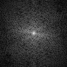{height=380px fig-alt="Magnitude of Cartesian k-space from Lecture 4"}
:::
::: {.figure-panel}
$$\mathcal F^{-1}$$

$$\longrightarrow$$
:::
::: {.figure-panel}
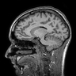{height=380px fig-alt="Brain reconstructed by inverse FFT in Lecture 4"}
:::
::::

::: notes
This is the same brain image and Fourier transform demonstration used in Lecture 4. The left panel shows the log magnitude of k-space. The inverse Fourier transform uses the complex data, including phase.
:::

# Paul Lauterbur (1973) {.compact}

::: {.culture-image}
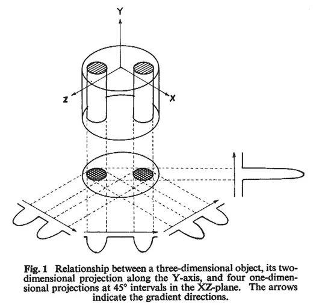{height=510px fig-alt="Lauterbur's projections of two tubes"}
:::

::: {.slide-reference}
[Lauterbur, *Image Formation by Induced Local Interactions* (1973)](https://doi.org/10.1038/242190a0)
:::

# Radial imaging requires us to “rotate” the gradients {#rotate-gradients .compact}

```{julia}
angle_slider_plot()
```

::: {.fragment}

```julia
seq = Sequence(sys)
@addblock seq += excitation
@addblock seq += rotz(θ) * readout
```

:::

::: notes
Start with the full spoke on the horizontal axis at $k_y = 0$. Sweep the angle to rotate both the readout waveform and the spoke. The excitation stays fixed. In the Koma code, $\theta$ is in radians.
:::

# Instead of multiple phase enc., we use multiple spokes {#multiple-spokes .compact}

```{julia}
radial_time_plot()
```

::: notes
Each TR acquires one rotated spoke. The k-space panel retains the spokes from completed TRs.
:::

# How many spokes do we need? {#how-many-spokes}

:::: {.figure-row .middle}

::: {.figure-panel}
```{julia}
stride = 5
horiz = five_radial_shots[1]["adc"]
grid_step_s = stride * (horiz[2][1] - horiz[1][1])
ext_s = 171.0
rad_s = abs(horiz[1][1])
lim = floor(Int, ext_s / grid_step_s)
gx = [i * grid_step_s for i in -lim:lim for _ in -lim:lim]
gy = [j * grid_step_s for _ in -lim:lim for j in -lim:lim]
spoke_traces = [scatter(mode="lines+markers", x=first.(sh["adc"]), y=last.(sh["adc"]),
    line=attr(color=BIOS_COLORS.blue, width=2), hoverinfo="skip",
    marker=attr(color=BIOS_COLORS.blue, size=[mod(i - 1 - length(sh["adc"]) ÷ 2, stride) == 0 ? 5 : 0 for i in eachindex(sh["adc"])]))
    for sh in five_radial_shots]
ang_s = π / length(five_radial_shots)
arc_s = range(0, ang_s; length=50)
sp_y = -0.47 * grid_step_s
bios_plot(GenericTrace[
    scatter(mode="markers", x=gx, y=gy, marker=attr(color="#bec7ce", size=4), hoverinfo="skip"),
    spoke_traces...,
    scatter(mode="lines", x=rad_s .* cos.(arc_s), y=rad_s .* sin.(arc_s),
        line=attr(color=BIOS_COLORS.orange, width=2), hoverinfo="skip"),
]; height=560, showlegend=false, margin=attr(l=68, r=20, t=8, b=64),
    xaxis=bios_axis(title="kₓ (1/m)", range=[-ext_s, ext_s], constrain="domain"),
    yaxis=bios_axis(title="kᵧ (1/m)", range=[-ext_s, ext_s], constrain="domain", scaleanchor="x"),
    annotations=[
        attr(x=rad_s * cos(ang_s / 2), y=rad_s * sin(ang_s / 2), text="kₘₐₓ Δθ",
            ax=24, ay=-56, arrowcolor=BIOS_COLORS.orange, font=attr(color=BIOS_COLORS.orange)),
        attr(x=-3grid_step_s, y=sp_y, ax=-4grid_step_s, ay=sp_y, xref="x", yref="y", axref="x", ayref="y",
            text="", showarrow=true, arrowside="end+start", arrowhead=2, startarrowhead=2,
            arrowcolor=BIOS_COLORS.blue, arrowwidth=1.4),
        attr(x=-3.5grid_step_s, y=sp_y, text="Δk", yshift=-7, yanchor="top", showarrow=false,
            font=attr(size=16, color=BIOS_COLORS.blue)),
    ], config=bios_config(scrollZoom=true))
```
:::
::: {.figure-panel .spoke-formulas}
$$\underbrace{\color{#e9782d}k_{\max}\Delta\theta}_{\text{arc length}}\leq\Delta k$$

$$k_{\max}=\frac{N}{2}\Delta k$$

$$\Delta\theta=\frac{\pi}{N_{\mathrm{sp}}}$$

$$\boxed{N_{\mathrm{sp}}\geq\frac{\pi N}{2}}$$
:::
::::

::: notes
The diagram marks every fifth ADC sample along each spoke and uses that same spacing for the illustrative Cartesian grid. Compare this spacing with the largest gap between spokes at the edge. The estimate assumes uniformly spaced full spokes with $N$ samples per spoke.
:::

# Projection-slice theorem: One spoke gives one projection {#projection-slice .compact}

::: {.projection-equation}
$$
S(k_x,k_y)\,[1(k_x)\delta(k_y)]
\;\xrightarrow{\;\mathcal F^{-1}\;}\;
m(x,y)*[\delta(x)1(y)]
$$
:::

```{julia}
proj_angles = [0, 45, 90]
proj_profiles = [1e3 .* tube_projection(a) for a in proj_angles]
proj_ymax = maximum(maximum, proj_profiles) * 1.05
rot2(pts, deg) = [(p[1] * cosd(deg) - p[2] * sind(deg), p[1] * sind(deg) + p[2] * cosd(deg)) for p in pts]
function proj_geom(deg)
    ax_pts = rot2([(-2.4, 2.4), (2.4, 2.4)], deg)
    ctr = 1e3 * tube_half_spacing * cosd(deg)
    offs = deg == 90 ? [0.0] : [-ctr, ctr]
    anns = [begin
        (x0, y0), (x1, y1) = rot2([(o, -2.4), (o, 2.4)], deg)
        attr(x=x1, y=y1, ax=x0, ay=y0, xref="x", yref="y", axref="x", ayref="y",
            text="", showarrow=true, arrowhead=3, arrowcolor=BIOS_COLORS.orange, arrowwidth=2)
    end for o in offs]
    (first.(ax_pts), last.(ax_pts), anns)
end
pos_mm, tube_mm = 1e3 .* positions, 1e3 .* tube_axis
px0, py0, anns0 = proj_geom(0)
proj_steps = [begin
    px, py, anns = proj_geom(a)
    attr(label=string(a, "°"), method="update",
        args=Any[Dict("x" => [px, pos_mm], "y" => [py, proj_profiles[k]]),
            Dict("annotations" => anns), [1, 2]])
end for (k, a) in enumerate(proj_angles)]

bios_plot([
    bios_heatmap(rows(tubes); x=tube_mm, y=tube_mm, colorscale=[[0, "#000"], [1, "#fff"]],
        zmin=0, zmax=1, showscale=false, hoverinfo="skip", zsmooth=false),
    scatter(mode="lines", x=px0, y=py0, line=attr(color=BIOS_COLORS.orange, width=2), hoverinfo="skip"),
    scatter(mode="lines", x=pos_mm, y=proj_profiles[1], xaxis="x2", yaxis="y2",
        line=attr(color=BIOS_COLORS.blue, width=2), hoverinfo="skip"),
]; height=470, showlegend=false, margin=attr(l=68, r=20, t=12, b=115), annotations=anns0,
    xaxis=bios_axis(domain=[0, 0.45], title="x (mm)", range=[-3.6, 3.6], constrain="domain"),
    yaxis=bios_axis(domain=[0, 1], title="y (mm)", range=[-3.6, 3.6], constrain="domain", scaleanchor="x"),
    xaxis2=bios_axis(domain=[0.55, 1], anchor="y2", title="Position along projection (mm)", range=[-3.6, 3.6], constrain="domain"),
    yaxis2=bios_axis(domain=[0, 1], anchor="x2", title="Projection", range=[0, proj_ymax],
        scaleanchor="x2", scaleratio=7.2 / proj_ymax, constrain="domain"),
    sliders=[bios_slider(proj_steps, "θ = "; x=0.28, len=0.44, y=-0.26, pad_t=10,
        ticklen=6, font=attr(color=BIOS_COLORS.ink, size=17))])
```

::: notes
At 0°, the mask selects the horizontal spoke. Multiplication by the mask becomes convolution with $\delta(x)1(y)$ after the inverse FT. In the convolution, $\delta(x)$ holds $x$ fixed and $1(y)$ sums along $y$, giving $p_{\theta=0}(x)=\int m(x,y')\,\mathrm{d}y'$ repeated across $y$. Each circle represents a cross-section of one of Lauterbur’s water tubes. The arrows show the direction of integration as the spoke rotates. The two peaks move closer at 45° and overlap at 90°.
:::

# If we take the projections, smear them in 2D and add them {#backprojection .compact}

```{julia}
bp_max = maximum(bp_frames[end])
bp_steps = [attr(label=string(n), method="restyle", args=[attr(z=[rows(bp_frames[k])])])
    for (k, n) in enumerate(views)]
bios_plot([
    bios_heatmap(rows(bp_frames[1]); x=tube_mm, y=tube_mm, colorscale=[[0, "#000"], [1, "#fff"]],
        zmin=0, zmax=bp_max, showscale=false, hoverinfo="skip", zsmooth=false),
]; height=510, showlegend=false, margin=attr(l=10, r=10, t=6, b=95),
    xaxis=attr(visible=false), yaxis=attr(visible=false, scaleanchor="x"),
    sliders=[bios_slider(bp_steps, "Number of views: "; x=0.06, len=0.88, y=-0.12, pad_t=10)])
```

::: notes
Spread each projection value back along its integration line. Start with 0°, 45°, and 90°. Increase the count and look for the halos around the two tubes.
:::

# Filtered backprojection {#filtered-backprojection}

```{julia}
fbp_steps = [attr(label=string(n), method="restyle", args=[attr(z=[rows(bp_frames[k]), rows(fbp_frames[k])])])
    for (k, n) in enumerate(views)]
bios_plot([
    bios_heatmap(rows(bp_frames[1]); x=tube_mm, y=tube_mm, colorscale=[[0, "#000"], [1, "#fff"]],
        zmin=0, zmax=bp_max, showscale=false, hoverinfo="skip", zsmooth=false),
    bios_heatmap(rows(fbp_frames[1]); x=tube_mm, y=tube_mm, xaxis="x2", yaxis="y2",
        colorscale=[[0, "#000"], [1, "#fff"]], zmin=0, zmax=1, showscale=false, hoverinfo="skip", zsmooth=false),
]; height=430, showlegend=false, margin=attr(l=10, r=10, t=54, b=95),
    xaxis=attr(domain=[0, 0.46], visible=false, constrain="domain"),
    yaxis=attr(domain=[0, 1], visible=false, scaleanchor="x", constrain="domain"),
    xaxis2=attr(domain=[0.54, 1], anchor="y2", visible=false, constrain="domain"),
    yaxis2=attr(domain=[0, 1], anchor="x2", visible=false, scaleanchor="x2", constrain="domain"),
    annotations=[
        attr(text="Unfiltered", xref="x domain", yref="paper", x=0.5, y=1.06, xanchor="center", yanchor="bottom", showarrow=false, font=attr(size=23)),
        attr(text="Ram–Lak filtered", xref="x2 domain", yref="paper", x=0.5, y=1.06, xanchor="center", yanchor="bottom", showarrow=false, font=attr(size=23)),
    ],
    sliders=[bios_slider(fbp_steps, "Number of views: "; x=0.06, len=0.88, y=-0.15, pad_t=10)])
```

::: {.figure-label}
$$S_{\mathrm{filtered}}(k_r,\theta)
= \underbrace{|k_r|}_{\text{Ram–Lak ramp}}\,S(k_r\cos\theta,\;k_r\sin\theta)$$
:::

::: notes
Apply the Ram–Lak ramp $|k_r|$ to each spoke before the 1D inverse Fourier transform. The ramp accounts for the larger k-space area represented by samples farther from the center.
:::

# Spiral acquisitions can be used for SNR efficiency {#spiral-acquisition .compact}

:::: {.figure-row}

::: {.figure-panel}
```{julia}
sp_wave = clean_seq_plot(sp; height=440, font_size=20, margin=attr(l=55, r=10, t=52, b=65))
filter!(t -> get(t, :name, "") in ("Gx", "Gy", "Gz", "B₁", "ADC"), sp_wave.data)
for t in sp_wave.data; t.visible = true; t.showlegend = true; end
sp_wave.layout.xaxis = attr(sp_wave.layout.xaxis; bios_axis()...)
sp_wave.layout.yaxis = attr(sp_wave.layout.yaxis; bios_axis()...)
sp_wave.layout.legend = attr(orientation="h", xref="paper", yref="paper", x=0, y=1.07, yanchor="bottom", font=attr(size=16))
sp_wave
```
:::
::: {.figure-panel}
```{julia}
spiral_kspace_plot(sp; show_guides=true, height=440)
```
:::
::::

::: {.slide-reference}
[Gary H. Glover, *Simple analytic spiral K-space algorithm* (1999)](https://pubmed.ncbi.nlm.nih.gov/10440968/)
:::

::: notes
The waveform starts with the same slice-selective excitation as the radial example. The in-plane trajectory shows one shot of a four-interleaf spiral designed for a 300 mm acquisition FOV and 2.5 mm resolution.
:::

# How do we reconstruct from this arbitrary k-space trajectory? {#spiral-image .compact}

:::: {.figure-row .fourier-panels .middle}

::: {.figure-panel}
```{julia}
spiral_kspace_plot(sp; show_guides=false, height=440)
```
:::
::: {.figure-panel}
$$?$$

$$\longrightarrow$$
:::
::: {.figure-panel}
```{julia}
bios_plot([
    bios_heatmap(rows(spiral_image ./ maximum(spiral_image)); colorscale=[[0, "#000"], [1, "#fff"]],
        showscale=false, hoverinfo="skip", zsmooth=false),
]; height=440, showlegend=false, margin=attr(l=10, r=10, t=6, b=10),
    xaxis=attr(visible=false), yaxis=attr(visible=false, scaleanchor="x"))
```
:::
::::

::: notes
The trajectory shows one shot. The image uses all four interleaves and the original 240 mm, 96 × 96 grid.
:::

# Density compensation function (DCF) {#density-compensation .compact}

:::: {.figure-row .middle .dcf-figure}
::: {.figure-panel}
```{julia}
p_colors = fill(BIOS_COLORS.ink, length(spiral_dens.samples))
for (i, idxs) in enumerate(spiral_dens.patch_samples), j in idxs
    p_colors[j] = DENSITY_COLORS[i]
end
patch_shapes = [attr(type="rect",
    x0=real(c) - spiral_dens.hw, x1=real(c) + spiral_dens.hw,
    y0=imag(c) - spiral_dens.hw, y1=imag(c) + spiral_dens.hw,
    line=attr(color=DENSITY_COLORS[i], width=2), fillcolor=DENSITY_COLORS[i] * "18", layer="below")
    for (i, c) in enumerate(spiral_dens.patches)]
bios_plot([
    scatter(mode="lines", x=real.(spiral_dens.path), y=imag.(spiral_dens.path),
        line=attr(color=BIOS_COLORS.gray, width=1), hoverinfo="skip"),
    scatter(mode="markers", x=real.(spiral_dens.samples), y=imag.(spiral_dens.samples),
        marker=attr(color=p_colors, size=5), hoverinfo="skip"),
]; height=540, showlegend=false, margin=attr(l=68, r=20, t=8, b=64), shapes=patch_shapes,
    density_k_axes(spiral_dens.radius)...)
```
:::

::: {.figure-panel .dcf-detail}
$$\omega_j \approx \text{k-space area per sample}$$
:::
::::

::: notes
The diagram is a schematic variable-density spiral. Equal weights would give the densely sampled patch more influence simply because it contains more samples. Using the patch average, the inner samples each represent about $A/5$, while the outer sample represents $A$. The inverse Fourier integral is approximated by $\sum_j \omega_j S_j e^{i2\pi\boldsymbol{k}_j\cdot\boldsymbol{x}}$, so the weights approximate the area elements of that integral.
:::

# Estimating the DCF with a Voronoi diagram {#voronoi-density-compensation .compact}

:::: {.figure-row .middle .dcf-figure}
::: {.figure-panel}
```{julia}
voronoi_diagram_plot(spiral_dens; height=540)
```
:::

::: {.figure-panel .dcf-detail .voronoi-detail}
$$\omega_j \approx \frac{\operatorname{area}(V_j)}{\text{visits to }\boldsymbol{k}_j}$$

```{julia}
voronoi_weights_plot(spiral_dens; height=420)
```
:::
::::

::: {.slide-reference}
[Rasche et al., *Resampling of Data Between Arbitrary Grids Using Convolution Interpolation* (1999)](https://doi.org/10.1109/42.774166)<br>
Guard samples · [Tanase and Boada, *Voronoi Based Sampling Density Correction* (ISMRM 2006, abstract 2950)](https://archive.ismrm.org/2006/2950.html)
:::

::: notes
$V_j$ is the Voronoi cell associated with $\boldsymbol{k}_j$. The diagram uses the same sample coordinates as the previous slide. Interior edges lie on perpendicular bisectors between samples. The purple cells touch the chosen disk cutoff, so their areas depend on where that cutoff is placed. The dashed curve shows a second estimate obtained by extrapolating the spiral one turn with guard samples. Those extra sites define cell boundaries. Only acquired samples receive weights for reconstruction. This spiral visits each acquired location once, so the denominator is one for every sample.
:::

# Estimating the DCF for radial sampling {#radial-density-compensation .compact}

:::: {.figure-row .middle .dcf-figure}
::: {.figure-panel}
```{julia}
voronoi_diagram_plot(radial_dens; height=540)
```
:::

::: {.figure-panel .voronoi-detail}
$$\omega_j \approx \frac{\operatorname{area}(V_j)}{\text{visits to }\boldsymbol{k}_j}$$

```{julia}
voronoi_weights_plot(radial_dens; sample_count=radial_dens.sample_count, height=420)
```
:::
::::

::: notes
The schematic uses eight full spokes with 21 samples each. The graph shows the first spoke from one end through the origin to the other. The dashed Ram–Lak ramp is $|k_r|\,\Delta k_r\,\Delta\theta$, with $\Delta k_r=20\,\mathrm{m}^{-1}$ and $\Delta\theta=\pi/8$. These factors put the ramp on the same area scale as the Voronoi weights. The ideal ramp is zero at the origin. Each of the eight center samples gets one eighth of the finite Voronoi cell's area. The purple endpoint cells are cut off by the disk. With samples at 180 and 200 $\mathrm{m}^{-1}$, the last cell begins near 190 and ends at the cutoff, leaving roughly half of a full 20 $\mathrm{m}^{-1}$ radial bin.
:::

# Nonuniform Fourier transform and gridding {#nonuniform-fourier-transform-and-gridding .compact}

:::: {.figure-row .three-panels .short-figures .gridding-panels}

::: {.figure-panel}
<div class="figure-label">Acquired nonuniform k-space</div>

<div id="gridding-input" class="chart"></div>

::: {.gridding-formula}
$$S_j=S(\boldsymbol{k}_j)$$
:::

:::
::: {.figure-panel}
<div class="figure-label">Gridded k-space</div>

<div id="gridding-grid" class="chart"></div>

::: {.gridding-formula}
$$S_g(\boldsymbol{k})=\sum_j \omega_j S_j C(\boldsymbol{k}-\boldsymbol{k}_j)$$
:::

::: {.figure-label}
$\omega_j$ is the density compensation weight.<br>
$C$ is the Kaiser–Bessel gridding kernel.
:::

:::
::: {.figure-panel}
<div class="figure-label">Inverse FT</div>

<div id="gridding-image" class="chart"></div>

::: {.gridding-formula}
$$\hat{m}(\boldsymbol{x})=\frac{\mathcal{F}^{-1}\{S_g\}(\boldsymbol{x})}{\mathcal{F}^{-1}\{C\}(\boldsymbol{x})}$$
:::

:::
::::

::: notes
The example uses the same axial brain phantom as the aliasing comparison. The first two panels show one interleaf before and after gridding. Zero is black and larger log magnitudes are brighter. Magnify one sample and describe how its value is added to the nearby grid points with the Kaiser–Bessel kernel. Combine the grids from all four interleaves for the inverse FFT, divide out the kernel response in image space, and crop the oversampled image. The adjoint NUFFT applies this kind of off-grid Fourier operation efficiently.
:::

# What do aliasing artifacts look like? {#sampling-psf .compact}

```{=html}
<div class="psf-comparison">
  <div></div>
  <div class="figure-label">Cartesian<div class="sampling-count" id="cartesian-count"></div></div>
  <div class="figure-label">Radial<div class="sampling-count" id="radial-count"></div></div>
  <div class="figure-label">Spiral<div class="sampling-count" id="spiral-count"></div></div>
  <div class="figure-label row-label">PSF</div>
  <div id="cartesian-psf" class="chart" role="img" aria-label="Cartesian point spread function"></div>
  <div id="radial-psf" class="chart" role="img" aria-label="Radial point spread function"></div>
  <div id="spiral-psf" class="chart" role="img" aria-label="Spiral point spread function"></div>
  <div class="figure-label row-label">Reconstruction</div>
  <div id="cartesian-axial" class="chart" role="img" aria-label="Cartesian axial reconstruction"></div>
  <div id="radial-axial" class="chart" role="img" aria-label="Radial axial reconstruction"></div>
  <div id="spiral-axial" class="chart" role="img" aria-label="Spiral axial reconstruction"></div>
</div>
<div id="sampling-acceleration-control" class="slide-control half-slider show-steps"></div>
```

::: notes
The reference is the proton density of KomaMRI's axial brain phantom. All panels use a 240 mm FOV and 2.5 mm pixels. The ideal single-coil, on-resonance model isolates undersampling. For all three trajectories, reconstruct with the adjoint NUFFT using density weights, 2× oversampled Kaiser–Bessel gridding, an inverse FFT, and deapodization. The PSF is the reconstruction of a point at the origin. Each PSF is normalized to its own peak and displayed on a linear scale that clips at 5%. The reconstructions share one grayscale window. At acceleration R, keep every Rth phase-encode line, spoke, or interleaf from its 1× trajectory.
:::

# What does off-resonance look like? {#off-resonance .compact}

```{=html}
<div class="figure-row off-resonance-panels">
  <div class="figure-panel field-panel">
    <div class="figure-label">B₀ map (Hz)</div>
    <div id="off-resonance-field" class="chart" role="img" aria-label="Simulated B0 offset map in hertz"></div>
  </div>
  <div></div>
  <div class="figure-label">Cartesian<div class="readout-duration" id="off-resonance-cartesian-duration"></div></div>
  <div class="figure-label">Radial<div class="readout-duration" id="off-resonance-radial-duration"></div></div>
  <div class="figure-label">Spiral<div class="readout-duration" id="off-resonance-spiral-duration"></div></div>
  <div class="figure-label row-label">PSF</div>
  <div id="off-resonance-cartesian-psf" class="chart" role="img" aria-label="Cartesian point spread function with off-resonance"></div>
  <div id="off-resonance-radial-psf" class="chart" role="img" aria-label="Radial point spread function with off-resonance"></div>
  <div id="off-resonance-spiral-psf" class="chart" role="img" aria-label="Spiral point spread function with off-resonance"></div>
  <div class="figure-label row-label">Reconstruction</div>
  <div id="off-resonance-cartesian" class="chart" role="img" aria-label="Cartesian reconstruction with off-resonance"></div>
  <div id="off-resonance-radial" class="chart" role="img" aria-label="Radial reconstruction with off-resonance"></div>
  <div id="off-resonance-spiral" class="chart" role="img" aria-label="Spiral reconstruction with off-resonance"></div>
</div>
<div class="off-resonance-label">Off-resonance</div>
<div id="off-resonance-control" class="slide-control half-slider show-steps"></div>
```

::: {.slide-reference}
[Time-segmented off-resonance correction · Noll et al. (1991)](https://doi.org/10.1109/42.108599)
:::

::: notes
The synthetic map shows the frequency offset $\Delta f$ relative to the receiver frequency. The slider scales its peak absolute offset. The ADC timing of each 1× trajectory is stretched to a 6 ms readout while retaining the original sample coordinates. The forward model multiplies the phantom by $\exp(-\mathrm{i}2\pi\Delta f\,t)$ at each ADC sample. Time is relative to the center sample for Cartesian and radial readouts and the initial sample for the center-out spiral. The reconstruction assumes on-resonance encoding and uses the same weights, gridding, and image window across slider settings.

Each PSF uses a single pixel at the image center with its frequency offset set directly by the slider. The PSFs use a fixed linear display range from 0 to 25% of the on-resonance peak.

[Noll et al., *A homogeneity correction method for magnetic resonance imaging with time-varying gradients* (1991)](https://doi.org/10.1109/42.108599)
:::

# What do gradient delays look like? {#gradient-delay .compact}

```{=html}
<div class="psf-comparison">
  <div></div>
  <div class="figure-label">Cartesian</div>
  <div class="figure-label">Radial</div>
  <div class="figure-label">Spiral</div>
  <div class="figure-label row-label">K-space</div>
  <div id="gradient-delay-cartesian-path" class="chart" role="img" aria-label="Nominal and delayed Cartesian readouts near the center of k-space"></div>
  <div id="gradient-delay-radial-path" class="chart" role="img" aria-label="Nominal and delayed radial spokes near the center of k-space"></div>
  <div id="gradient-delay-spiral-path" class="chart" role="img" aria-label="Nominal and delayed spiral interleaves near the center of k-space"></div>
  <div class="figure-label row-label">Reconstruction</div>
  <div id="gradient-delay-cartesian-image" class="chart" role="img" aria-label="Cartesian reconstruction with gradient delay"></div>
  <div id="gradient-delay-radial-image" class="chart" role="img" aria-label="Radial reconstruction with gradient delay"></div>
  <div id="gradient-delay-spiral-image" class="chart" role="img" aria-label="Spiral reconstruction with gradient delay"></div>
</div>
<div class="gradient-delay-label">Gradient delay</div>
<div id="gradient-delay-control" class="slide-control half-slider show-steps"></div>
```

::: {.slide-reference}
[Gradient-delay and trajectory correction · Brodsky et al. (2009), Fig. 4](https://pmc.ncbi.nlm.nih.gov/articles/PMC2857383/)
:::

::: notes
Use the 1× trajectories and their native readout timings from the aliasing comparison. The top row shows representative readouts near the center of k-space. Gray circles mark the nominal samples and the blue dots mark the delayed samples. Both in-plane gradients are delayed by the same amount relative to the ADC, giving acquisition coordinates $\boldsymbol{k}(t-\tau)$. Reconstruct using the nominal coordinates, density weights, and image window. In the flat part of a Cartesian readout, the shift in $k_x$ mainly adds an image phase ramp. With a common delay, radial samples slide along each spoke and spiral samples move earlier along each interleaf. Differential delays can also shift radial spokes perpendicular to their readout direction.

The slider spans 0–4 µs. At this demo's spiral dwell of about 2.5 µs, a 4 µs delay spans about 1.6 ADC dwell intervals. Brodsky et al. measured timing advances of 5.6–7.1 µs, and a 3 T spiral spectroscopy study measured 8 µs on both in-plane axes. The reconstructions share a fixed linear grayscale window from 0 to 1.8. Brightening can occur when strong low-frequency samples are gridded at their nominal coordinates with the nominal density weights.

[Brodsky et al., *Characterizing and Correcting Gradient Errors in Non-Cartesian Imaging* (2009)](https://pmc.ncbi.nlm.nih.gov/articles/PMC2857383/) · [3 T spiral study](https://pmc.ncbi.nlm.nih.gov/articles/PMC4010560/)

[Rosenzweig et al., *Simple Auto-Calibrated Gradient Delay Estimation From Few Spokes Using Radial Intersections (RING)* (2019)](https://doi.org/10.1002/mrm.27506)
:::

# Open-source MRI reconstruction {#open-source-mri-reconstruction .center}

# BART {#bart .compact .reconstruction-tool}

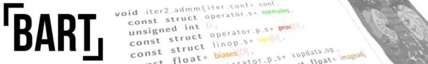{height=138px fig-alt="BART banner"}

:::: {.figure-row .middle}

::: {.figure-panel .culture-image}
<table aria-label="BART project details">
<tbody>
<tr><th scope="row">Frontend</th><td>MATLAB, Python, <a href="https://github.com/MagneticResonanceImaging/BartIO.jl">Julia</a></td></tr>
<tr><th scope="row">Backend</th><td>C</td></tr>
<tr><th scope="row">Stars</th><td><a href="https://codeberg.org/mrirecon/bart">14 (Codeberg)</a><br><a href="https://github.com/mrirecon/bart">370 (GitHub archive)</a></td></tr>
<tr><th scope="row">License</th><td>BSD-3-Clause</td></tr>
</tbody>
</table>

{height=180px fig-alt="QR code for the BART toolbox website"}

::: {.figure-label}
[mrirecon.codeberg.page](https://mrirecon.codeberg.page/)
:::

:::

::: {.figure-panel .culture-image}
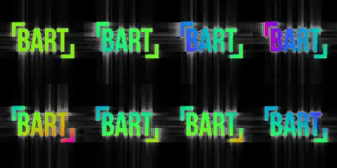{height=316px fig-alt="BART logo reconstructions from simulated MRI data"}
:::
::::

::: {.slide-reference}
[Uecker et al. Berkeley Advanced Reconstruction Toolbox. ISMRM 2015, abstract 2486.](https://archive.ismrm.org/2015/2486.html)
:::

# 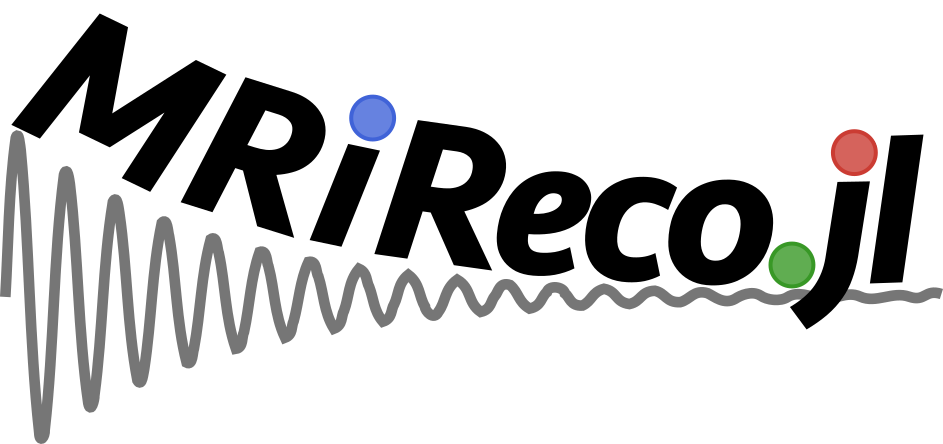{height=114} {#mrireco .compact .reconstruction-tool data-menu-title="MRIReco.jl"}

:::: {.figure-row .middle}

::: {.figure-panel .culture-image}
<table aria-label="MRIReco.jl project details">
<tbody>
<tr><th scope="row">Frontend</th><td>Julia</td></tr>
<tr><th scope="row">Backend</th><td>Julia*</td></tr>
<tr><th scope="row">Stars</th><td><a href="https://github.com/MagneticResonanceImaging/MRIReco.jl">98 (GitHub)</a></td></tr>
<tr><th scope="row">License</th><td>MIT</td></tr>
</tbody>
</table>

::: {.tool-footnote}
*CPU, CUDA, and AMDGPU.
:::

{height=180px fig-alt="QR code for the MRIReco.jl repository"}

::: {.figure-label}
[MRIReco.jl on GitHub](https://github.com/MagneticResonanceImaging/MRIReco.jl)
:::

:::

::: {.figure-panel .culture-image}
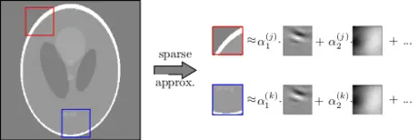{height=160px fig-alt="Sparse representation of image patches from a phantom"}

::: {.tool-examples}
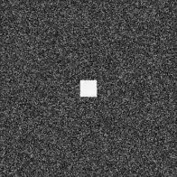{height=220px fig-alt="Variable-density k-space sampling mask"}

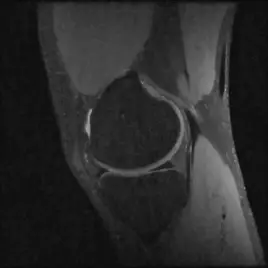{height=220px fig-alt="Reconstructed sagittal knee image"}
:::

:::
::::

::: {.slide-reference}
[Knopp and Grosser. MRIReco.jl: An MRI Reconstruction Framework written in Julia. Magnetic Resonance in Medicine, 2021.](https://doi.org/10.1002/mrm.28792)
:::

# Laboratory 5 {#lab-activity .compact}

:::: {.figure-row .middle}
::: {.figure-panel}
- Design a radial MRI pulse sequence.
- Simulate it in KomaMRI and reconstruct the data with an OpenRecon Docker container.
- Acquire data on the scanner and reconstruct it with the same container.
:::

::: {.figure-panel}
```{=html}
<iframe data-external="1" data-src="../../lab/5/activity5.html" title="Activity 5: Design and simulate a radial acquisition"></iframe>
```
:::
::::

# OpenRecon let’s you deploy custom reconstructions {#open-recon-lets-you-deploy-custom-reconstructions .compact}

:::: {.figure-row .middle}

::: {.figure-panel .culture-image}
{height=390px fig-alt="Open MAGNETOM Community graphic"}

[Open Recon documentation](https://doclib.siemens-healthineers.com/rest/v1/view?document-id=1033256)
:::
::: {.figure-panel .open-recon-list}

- Compatible Siemens MAGNETOM scanners only
- Docker-based reconstruction
- Runs on MARS (CPU/GPU)
- Uses `.mrd` for raw data and image output
- It allows you to add UI parameters
    - Reconstruction parameters
    - Display parameters

:::
::::

::: notes
Point out where the custom container runs and how scanner protocol parameters are passed to it.
:::

# Radial OpenRecon container will reconstruct your data {#radial-open-recon-container-reconstructs-your-data .compact}

:::::: {.figure-row .middle .open-recon-demo}

::::: {.figure-panel .culture-image}
:::: {.fragment .open-recon-step}
<div class="open-recon-step-number">(1)</div>

{height=185px fig-alt="BartIO.jl project and package description"}
::::

:::: {.fragment .open-recon-step}
<div class="open-recon-step-number">(2)</div>

{height=100px fig-alt="GitHub release for bios214radial 0.1.3"}

```bash
docker run ghcr.io/mcgrathcm/bios214-radial:0.1.3
```
::::

:::: {.fragment .open-recon-step}
<div class="open-recon-step-number">(3)</div>

::: {.figure-label}
[`/opt/recon/julia/recon.jl`](https://github.com/mcgrathcm/OpenReconContainers/blob/openrecon-bios214radial-v0.1.3/containers/bios214-radial/recon.jl#L38)
:::

```julia
coil_images = BartIO.bart(
    1, "nufft -i -x128:128:1 -l0.1 -m100",
    info.trajectory, data)
```
::::

:::::
::: {.figure-panel .culture-image .resolution-phantom}
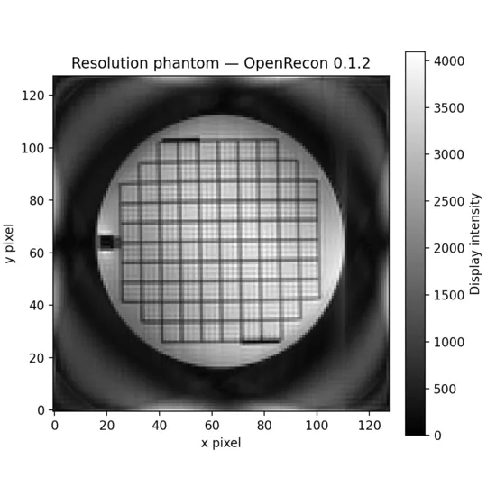{fig-alt="Resolution phantom reconstructed with Open Recon 0.1.2"}
:::
::::::

::: notes
The course container pairs the radial sequence with its ADC coordinates. The figure shows the reconstructed resolution phantom.
The [0.1.3 release](https://github.com/mcgrathcm/OpenReconContainers/releases/tag/openrecon-bios214radial-v0.1.3) provides the scanner ZIP and the Docker image.
:::

# You will test in simulation, then on the scanner {#test-in-simulation-then-on-the-scanner .compact}

:::: {.figure-row .middle .open-recon-demo}

::: {.figure-panel}
```julia
# MRI simulation
raw = simulate(obj, seq, sys)

# Download the Docker image and start the container
container = "ghcr.io/mcgrathcm/bios214-radial:0.1.3"
OpenReconClient.start(; image=container)

# Send MRD acquisition data over TCP
image = OpenReconClient.recon(raw)
```

::: {.figure-label}
[OpenReconClient.jl in BIOS 214](https://github.com/cncastillo/bios-214/blob/master/openrecon/OpenReconClient.jl)
:::

:::

::: {.figure-panel .culture-image}
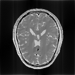{height=405px fig-alt="Axial brain phantom reconstructed with OpenRecon 0.1.3"}
:::
::::

::: notes
Use the course [OpenReconClient.jl](https://github.com/cncastillo/bios-214/blob/cb51655faac038a3652102c34f57cb50c8311587/openrecon/OpenReconClient.jl) with the release’s `radial_bssfp.seq`. Inside Docker, KomaMRI simulated the on-resonance axial BrainWeb phantom using the bundled radial bSSFP sequence (TR 3.66 ms, TE 1.83 ms, 202 spokes, 256 samples per spoke). The OpenRecon 0.1.3 container reconstructed a 128 × 128 image over a 256 × 256 mm field of view.
:::

# Pulse sequence design {#pulse-sequence-workflow}

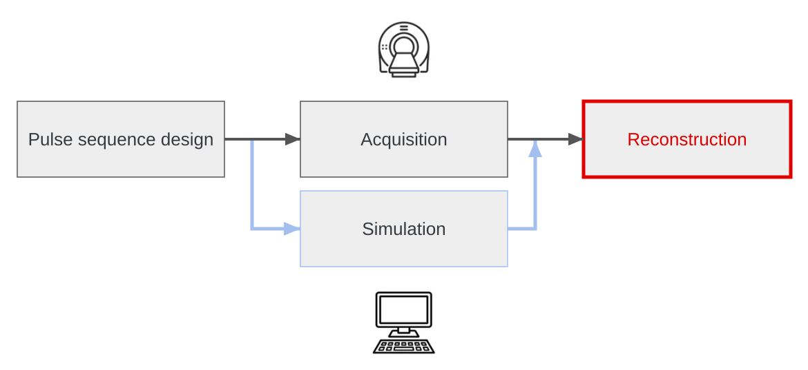{width=86% fig-align="center" fig-alt="Pulse sequence design feeds acquisition and simulation. Both paths feed reconstruction."}

# Questions? {#questions .center}

{height=180px fig-alt="Water-drop character with spiral eyes"}

```{julia}
embed_json("lecture5-data", lecture_data)
```

```{=html}
<script>
BIOS214.onReady(Plotly => {
  const d = JSON.parse(document.getElementById('lecture5-data').textContent);
  const {C, config, axis, baseLayout, standaloneSlider, linkZoom, onSlide} = BIOS214;
  const split = (pairs, i) => pairs.map(p => p[i]);
  const line = (x, y, color, extra = {}) => ({x, y, type: 'scatter', mode: 'lines', line: {color, width: 2}, hoverinfo: 'skip', ...extra});
  const points = (x, y, color, size = 4) => ({x, y, type: 'scatter', mode: 'markers', marker: {color, size}, hoverinfo: 'skip'});
  const heat = (z, props = {}) => ({z, type: 'heatmap', colorscale: [[0, '#000'], [1, '#fff']], showscale: false, hoverinfo: 'skip', zsmooth: false, ...props});
  const kAxes = extent => ({
    xaxis: {...axis, title: 'kₓ (1/m)', range: [-extent, extent], constrain: 'domain'},
    yaxis: {...axis, title: 'kᵧ (1/m)', range: [-extent, extent], constrain: 'domain', scaleanchor: 'x'}
  });
  const picture = {xaxis: {visible: false}, yaxis: {visible: false, scaleanchor: 'x'}, margin: {l: 10, r: 10, t: 6, b: 10}};
  const plot = (id, data, layout = {}, cfg = {}) => Plotly.react(document.getElementById(id), data,
    baseLayout({margin: {l: 68, r: 20, t: 8, b: 64}, showlegend: false, ...layout}), {...config, ...cfg});
  const imageWindow = {zmin: 0, zmax: 3, colorscale: [[0, '#000'], [1/3, '#bfbfbf'], [1, '#fff']]};
  const plotComparisonImage = (id, trace, layout) => {
    const el = document.getElementById(id);
    if (el.data) return Plotly.restyle(el, {z: [trace.z]});
    return plot(id, [trace], {...layout, xaxis: {...layout.xaxis, range: layout.xaxis.range.slice()},
      yaxis: {...layout.yaxis, range: layout.yaxis.range.slice()}}, {doubleClick: 'reset'});
  };

  onSlide('cartesian-lines', () => {
    const reps = d.cartesianTRs, tr = reps[0].tr;
    const times = Array.from({length: 1 + tr * reps.length * 20}, (_, i) => i / 20);
    const acquired = reps.map((r, i) => points(split(r.adc, 0), split(r.adc, 1), d.readoutColors[i]));
    const names = ['Gx', 'Gy', 'Gz', '|B1|_AM', 'ADC'];
    standaloneSlider(Plotly, 'cartesian-time', times, 'Time: ', t => t.toFixed(2) + ' ms', t => {
      const i = Math.min(Math.floor(t / tr), reps.length - 1), off = i * tr, local = t - off, r = reps[i];
      const traces = r.wave.data.filter(tr => names.includes(tr.name)).map(tr => ({
        ...tr, name: tr.name === '|B1|_AM' ? 'B₁' : tr.name,
        x: tr.x.map(v => v === null ? null : v + off), xaxis: 'x', yaxis: 'y', visible: true, showlegend: true
      }));
      plot('cartesian-wave', traces, {
        xaxis: {...axis, title: 'Time (ms)', range: [off, off + tr]}, yaxis: {...axis, range: [-32, 32]},
        shapes: [{type: 'line', xref: 'x', yref: 'paper', x0: t, x1: t, y0: 0, y1: 1, line: {color: '#d84657', width: 2}}],
        showlegend: true, margin: {l: 55, r: 10, t: 52, b: 65},
        legend: {orientation: 'h', xref: 'paper', yref: 'paper', x: 0, y: 1.07, yanchor: 'bottom', font: {size: 16}}
      });
      const end = r.t.findLastIndex(st => st <= local);
      const path = [[0, 0], ...r.trajectory.slice(0, end + 1)], cur = path.at(-1);
      const cnt = r.adcTime.findLastIndex(st => st <= local + 1e-9) + 1, act = acquired[i];
      plot('cartesian-trajectory', [line(split(path, 0), split(path, 1), C.gray), ...acquired.slice(0, i),
        {...act, x: act.x.slice(0, cnt), y: act.y.slice(0, cnt)}, points([cur[0]], [cur[1]], '#d84657', 9)], kAxes(215));
    });
  });

  onSlide('nonuniform-fourier-transform-and-gridding', () => {
    const extent = d.spiralExtent, grid = d.interleafGrid, half = grid.length / 2, step = extent / half;
    const pal = ['#000', '#444', '#676767', '#818181', '#9b9b9b', '#b1b1b1', '#c6c6c6', '#dadada', '#ededed', '#fff'];
    const segs = pal.map(() => [[], []]), maxSig = Math.max(...d.signal);
    for (let j = 1; j < d.spiral.length; j++) {
      const bin = Math.round((pal.length - 1) * (d.signal[j - 1] + d.signal[j]) / (2 * maxSig));
      segs[bin][0].push(d.spiral[j - 1][0], d.spiral[j][0], null);
      segs[bin][1].push(d.spiral[j - 1][1], d.spiral[j][1], null);
    }
    const gAx = kAxes(extent * 1.07);
    const panel = {xaxis: {...gAx.xaxis, visible: false}, yaxis: {...gAx.yaxis, visible: false}, margin: picture.margin, plot_bgcolor: '#000'};
    const cfg = {doubleClick: 'reset', showTips: false};
    const gAxis = grid.map((_, i) => (i - half) * step);
    const cscale = pal.map((c, i) => [i / (pal.length - 1), c]);
    linkZoom(Plotly, [
      plot('gridding-input', segs.map(([xs, ys], i) => line(xs, ys, pal[i], {line: {color: pal[i], width: 1.45}})), panel, cfg),
      plot('gridding-grid', [heat(grid, {x: gAxis, y: gAxis, colorscale: cscale})], panel, cfg)
    ]);
    plot('gridding-image', [heat(d.griddingImage)], picture);
  });

  onSlide('sampling-psf', () => {
    const range = [-0.5, d.samplingComparison[0][0].image.length - 0.5];
    const layout = {...picture, uirevision: 'sampling-psf', margin: {l: 0, r: 0, t: 0, b: 0},
      xaxis: {...picture.xaxis, range: range.slice(), constrain: 'domain'},
      yaxis: {...picture.yaxis, range: range.slice(), constrain: 'domain'}};
    let linked = false;
    standaloneSlider(Plotly, 'sampling-acceleration-control', [1, 2, 3], 'Acceleration: ', r => r + '×', r => {
      const recons = ['cartesian', 'radial', 'spiral'].map((k, i) => {
        const {psf, image, count} = d.samplingComparison[r - 1][i];
        document.getElementById(k + '-count').textContent = count;
        plotComparisonImage(k + '-psf', heat(psf, {zmin: 0, zmax: 0.05}), layout);
        return plotComparisonImage(k + '-axial', heat(image, imageWindow), layout);
      });
      if (!linked) { linked = true; linkZoom(Plotly, recons); }
    });
  });

  onSlide('off-resonance', () => {
    const {levels, field, images, psfs, readoutMs} = d.offResonance, kinds = ['cartesian', 'radial', 'spiral'];
    const maxHz = levels.at(-1), range = [-0.5, field.length - 0.5];
    const layout = {...picture, uirevision: 'off-resonance', plot_bgcolor: '#000', margin: {l: 0, r: 0, t: 0, b: 0, autoexpand: false},
      xaxis: {...picture.xaxis, range: range.slice(), constrain: 'domain'},
      yaxis: {...picture.yaxis, range: range.slice(), constrain: 'domain'}};
    kinds.forEach((k, i) => { document.getElementById('off-resonance-' + k + '-duration').textContent = Number(readoutMs[i].toFixed(2)) + ' ms readout'; });
    let linked = false;
    standaloneSlider(Plotly, 'off-resonance-control', levels, '', hz => hz + ' Hz', hz => {
      const map = field.map(row => row.map(v => v === null ? null : hz * v));
      const fPlot = plotComparisonImage('off-resonance-field', heat(map, {
        zmin: -maxHz, zmax: maxHz, colorscale: 'RdBu', showscale: true,
        hoverongaps: false, hoverinfo: 'z', hovertemplate: '%{z:.1f} Hz<extra></extra>',
        colorbar: {orientation: 'h', x: 0.5, xanchor: 'center', y: -0.035, yanchor: 'top',
          len: 0.82, thickness: 10, ypad: 0, outlinewidth: 0, tickvals: [-maxHz, 0, maxHz], tickfont: {size: 16}}
      }), {...layout, plot_bgcolor: '#dcebf3', margin: {...layout.margin, b: 44}});
      const lvl = levels.indexOf(hz);
      const pPlots = kinds.map((k, i) => plotComparisonImage('off-resonance-' + k + '-psf', heat(psfs[i][lvl], {zmin: 0, zmax: 0.25}), layout));
      const rPlots = kinds.map((k, i) => plotComparisonImage('off-resonance-' + k, heat(lvl === 0 ? d.samplingComparison[0][i].image : images[i][lvl - 1], imageWindow), layout));
      if (!linked) { linked = true; linkZoom(Plotly, pPlots); linkZoom(Plotly, [fPlot, ...rPlots]); }
    });
  });

  onSlide('gradient-delay', () => {
    const {levels, panels} = d.gradientDelay, kinds = ['cartesian', 'radial', 'spiral'];
    const axes = kAxes(70), guideAx = {dtick: 35, title: {text: ''}, ticks: '', showticklabels: false, automargin: false};
    const pathLayout = {uirevision: 'gradient-delay', margin: {l: 0, r: 0, t: 0, b: 0}, xaxis: {...axes.xaxis, ...guideAx}, yaxis: {...axes.yaxis, ...guideAx}};
    const imgLayout = {...picture, uirevision: 'gradient-delay', margin: {l: 0, r: 0, t: 0, b: 0}};
    standaloneSlider(Plotly, 'gradient-delay-control', levels, '', delay => delay + ' µs', delay => {
      const lvl = levels.indexOf(delay);
      kinds.forEach((k, i) => {
        const {paths, delayed} = panels[i], frame = delayed[lvl - 1];
        const mk = p => { const st = Math.round(p.length / 8); return p.map((_, idx) => idx % st === 0 ? 5 : 0); };
        const nom = paths.map(p => line(split(p, 0), split(p, 1), C.gray, {mode: 'markers', marker: {color: C.gray, size: mk(p), symbol: 'circle-open'}}));
        const act = (frame?.paths ?? paths).map(p => line(split(p, 0), split(p, 1), C.blue, {mode: 'lines+markers', marker: {size: mk(p)}}));
        plot('gradient-delay-' + k + '-path', [...act, ...nom], pathLayout);
        plot('gradient-delay-' + k + '-image', [heat(frame ? frame.image : d.samplingComparison[0][i].image, {zmin: 0, zmax: 1.8})], imgLayout);
      });
    });
  });
});
</script>
```
