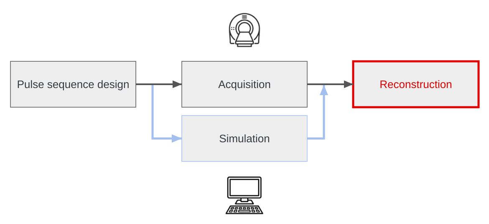

```{julia}
#| output: false
include("../common.jl")
include("../../openrecon/OpenReconClient.jl")
using Base64
using FFTW
import MRISequenceBuildingBlocks as SBB

const LECTURE6_TISSUES = Dict(
    "WM"  => [0.77, 0.832, 0.080, 0.045, 0.0],
    "GM"  => [0.86, 1.330, 0.110, 0.050, 0.0],
    "CSF" => [1.0,  4.0,   1.5,   0.20,  0.0],
)
const LECTURE6_COLORS = ["#2a7fb8", "#d77630", "#31966b"]
const OPENRECON_IMAGE = "ghcr.io/mcgrathcm/bios214-radial:0.1.3"

# The 96 × 96 Cartesian example from Lecture 4.
scanner = Scanner(limits=HardwareLimits(Gmax=20e-3, Smax=40.0,
    RF_dead_time=0.0, RF_ring_down_time=0.0, ADC_dead_time=0.0))
N, fov, dwell = 96, 0.24, 5e-6
dk = 1 / fov
excitation = PulseDesigner.build_sinc_pulse(π/4; duration=1e-3, time_bw_product=4.0,
    slice_thickness=10e-3, apodization=0.5, use=Excitation(), sys=scanner)
line_seq(ky; tr=nothing) = cartesian_line(ky, scanner; excitation, nx=N, fov, dwell, tr)
five_shots() = reduce(+, (line_seq(line * dk; tr=12e-3) for line in (-48, -24, 0, 24, 47)))

function excitation_train()
    rf = deepcopy(excitation.RF[1, 1])
    rf.A .*= 10 / 45
    shot = Sequence(scanner)
    addblock!(shot, rf)
    addblock!(shot, Delay(5e-3 - dur(shot)))
    reduce(+, (deepcopy(shot) for _ in 1:100))
end

sim_params = Dict{String,Any}("gpu"=>false, "Nthreads"=>1, "precision"=>"f64", "Δt"=>20e-6, "Δt_rf"=>20e-6)

function cartesian_images()
    density = load_brain_96x96()
    coords = ((0:N-1) .- N ÷ 2) .* (fov / N)
    x, y, inside = repeat(coords; inner=N), repeat(coords; outer=N), vec(density) .> 0
    brain = Phantom(x=x[inside], y=y[inside], ρ=vec(density)[inside],
        T1=fill(Inf, count(inside)), T2=fill(Inf, count(inside)))
    spectrum = zeros(ComplexF64, N, N)
    for (row, ky) in enumerate((-N÷2:N÷2-1) .* dk)
        spectrum[row, :] .= vec(simulate(brain, line_seq(ky), scanner; verbose=false,
            sim_params=merge(sim_params, Dict("return_type"=>"mat"))))
    end
    image = abs.(fftshift(ifft(ifftshift(spectrum))))
    log_spec = log10.(1 .+ 1000 .* abs.(spectrum) ./ maximum(abs.(spectrum)))
    (; k=rows(log_spec), image=rows(image ./ maximum(image)),
        x=1e3 .* coords, kaxis=(-N÷2:N÷2-1) .* dk)
end

# ---- Unified 1D slice-selective RF pulse demos (rf_center, rf_phase, slr_minphase, refocusing) ----

function unit_rf_envelope(a_raw, T)
    m = length(a_raw)
    dt = T / max(m - 1, 1)
    area_rad = 2π * γ * (m == 1 ? a_raw[1] * T : sum(0.5 .* (a_raw[1:end-1] .+ a_raw[2:end])) * dt)
    a_raw ./ area_rad
end

function extract_wave(seq, names)
    traces = plot_seq(seq; slider=false, show_rf_frame=false).data
    Dict(t.name => (; x=collect(t.x), y=collect(t.y), line=t.line)
        for t in traces if haskey(t, :name) && t.name in names)
end

function sample_slice_spins(spins, seq, t_grid_s; Δt=25e-6, t_offset=0.0)
    rec = record_states(spins, seq, scanner; Δt, Δt_rf=10e-6)
    frames = [begin
        idx = something(findlast(<=(tg + t_offset + 1e-9), rec.times), 1)
        [[round(rec.states[idx][j, 1]; digits=4), round(rec.states[idx][j, 2]; digits=4)] for j in eachindex(spins.z)]
    end for tg in t_grid_s]
    last_s = rec.states[end]
    frames, complex.(last_s[:, 1], last_s[:, 2])
end

function measure_tc(xy_end, omega, T)
    phi = angle.(xy_end)
    for j in 2:length(phi)
        d = phi[j] - phi[j - 1]
        while d > π; d -= 2π; end
        while d < -π; d += 2π; end
        phi[j] = phi[j - 1] + d
    end
    t_iso = -sum(omega .* (phi .- sum(phi) / length(phi))) / sum(omega .^ 2)
    clamp(T - t_iso, 0.0, T), t_iso
end

function rf_excitation_demo(; slr=false, phi_deg=0)
    T_nom, tbw, slice_thickness, dt_imp = 1e-3, 4.0, 10e-3, 1e-6
    T_total = slr ? 1.4e-3 : 1.5e-3
    n_frames = slr ? 57 : 61
    gz_T_m = (tbw / T_nom) / (γ * slice_thickness)
    z_mm = collect(range(-2.0, 2.0; length=9))
    z_m = z_mm .* 1e-3
    omega = 2π * γ * gz_T_m .* z_m
    spins = Phantom(x=zeros(9), y=zeros(9), z=z_m, T1=fill(Inf, 9), T2=fill(Inf, 9))
    t_grid_s = collect(range(0.0, T_total; length=n_frames))
    a_unit = slr ? Float64[] : unit_rf_envelope(real.(excitation.RF[1, 1].A), excitation.RF[1, 1].T)
    ph = deg2rad(phi_deg)
    flip_degs = collect(10:10:90)
    T_rf_ref = Ref(T_nom)

    cases = map(flip_degs) do deg
        flip_rad = deg2rad(deg)
        if slr
            rf_slr, _, _ = PulseDesigner.make_slr_pulse(flip_rad; duration=T_nom, time_bw_product=tbw,
                slice_thickness, use=Excitation(), filter_type=:min,
                passband_ripple=0.001, stopband_ripple=0.001, dwell=10e-6, sys=scanner)
            T, a_real = rf_slr.T, real.(rf_slr.A)
        else
            T, a_real = excitation.RF[1, 1].T, flip_rad .* a_unit
        end
        T_rf_ref[] = T
        T_rew = T_total - T

        seq_no_rew = Sequence(scanner)
        addblock!(seq_no_rew, RF(a_real, T); z=Grad(gz_T_m, T))
        _, xy_rf_end = sample_slice_spins(spins, seq_no_rew, t_grid_s)
        tc, t_iso = measure_tc(xy_rf_end, omega, T)
        gz_rew_T_m = -gz_T_m * (t_iso / T_rew)

        seq_wave = Sequence(scanner)
        addblock!(seq_wave, RF(a_real, T); z=Grad(gz_T_m, T))
        addblock!(seq_wave; z=Grad(gz_rew_T_m, T_rew))
        wave_actual = extract_wave(seq_wave, ("|B1|_AM", "Gz"))

        seq_actual = phi_deg == 0 ? seq_wave : begin
            s = Sequence(scanner)
            addblock!(s, RF(cis(ph) .* a_real, T); z=Grad(gz_T_m, T))
            addblock!(s; z=Grad(gz_rew_T_m, T_rew))
            s
        end
        hist_actual, _ = sample_slice_spins(spins, seq_actual, t_grid_s)

        t_rem = max(T - tc - dt_imp / 2, 1e-6)
        seq_equiv = Sequence(scanner)
        tc > dt_imp && addblock!(seq_equiv, Delay(tc - dt_imp / 2))
        addblock!(seq_equiv, RF((flip_rad * cis(ph)) / (2π * γ * dt_imp), dt_imp))
        addblock!(seq_equiv; z=Grad(gz_T_m, t_rem))
        addblock!(seq_equiv; z=Grad(gz_rew_T_m, T_rew))
        hist_equiv, _ = sample_slice_spins(spins, seq_equiv, t_grid_s)
        wave_equiv = extract_wave(seq_equiv, ("Gz",))

        peak_uT = maximum(abs, filter(isfinite, Float64[v for v in wave_actual["|B1|_AM"].y if v isa Number]))
        (; deg, amp=round(sin(flip_rad); digits=4), tc_ms=round(1e3 * tc; digits=4),
            gz_rew_mTm=round(1e3 * gz_rew_T_m; digits=3), peak_uT=round(peak_uT; digits=3),
            wave_actual, wave_equiv, hist_actual, hist_equiv)
    end
    (; rf_dur_ms=1e3 * T_rf_ref[], duration_ms=1e3 * T_total, t_ms=round.(1e3 .* t_grid_s; digits=4),
        phi_deg, gz_mTm=round(1e3 * gz_T_m; digits=3), z_mm, flip_degs, cases)
end

function refocusing_demo(kind::Symbol)
    T_nom, tbw, slice_thickness, dt_imp = 10e-3, 8.0, 10e-3, 1e-6
    gz_T_m = (tbw / T_nom) / (γ * slice_thickness)
    if kind === :slr
        rf_slr, _, _ = PulseDesigner.make_slr_pulse(π; duration=T_nom, time_bw_product=tbw,
            slice_thickness, use=Refocusing(), filter_type=:ls,
            passband_ripple=0.005, stopband_ripple=0.005, dwell=10e-6, sys=scanner)
        T, a_pi = rf_slr.T, real.(rf_slr.A)
    else
        ref_seq = PulseDesigner.build_sinc_pulse(π; duration=1e-3, time_bw_product=tbw,
            slice_thickness, apodization=0.5, use=Excitation(), sys=scanner)
        T, a_pi = T_nom, π .* unit_rf_envelope(real.(ref_seq.RF[1, 1].A), T_nom)
    end
    z_mm = collect(range(-2.0, 2.0; length=9))
    spins = Phantom(x=zeros(9), y=zeros(9), z=z_mm .* 1e-3, T1=fill(Inf, 9), T2=fill(Inf, 9))
    t_grid_s = collect(range(0.0, T; length=41))
    prep90 = Sequence(scanner)
    addblock!(prep90, RF((π / 2) / (2π * γ * dt_imp), dt_imp))

    tc = T / 2
    seq_actual = Sequence(scanner)
    addblock!(seq_actual, RF(a_pi, T); z=Grad(gz_T_m, T))
    hist_actual, _ = sample_slice_spins(spins, prep90 + seq_actual, t_grid_s; Δt=250e-6, t_offset=dt_imp)
    wave_actual = extract_wave(seq_actual, ("|B1|_AM", "Gz"))

    seq_equiv = Sequence(scanner)
    addblock!(seq_equiv; z=Grad(gz_T_m, tc - dt_imp / 2))
    addblock!(seq_equiv, RF(π / (2π * γ * dt_imp), dt_imp))
    addblock!(seq_equiv; z=Grad(gz_T_m, T - tc - dt_imp / 2))
    hist_equiv, _ = sample_slice_spins(spins, prep90 + seq_equiv, t_grid_s; Δt=250e-6, t_offset=dt_imp)
    wave_equiv = extract_wave(seq_equiv, ("Gz",))

    peak_uT = maximum(abs, filter(isfinite, Float64[v for v in wave_actual["|B1|_AM"].y if v isa Number]))
    (; duration_ms=1e3 * T, tc_ms=round(1e3 * tc; digits=4), t_ms=round.(1e3 .* t_grid_s; digits=4),
        gz_mTm=round(1e3 * gz_T_m; digits=3), peak_uT=round(peak_uT; digits=3),
        z_mm, wave_actual, wave_equiv, hist_actual, hist_equiv)
end

function spin_echo_sequence()
    seq = PulseDesigner.build_sinc_pulse(π/2; duration=1e-3, time_bw_product=4.0,
        slice_thickness=10e-3, apodization=0.5, use=Excitation(), sys=scanner)
    refoc, gz, _ = PulseDesigner.make_slr_pulse(π; duration=10e-3,
        time_bw_product=8.0, slice_thickness=10e-3, use=Refocusing(), filter_type=:ls,
        passband_ripple=0.005, stopband_ripple=0.005, dwell=10e-6, sys=scanner)
    crusher = PulseDesigner.make_trapezoid(; area=γ * 8e-6, duration=2e-3, sys=scanner)
    te = 40e-3
    t90 = seq.RF[1, 1].delay + seq.RF[1, 1].center
    t180 = t90 + te / 2
    addblock!(seq, Delay(t180 - refoc.delay - refoc.center - dur(crusher) - dur(seq)))
    addblock!(seq; z=crusher)
    addblock!(seq, refoc; z=gz)
    post_area = -last(plot_M0(seq; slider=false).data[3].y)
    addblock!(seq; z=PulseDesigner.make_trapezoid(; area=post_area, duration=2e-3, sys=scanner))
    readout = 2e-3
    addblock!(seq, Delay(t90 + te - readout / 2 - dur(seq)))
    addblock!(seq, ADC(64, readout))
    seq
end

# ---- Single-voxel & bSSFP image simulations ----

function lecture_brain_maps()
    obj = brain_phantom2D(ss=4, tissue_properties=LECTURE6_TISSUES)
    xs, ys = sort(unique(obj.x)), sort(unique(obj.y))
    xi, yi = Dict(v => i for (i, v) in enumerate(xs)), Dict(v => i for (i, v) in enumerate(ys))
    props = unique(collect(zip(obj.ρ, obj.T1, obj.T2, obj.T2s)))
    labels = zeros(Int, length(ys), length(xs))
    for i in eachindex(obj.x)
        labels[yi[obj.y[i]], xi[obj.x[i]]] = findfirst(==((obj.ρ[i], obj.T1[i], obj.T2[i], obj.T2s[i])), props)
    end
    (; x=1e3 .* xs, y=1e3 .* ys, labels=rows(labels),
        tissues=[(; rho=p[1], t1=1e3 * p[2], t2=1e3 * p[3], t2s=1e3 * p[4]) for p in props])
end

function lecture_voxel_cases(brain_maps)
    tissues = brain_maps.tissues
    n = length(tissues)
    voxel = Phantom(x=zeros(n), y=zeros(n), z=zeros(n), ρ=ones(n),
        T1=[t.t1 * 1e-3 for t in tissues], T2=[t.t2 * 1e-3 for t in tissues], Δw=zeros(n))
    flips = collect(3:40)
    train = excitation_train()
    cases, common_time = [], Float64[]
    for flip in flips
        seq = Complex(flip / 10) * train
        rf_blocks = findall(is_RF_on.(seq))
        b_starts = cumsum([0.0; seq.DUR])[rf_blocks]
        boundaries = Set(round.(Int, 1e9 .* [b_starts .+ delay.(seq.RF[1, rf_blocks]); b_starts .+ dur.(seq.RF[1, rf_blocks]); dur(seq)]))
        time, xy, z = [0.0], [Float32[0.0] for _ in 1:n], [Float32[1.0] for _ in 1:n]
        last_t = Ref(0.0)
        record = function (progress, blocks, data, _)
            t = data.seqd.t[last(blocks.parts[progress.block])]
            if !blocks.excitation_bool[progress.block] || t - last_t[] >= 0.20e-3 - 1e-12 || round(Int, 1e9 * t) in boundaries
                push!(time, 1e3 * t)
                for i in 1:n
                    push!(xy[i], Float32(abs(data.Xt.xy[i])))
                    push!(z[i], Float32(data.Xt.z[i]))
                end
                last_t[] = t
            end
        end
        simulate(voxel, seq, scanner; verbose=false, callbacks=(record,), sim_params=Dict{String,Any}(
            "gpu"=>false, "Nthreads"=>1, "precision"=>"f64", "Δt"=>0.20e-3, "Δt_rf"=>20e-6,
            "max_block_length"=>1, "max_rf_block_length"=>1, "return_type"=>"state"))
        isempty(common_time) && (common_time = time)
        push!(cases, (; flip, xy, z))
    end
    (; time=common_time, flips, tissues, cases)
end

bssfp_sys() = Scanner(limits=HardwareLimits(B0=3.0, B1=20e-6, Gmax=30e-3, Smax=180,
    ADC_Δt=1e-6, DUR_Δt=10e-6, GR_Δt=10e-6, RF_Δt=1e-6,
    RF_dead_time=120e-6, RF_ring_down_time=50e-6, ADC_dead_time=10e-6))

function bssfp_brain()
    obj = brain_phantom2D(ss=4, tissue_properties=LECTURE6_TISSUES)
    obj.Δw .= 0
    obj
end

function pad_readout(shot, half, echo_padding, sys)
    before, after = half + max(0.0, -echo_padding), half + max(0.0, echo_padding)
    before > 0 && (shot = PulseDesigner.build_delay(before; sys) + shot)
    after > 0 && (shot += PulseDesigner.build_delay(after; sys))
    shot
end

function reconstruct_cartesian_2d(raw, s, line_order)
    spectrum = zeros(ComplexF64, s.n_image, s.n_adc)
    for (profile, line) in zip(raw.profiles, line_order)
        spectrum[line + 65, :] .= vec(profile.data)
    end
    crop = (s.n_adc - s.n_image) ÷ 2 .+ (1:s.n_image)
    (; spectrum, image=abs.(fftshift(ifft(ifftshift(spectrum)))[:, crop]))
end

function lecture_gm_echo_envelope(seq, sys, n_dummy)
    probe = deepcopy(seq)
    probe.GR .= 0 .* probe.GR
    rf_blocks = findall(is_RF_on.(seq))
    first_adc = findfirst(is_ADC_on, seq.ADC)
    offset, template = first_adc - rf_blocks[n_dummy + 1], seq.ADC[first_adc]
    for block in rf_blocks
        probe.ADC[block + offset] = deepcopy(template)
    end
    voxel = Phantom(x=[0.0], y=[0.0], z=[0.0], ρ=[1.0], T1=[1.330], T2=[0.110])
    vals = simulate(voxel, probe, sys; verbose=false, sim_params=Dict{String,Any}(
        "gpu"=>false, "Nthreads"=>1, "precision"=>"f64", "Δt"=>50e-6, "Δt_rf"=>20e-6, "return_type"=>"mat"))
    abs.(reshape(vec(vals), template.N, :)[129, :])
end

function lecture_cartesian_setup()
    sys = bssfp_sys()
    n_adc, n_image, fov = 256, 128, 0.256
    exc = PulseDesigner.build_sinc_pulse(deg2rad(35); duration=1.2e-3,
        time_bw_product=4.0, slice_thickness=10e-3, apodization=0.5, use=Excitation(), sys)
    kernel = SBB.bssfp_readout_kernel((2fov, fov), (n_adc, n_image), sys, 1 / (n_adc * 2e-6);
        fixed_area=(0.0, 0.0, area(exc.GR[3, 2])))
    rf = exc.RF[1, 1]
    te0 = dur(exc[1]) + kernel.center_time() - delay(rf) - rf_center(rf)
    tr0 = dur(exc[1]) + dur(kernel.readout(-64))
    raster = sys.limits.DUR_Δt
    echo_padding = round_to_raster(2te0 - tr0, raster)
    (; sys, n_adc, n_image, fov, excitation=exc, kernel, raster, echo_padding, tr=tr0 + abs(echo_padding))
end

function lecture_cartesian_sequence(s, tr_multiplier, n_dummy, order; constant_dummies=false)
    (; sys, excitation, kernel, echo_padding, raster, tr, fov) = s
    half = round_to_raster((tr_multiplier - 1) * tr / 2, raster)
    readout(i) = pad_readout(kernel.readout(i), half, echo_padding, sys)
    seq = SBB.build_cartesian_bssfp(excitation, (; readout, encodings=kernel.encodings), sys;
        trigger=nothing, n_ramp_shots=max(1, n_dummy), view_order=order)
    if n_dummy == 0
        blocks = length(excitation[1]) + length(readout(0))
        seq = cispi(1) * seq[(blocks + 1):end]
    elseif constant_dummies
        rf_blocks = findall(is_RF_on.(seq))
        full_A = seq.RF[1, rf_blocks[n_dummy + 1]].A
        for b in rf_blocks[1:n_dummy]; seq.RF[1, b].A = copy(full_A); end
    end
    seq.DEF["FOV"] = [fov, fov, 10e-3]
    seq
end

function lecture_cartesian_images()
    s, obj = lecture_cartesian_setup(), bssfp_brain()
    dummy, trs = collect(0:10:50), round.(1e3 * s.tr .* [1, 2]; digits=3)
    all_cases = Dict("linear" => [], "center_out" => [])
    for order in (:linear, :center_out), multiplier in (1, 2), d in dummy
        seq = lecture_cartesian_sequence(s, multiplier, d, order; constant_dummies=true)
        line_order = only(SBB.cartesian_line_order(-64:63, 128; view_order=order))
        raw = simulate(obj, seq, s.sys; verbose=false, sim_params=Dict{String,Any}(
            "gpu"=>false, "Nthreads"=>4, "precision"=>"f32", "Δt"=>50e-6, "Δt_rf"=>20e-6))
        res = reconstruct_cartesian_2d(raw, s, line_order)
        img = res.image .* (4095 / maximum(res.image))
        envelope = lecture_gm_echo_envelope(seq, s.sys, d)
        push!(all_cases[string(order)], (; tr=trs[multiplier], dummy=d,
            image=[Float32.(r) for r in eachrow(img)],
            kspace=[Float32.(r) for r in eachrow(abs.(res.spectrum))],
            signal=envelope, acquiredStart=d + 1))
    end
    coords = 1e3 .* collect((-64:63) .* s.fov / s.n_image)
    kx, ky = collect(-128:127) ./ (2s.fov), collect(-64:63) ./ s.fov
    kScale = maximum(maximum(maximum, c.kspace) for cases in values(all_cases) for c in cases)
    Dict(order => (; x=coords, y=coords, kx, ky, trs, dummy, cases, scale=4095.0, kScale, samples=256, lines=128)
        for (order, cases) in all_cases)
end

function lecture_radial_images()
    OpenReconClient.start(; image=OPENRECON_IMAGE)
    try
        sys, obj = bssfp_sys(), bssfp_brain()
        n_adc, n_spokes, n_image, fov = 256, 202, 128, 0.256
        angles = (0:n_spokes-1) .* (π / n_spokes)
        exc = PulseDesigner.build_sinc_pulse(deg2rad(35); duration=1.2e-3,
            time_bw_product=4.0, slice_thickness=10e-3, apodization=0.5, use=Excitation(), sys)
        kernel = SBB.bssfp_readout_kernel((2fov,), (n_adc,), sys, 1 / (n_adc * 2e-6);
            fixed_area=(0.0, 0.0, area(exc.GR[3, 2])))
        rf = exc.RF[1, 1]
        te0 = dur(exc[1]) + kernel.center_time() - delay(rf) - rf_center(rf)
        tr0 = dur(exc[1]) + dur(kernel.readout())
        raster = sys.limits.DUR_Δt
        echo_padding = round_to_raster(2te0 - tr0, raster)
        tr = tr0 + abs(echo_padding)

        dummy, trs = collect(0:10:50), [3.28, 6.56]
        cases, common_k, global_max = [], nothing, 0.0
        for target_tr in trs, d in dummy
            half = round_to_raster((target_tr / (1e3 * tr) - 1) * tr / 2, raster)
            function spoke_readout(lin)
                spoke = rotz(angles[lin + 1]) * kernel.readout()
                adc_b = only(findall(is_ADC_on, spoke.ADC))
                push!(spoke.EXT[adc_b], PulseDesigner.make_label(:SET, :LIN, lin))
                pad_readout(spoke, half, echo_padding, sys)
            end
            seq = SBB.build_cartesian_bssfp(exc, (; readout=spoke_readout, encodings=[(lin,) for lin in 0:n_spokes-1]),
                sys; trigger=nothing, n_ramp_shots=max(1, d))
            rf_blocks = findall(is_RF_on.(seq))
            full_A = seq.RF[1, rf_blocks[max(1, d) + 1]].A
            for b in rf_blocks[1:d]; seq.RF[1, b].A = copy(full_A); end
            if d == 0
                blocks = length(exc[1]) + length(spoke_readout(0))
                seq = cispi(1) * seq[(blocks + 1):end]
            end
            seq.DEF["FOV"] = [fov, fov, 10e-3]
            raw = simulate(obj, seq, sys; verbose=false, sim_params=Dict{String,Any}(
                "gpu"=>false, "Nthreads"=>2, "precision"=>"f32", "Δt"=>50e-6, "Δt_rf"=>20e-6))
            common_k === nothing && (common_k = get_kspace(seq)[2])
            magnitude = vec(hcat((abs.(p.data[:, 1]) for p in raw.profiles)...))
            img = dropdims(only(OpenReconClient.recon(raw; full=true)).image; dims=(1, 2))
            signal = lecture_gm_echo_envelope(seq, sys, d)
            push!(cases, (; tr=target_tr, dummy=d, image=[collect(r) for r in eachrow(img)],
                signal, acquiredStart=d + 1, kspace_magnitude=magnitude))
            global_max = max(global_max, maximum(magnitude))
        end
        coords = 1e3 .* collect((-64:63) .* fov / n_image)
        (; x=coords, y=coords, trs, dummy, cases, scale=4095.0, spokes=n_spokes, samples=n_adc,
            kspace=(; kx=common_k[:, 1], ky=common_k[:, 2], max_magnitude=global_max))
    finally
        OpenReconClient.stop()
    end
end

function lecture_catalysis()
    s = lecture_cartesian_setup()
    s = merge(s, (; excitation=Complex(40 / 35) * s.excitation))
    mult = 5e-3 / s.tr
    abrupt = lecture_cartesian_sequence(s, mult, 0, :linear)
    ramp = lecture_cartesian_sequence(s, mult, 14, :linear)
    prep = Complex(-0.5) * s.excitation
    half = prep + PulseDesigner.build_delay(round_to_raster(2.5e-3 - dur(prep), s.raster); sys=s.sys) + abrupt
    half.DEF["FOV"] = [s.fov, s.fov, 10e-3]

    obj = bssfp_brain()
    voxel = Phantom(x=[0.0], y=[0.0], z=[0.0], ρ=[1.0], T1=[1.330], T2=[0.110])
    line_order = only(SBB.cartesian_line_order(-64:63, 128; view_order=:linear))
    cases = map([("No preparation", abrupt, 0), ("α/2 preparation", half, 1), ("14-pulse linear ramp", ramp, 14)]) do (name, seq, n_dummy)
        rf_blocks = findall(is_RF_on.(seq))
        rf_events = seq.RF[1, rf_blocks]
        raw = simulate(obj, seq, s.sys; verbose=false, sim_params=Dict{String,Any}(
            "gpu"=>false, "Nthreads"=>4, "precision"=>"f32", "Δt"=>50e-6, "Δt_rf"=>20e-6))
        image = reconstruct_cartesian_2d(raw, s, line_order).image
        if name == "α/2 preparation"
            probe = deepcopy(seq); probe.GR .= 0 .* probe.GR
            vals = simulate(voxel, probe, s.sys; verbose=false, sim_params=Dict{String,Any}(
                "gpu"=>false, "Nthreads"=>1, "precision"=>"f64", "Δt"=>50e-6, "Δt_rf"=>20e-6, "return_type"=>"mat"))
            signal, rf_x, shot = abs.(reshape(vec(vals), 256, :)[129, :]), [0.5; collect(1:128)], collect(1:128)
        else
            signal = lecture_gm_echo_envelope(seq, s.sys, n_dummy)
            rf_x = shot = collect(1:length(rf_blocks))
        end
        rf_angles = get_flip_angles(seq)[rf_blocks] .* sign.(cos.(getproperty.(rf_events, :ϕ)))
        (; name, signal, shot, rf_x, rf_angles, image)
    end
    img_scale = maximum(maximum(c.image) for c in cases)
    packed = map(cases) do c
        scaled = Float32.(c.image .* (4095 / img_scale))
        vals = sort(vec(scaled))
        pos = 1 + (length(vals) - 1) * 0.95
        lo, hi = floor(Int, pos), ceil(Int, pos)
        merge(c, (; image=rows(scaled), window_max=vals[lo] + (pos - lo) * (vals[hi] - vals[lo])))
    end
    coords = 1e3 .* collect((-64:63) .* s.fov / s.n_image)
    (; x=coords, y=coords, cases=packed)
end

function lecture_profile()
    rf, gz, gzr = PulseDesigner.make_sinc_pulse(deg2rad(70); duration=0.8e-3,
        time_bw_product=2.0, slice_thickness=6e-3, apodization=0.5, use=Excitation(), sys=scanner)
    n, counts, tr = 241, [1, 2, 8, 32, 64, 160, 512, 1024, 2048], 5e-3
    obj = Phantom(x=zeros(n), z=collect(range(-9e-3, 9e-3; length=n)), T1=fill(1.115, n), T2=fill(0.041, n))
    seq = Sequence(scanner)
    for j in 1:last(counts)
        r = deepcopy(rf); r.ϕ = isodd(j) ? 0.0 : π
        shot = Sequence(scanner)
        addblock!(shot, r; z=gz); addblock!(shot; z=gzr)
        addblock!(shot, Delay(r.delay + r.center + tr / 2 - 0.5e-6 - dur(shot)))
        addblock!(shot, ADC(1, 1e-6)); addblock!(shot; z=gzr)
        addblock!(shot, Delay(tr - dur(shot)))
        seq += shot
    end
    profiles, shot_num = Vector{Vector{Float64}}(), Ref(0)
    record = function (progress, blocks, data, _)
        p = blocks.parts[progress.block]
        if data.seqd.ADC[last(p)]
            shot_num[] += 1
            shot_num[] in counts && push!(profiles, abs.(collect(data.Xt.xy)))
        end
    end
    simulate(obj, seq, scanner; verbose=false, callbacks=(record,), sim_params=merge(sim_params,
        Dict("return_type"=>"state", "max_block_length"=>1, "max_rf_block_length"=>2000, "Δt_rf"=>5e-6)))
    (; z=1e3 .* obj.z, counts, profiles)
end

module LectureCMRA
using KomaMRI
const sys = Scanner(limits=HardwareLimits(B0=0.55, Gmax=40e-3, Smax=25.0))
const Trf = 500e-6
const B1 = 1 / (360 * γ * Trf)
const Tadc = 1e-6
const Tfatsat = 26.624e-3
const TR = 5.3e-3
const TE = TR / 2
const fat_freq = γ * sys.limits.B0 * (-3.4e-6)
const Niso = 200
const dx = collect(range(-0.75e-3, 0.75e-3; length=Niso))

function FatSat(α, Δf; sample=false)
    a = sqrt(log(2) / 2) / (fat_freq / π)
    τ = range(-Tfatsat / 2, Tfatsat / 2, 64)
    seq = Sequence() + Grad(-8e-3, 3000e-6, 500e-6) + RF(exp.(-(π .* τ ./ a) .^ 2), Tfatsat, Δf)
    seq = (α / get_flip_angles(seq)[2] + 0im) * seq
    sample && (seq += ADC(1, 1e-6))
    seq += Grad(8e-3, 3000e-6, 500e-6)
    sample && (seq += ADC(1, 1e-6))
    seq
end

function T2prep(TE; sample=false)
    gap = sample ? ADC(20, TE / 2 - 1.5Trf) : Delay(TE / 2 - 1.5Trf)
    seq = Sequence() + RF(90 * B1, Trf) + gap + RF(180im * B1 / 2, 2Trf) + deepcopy(gap) +
        RF(-90 * B1, Trf) + Grad(8e-3, 6000e-6, 600e-6)
    sample && (seq += ADC(1, 1e-6))
    seq
end

function bSSFP(iNAV_lines, im_segments, iNAV_flip, im_flip; sample=false)
    seq = Sequence()
    for i in 0:(iNAV_lines + im_segments - 1)
        α = (iNAV_lines != 0 ? min(((im_flip - iNAV_flip) / iNAV_lines) * i + iNAV_flip, im_flip) : im_flip) * (-1)^i
        seq += RF(α * B1, Trf)
        if i < iNAV_lines && !sample
            seq += Delay(TR - Trf)
        else
            seq += Delay(TE - Trf / 2 - Tadc / 2)
            seq += ADC(1, Tadc)
            seq += Delay(TR - TE - Tadc / 2 - Trf / 2)
        end
    end
    seq
end

function CMRA(dummy_hb, iNAV_lines, im_segments, iNAV_flip, im_flip, t2p_dur=50e-3, fs_flip=180, RR=1.0;
        sample_recovery=zeros(Bool, dummy_hb + 1))
    seq = Sequence()
    for hb in 1:(dummy_hb + 1)
        sample = sample_recovery[hb]
        t2p, fs, bs = T2prep(t2p_dur; sample), FatSat(fs_flip, fat_freq; sample), bSSFP(iNAV_lines, im_segments, iNAV_flip, im_flip; sample)
        rr_delay = RR - dur(bs) - dur(t2p) - dur(fs)
        seq += t2p
        seq += fs
        seq += bs
        seq += sample ? ADC(80, rr_delay) : Delay(rr_delay)
    end
    seq
end

function cardiac_phantom(off; off_fat=fat_freq)
    Phantom(x=dx, ρ=fill(0.6, Niso), T1=fill(701e-3, Niso), T2=fill(58e-3, Niso), Δw=fill(2π * off, Niso)) +
    Phantom(x=dx, ρ=fill(0.7, Niso), T1=fill(1122e-3, Niso), T2=fill(263e-3, Niso), Δw=fill(2π * off, Niso)) +
    Phantom(x=dx, ρ=fill(1.0, Niso), T1=fill(183e-3, Niso), T2=fill(93e-3, Niso), Δw=fill(2π * (off_fat + off), Niso)) +
    Phantom(x=dx, ρ=fill(1.0, Niso), T1=fill(130e-3, Niso), T2=fill(93e-3, Niso), Δw=fill(2π * (off_fat + off), Niso))
end
end

function lecture_cmra()
    cases = map([40, 70, 110]) do flip
        seq = LectureCMRA.CMRA(3, 6, 20, 3.2, flip, 50e-3, 180, 1.0; sample_recovery=ones(Bool, 4))
        mag = simulate(LectureCMRA.cardiac_phantom(0), seq, LectureCMRA.sys; verbose=false,
            sim_params=Dict{String,Any}("return_type"=>"mat", "sim_method"=>BlochDict(save_Mz=true),
                "Δt_rf"=>LectureCMRA.Trf, "gpu"=>false, "Nthreads"=>1))
        groups = [(j - 1) * LectureCMRA.Niso .+ (1:LectureCMRA.Niso) for j in 1:3]
        xy = [vec(abs.(sum(mag[:, ii, 1, 1]; dims=2) ./ length(ii))) for ii in groups]
        t = get_adc_sampling_times(seq)
        t2 = dur(LectureCMRA.T2prep(0.050; sample=true))
        fat = dur(LectureCMRA.FatSat(180, LectureCMRA.fat_freq; sample=true))
        regions = [[hb, hb + t2, hb + t2 + fat, hb + t2 + fat + 6LectureCMRA.TR, hb + t2 + fat + 26LectureCMRA.TR] for hb in 0:3]
        wave = [w for w in plot_seq(seq; slider=false, show_rf_frame=false).data if w.name == "|B1|_AM"]
        for w in wave; w.x = [v isa Number ? v / 1e3 : nothing for v in w.x]; end
        echo_idx = findall(time -> any(r[3] + 1e-9 < time < r[5] - 1e-9 for r in regions), t)
        (; flip, t, xy, regions, wave, echo_t=t[echo_idx], echo_xy=[v[echo_idx] for v in xy])
    end
    (; cases, names=["Myocardium", "Blood", "Fat"])
end

function lecture_cmra_contrast()
    angles, heart_rates = collect(20:10:180), collect(55:10:85)
    sig_hr = zeros(length(angles), length(heart_rates), 2)
    jobs = collect(Iterators.product(eachindex(angles), eachindex(heart_rates)))
    Threads.@threads for job in eachindex(jobs)
        a, h = jobs[job]
        seq = LectureCMRA.CMRA(3, 6, 20, 3.2, angles[a], 50e-3, 180, 60 / heart_rates[h])
        mag = simulate(LectureCMRA.cardiac_phantom(0), seq, LectureCMRA.sys; verbose=false,
            sim_params=Dict{String,Any}("return_type"=>"mat", "sim_method"=>BlochDict(),
                "Δt_rf"=>LectureCMRA.Trf, "gpu"=>false, "Nthreads"=>1))
        for (j, spins) in enumerate((LectureCMRA.Niso .+ (1:LectureCMRA.Niso), 1:LectureCMRA.Niso))
            echoes = ComplexF64.(mag[end-19:end, spins, 1, 1])
            sig_hr[a, h, j] = sum(abs.(sum(echoes; dims=2) ./ LectureCMRA.Niso)) / 20
        end
    end
    signals = [vec(sum(sig_hr[a, :, :]; dims=1) ./ length(heart_rates)) for a in eachindex(angles)]
    signal_std = [[sqrt(sum((sig_hr[a, :, j] .- signals[a][j]) .^ 2) / (length(heart_rates) - 1)) for j in 1:2] for a in eachindex(angles)]
    c_hr = abs.(sig_hr[:, :, 1] .- sig_hr[:, :, 2])
    contrast = vec(sum(c_hr; dims=2) ./ length(heart_rates))
    contrast_std = [sqrt(sum((c_hr[a, :] .- contrast[a]) .^ 2) / (length(heart_rates) - 1)) for a in eachindex(angles)]
    (; angles, signals, signal_std, contrast, contrast_std, names=["Blood", "Myocardium"])
end

function pack_kspace_data(cartesian, radial)
    peak = max(radial.kspace.max_magnitude, maximum(d.kScale for d in values(cartesian)))
    log_min, log_max = log10(peak) - 5, log10(peak)
    logbyte(v) = round(UInt8, 255 * clamp((log10(max(v, peak * 1e-5)) - log_min) / 5, 0, 1))
    cart_packed = Dict(name => begin
        cases = map(d.cases) do c
            enc = base64encode(UInt8[logbyte(v) for row in c.kspace for v in row])
            (; c.tr, c.dummy, image=[round.(Int, r) for r in c.image],
                signal=round.(c.signal; digits=8), c.acquiredStart, kspaceDisplayEncoded=enc)
        end
        merge(d, (; cases, kspaceLogRange=[log_min, log_max]))
    end for (name, d) in cartesian)
    rad_cases = map(radial.cases) do c
        (; c.tr, c.dummy, image=[round.(Int, r) for r in c.image],
            signal=round.(c.signal; digits=8), c.acquiredStart,
            kspaceDisplayEncoded=base64encode(logbyte.(c.kspace_magnitude)))
    end
    cart_packed, merge(radial, (; cases=rad_cases, kspaceLogRange=[log_min, log_max]))
end

# Compute all datasets once
brain_maps = lecture_brain_maps()
voxel_cases = lecture_voxel_cases(brain_maps)
catalysis_data = lecture_catalysis()
profile_data = lecture_profile()
cmra_data = lecture_cmra()
cmra_contrast_data = lecture_cmra_contrast()
cart_packed, rad_packed = pack_kspace_data(lecture_cartesian_images(), lecture_radial_images())
voxel_seq = excitation_train()

lecture6_data = (;
    voxel=(; wave=plot_seq(voxel_seq; slider=false, show_rf_frame=false).data, duration=1e3 * dur(voxel_seq), flip_deg=10),
    rf_center=rf_excitation_demo(; slr=false, phi_deg=0),
    rf_phase=rf_excitation_demo(; slr=false, phi_deg=60),
    slr_minphase=rf_excitation_demo(; slr=true, phi_deg=0),
    refocus_sinc=refocusing_demo(:sinc),
    refocus_slr=refocusing_demo(:slr),
    brain=brain_maps, voxel_cases, cartesian=cart_packed, radial=rad_packed, cmra=cmra_data,
)
```

# Pulse sequence design workflow {#pulse-sequence-workflow}

{fig-alt="Pulse sequence design leads to acquisition or simulation. Both paths lead to reconstruction." width=1090}

# How can we modify image contrast? {#image-contrast}

::::: {.encoding-panels}
::: {}
$$\boldsymbol{k}(t)=\frac{\gamma}{2\pi}\int_0^t\boldsymbol{G}(\tau)\,\mathrm d\tau$$

```{julia}
enc_seq = five_shots()
enc_rule = MaxStepSizeRule(1, 20e-6)
enc_t = 1e3 .* discretize(enc_seq; sampling_rule=KomaMRI.KomaMRIBase.MomentSamplingRule(enc_rule)).t[2:end]
enc_k, enc_adc = get_kspace(enc_seq; sampling_rule=enc_rule)
enc_centers = only(t for t in plot_seq(enc_seq; slider=false, show_rf_frame=false).data if t.name == "RF_center").x
px, py = Any[], Any[]
for i in axes(enc_k, 1)
    if i > 1 && any(t -> t isa Number && enc_t[i-1] <= t < enc_t[i], enc_centers)
        push!(px, nothing); push!(py, nothing)
    end
    push!(px, enc_k[i, 1]); push!(py, enc_k[i, 2])
end
enc_pal = ["#636EFA", "#EF553B", "#00CC96", "#AB63FA", "#19B8D3"]
adc_traces = [scatter(mode="lines", x=enc_adc[(i-1)*96+1:i*96, 1], y=enc_adc[(i-1)*96+1:i*96, 2],
    line=attr(color=enc_pal[i], width=2.5), hoverinfo="skip") for i in 1:5]
bios_plot(GenericTrace[
    scatter(mode="lines", x=px, y=py, line=attr(color="#c6ccd1", width=1.5), hoverinfo="skip"),
    adc_traces...,
]; height=284, font_size=16, showlegend=false, margin=attr(l=65, r=30, t=14, b=55),
    xaxis=bios_axis(range=[-420, 420], dtick=200, constrain="domain", title=attr(standoff=12, text="kₓ (1/m)")),
    yaxis=bios_axis(range=[-420, 420], dtick=200, constrain="domain", scaleanchor="x", title=attr(standoff=12, text="kᵧ (1/m)")))
```

:::

::: {.reconstruction-panel}
$$S(t)=\int_V m(\boldsymbol{x})\,\mathrm e^{-\mathrm i2\pi\boldsymbol{k}(t)\cdot\boldsymbol{x}}\,\mathrm d\boldsymbol{x}$$

```{julia}
enc_brain = cartesian_images()
bw = [[0, "#000"], [1, "#fff"]]
bios_plot([
    bios_heatmap(enc_brain.k; x=enc_brain.kaxis, y=enc_brain.kaxis, colorscale=bw, zmin=0, zmax=3.001,
        showscale=false, hovertemplate="kₓ=%{x:.1f}<br>kᵧ=%{y:.1f}<extra>1/m</extra>"),
    bios_heatmap(enc_brain.image; xaxis="x2", yaxis="y2", x=enc_brain.x, y=enc_brain.x, colorscale=bw, zmin=0, zmax=1,
        showscale=false, hovertemplate="x=%{x:.1f}<br>y=%{y:.1f}<br>Magnitude: %{z:.2f}<extra></extra>"),
]; height=284, font_size=16, showlegend=false, margin=attr(l=12, r=12, t=14, b=35),
    xaxis=attr(visible=false, constrain="domain", domain=[0, 0.43]),
    yaxis=attr(visible=false, constrain="domain", scaleanchor="x", scaleratio=1),
    xaxis2=attr(visible=false, constrain="domain", domain=[0.57, 1], anchor="y2"),
    yaxis2=attr(visible=false, constrain="domain", anchor="x2", scaleanchor="x2", scaleratio=1))
```

[$\xrightarrow{\mathcal F^{-1}}$]{.inverse-ft}
:::
:::::

::: {.fragment}
What did we assume about $m(\boldsymbol{x})$ for this?
:::

::: {.fragment}
What is different between tissues that can generate different contrasts?
:::

# Let’s start with one RF pulse {#one-rf .center}

# What is the RF center? {#rf-center}

<div id="rf-center-plot"></div>

::: {.slide-note}
Bernstein, King & Zhou, *Handbook of MRI Pulse Sequences* (2004), Ch. 2–3 (isodelay / RF center & slice rephasing)
:::

# What about RF phase? {#rf-phase}

<div id="rf-phase-plot"></div>

# Minimum-phase SLR excitation {#slr-minphase}

<div id="slr-minphase-plot"></div>

::: {.slide-note}
[Pauly et al., *IEEE Trans Med Imaging* (1991)](https://doi.org/10.1109/42.75611) · KomaMRI: [`PulseDesigner.make_slr_pulse`](https://juliahealth.org/KomaMRI.jl/dev/api/KomaMRIBase/#KomaMRIBase.PulseDesigner.make_slr_pulse) (`filter_type=:min`)
:::

# What about refocusing pulses? {#refocusing-pulse}

<div id="refocusing-plot"></div>

# Shinnar–Le Roux (SLR) refocusing pulses {#slr-refocusing}

<div id="slr-refocusing-plot"></div>

::: {.slide-note}
[Pauly et al., *IEEE Trans Med Imaging* (1991)](https://doi.org/10.1109/42.75611) · KomaMRI: [`PulseDesigner.make_slr_pulse`](https://juliahealth.org/KomaMRI.jl/dev/api/KomaMRIBase/#KomaMRIBase.PulseDesigner.make_slr_pulse)
:::

# A 180° pulse reverses gradient dephasing {#spin-echo-moment}

```{julia}
spin_echo_seq = spin_echo_sequence()
sequence_plot = plot_seq(spin_echo_seq; slider=false)
only(trace for trace in sequence_plot.data if trace.name == "RF_center").visible = true
moment_plot = plot_M0(spin_echo_seq; slider=false)
filter!(trace -> trace.name == "M0z", moment_plot.data)
spin_echo_plot = [sequence_plot; moment_plot]
for trace in spin_echo_plot.data
    trace.legend = trace.yaxis == "y2" ? "legend2" : "legend"
end
for ax in (spin_echo_plot.layout.xaxis1, spin_echo_plot.layout.xaxis2,
           spin_echo_plot.layout.yaxis1, spin_echo_plot.layout.yaxis2)
    ax.showgrid = true; ax.gridcolor = "#e8ebed"
    ax.zeroline = true; ax.zerolinecolor = BIOS_COLORS.gray
    ax.showline = true; ax.linecolor = BIOS_COLORS.gray
    ax.mirror = true; ax.ticks = "outside"
end
spin_echo_plot.layout.xaxis1.matches = "x2"
spin_echo_plot.layout.xaxis1.showticklabels = false
spin_echo_plot.layout.height = 590
spin_echo_plot.layout.font = attr(size=16, color=BIOS_COLORS.ink)
spin_echo_plot.layout.margin = attr(l=65, r=30, t=75, b=55)
spin_echo_plot.layout.paper_bgcolor = "rgba(0,0,0,0)"
spin_echo_plot.layout.plot_bgcolor = "rgba(0,0,0,0)"
spin_echo_plot.layout.legend = attr(orientation="h", x=0, xanchor="left",
    y=last(spin_echo_plot.layout.yaxis1.domain) + 0.10, yanchor="bottom", yref="paper", font=attr(size=16))
spin_echo_plot.layout.legend2 = attr(orientation="h", x=0, xanchor="left",
    y=last(spin_echo_plot.layout.yaxis2.domain) + 0.075, yanchor="bottom", yref="paper", font=attr(size=16))
spin_echo_plot.config = bios_config()
spin_echo_plot
```

# Single-voxel simulations: Sometimes a whole image is overkill {#voxel-uses .lesson-slide}

::: {.columns}
::: {.column width="45%"}
- Excitation profiles
- Refocusing efficiency
- Signal-to-Noise Ratio (SNR)
- Contrast between tissues
- Fat suppression
:::
::: {.column width="55%"}
{width=100% height=420px fig-alt="Five magnetization vectors distributed along z within one voxel, with different transverse phases"}
:::
:::

# Single-voxel simulations to analyze signal dynamics {#single-voxel}

<div id="voxel-simulation"></div>

::: {.notes}
The histories are native KomaMRI simulation callback states for every tissue class and each flip angle from 3° through 40°. Magnetization is normalized to M₀ = 1. The 100-pulse train uses the actual 1 ms RF waveform and 5 ms TR. Clicking the brain selects the tissue history; the browser displays cached native states without solving the Bloch equations.
:::

# K-space weighting: Cartesian linear {#sequence-image-effects .lesson-slide}

<div id="cartesian-linear-plot" class="lesson-plot"></div>

::: {.notes}
Native KomaMRI bSSFP simulation using the Activity 5 excitation, readout sampling and hardware limits. Cartesian imaging has 128 phase-encode lines, 256 readout samples at 2 µs, a 256 mm FOV and a 128 × 128 reconstruction after removing readout oversampling. The common comparison TRs are 3.28 and 6.56 ms, TE = TR/2, with 35° excitation and 0/π RF phase cycling. All phantom spins have Δω = 0, including fat; density and relaxation remain heterogeneous. This isolates transient weighting from off-resonance distortion. Dummy shots use the same full 35° excitation and 0/π phase cycling as the acquired shots, with ADC disabled. There is no flip-angle ramp in these three examples. Dummy-shot counts 0, 10, 20, 30, 40 and 50 are independently simulated. Left: on-resonance unit-density GM voxel echo envelope sampled natively at every RF-shot TE; all RF echoes are displayed, with acquisition in blue. Every acquired shot is retained in the k-space data and reconstruction. Center: the actual acquired complex data's log magnitude, arranged by physical k-space position. Right: the reconstruction. Image normalization follows the lab display convention. No acquired data are replaced by a modeled weighting curve.
:::

# K-space weighting: Cartesian center-out {#cartesian-center-out .lesson-slide}

<div id="cartesian-center-out-plot" class="lesson-plot"></div>

::: {.notes}
The same on-resonance sequence, object, TR/TE, reconstruction and display settings as the preceding linear Cartesian example; only the native Cartesian view order changes to 0, −1, +1, −2, +2, … . The earliest transient echoes now weight the center of k-space.
:::

# K-space weighting: Radial {#radial-image-effects .lesson-slide}

<div id="radial-brain-plot" class="lesson-plot"></div>

::: {.notes}
The Activity 5 native radial bSSFP sequence with the same all-spins-on-resonance phantom, padded to the same 3.28/6.56 ms TRs as the Cartesian examples, TE = TR/2. All 51,712 actual ADC coordinates and magnitudes are displayed (256 samples × 202 spokes). The reconstruction uses the lab OpenRecon pipeline at 128 × 128 over 256 mm. The left envelope is the same physical unit-density on-resonance GM probe, simulated with the actual RF/timing; the center and image come from the full brain acquisition. The three examples share a five-decade logarithmic k-space display range. Cached display values are quantized only after simulation; complete native recomputation functions remain in this source.
:::

# bSSFP steady-state slice profile {#steady-profile .lesson-slide}

```{julia}
norm_profs = [p ./ maximum(p) for p in profile_data.profiles]
prof_steps = [attr(label=string(n), method="restyle", args=[Dict("y" => [norm_profs[k]]), [1]])
    for (k, n) in enumerate(profile_data.counts)]
bios_plot([
    scatter(mode="lines", x=profile_data.z, y=norm_profs[1], name="First excitation",
        line=attr(color=LECTURE6_COLORS[1], width=3)),
    scatter(mode="lines", x=profile_data.z, y=norm_profs[1], name="Selected repetition",
        xaxis="x2", yaxis="y2", line=attr(color=LECTURE6_COLORS[1], width=3)),
]; height=540, showlegend=false, margin=attr(l=75, r=30, t=35, b=125),
    xaxis=bios_axis(domain=[0, 0.43], range=[-9, 9], title=attr(standoff=12, text="Slice position (mm)")),
    yaxis=bios_axis(range=[0, 1.05], title=attr(standoff=12, text="Normalized |Mₓᵧ|")),
    xaxis2=bios_axis(domain=[0.57, 1], anchor="y2", range=[-9, 9], title=attr(standoff=12, text="Slice position (mm)")),
    yaxis2=bios_axis(anchor="x2", range=[0, 1.05], matches="y"),
    annotations=[
        attr(xref="x domain", yref="paper", x=0.5, y=1.1, xanchor="center", showarrow=false, text="First excitation"),
        attr(xref="x2 domain", yref="paper", x=0.5, y=1.1, xanchor="center", showarrow=false, text="Selected repetition"),
    ],
    sliders=[bios_slider(prof_steps, "RF pulses: "; y=-0.25)])
```

::: {.slide-note}
[Lu et al. (ISMRM 2016), Fig. 5](https://cds.ismrm.org/protected/16MProceedings/PDFfiles/3201.html) · [Staehle et al. (MRM 2008)](https://doi.org/10.1002/mrm.21557)
:::

::: {.notes}
This native KomaMRI Bloch simulation illustrates the distortion mechanism shown directly in Lu, Speier & Chang (ISMRM 2016), Figure 5. It is not a reproduction of a published figure. Staehle et al. (2008) analyzes and measures bSSFP slice-profile changes; Sung et al. (2010) is retained below only as a parameter source, not as evidence of this distortion. The RF pulse is a 0.8 ms Hann-windowed sinc, TBP 2, 70° nominal flip angle, 6 mm nominal slice thickness, with 0/π phase cycling. Slice-select Gz and its two rephasers have exactly zero total area in every 5 ms TR. Profiles are recorded at TE = TR/2 = 2.5 ms using ADC events. Spins are stationary and on resonance, with myocardial T1/T2 = 1115/41 ms. Each displayed profile is normalized to its own peak to isolate the change in shape.

Sung et al., MAGMA 23:85–91 (2010), DOI 10.1007/s10334-010-0202-2, supports typical cardiac TBP 1.5–2 and the myocardial relaxation values used here: https://usc-mrel.github.io/Journal/2010/Sung_2010_MAGMA.pdf.

Lu, Speier & Chang, ISMRM 2016, abstract 3201, Figure 5 shows pronounced bSSFP steady-state slice-profile distortion using a 70° Hann-filtered sinc at TBP 1.6: https://cds.ismrm.org/protected/16MProceedings/PDFfiles/3201.html.

Staehle et al., MRM 59:1197–1202 (2008), DOI 10.1002/mrm.21557, documents measured and simulated bSSFP slice-profile changes and off-resonance-dependent broadening. The present example keeps off resonance at zero to isolate the effect of repeated excitation and relaxation.
:::

# bSSFP catalysis {#catalysis .lesson-slide}

```{julia}
cat_traces = GenericTrace[]
cat_domains = ([0.43, 0.60], [0.63, 0.80], [0.83, 1.0])
for (i, c) in enumerate(catalysis_data.cases)
    sx, sy = Any[], Any[]
    for (p, a) in zip(c.rf_x, c.rf_angles)
        push!(sx, p, p, nothing); push!(sy, 0, a, nothing)
    end
    suf = i == 1 ? "" : string(i)
    push!(cat_traces, scatter(mode="lines", x=sx, y=sy, name=c.name, xaxis="x$suf", yaxis="y$suf",
        line=attr(color=LECTURE6_COLORS[i], width=3), showlegend=false))
end
for (i, c) in enumerate(catalysis_data.cases)
    push!(cat_traces, scatter(mode="lines", x=c.shot, y=c.signal, name=c.name, xaxis="x4", yaxis="y4",
        line=attr(color=LECTURE6_COLORS[i], width=3)))
end
for (i, c) in enumerate(catalysis_data.cases)
    push!(cat_traces, bios_heatmap(c.image; x=catalysis_data.x, y=catalysis_data.y,
        colorscale=[[0, "black"], [1, "white"]], zmin=0, zmax=c.window_max,
        showscale=false, hoverinfo="skip", xaxis="x$(i+4)", yaxis="y$(i+4)"))
end
cat_axes = Dict{Symbol,Any}(
    :xaxis4 => bios_axis(domain=[0, 0.30], anchor="y4", range=[0, 160], nticks=4,
        title=attr(text="RF pulse number", standoff=10, font=attr(size=19)), tickfont=attr(size=16)),
    :yaxis4 => bios_axis(domain=[0, 1], range=[0, 0.7], anchor="x4",
        title=attr(text="Echo magnitude", standoff=12, font=attr(size=19)), tickfont=attr(size=16)),
)
for (i, dom) in enumerate(cat_domains)
    suf = i == 1 ? "" : string(i)
    cat_axes[Symbol("xaxis$suf")] = bios_axis(domain=dom, anchor="y$suf", range=[0, 28], tickfont=attr(size=15))
    cat_axes[Symbol("yaxis$suf")] = bios_axis(; domain=[0.68, 1], anchor="x$suf", range=[-45, 45],
        showticklabels=(i == 1), tickfont=attr(size=15),
        (i == 1 ? (; title=attr(text="Flip angle (°)", standoff=12, font=attr(size=19))) : NamedTuple())...)
    ia = string(i + 4)
    cat_axes[Symbol("xaxis$ia")] = attr(domain=dom, anchor="y$ia", visible=false, constrain="domain")
    cat_axes[Symbol("yaxis$ia")] = attr(domain=[0, 0.52], anchor="x$ia", visible=false, scaleanchor="x$ia", scaleratio=1, constrain="domain")
end
bios_plot(cat_traces; height=600, margin=attr(l=85, r=25, t=45, b=15),
    legend=attr(orientation="v", x=0.29, xanchor="right", y=0.99, yanchor="top", font=attr(size=15)),
    annotations=[attr(xref=(i == 1 ? "x" : "x$i") * " domain", yref="paper", x=0.5, xanchor="center",
        y=1.07, text=c.name, showarrow=false, font=attr(size=19)) for (i, c) in enumerate(catalysis_data.cases)],
    cat_axes...)
```

::: {.notes}
Native KomaMRI Cartesian linear bSSFP images with the same 40° excitation, TR = 5 ms, TE = 2.5 ms, RF pulse, on-resonance brain phantom, sampling and reconstruction. Compare no preparation, an opposite-phase α/2 pulse whose center precedes the first readout RF center by TR/2, and a 14-pulse linear flip-angle ramp. Each image is displayed independently from zero (black) to its own 95th magnitude percentile (white). Echo envelopes use a unit-density GM voxel with the same RF/timing. RF stems show the actual signed flip angles, and the image columns align with the preparation columns above.
:::

# Cardiac bSSFP MRA signal dynamics {#cardiac-bssfp .lesson-slide}

<div id="cardiac-bssfp-plot" class="lesson-plot"></div>

::: {.slide-note}
[KomaMRI low-field CMRA example](https://github.com/JuliaHealth/KomaMRI.jl/blob/master/examples/4.reproducible_notebooks/pluto-02-low-field-cmra-optimization.jl)
:::

# Cardiac bSSFP MRA design {#cmra-design .lesson-slide}

```{julia}
da = cmra_contrast_data.angles
dcols = ["red", "blue"]
blood_peak = maximum(s[1] for s in cmra_contrast_data.signals)
dsnr = [[s[j] / blood_peak for s in cmra_contrast_data.signals] for j in 1:2]
derr = [[s[j] / blood_peak for s in cmra_contrast_data.signal_std] for j in 1:2]
dcon = cmra_contrast_data.contrast
init_idx = findfirst(==(110), da)
sel0 = da[init_idx]
dmarker(vals, idx, col; open=false, kwargs...) = scatter(mode="markers", x=[da[idx]], y=[vals[idx]],
    showlegend=false, hovertemplate="%{x}°<br>%{y:.4f}<extra></extra>",
    marker=open ? attr(color=col, size=15, symbol="circle-open", line=attr(width=3)) : attr(color=col, size=9); kwargs...)
design_steps = [attr(label=string(a), method="update", args=Any[
    Dict("x" => [[a], [a], [a]], "y" => [[dsnr[1][k]], [dsnr[2][k]], [dcon[k]]]),
    Dict("shapes[0].x0" => a, "shapes[0].x1" => a, "shapes[1].x0" => a, "shapes[1].x1" => a),
    [4, 5, 8]]) for (k, a) in enumerate(da)]

bios_plot([
    scatter(mode="lines", x=da, y=dsnr[1], name="Blood", legendgroup="Blood", line=attr(color=dcols[1], width=3),
        error_y=attr(type="data", array=derr[1], visible=true, thickness=1, width=3)),
    scatter(mode="lines", x=da, y=dsnr[2], name="Myocardium", legendgroup="Myocardium", line=attr(color=dcols[2], width=3),
        error_y=attr(type="data", array=derr[2], visible=true, thickness=1, width=3)),
    dmarker(dsnr[1], argmax(dsnr[1]), dcols[1]; legendgroup="Blood"),
    dmarker(dsnr[2], argmax(dsnr[2]), dcols[2]; legendgroup="Myocardium"),
    dmarker(dsnr[1], init_idx, dcols[1]; open=true, legendgroup="Blood"),
    dmarker(dsnr[2], init_idx, dcols[2]; open=true, legendgroup="Myocardium"),
    scatter(mode="lines", x=da, y=dcon, name="|Blood − Myocardium|", legendgroup="contrast",
        xaxis="x2", yaxis="y2", line=attr(color=LECTURE6_COLORS[3], width=3),
        error_y=attr(type="data", array=cmra_contrast_data.contrast_std, visible=true, thickness=1, width=3)),
    dmarker(dcon, argmax(dcon), LECTURE6_COLORS[3]; xaxis="x2", yaxis="y2", legendgroup="contrast"),
    dmarker(dcon, init_idx, LECTURE6_COLORS[3]; open=true, xaxis="x2", yaxis="y2", legendgroup="contrast"),
]; height=540, margin=attr(l=90, r=30, t=45, b=125),
    legend=attr(orientation="h", x=0.5, xanchor="center", y=1.12),
    xaxis=bios_axis(domain=[0, 0.44], range=[20, 180], dtick=40, title=attr(text="Flip angle (°)", standoff=12)),
    yaxis=bios_axis(rangemode="tozero", title=attr(text="Relative SNR", standoff=12)),
    xaxis2=bios_axis(domain=[0.59, 1], anchor="y2", range=[20, 180], dtick=40, title=attr(text="Flip angle (°)", standoff=12)),
    yaxis2=bios_axis(anchor="x2", rangemode="tozero", title=attr(text="|Blood − Myocardium|", standoff=12)),
    shapes=[attr(type="line", xref=xr, yref="paper", x0=sel0, x1=sel0, y0=0, y1=1,
        line=attr(color=BIOS_COLORS.gray, width=1.5, dash="dot")) for xr in ("x", "x2")],
    sliders=[bios_slider(design_steps, "Flip angle: "; suffix="°", active=init_idx - 1, y=-0.25)])
```

::: {.notes}
The curves reproduce the flip-angle optimization in the KomaMRI low-field CMRA tutorial: 50 ms T₂ preparation, fat saturation, six ramp pulses, four heartbeats, and twenty acquired echoes per heartbeat. Heart rates are 55, 65, 75 and 85 bpm, matching the documented protocol. For each tissue, the signal is the mean magnitude of the coherent isochromat average over the twenty acquired echoes of the final heartbeat. Readout flip angle is sampled from 20° to 180° in 10° steps. The mean signals and mean absolute blood–myocardium signal difference are taken across the four heart rates; native Plotly error bars show the unbiased standard deviation across heart rates.

For a fixed noise level, voxel size, readout bandwidth, and acquisition/reconstruction, SNR is proportional to signal magnitude. The left panel uses this fixed-noise assumption and divides BOTH tissue signals by the global maximum blood signal. It shows relative SNR normalized to the peak blood SNR; it is not an absolute SNR estimate. The right panel shows the magnitude of the difference between the original blood and myocardial signals on their common magnetization scale. No noise variance or arbitrary SNR multiplier is supplied.

Solid dots identify the maxima of the sampled curves; open circles and the vertical guides identify the selected flip angle. The maxima over this 10° grid are 110° for blood signal, 80° for myocardial signal, and 130° for their signal separation.
:::

# OK, let’s assume steady state now {#assume-steady-state .center}

# Richard R. Ernst {#ernst-story .smaller}

::: {.columns}
::: {.column width="64%"}

::: {.fragment}
- **1966:** Described the signal-maximizing flip angle with Weston A. Anderson.
:::

::: {.fragment}
- **1991 Nobel Prize in Chemistry:** Development of methods for high-resolution NMR spectroscopy.
:::

:::
::: {.column .figure-centered width="36%"}

{height=400px fig-alt="Richard R. Ernst"}

:::
:::

::: {.slide-note}
[Ernst & Anderson, “Application of Fourier Transform Spectroscopy to Magnetic Resonance,” *Rev. Sci. Instrum.* (1966)](https://doi.org/10.1063/1.1719961)
:::

::: {.notes}
Ernst and Anderson (1966), *Application of Fourier Transform Spectroscopy to Magnetic Resonance*: https://doi.org/10.1063/1.1719961.

The 1966 paper introduced the optimum excitation angle. See also Andrew A. Maudsley, *In Memory of Richard Ernst*, ISMRM 2022: https://cds.ismrm.org/protected/22MProceedings/PDFfiles/E8614.html.

The Nobel Prize recognized high-resolution NMR methodology; it was not awarded specifically for the Ernst angle. Award and portrait source: Lindau Nobel Laureate Meetings, https://mediatheque.lindau-nobel.org/laureates/ernst.
:::

# Ernst angle: Maximizing signal {#ernst-angle .lesson-slide}

::: {.lesson-equation}
$\alpha_E=\cos^{-1}(e^{-TR/T_1})$ = <span id="ernst-result"></span>
:::

<div id="ernst-angle-plot" class="lesson-plot"></div>

::: {.notes}
Ideal spoiled GRE: no residual transverse magnetization before the next excitation. Signal shown at TE = 0.
:::

# Maximum signal does not necessarily maximize tissue contrast {#tissue-contrast .lesson-slide}

```{julia}
gre_sig(rho, t1, t2s, tr, te, deg) = (a = deg2rad(deg); e = exp(-tr / t1); rho * sin(a) * (1 - e) / (1 - e * cos(a)) * exp(-te / t2s))
a_gre = collect(0.0:0.5:120.0)
s_wm = [gre_sig(0.77, 832.0, 45.0, 10.0, 5.0, a) for a in a_gre]
s_gm = [gre_sig(0.86, 1330.0, 50.0, 10.0, 5.0, a) for a in a_gre]
d_gre = abs.(s_wm .- s_gm)
a_cmra = Float64.(cmra_contrast_data.angles)
s_bl = [s[1] for s in cmra_contrast_data.signals]
s_my = [s[2] for s in cmra_contrast_data.signals]
d_cmra = abs.(s_bl .- s_my)

function tc_args(a, s1, s2, diff, n1, n2)
    m1, m2, mc = argmax(s1), argmax(s2), argmax(diff)
    [Dict("x" => [a, a, [a[m1]], [a[m2]], a, [a[mc]]],
          "y" => [s1, s2, [s1[m1]], [s2[m2]], diff, [diff[mc]]],
          "name" => [n1, n2, "", "", "|Signal difference|", ""])]
end
m1, m2, mc = argmax(s_wm), argmax(s_gm), argmax(d_gre)

bios_plot([
    scatter(mode="lines", x=a_gre, y=s_wm, name="WM", line=attr(color=LECTURE6_COLORS[1], width=3)),
    scatter(mode="lines", x=a_gre, y=s_gm, name="GM", line=attr(color=LECTURE6_COLORS[2], width=3)),
    scatter(mode="markers", x=[a_gre[m1]], y=[s_wm[m1]], showlegend=false, marker=attr(color=LECTURE6_COLORS[1], size=12)),
    scatter(mode="markers", x=[a_gre[m2]], y=[s_gm[m2]], showlegend=false, marker=attr(color=LECTURE6_COLORS[2], size=12)),
    scatter(mode="lines", x=a_gre, y=d_gre, name="|Signal difference|", xaxis="x2", yaxis="y2",
        line=attr(color=LECTURE6_COLORS[3], width=3)),
    scatter(mode="markers", x=[a_gre[mc]], y=[d_gre[mc]], showlegend=false, xaxis="x2", yaxis="y2",
        marker=attr(color=LECTURE6_COLORS[3], size=12)),
]; height=540, margin=attr(l=95, r=30, t=35, b=150),
    legend=attr(orientation="h", x=0.5, xanchor="center", y=1.12),
    xaxis=bios_axis(domain=[0, 0.45], title=attr(standoff=12, text="Flip angle (°)")),
    yaxis=bios_axis(title=attr(standoff=12, text="Signal")),
    xaxis2=bios_axis(domain=[0.59, 1], anchor="y2", title=attr(standoff=12, text="Flip angle (°)")),
    yaxis2=bios_axis(anchor="x2", title=attr(standoff=12, text="Signal difference")),
    updatemenus=[attr(type="dropdown", direction="up", x=0.28, xanchor="left", y=-0.31, yanchor="top", active=0,
        font=attr(size=20, color=BIOS_COLORS.ink), bordercolor=BIOS_COLORS.blue, buttons=[
            attr(label="Spoiled GRE: WM / GM", method="restyle", args=tc_args(a_gre, s_wm, s_gm, d_gre, "WM", "GM")),
            attr(label="Cardiac bSSFP: blood / myocardium", method="restyle", args=tc_args(a_cmra, s_bl, s_my, d_cmra, "Blood", "Myocardium")),
        ])],
    annotations=[attr(xref="paper", yref="paper", x=0.26, xanchor="right", y=-0.365, yanchor="middle",
        text="Sequence", showarrow=false, font=attr(size=20))])
```

::: {.notes}
Contrast = absolute signal difference · GRE: analytical model, TE 5 ms · CMRA: KomaMRI, 50 ms T₂ preparation and last-heartbeat acquisition average
:::

# TE and TR change image contrast {#timing-contrast .lesson-slide}

::: {#timing-eq-se .lesson-equation}
$S = \rho\left(1 - e^{-\mathrm{TR}/T_1}\right)e^{-\mathrm{TE}/T_2}$
:::

::: {#timing-eq-gre .lesson-equation style="display: none;"}
$S = \rho\,\dfrac{\sin\alpha\left(1 - e^{-\mathrm{TR}/T_1}\right)}{1 - \cos\alpha\,e^{-\mathrm{TR}/T_1}}\,e^{-\mathrm{TE}/T_2^*}$
:::

<div id="timing-contrast-plot" class="lesson-plot"></div>

::: {.notes}
Analytical tissue-weighted brain phantom · spin echo: T₂ decay · spoiled GRE: T₂* decay · fixed display scale within each model
:::

# Scanner laboratory: Test your radial bSSFP sequence {#scanner-laboratory}

::: {.columns .lab-columns}
::: {.column width="38%"}
- Bring the radial bSSFP `.seq` you designed on Wednesday.
- Acquire images of the resolution phantom and compare them with your simulation.
- Submit a PDF report and the exact `.seq` used on the scanner.
- If you have an updated `.seq`, send it to [Charles McGrath](mailto:cmmcg@stanford.edu).
:::
::: {.column width="62%"}
```{=html}
<iframe class="activity-frame" data-external="1" data-src="../../lab/6/activity6.html" title="Activity 6: Acquire and reconstruct radial data"></iframe>
```
:::
:::

# Questions? {#questions .center}

{fig-alt="Blue water-drop character with spiral eyes." height=180}

```{julia}
embed_json("lecture6-data", lecture6_data)
```

```{=html}
<script>
BIOS214.onReady(Plotly => {
  const D = JSON.parse(document.getElementById('lecture6-data').textContent);
  const {C, config, axis, baseLayout, slider, onSlide} = BIOS214;
  const colors = ['#2a7fb8', '#d77630', '#31966b'];
  const spinColors = ['#2166ac', '#3b88c3', '#67a9cf', '#9ccae1', '#868e96', '#f4a582', '#e07b54', '#cc4c39', '#a50f15'];
  const lessonLayout = baseLayout({margin: {l: 75, r: 30, t: 35, b: 125}, legend: {orientation: 'h', x: 0.5, xanchor: 'center', y: 1.12}});
  const line = (x, y, name, color, extra = {}) => ({x, y, name, type: 'scatter', mode: 'lines', line: {color, width: 3}, ...extra});
  const heatmap = (z, extra = {}) => ({z, type: 'heatmap', colorscale: [[0, 'black'], [1, 'white']], showscale: false, hoverinfo: 'skip', ...extra});
  const gre = (t, tr, te, deg) => { const a = deg * Math.PI / 180, e = Math.exp(-tr / t.t1); return t.rho * Math.sin(a) * (1 - e) / (1 - e * Math.cos(a)) * Math.exp(-te / t.t2s); };

  // Unified 2x2 RF viewer for excitation (rf-center, rf-phase, slr-minphase) & refocusing (sinc, SLR)
  const circleAngles = Array.from({length: 91}, (_, i) => 2 * Math.PI * i / 90);
  const unitX = circleAngles.map(Math.cos), unitY = circleAngles.map(Math.sin);
  const init0 = D.rf_center.cases[D.rf_center.flip_degs.indexOf(30)];
  const gzColor = init0.wave_actual.Gz.line?.color || '#00CC96';
  const rfColor = init0.wave_actual['|B1|_AM'].line?.color || '#AB63FA';
  const arrow2d = (mx, my, headLen = 0.11, headAngle = 0.44) => {
    const r = Math.hypot(mx, my);
    if (r < 1e-4) return {x: [0, 0], y: [0, 0]};
    const len = Math.min(headLen, 0.35 * r), ang = Math.atan2(my, mx);
    return {
      x: [0, mx, null, mx - len * Math.cos(ang - headAngle), mx, mx - len * Math.cos(ang + headAngle)],
      y: [0, my, null, my - len * Math.sin(ang - headAngle), my, my - len * Math.sin(ang + headAngle)]
    };
  };

  function mountRFViewer(id, DATA, {hasFlip = true, phiDeg = 0, maxB1 = null, pad = 0.1, dtick = 0.25} = {}) {
    const el = document.getElementById(id);
    if (!el) return;
    const nSpins = DATA.z_mm.length, perMag = nSpins + 3;
    let frame = 0, caseIdx = hasFlip ? DATA.flip_degs.indexOf(30) : 0;
    const curCase = () => hasFlip ? DATA.cases[caseIdx] : DATA;
    const b1Peak = maxB1 ?? Math.max(...DATA.cases.map(c => c.peak_uT));
    const b1Range = [-(hasFlip ? 1.26 : 1.24) * b1Peak, (hasFlip ? 1.26 : 1.24) * b1Peak];
    const gzPeak = hasFlip ? Math.max(DATA.gz_mTm, ...DATA.cases.map(c => Math.abs(c.gz_rew_mTm))) : DATA.gz_mTm;
    const gzRange = [-(phiDeg ? 1.52 : hasFlip ? 1.32 : 1.45) * gzPeak, (phiDeg ? 1.52 : hasFlip ? 1.32 : 1.45) * gzPeak];

    const areaCoords = cur => hasFlip
      ? {x: [cur.tc_ms, cur.tc_ms, DATA.rf_dur_ms, DATA.rf_dur_ms, DATA.rf_dur_ms, DATA.duration_ms, DATA.duration_ms],
         y: [0, DATA.gz_mTm, DATA.gz_mTm, 0, cur.gz_rew_mTm, cur.gz_rew_mTm, 0]}
      : {x: [0, 0, DATA.duration_ms, DATA.duration_ms], y: [0, DATA.gz_mTm, DATA.gz_mTm, 0]};
    const rfShapes = (tc, tCur) => [
      {type: 'line', xref: 'x', yref: 'y domain', x0: tc, x1: tc, y0: 0, y1: 1, line: {color: '#6c757d', width: 1.8, dash: 'dash'}},
      {type: 'line', xref: 'x', yref: 'y domain', x0: tCur, x1: tCur, y0: 0, y1: 1, line: {color: C.red, width: 2.5}},
      {type: 'line', xref: 'x2', yref: 'y2 domain', x0: tCur, x1: tCur, y0: 0, y1: 1, line: {color: C.red, width: 2.5}}
    ];
    const magTraces = (state, amp, xa, ya) => {
      const trs = [
        {x: unitX, y: unitY, xaxis: xa, yaxis: ya, mode: 'lines', line: {color: '#d8dde2', width: 1.3}, hoverinfo: 'skip'},
        {x: unitX.map(v => amp * v), y: unitY.map(v => amp * v), xaxis: xa, yaxis: ya, mode: 'lines', line: {color: '#adb5bd', width: 1.2, dash: 'dot'}, hoverinfo: 'skip'}
      ];
      let sx = 0, sy = 0;
      for (let j = 0; j < nSpins; j++) {
        const [mx, my] = state[j], a = arrow2d(mx, my);
        sx += mx; sy += my;
        trs.push({x: a.x, y: a.y, xaxis: xa, yaxis: ya, mode: 'lines', line: {color: spinColors[j], width: 2.6},
          hovertemplate: `z = ${DATA.z_mm[j].toFixed(1)} mm<extra></extra>`});
      }
      const net = arrow2d(sx / nSpins, sy / nSpins, 0.14, 0.45);
      trs.push({x: net.x, y: net.y, xaxis: xa, yaxis: ya, mode: 'lines', line: {color: '#111', width: 4.5}, hovertemplate: 'Mean M<sub>xy</sub><extra></extra>'});
      return trs;
    };

    const phiExtras = [];
    const phiAnns = [];
    if (phiDeg) {
      const ph = phiDeg * Math.PI / 180, steps = Math.max(12, Math.round(phiDeg / 4)), r = 0.36;
      const gx = [0, -Math.sin(ph)], gy = [0, Math.cos(ph)], ax = [], ay = [];
      for (let i = 0; i <= steps; i++) { const th = Math.PI / 2 + ph * i / steps; ax.push(r * Math.cos(th)); ay.push(r * Math.sin(th)); }
      const endTh = Math.PI / 2 + ph, ex = r * Math.cos(endTh), ey = r * Math.sin(endTh), tang = endTh + Math.PI / 2;
      ax.push(null, ex - 0.08 * Math.cos(tang - 0.48), ex, ex - 0.08 * Math.cos(tang + 0.48));
      ay.push(null, ey - 0.08 * Math.sin(tang - 0.48), ey, ey - 0.08 * Math.sin(tang + 0.48));
      for (const [xa, ya] of [['x3', 'y3'], ['x4', 'y4']]) {
        phiExtras.push(
          {x: gx, y: gy, xaxis: xa, yaxis: ya, mode: 'lines', line: {color: 'rgba(171,99,250,0.45)', width: 1.8, dash: 'dash'}, hoverinfo: 'skip'},
          {x: ax, y: ay, xaxis: xa, yaxis: ya, mode: 'lines', line: {color: rfColor, width: 2.4}, hoverinfo: 'skip'});
        const mid = Math.PI / 2 + ph / 2;
        phiAnns.push({x: 0.58 * Math.cos(mid), y: 0.58 * Math.sin(mid), xref: xa, yref: ya, text: '<b>φ</b>',
          showarrow: false, xanchor: 'center', yanchor: 'middle', font: {size: 15, color: rfColor}});
      }
    }
    const anns = cur => {
      const tc = cur.tc_ms, tip = Math.max(cur.peak_uT, (hasFlip ? 0.25 : 0.35) * b1Peak);
      const tcLbl = {y: 0.99, showarrow: false, xanchor: 'right', xshift: -8, yanchor: 'top', font: {size: 14, color: C.ink}, text: `<b>t<sub>c</sub> = ${tc.toFixed(2)} ms</b>`};
      const out = [{...tcLbl, xref: 'x', yref: 'y domain', x: tc}, {...tcLbl, xref: 'x2', yref: 'y2 domain', x: tc},
        {xref: 'x2', yref: 'y6', axref: 'x2', ayref: 'y6', x: tc, y: tip, ax: tc, ay: 0, text: '', showarrow: true, arrowhead: 2, arrowsize: 1.1, arrowwidth: 3, arrowcolor: rfColor},
        ...phiAnns];
      if (phiDeg) {
        const phLbl = {y: 0.99, showarrow: false, xanchor: 'left', xshift: 8, yanchor: 'top', font: {size: 14, color: rfColor}, text: `<b>φ = ${phiDeg}°</b>`};
        out.push({...phLbl, xref: 'x', yref: 'y domain', x: tc}, {...phLbl, xref: 'x2', yref: 'y2 domain', x: tc});
      }
      return out;
    };

    const c0 = curCase(), a0 = areaCoords(c0), amp0 = hasFlip ? c0.amp : 1.0;
    const traces = [
      {x: a0.x, y: a0.y, xaxis: 'x', yaxis: 'y', mode: 'lines', fill: 'tozeroy', fillcolor: 'rgba(0,204,150,0.22)', line: {width: 0}, hoverinfo: 'skip'},
      {...c0.wave_actual.Gz, xaxis: 'x', yaxis: 'y', mode: 'lines', line: {...c0.wave_actual.Gz.line, color: gzColor, width: 2.2}, hoverinfo: 'skip'},
      {...c0.wave_actual['|B1|_AM'], xaxis: 'x', yaxis: 'y5', mode: 'lines', line: {...c0.wave_actual['|B1|_AM'].line, color: rfColor, width: 2.8}, hoverinfo: 'skip'},
      {x: a0.x, y: a0.y, xaxis: 'x2', yaxis: 'y2', mode: 'lines', fill: 'tozeroy', fillcolor: 'rgba(0,204,150,0.22)', line: {width: 0}, hoverinfo: 'skip'},
      {...c0.wave_equiv.Gz, xaxis: 'x2', yaxis: 'y2', mode: 'lines', line: {...c0.wave_equiv.Gz.line, color: gzColor, width: 2.2}, hoverinfo: 'skip'},
      {x: [0, DATA.duration_ms], y: [0, 0], xaxis: 'x2', yaxis: 'y6', mode: 'lines', line: {color: 'rgba(0,0,0,0)', width: 0}, hoverinfo: 'skip'},
      ...magTraces(c0.hist_actual[frame], amp0, 'x3', 'y3'),
      ...magTraces(c0.hist_equiv[frame], amp0, 'x4', 'y4'),
      ...phiExtras
    ];
    const seqX = {...axis, automargin: false, range: [-pad, DATA.duration_ms + pad], tick0: 0, dtick, zeroline: false, tickfont: {size: 13}};
    const b1Ax = {...axis, automargin: false, side: 'left', range: b1Range, title: {standoff: 12, text: 'B₁ (µT)', font: {color: rfColor, size: 14}}, tickfont: {size: 13}};
    const gzAx = {...axis, automargin: false, side: 'right', range: gzRange, showgrid: false, zeroline: false, title: {standoff: 12, text: 'G<sub>z</sub> (mT/m)', font: {color: gzColor, size: 14}}, tickfont: {size: 13}};
    const magX = {...axis, automargin: false, range: [-1.18, 1.18], dtick: 0.5, constrain: 'domain', tickfont: {size: 13}};
    const magY = {...axis, automargin: false, range: [-1.18, 1.18], dtick: 0.5, constrain: 'domain', title: {standoff: 12, text: 'M<sub>y</sub>'}, tickfont: {size: 13}};
    const tSteps = DATA.t_ms.map((t, i) => ({label: t.toFixed(2), method: 'skip', args: ['time', i]}));
    const sliders = hasFlip
      ? [slider(tSteps, 'Time: ', ' ms', frame, {x: 0.05, len: 0.4, y: -0.25}),
         slider(DATA.flip_degs.map((deg, i) => ({label: `${deg}°`, method: 'skip', args: ['flip', i]})), 'Flip angle: ', '', caseIdx, {x: 0.55, len: 0.4, y: -0.25})]
      : [slider(tSteps, 'Time: ', ' ms', frame, {y: -0.25})];

    Plotly.newPlot(el, traces, baseLayout({
      font: {size: 16, color: C.ink}, showlegend: false, margin: {l: 64, r: 24, t: 14, b: 125},
      xaxis: {...seqX, domain: [0, 0.57], anchor: 'y', matches: 'x2', showticklabels: false},
      yaxis: {...gzAx, domain: [0.52, 1.0], anchor: 'x'}, yaxis5: {...b1Ax, overlaying: 'y', anchor: 'x'},
      xaxis3: {...magX, domain: [0.74, 1.0], anchor: 'y3', showticklabels: false},
      yaxis3: {...magY, domain: [0.52, 1.0], anchor: 'x3', scaleanchor: 'x3', scaleratio: 1},
      xaxis2: {...seqX, domain: [0, 0.57], anchor: 'y2', title: {standoff: 12, text: 'Time (ms)'}},
      yaxis2: {...gzAx, domain: [0.0, 0.48], anchor: 'x2'}, yaxis6: {...b1Ax, overlaying: 'y2', anchor: 'x2'},
      xaxis4: {...magX, domain: [0.74, 1.0], anchor: 'y4', title: {standoff: 12, text: 'M<sub>x</sub>'}},
      yaxis4: {...magY, domain: [0.0, 0.48], anchor: 'x4', scaleanchor: 'x4', scaleratio: 1},
      shapes: rfShapes(c0.tc_ms, DATA.t_ms[frame]), annotations: anns(c0), sliders
    }), config);

    let pending = false, pendingWave = false;
    const applyUpdate = () => {
      pending = false;
      const updateWave = pendingWave; pendingWave = false;
      const cur = curCase(), xs = [], ys = [], idxs = [], tCur = DATA.t_ms[frame];
      if (updateWave) {
        const a = areaCoords(cur);
        xs.push(a.x, cur.wave_actual.Gz.x, cur.wave_actual['|B1|_AM'].x, a.x, cur.wave_equiv.Gz.x);
        ys.push(a.y, cur.wave_actual.Gz.y, cur.wave_actual['|B1|_AM'].y, a.y, cur.wave_equiv.Gz.y);
        idxs.push(0, 1, 2, 3, 4);
      }
      const pushMag = (baseIdx, state) => {
        if (hasFlip && updateWave) { xs.push(unitX.map(v => cur.amp * v)); ys.push(unitY.map(v => cur.amp * v)); idxs.push(baseIdx + 1); }
        let sx = 0, sy = 0;
        for (let j = 0; j < nSpins; j++) {
          const [mx, my] = state[j], a = arrow2d(mx, my);
          sx += mx; sy += my; xs.push(a.x); ys.push(a.y); idxs.push(baseIdx + 2 + j);
        }
        const net = arrow2d(sx / nSpins, sy / nSpins, 0.14, 0.45);
        xs.push(net.x); ys.push(net.y); idxs.push(baseIdx + 2 + nSpins);
      };
      pushMag(6, cur.hist_actual[frame]); pushMag(6 + perMag, cur.hist_equiv[frame]);
      const lay = {'shapes[1].x0': tCur, 'shapes[1].x1': tCur, 'shapes[2].x0': tCur, 'shapes[2].x1': tCur};
      if (updateWave) {
        const tc = cur.tc_ms, tip = Math.max(cur.peak_uT, (hasFlip ? 0.25 : 0.35) * b1Peak);
        const lbl = `<b>t<sub>c</sub> = ${tc.toFixed(2)} ms</b>`;
        Object.assign(lay, {
          'shapes[0].x0': tc, 'shapes[0].x1': tc,
          'annotations[0].x': tc, 'annotations[0].text': lbl,
          'annotations[1].x': tc, 'annotations[1].text': lbl,
          'annotations[2].x': tc, 'annotations[2].ax': tc, 'annotations[2].y': tip
        });
        if (phiDeg) Object.assign(lay, {'annotations[5].x': tc, 'annotations[6].x': tc});
      }
      Plotly.update(el, {x: xs, y: ys}, lay, idxs);
    };
    el.on('plotly_sliderchange', e => {
      const [kind, idx] = e.step.args;
      if (kind === 'flip') { caseIdx = idx; pendingWave = true; } else frame = idx;
      if (!pending) { pending = true; requestAnimationFrame(applyUpdate); }
    });
  }

  const refMaxB1 = Math.max(D.refocus_sinc.peak_uT, D.refocus_slr.peak_uT);
  onSlide('rf-center', () => mountRFViewer('rf-center-plot', D.rf_center));
  onSlide('rf-phase', () => mountRFViewer('rf-phase-plot', D.rf_phase, {phiDeg: D.rf_phase.phi_deg}));
  onSlide('slr-minphase', () => mountRFViewer('slr-minphase-plot', D.slr_minphase));
  onSlide('refocusing-pulse', () => mountRFViewer('refocusing-plot', D.refocus_sinc, {hasFlip: false, maxB1: refMaxB1, pad: 0.8, dtick: 2.5}));
  onSlide('slr-refocusing', () => mountRFViewer('slr-refocusing-plot', D.refocus_slr, {hasFlip: false, maxB1: refMaxB1, pad: 0.8, dtick: 2.5}));

  onSlide('single-voxel', async () => {
    const el = document.getElementById('voxel-simulation');
    const rfTrace = D.voxel.wave.find(t => t.name === '|B1|_AM');
    const timeAxis = {...axis, range: [0, D.voxel.duration], dtick: 100};
    let flip = 10;
    const r0 = Math.floor(D.brain.y.length / 2), c0 = D.brain.labels[r0].findIndex(l => D.brain.tissues[l - 1]?.t1 === 1330);
    let label = D.brain.labels[r0][c0], vx = D.brain.x[c0], vy = D.brain.y[r0];
    const draw = () => {
      const sc = flip / D.voxel.flip_deg, nc = D.voxel_cases.cases[flip - 3];
      const rfVals = rfTrace.y.filter(Number.isFinite);
      return Plotly.react(el, [
        heatmap(D.brain.labels.map(row => row.map(l => l ? D.brain.tissues[l - 1].rho : 0)), {x: D.brain.x, y: D.brain.y, zmin: 0, zmax: 1, hoverinfo: 'none'}),
        {type: 'scatter', x: [vx], y: [vy], mode: 'markers', marker: {color: C.red, size: 10, symbol: 'square-open', line: {width: 3}}, showlegend: false, hoverinfo: 'skip'},
        {...rfTrace, name: 'B₁', xaxis: 'x2', yaxis: 'y2', visible: true, showlegend: true, y: rfTrace.y.map(v => v === null ? null : v * sc), line: {...rfTrace.line, color: '#AB63FA'}},
        line(D.voxel_cases.time, nc.xy[label - 1], '|M<sub>xy</sub>|', colors[0], {xaxis: 'x3', yaxis: 'y3'}),
        line(D.voxel_cases.time, nc.z[label - 1], 'M<sub>z</sub>', colors[1], {xaxis: 'x3', yaxis: 'y3'})
      ], baseLayout({margin: {l: 45, r: 30, t: 35, b: 115}, legend: {orientation: 'h', x: 0.72, xanchor: 'center', y: 1.12},
        xaxis: {domain: [0, 0.29], visible: false}, yaxis: {visible: false, scaleanchor: 'x', scaleratio: 1},
        xaxis2: {...timeAxis, domain: [0.42, 1], anchor: 'y2', matches: 'x3', showticklabels: false},
        yaxis2: {...axis, domain: [0.57, 1], anchor: 'x2', title: {standoff: 12, text: 'B₁ (µT)'}, range: [1.15 * Math.min(...rfVals) * Math.max(1, sc), 1.15 * Math.max(...rfVals) * Math.max(1, sc)]},
        xaxis3: {...timeAxis, domain: [0.42, 1], anchor: 'y3', title: {standoff: 12, text: 'Time (ms)'}},
        yaxis3: {...axis, domain: [0, 0.43], anchor: 'x3', title: {standoff: 12, text: 'Magnetization'}, range: [-1.05, 1.05]},
        sliders: [slider(Array.from({length: 38}, (_, i) => ({label: String(i + 3), method: 'skip', args: ['flip', i + 3]})), 'Flip angle: ', '°', flip - 3, {x: 0.44, len: 0.52, y: -0.22})]
      }), config);
    };
    await draw();
    el.on('plotly_sliderchange', e => { flip = e.step.args[1]; draw(); });
    el.on('plotly_click', e => {
      const p = e.points[0]; if (p.curveNumber !== 0) return;
      const col = D.brain.x.indexOf(p.x), row = D.brain.y.indexOf(p.y), l = D.brain.labels[row][col];
      if (l) { label = l; vx = p.x; vy = p.y; draw(); }
    });
  });

  function mountAcquisition(id, data, radial = false) {
    const el = document.getElementById(id);
    if (!el) return;
    let trIdx = 0, dIdx = 0;
    const draw = () => {
      const c = data.cases.find(x => x.tr === data.trs[trIdx] && x.dummy === data.dummy[dIdx]);
      if (!c.kspaceDisplay) {
        const bytes = Uint8Array.from(atob(c.kspaceDisplayEncoded), ch => ch.charCodeAt(0));
        c.kspaceDisplay = radial ? bytes : Array.from({length: data.ky.length}, (_, r) => Array.from(bytes.subarray(r * data.kx.length, (r + 1) * data.kx.length)));
      }
      const pulses = c.signal.map((_, i) => i + 1), start = c.acquiredStart - 1;
      const ks = radial
        ? {type: 'scattergl', mode: 'markers', x: data.kspace.kx, y: data.kspace.ky, xaxis: 'x2', yaxis: 'y2', showlegend: false,
           marker: {size: 2, color: c.kspaceDisplay, colorscale: [[0, 'black'], [1, 'white']], cmin: 0, cmax: 255, showscale: false}, hoverinfo: 'skip'}
        : heatmap(c.kspaceDisplay, {x: data.kx, y: data.ky, zmin: 0, zmax: 255, xaxis: 'x2', yaxis: 'y2'});
      return Plotly.react(el, [
        line(pulses.slice(0, start + 1), c.signal.slice(0, start + 1), 'Dummy shots', '#adb5bd', {showlegend: true}),
        line(pulses.slice(start), c.signal.slice(start), 'Acquired echoes', colors[0], {showlegend: true}),
        ks, heatmap(c.image, {x: data.x, y: data.y, zmin: 0, zmax: data.scale, xaxis: 'x3', yaxis: 'y3'})
      ], {...lessonLayout, margin: {l: 85, r: 20, t: 40, b: 130}, legend: {orientation: 'h', x: 0.14, xanchor: 'center', y: 1.12, font: {size: 16}},
        xaxis: {...axis, domain: [0, 0.27], range: [0, Math.max(...data.dummy) + (data.lines || data.spokes)], title: {standoff: 12, text: 'RF pulse number'}, nticks: 5, tickfont: {size: 16}},
        yaxis: {...axis, range: [0, 0.6], title: {standoff: 12, text: 'Echo magnitude'}, tickfont: {size: 16}},
        xaxis2: {...axis, domain: [0.39, 0.65], anchor: 'y2', range: [-255, 255], title: {standoff: 12, text: 'kₓ (1/m)'}, nticks: 3, tickfont: {size: 16}, constrain: 'domain'},
        yaxis2: {...axis, anchor: 'x2', range: [-255, 255], scaleanchor: 'x2', scaleratio: 1, title: {standoff: 12, text: 'kᵧ (1/m)'}, nticks: 3, tickfont: {size: 16}, constrain: 'domain'},
        xaxis3: {domain: [0.74, 1], anchor: 'y3', visible: false}, yaxis3: {anchor: 'x3', visible: false, scaleanchor: 'x3', scaleratio: 1},
        shapes: [{type: 'rect', xref: 'x2 domain', yref: 'y2 domain', x0: 0, x1: 1, y0: 0, y1: 1, fillcolor: 'black', line: {width: 0}, layer: 'below'}],
        sliders: [
          slider(data.trs.map((v, i) => ({label: String(v), method: 'skip', args: ['tr', i]})), 'TR: ', ' ms', trIdx, {x: 0.05, len: 0.4, y: -0.25}),
          slider(data.dummy.map((v, i) => ({label: String(v), method: 'skip', args: ['dummy', i]})), 'Dummy shots: ', '', dIdx, {x: 0.55, len: 0.4, y: -0.25})
        ]}, config);
    };
    draw();
    el.on('plotly_sliderchange', e => { if (e.step.args[0] === 'tr') trIdx = e.step.args[1]; else dIdx = e.step.args[1]; draw(); });
  }
  onSlide('sequence-image-effects', () => mountAcquisition('cartesian-linear-plot', D.cartesian.linear));
  onSlide('cartesian-center-out', () => mountAcquisition('cartesian-center-out-plot', D.cartesian.center_out));
  onSlide('radial-image-effects', () => mountAcquisition('radial-brain-plot', D.radial, true));

  onSlide('cardiac-bssfp', () => {
    const el = document.getElementById('cardiac-bssfp-plot'), cmraColors = ['blue', 'red', 'green'];
    let flip = 2, beat = 3;
    const draw = () => {
      const c = D.cmra.cases[flip], r = c.regions[beat], names = D.cmra.names, range = [r[0] - 0.1, r[0] + 0.8];
      return Plotly.react(el, [
        ...c.wave.map(w => ({...w, mode: 'lines', line: {color: '#ab63fa', width: 2}, showlegend: false, hovertemplate: '%{x:.4f} s<br>%{y:.2f} µT<extra>|B₁|</extra>'})),
        ...c.xy.map((y, i) => ({x: c.t, y, name: names[i], legendgroup: names[i], type: 'scatter', mode: 'lines', line: {color: cmraColors[i], width: 2.5}, xaxis: 'x2', yaxis: 'y2', showlegend: true, hovertemplate: '%{x:.4f} s<br>%{y:.4f}<extra>' + names[i] + '</extra>'})),
        ...c.echo_xy.map((y, i) => ({x: c.echo_t, y, name: names[i], legendgroup: names[i], type: 'scatter', mode: 'markers', marker: {color: cmraColors[i], size: 5}, xaxis: 'x2', yaxis: 'y2', showlegend: false, hovertemplate: 'Echo: %{x:.4f} s<br>%{y:.4f}<extra>' + names[i] + '</extra>'}))
      ], {...lessonLayout, height: 540, margin: {l: 75, r: 30, t: 35, b: 110},
        legend: {orientation: 'h', x: 0.5, xanchor: 'center', y: 0.745, yanchor: 'middle', font: {size: 20}},
        xaxis: {...axis, range, matches: 'x2', showticklabels: false}, yaxis: {...axis, domain: [0.82, 1], title: {standoff: 12, text: '|B₁| (µT)'}},
        xaxis2: {...axis, anchor: 'y2', range, title: {standoff: 12, text: 'Time (s)'}}, yaxis2: {...axis, anchor: 'x2', domain: [0, 0.66], title: {standoff: 12, text: 'M<sub>xy</sub>'}, range: [0, 0.4]},
        sliders: [
          slider(D.cmra.cases.map((x, i) => ({label: String(x.flip), method: 'skip', args: ['f', i]})), 'Flip angle: ', '°', flip, {x: 0.05, len: 0.4, y: -0.22}),
          slider([1, 2, 3, 4].map((v, i) => ({label: String(v), method: 'skip', args: ['b', i]})), 'Heartbeat: ', '', beat, {x: 0.55, len: 0.4, y: -0.22})
        ]}, config);
    };
    draw();
    el.on('plotly_sliderchange', e => { if (e.step.args[0] === 'f') flip = e.step.args[1]; else beat = e.step.args[1]; draw(); });
  });

  onSlide('ernst-angle', () => {
    const el = document.getElementById('ernst-angle-plot');
    const t1s = Array.from({length: 113}, (_, i) => 200 + i * 25), trs = Array.from({length: 99}, (_, i) => i + 2);
    let t1 = 1300, tr = 10;
    const draw = () => {
      const tissue = {rho: 1, t1, t2s: 1e12}, a = Array.from({length: 181}, (_, i) => i / 2), s = a.map(deg => gre(tissue, tr, 0, deg));
      const ang = Math.acos(Math.exp(-tr / t1)) * 180 / Math.PI;
      document.getElementById('ernst-result').textContent = ang.toFixed(1) + '°';
      return Plotly.react(el, [line(a, s, 'Steady-state signal', colors[0]),
        {x: [ang], y: [gre(tissue, tr, 0, ang)], mode: 'markers', name: 'Ernst angle', marker: {color: C.red, size: 13}}
      ], {...lessonLayout, xaxis: {...axis, title: {standoff: 12, text: 'Flip angle (°)'}, range: [0, 90]}, yaxis: {...axis, title: {standoff: 12, text: 'Signal'}},
        shapes: [{type: 'line', x0: ang, x1: ang, y0: 0, y1: Math.max(...s), line: {color: C.red, dash: 'dot'}}],
        sliders: [
          slider(t1s.map(v => ({label: String(v), method: 'skip', args: ['t1', v]})), 'T₁: ', ' ms', t1s.indexOf(t1), {x: 0.05, len: 0.4, y: -0.2}),
          slider(trs.map(v => ({label: String(v), method: 'skip', args: ['tr', v]})), 'TR: ', ' ms', trs.indexOf(tr), {x: 0.55, len: 0.4, y: -0.2})
        ]}, config);
    };
    draw();
    el.on('plotly_sliderchange', e => { if (e.step.args[0] === 't1') t1 = e.step.args[1]; else tr = e.step.args[1]; draw(); });
  });

  onSlide('timing-contrast', () => {
    const el = document.getElementById('timing-contrast-plot');
    const brainTissues = [{rho: 0.77, t1: 832, t2: 80, t2s: 45}, {rho: 0.86, t1: 1330, t2: 110, t2s: 50}, {rho: 1, t1: 4000, t2: 1500, t2s: 200}];
    const trs = Array.from({length: 50}, (_, i) => (i + 1) * 100), tes = Array.from({length: 30}, (_, i) => (i + 1) * 5);
    const echoes = Array.from({length: 161}, (_, i) => i);
    let tr = 700, te = 15, mode = 'se';
    const draw = () => {
      te = Math.min(te, tr - 10);
      document.getElementById('timing-eq-se').style.display = mode === 'se' ? 'flex' : 'none';
      document.getElementById('timing-eq-gre').style.display = mode === 'gre' ? 'flex' : 'none';
      const sig = (t, e) => mode === 'se' ? t.rho * (1 - Math.exp(-tr / t.t1)) * Math.exp(-e / t.t2) : gre(t, tr, e, 20);
      const vals = D.brain.tissues.map(t => sig(t, te)), zmax = mode === 'se' ? 1 : 0.2;
      return Plotly.react(el, [
        heatmap(D.brain.labels.map(row => row.map(l => l ? vals[l - 1] : 0)), {x: D.brain.x, y: D.brain.y, zmin: 0, zmax}),
        ...brainTissues.map((t, i) => line(echoes, echoes.map(e => sig(t, e)), ['WM', 'GM', 'CSF'][i], colors[i], {xaxis: 'x2', yaxis: 'y2'}))
      ], {...lessonLayout, legend: {orientation: 'h', x: 0.795, xanchor: 'center', y: 1.12},
        xaxis: {domain: [0, 0.46], visible: false}, yaxis: {visible: false, scaleanchor: 'x', scaleratio: 1},
        xaxis2: {...axis, domain: [0.59, 1], anchor: 'y2', title: {standoff: 12, text: 'TE (ms)'}},
        yaxis2: {...axis, anchor: 'x2', title: {standoff: 12, text: 'Signal'}, range: [0, zmax]},
        shapes: [{type: 'line', xref: 'x2', yref: 'paper', x0: te, x1: te, y0: 0, y1: 1, line: {color: C.red, dash: 'dot'}}],
        sliders: [
          slider(trs.map(v => ({label: String(v), method: 'skip', args: ['tr', v]})), 'TR: ', ' ms', trs.indexOf(tr), {x: 0.32, len: 0.27, y: -0.2}),
          slider(tes.map(v => ({label: String(v), method: 'skip', args: ['te', v]})), 'TE: ', ' ms', tes.indexOf(te), {x: 0.68, len: 0.27, y: -0.2})
        ],
        updatemenus: [{type: 'dropdown', direction: 'up', x: 0, xanchor: 'left', y: -0.21, yanchor: 'top', active: mode === 'se' ? 0 : 1,
          font: {size: 20, color: C.ink}, bordercolor: C.blue,
          buttons: [{label: 'Spin echo (90°)', method: 'skip', args: ['se']}, {label: 'Spoiled GRE (20°)', method: 'skip', args: ['gre']}]}]
      }, config);
    };
    draw();
    el.on('plotly_sliderchange', e => { if (e.step.args[0] === 'tr') tr = e.step.args[1]; else te = e.step.args[1]; draw(); });
    el.on('plotly_buttonclicked', e => { mode = e.button.args[0]; draw(); });
  });
});
</script>
```
