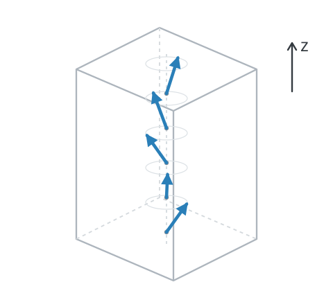
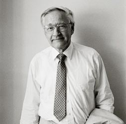

~~~{julia}
#| output: false
using Base64
using FFTW
using PNGFiles
using KomaMRI
using KomaMRI.KomaMRIPlots.PlotlyBase

# The 96 × 96 Cartesian example from Lecture 4.

scanner = Scanner(limits=HardwareLimits(Gmax=20e-3, Smax=40.0,
    RF_dead_time=0.0, RF_ring_down_time=0.0, ADC_dead_time=0.0))
N, fov, dwell = 96, 0.24, 5e-6
dk = 1/fov
excitation = PulseDesigner.build_sinc_pulse(π/4; duration=1e-3, time_bw_product=4.0,
    slice_thickness=10e-3, apodization=0.5, use=Excitation(), sys=scanner)

function cartesian_line(ky)
    seq = deepcopy(excitation)
    readout = PulseDesigner.make_trapezoid(; flat_area=(N-1)*dk, flat_time=(N-1)*dwell, sys=scanner)
    pre_area = -N/2*dk - γ*readout.A*readout.rise/2
    pre_x = PulseDesigner.make_trapezoid(; area=pre_area, sys=scanner)
    pre_y = PulseDesigner.make_trapezoid(; area=ky, sys=scanner)
    encoding_duration = max(dur(pre_x), dur(pre_y)) + 0.25e-3
    addblock!(seq; x=PulseDesigner.make_trapezoid(; area=pre_area, duration=encoding_duration, sys=scanner),
        y=PulseDesigner.make_trapezoid(; area=ky, duration=encoding_duration, sys=scanner))
    addblock!(seq, ADC(N, (N-1)*dwell, readout.rise); x=readout)
    seq
end

function five_shots()
    seq = Sequence(scanner)
    for line in (-48, -24, 0, 24, 47)
        shot = cartesian_line(line*dk)
        addblock!(shot, Delay(12e-3-dur(shot)))
        seq += shot
    end
    seq
end

function excitation_train()
    rf = deepcopy(excitation.RF[1,1])
    rf.A .*= 10/45
    shot = Sequence(scanner)
    addblock!(shot, rf)
    addblock!(shot, Delay(5e-3-dur(shot)))
    seq = Sequence(scanner)
    for _ in 1:100
        seq += shot
    end
    seq
end

rows(matrix) = [collect(row) for row in eachrow(matrix)]
sim_params = Dict{String,Any}("gpu"=>false, "Nthreads"=>1, "precision"=>"f64",
    "Δt"=>20e-6, "Δt_rf"=>20e-6)

function cartesian_images()
    density = Float64.(PNGFiles.load(joinpath(@__DIR__, "figures", "brain-density.png")))
    coordinates = ((0:N-1) .- N÷2) .* (fov/N)
    x = repeat(coordinates; inner=N)
    y = repeat(coordinates; outer=N)
    inside = vec(density) .> 0
    brain = Phantom(x=x[inside], y=y[inside], ρ=vec(density)[inside],
        T1=fill(Inf,count(inside)), T2=fill(Inf,count(inside)))
    spectrum = zeros(ComplexF64, N, N)
    for (row, ky) in enumerate((-N÷2:N÷2-1) .* dk)
        spectrum[row,:] .= vec(simulate(brain, cartesian_line(ky), scanner; verbose=false,
            sim_params=merge(sim_params, Dict("return_type"=>"mat"))))
    end
    image = abs.(fftshift(ifft(ifftshift(spectrum))))
    log_spectrum = log10.(1 .+ 1000 .* abs.(spectrum) ./ maximum(abs.(spectrum)))
    (; k=rows(log_spectrum), image=rows(image ./ maximum(image)),
        x=1e3 .* coordinates, kaxis=(-N÷2:N÷2-1) .* dk)
end

function rf_center_demo()
    rf = excitation.RF[1, 1]
    T = rf.T
    T_rew = 0.5e-3
    T_total = T + T_rew
    tbw = 4.0
    slice_thickness = 10e-3
    gz_T_m = (tbw / T) / (γ * slice_thickness)
    z_mm = collect(range(-2.0, 2.0; length=9))
    z_m = z_mm .* 1e-3
    omega = 2π * γ * gz_T_m .* z_m
    spins = Phantom(x=zeros(length(z_m)), y=zeros(length(z_m)), z=z_m,
        T1=fill(Inf, length(z_m)), T2=fill(Inf, length(z_m)))

    # Normalize the KomaMRI sinc RF waveform (from PulseDesigner.build_sinc_pulse) to 1 rad.
    a_raw = real.(rf.A)
    m = length(a_raw)
    dt_rf = T / max(m - 1, 1)
    area_rad = 2π * γ * (m == 1 ? a_raw[1] * T : sum(0.5 .* (a_raw[1:end-1] .+ a_raw[2:end])) * dt_rf)
    a_unit = a_raw ./ area_rad
    t_wave_ms = collect(range(0.0, 1e3 * T; length=m))
    b1_unit_uT = round.(1e6 .* a_unit; digits=3)

    # 61 slider time points (0.00 -> 1.50 ms, step 0.025 ms) simulated with KomaMRI.simulate.
    n_frames = 61
    t_grid_s = collect(range(0.0, T_total; length=n_frames))
    t_ms = round.(1e3 .* t_grid_s; digits=4)
    rf_sim_params = Dict{String,Any}("gpu"=>false, "Nthreads"=>1, "precision"=>"f64",
        "Δt"=>25e-6, "Δt_rf"=>10e-6, "max_block_length"=>1, "max_rf_block_length"=>1,
        "return_type"=>"state")

    function sample_koma(seq; t_offset=0.0)
        ts = Float64[0.0]
        xs = Vector{Vector{Float64}}([zeros(length(z_m))])
        ys = Vector{Vector{Float64}}([zeros(length(z_m))])
        record = function(progress, blocks, data, _)
            part = blocks.parts[progress.block]
            push!(ts, data.seqd.t[last(part)])
            push!(xs, real.(data.Xt.xy))
            push!(ys, imag.(data.Xt.xy))
        end
        simulate(spins, seq, scanner; verbose=false, callbacks=(record,), sim_params=rf_sim_params)
        frames = Vector{Vector{Vector{Float64}}}(undef, n_frames)
        for (i, tg) in enumerate(t_grid_s)
            idx = findlast(<=(tg + t_offset + 1e-9), ts)
            idx = idx === nothing ? 1 : idx
            frames[i] = [[round(xs[idx][j]; digits=4), round(ys[idx][j]; digits=4)] for j in eachindex(z_m)]
        end
        frames, complex.(xs[end], ys[end])
    end

    function extract_plot_seq(seq, names)
        traces = plot_seq(seq; slider=false, show_rf_frame=false).data
        Dict(t.name => (; x=collect(t.x), y=collect(t.y), line=t.line)
             for t in traces if haskey(t, :name) && t.name in names)
    end

    dt_imp = 1e-6
    flip_degs = collect(10:10:90)
    cases = map(flip_degs) do deg
        flip_rad = deg2rad(deg)
        # Step 1: Simulate RF + Gz (no rewinder) to measure passband phase slope at t = T -> exact t_c.
        seq_no_rew = Sequence(scanner)
        addblock!(seq_no_rew, RF(flip_rad .* a_unit, T); z=Grad(gz_T_m, T))
        _, xy_rf_end = sample_koma(seq_no_rew)

        phi = angle.(xy_rf_end)
        for j in 2:length(phi)
            d = phi[j] - phi[j - 1]
            while d > π; d -= 2π; end
            while d < -π; d += 2π; end
            phi[j] = phi[j - 1] + d
        end
        phi_c = phi .- (sum(phi) / length(phi))
        t_iso = -sum(omega .* phi_c) / sum(omega .^ 2)
        tc = clamp(T - t_iso, 0.0, T)
        gz_rew_T_m = -gz_T_m * (t_iso / T_rew)

        # Step 2: Actual sequence with exact Gz rewinder over [T, T + T_rew].
        seq_actual = Sequence(scanner)
        addblock!(seq_actual, RF(flip_rad .* a_unit, T); z=Grad(gz_T_m, T))
        addblock!(seq_actual; z=Grad(gz_rew_T_m, T_rew))
        hist_actual, _ = sample_koma(seq_actual)
        wave_actual = extract_plot_seq(seq_actual, ("|B1|_AM", "Gz"))

        # Step 3: Equivalent sequence: Delay(tc) + hard RF(α) + square Gz [tc, T] + same Gz rewinder.
        t_rem = max(T - tc - dt_imp / 2, 1e-6)
        seq_equiv = Sequence(scanner)
        tc > dt_imp && addblock!(seq_equiv, Delay(tc - dt_imp / 2))
        addblock!(seq_equiv, RF(flip_rad / (2π * γ * dt_imp), dt_imp))
        addblock!(seq_equiv; z=Grad(gz_T_m, t_rem))
        addblock!(seq_equiv; z=Grad(gz_rew_T_m, T_rew))
        hist_equiv, _ = sample_koma(seq_equiv)
        wave_equiv = extract_plot_seq(seq_equiv, ("Gz",))

        peak_uT = maximum(abs, filter(isfinite, Float64[v for v in wave_actual["|B1|_AM"].y if v isa Number]))
        (; deg, amp=round(sin(flip_rad); digits=4), tc_ms=round(1e3 * tc; digits=4),
            gz_rew_mTm=round(1e3 * gz_rew_T_m; digits=3), peak_uT=round(peak_uT; digits=3),
            wave_actual, wave_equiv, hist_actual, hist_equiv)
    end
    (; rf_dur_ms=1e3 * T, duration_ms=1e3 * T_total, t_ms,
        gz_mTm=round(1e3 * gz_T_m; digits=3), z_mm, flip_degs, cases)
end

function refocusing_demo(kind::Symbol)
    T_nom = 10e-3
    tbw = 8.0
    slice_thickness = 10e-3
    gz_T_m = (tbw / T_nom) / (γ * slice_thickness)
    if kind === :slr
        rf_slr, _, _ = PulseDesigner.make_slr_pulse(π; duration=T_nom, time_bw_product=tbw,
            slice_thickness=slice_thickness, use=Refocusing(), filter_type=:ls,
            passband_ripple=0.005, stopband_ripple=0.005, dwell=10e-6, sys=scanner)
        T = rf_slr.T
        a_pi = real.(rf_slr.A)
    else
        ref_seq = PulseDesigner.build_sinc_pulse(π; duration=1e-3, time_bw_product=tbw,
            slice_thickness=slice_thickness, apodization=0.5, use=Excitation(), sys=scanner)
        T = T_nom
        a_raw = real.(ref_seq.RF[1, 1].A)
        m = length(a_raw)
        dt_rf = T / max(m - 1, 1)
        area_rad = 2π * γ * (m == 1 ? a_raw[1] * T : sum(0.5 .* (a_raw[1:end-1] .+ a_raw[2:end])) * dt_rf)
        a_pi = π .* (a_raw ./ area_rad)
    end

    z_mm = collect(range(-2.0, 2.0; length=9))
    z_m = z_mm .* 1e-3
    spins = Phantom(x=zeros(length(z_m)), y=zeros(length(z_m)), z=z_m,
        T1=fill(Inf, length(z_m)), T2=fill(Inf, length(z_m)))
    n_frames = 41
    t_grid_s = collect(range(0.0, T; length=n_frames))
    t_ms = round.(1e3 .* t_grid_s; digits=4)
    ref_sim_params = Dict{String,Any}("gpu"=>false, "Nthreads"=>1, "precision"=>"f64",
        "Δt"=>250e-6, "Δt_rf"=>10e-6, "max_block_length"=>1, "max_rf_block_length"=>1,
        "return_type"=>"state")

    dt_imp = 1e-6
    prep90 = Sequence(scanner)
    addblock!(prep90, RF((π / 2) / (2π * γ * dt_imp), dt_imp))

    function sample_refocus(seq)
        ts = Float64[0.0]
        xs = Vector{Vector{Float64}}([zeros(length(z_m))])
        ys = Vector{Vector{Float64}}([zeros(length(z_m))])
        record = function(progress, blocks, data, _)
            part = blocks.parts[progress.block]
            push!(ts, data.seqd.t[last(part)])
            push!(xs, real.(data.Xt.xy))
            push!(ys, imag.(data.Xt.xy))
        end
        simulate(spins, prep90 + seq, scanner; verbose=false, callbacks=(record,), sim_params=ref_sim_params)
        frames = Vector{Vector{Vector{Float64}}}(undef, n_frames)
        for (i, tg) in enumerate(t_grid_s)
            idx = findlast(<=(tg + dt_imp + 1e-9), ts)
            idx = idx === nothing ? 1 : idx
            frames[i] = [[round(xs[idx][j]; digits=4), round(ys[idx][j]; digits=4)] for j in eachindex(z_m)]
        end
        frames
    end

    function extract_plot_seq(seq, names)
        traces = plot_seq(seq; slider=false, show_rf_frame=false).data
        Dict(t.name => (; x=collect(t.x), y=collect(t.y), line=t.line)
             for t in traces if haskey(t, :name) && t.name in names)
    end

    tc = T / 2
    seq_actual = Sequence(scanner)
    addblock!(seq_actual, RF(a_pi, T); z=Grad(gz_T_m, T))
    hist_actual = sample_refocus(seq_actual)
    wave_actual = extract_plot_seq(seq_actual, ("|B1|_AM", "Gz"))

    seq_equiv = Sequence(scanner)
    addblock!(seq_equiv; z=Grad(gz_T_m, tc - dt_imp / 2))
    addblock!(seq_equiv, RF(π / (2π * γ * dt_imp), dt_imp))
    addblock!(seq_equiv; z=Grad(gz_T_m, T - tc - dt_imp / 2))
    hist_equiv = sample_refocus(seq_equiv)
    wave_equiv = extract_plot_seq(seq_equiv, ("Gz",))

    peak_uT = maximum(abs, filter(isfinite, Float64[v for v in wave_actual["|B1|_AM"].y if v isa Number]))
    (; duration_ms=1e3 * T, tc_ms=round(1e3 * tc; digits=4), t_ms,
        gz_mTm=round(1e3 * gz_T_m; digits=3), peak_uT=round(peak_uT; digits=3),
        z_mm, wave_actual, wave_equiv, hist_actual, hist_equiv)
end

function rf_phase_demo()
    rf = excitation.RF[1, 1]
    T = rf.T
    T_rew = 0.5e-3
    T_total = T + T_rew
    tbw = 4.0
    slice_thickness = 10e-3
    gz_T_m = (tbw / T) / (γ * slice_thickness)
    z_mm = collect(range(-2.0, 2.0; length=9))
    z_m = z_mm .* 1e-3
    omega = 2π * γ * gz_T_m .* z_m
    spins = Phantom(x=zeros(length(z_m)), y=zeros(length(z_m)), z=z_m,
        T1=fill(Inf, length(z_m)), T2=fill(Inf, length(z_m)))

    a_raw = real.(rf.A)
    m = length(a_raw)
    dt_rf = T / max(m - 1, 1)
    area_rad = 2π * γ * (m == 1 ? a_raw[1] * T : sum(0.5 .* (a_raw[1:end-1] .+ a_raw[2:end])) * dt_rf)
    a_unit = a_raw ./ area_rad

    n_frames = 61
    t_grid_s = collect(range(0.0, T_total; length=n_frames))
    t_ms = round.(1e3 .* t_grid_s; digits=4)
    ph_sim_params = Dict{String,Any}("gpu"=>false, "Nthreads"=>1, "precision"=>"f64",
        "Δt"=>25e-6, "Δt_rf"=>10e-6, "max_block_length"=>1, "max_rf_block_length"=>1,
        "return_type"=>"state")

    function sample_koma(seq)
        ts = Float64[0.0]
        xs = Vector{Vector{Float64}}([zeros(length(z_m))])
        ys = Vector{Vector{Float64}}([zeros(length(z_m))])
        record = function(progress, blocks, data, _)
            part = blocks.parts[progress.block]
            push!(ts, data.seqd.t[last(part)])
            push!(xs, real.(data.Xt.xy))
            push!(ys, imag.(data.Xt.xy))
        end
        simulate(spins, seq, scanner; verbose=false, callbacks=(record,), sim_params=ph_sim_params)
        frames = Vector{Vector{Vector{Float64}}}(undef, n_frames)
        for (i, tg) in enumerate(t_grid_s)
            idx = findlast(<=(tg + 1e-9), ts)
            idx = idx === nothing ? 1 : idx
            frames[i] = [[round(xs[idx][j]; digits=4), round(ys[idx][j]; digits=4)] for j in eachindex(z_m)]
        end
        frames, complex.(xs[end], ys[end])
    end

    function extract_plot_seq(seq, names)
        traces = plot_seq(seq; slider=false, show_rf_frame=false).data
        Dict(t.name => (; x=collect(t.x), y=collect(t.y), line=t.line)
             for t in traces if haskey(t, :name) && t.name in names)
    end

    phi_deg = 60
    ph = deg2rad(phi_deg)
    dt_imp = 1e-6
    flip_degs = collect(10:10:90)
    cases = map(flip_degs) do deg
        flip_rad = deg2rad(deg)
        seq_no_rew = Sequence(scanner)
        addblock!(seq_no_rew, RF(flip_rad .* a_unit, T); z=Grad(gz_T_m, T))
        _, xy_rf_end = sample_koma(seq_no_rew)
        phi0 = angle.(xy_rf_end)
        for j in 2:length(phi0)
            d = phi0[j] - phi0[j - 1]
            while d > π; d -= 2π; end
            while d < -π; d += 2π; end
            phi0[j] = phi0[j - 1] + d
        end
        t_iso = -sum(omega .* (phi0 .- sum(phi0) / length(phi0))) / sum(omega .^ 2)
        tc = clamp(T - t_iso, 0.0, T)
        gz_rew_T_m = -gz_T_m * (t_iso / T_rew)
        t_rem = max(T - tc - dt_imp / 2, 1e-6)

        # Signed B1 envelope + Gz via plot_seq; KomaMRI simulation uses complex RF * exp(i*phi).
        seq_wave_actual = Sequence(scanner)
        addblock!(seq_wave_actual, RF(flip_rad .* a_unit, T); z=Grad(gz_T_m, T))
        addblock!(seq_wave_actual; z=Grad(gz_rew_T_m, T_rew))
        wave_actual = extract_plot_seq(seq_wave_actual, ("|B1|_AM", "Gz"))

        seq_actual = Sequence(scanner)
        addblock!(seq_actual, RF((flip_rad * cis(ph)) .* a_unit, T); z=Grad(gz_T_m, T))
        addblock!(seq_actual; z=Grad(gz_rew_T_m, T_rew))
        hist_actual, _ = sample_koma(seq_actual)

        seq_equiv = Sequence(scanner)
        tc > dt_imp && addblock!(seq_equiv, Delay(tc - dt_imp / 2))
        addblock!(seq_equiv, RF((flip_rad * cis(ph)) / (2π * γ * dt_imp), dt_imp))
        addblock!(seq_equiv; z=Grad(gz_T_m, t_rem))
        addblock!(seq_equiv; z=Grad(gz_rew_T_m, T_rew))
        hist_equiv, _ = sample_koma(seq_equiv)
        wave_equiv = extract_plot_seq(seq_equiv, ("Gz",))

        peak_uT = maximum(abs, filter(isfinite, Float64[v for v in wave_actual["|B1|_AM"].y if v isa Number]))
        (; deg, amp=round(sin(flip_rad); digits=4), tc_ms=round(1e3 * tc; digits=4),
            gz_rew_mTm=round(1e3 * gz_rew_T_m; digits=3), peak_uT=round(peak_uT; digits=3),
            wave_actual, wave_equiv, hist_actual, hist_equiv)
    end

    (; rf_dur_ms=1e3 * T, duration_ms=1e3 * T_total, t_ms, phi_deg,
        gz_mTm=round(1e3 * gz_T_m; digits=3), z_mm, flip_degs, cases)
end

function slr_minphase_demo()
    T_nom = 1e-3
    T_total = 1.4e-3
    tbw = 4.0
    slice_thickness = 10e-3
    gz_T_m = (tbw / T_nom) / (γ * slice_thickness)
    z_mm = collect(range(-2.0, 2.0; length=9))
    z_m = z_mm .* 1e-3
    omega = 2π * γ * gz_T_m .* z_m
    spins = Phantom(x=zeros(length(z_m)), y=zeros(length(z_m)), z=z_m,
        T1=fill(Inf, length(z_m)), T2=fill(Inf, length(z_m)))

    n_frames = 57
    t_grid_s = collect(range(0.0, T_total; length=n_frames))
    t_ms = round.(1e3 .* t_grid_s; digits=4)
    sim_p = Dict{String,Any}("gpu"=>false, "Nthreads"=>1, "precision"=>"f64",
        "Δt"=>25e-6, "Δt_rf"=>10e-6, "max_block_length"=>1, "max_rf_block_length"=>1,
        "return_type"=>"state")

    function sample_koma(seq)
        ts = Float64[0.0]
        xs = Vector{Vector{Float64}}([zeros(length(z_m))])
        ys = Vector{Vector{Float64}}([zeros(length(z_m))])
        record = function(progress, blocks, data, _)
            part = blocks.parts[progress.block]
            push!(ts, data.seqd.t[last(part)])
            push!(xs, real.(data.Xt.xy))
            push!(ys, imag.(data.Xt.xy))
        end
        simulate(spins, seq, scanner; verbose=false, callbacks=(record,), sim_params=sim_p)
        frames = Vector{Vector{Vector{Float64}}}(undef, n_frames)
        for (i, tg) in enumerate(t_grid_s)
            idx = findlast(<=(tg + 1e-9), ts)
            idx = idx === nothing ? 1 : idx
            frames[i] = [[round(xs[idx][j]; digits=4), round(ys[idx][j]; digits=4)] for j in eachindex(z_m)]
        end
        frames, complex.(xs[end], ys[end])
    end

    function extract_plot_seq(seq, names)
        traces = plot_seq(seq; slider=false, show_rf_frame=false).data
        Dict(t.name => (; x=collect(t.x), y=collect(t.y), line=t.line)
             for t in traces if haskey(t, :name) && t.name in names)
    end

    dt_imp = 1e-6
    flip_degs = collect(10:10:90)
    T_rf_ref = Ref(T_nom)
    cases = map(flip_degs) do deg
        flip_rad = deg2rad(deg)
        rf_slr, _, _ = PulseDesigner.make_slr_pulse(flip_rad; duration=T_nom, time_bw_product=tbw,
            slice_thickness=slice_thickness, use=Excitation(), filter_type=:min,
            passband_ripple=0.001, stopband_ripple=0.001, dwell=10e-6, sys=scanner)
        T = rf_slr.T
        T_rf_ref[] = T
        T_rew = T_total - T
        a_rf = real.(rf_slr.A)

        seq_no_rew = Sequence(scanner)
        addblock!(seq_no_rew, RF(a_rf, T); z=Grad(gz_T_m, T))
        _, xy_rf_end = sample_koma(seq_no_rew)

        phi = angle.(xy_rf_end)
        for j in 2:length(phi)
            d = phi[j] - phi[j - 1]
            while d > π; d -= 2π; end
            while d < -π; d += 2π; end
            phi[j] = phi[j - 1] + d
        end
        phi_c = phi .- (sum(phi) / length(phi))
        t_iso = -sum(omega .* phi_c) / sum(omega .^ 2)
        tc = clamp(T - t_iso, 0.0, T)
        gz_rew_T_m = -gz_T_m * (t_iso / T_rew)

        seq_actual = Sequence(scanner)
        addblock!(seq_actual, RF(a_rf, T); z=Grad(gz_T_m, T))
        addblock!(seq_actual; z=Grad(gz_rew_T_m, T_rew))
        hist_actual, _ = sample_koma(seq_actual)
        wave_actual = extract_plot_seq(seq_actual, ("|B1|_AM", "Gz"))

        t_rem = max(T - tc - dt_imp / 2, 1e-6)
        seq_equiv = Sequence(scanner)
        tc > dt_imp && addblock!(seq_equiv, Delay(tc - dt_imp / 2))
        addblock!(seq_equiv, RF(flip_rad / (2π * γ * dt_imp), dt_imp))
        addblock!(seq_equiv; z=Grad(gz_T_m, t_rem))
        addblock!(seq_equiv; z=Grad(gz_rew_T_m, T_rew))
        hist_equiv, _ = sample_koma(seq_equiv)
        wave_equiv = extract_plot_seq(seq_equiv, ("Gz",))

        peak_uT = maximum(abs, filter(isfinite, Float64[v for v in wave_actual["|B1|_AM"].y if v isa Number]))
        (; deg, amp=round(sin(flip_rad); digits=4), tc_ms=round(1e3 * tc; digits=4),
            gz_rew_mTm=round(1e3 * gz_rew_T_m; digits=3), peak_uT=round(peak_uT; digits=3),
            wave_actual, wave_equiv, hist_actual, hist_equiv)
    end
    (; rf_dur_ms=1e3 * T_rf_ref[], duration_ms=1e3 * T_total, t_ms,
        gz_mTm=round(1e3 * gz_T_m; digits=3), z_mm, flip_degs, cases)
end

function spin_echo_sequence()
    seq = PulseDesigner.build_sinc_pulse(π/2; duration=1e-3, time_bw_product=4.0,
        slice_thickness=10e-3, apodization=0.5, use=Excitation(), sys=scanner)
    refoc, gz, _ = PulseDesigner.make_slr_pulse(π; duration=10e-3,
        time_bw_product=8.0, slice_thickness=10e-3, use=Refocusing(), filter_type=:ls,
        passband_ripple=0.005, stopband_ripple=0.005, dwell=10e-6, sys=scanner)
    crusher = PulseDesigner.make_trapezoid(; area=γ*8e-6, duration=2e-3, sys=scanner)
    te = 40e-3
    t90 = seq.RF[1,1].delay + seq.RF[1,1].center
    t180 = t90 + te/2
    addblock!(seq, Delay(t180 - refoc.delay - refoc.center - dur(crusher) - dur(seq)))
    addblock!(seq; z=crusher)
    addblock!(seq, refoc; z=gz)
    before_post = plot_M0(seq; slider=false)
    post_area = -last(before_post.data[3].y)
    addblock!(seq; z=PulseDesigner.make_trapezoid(; area=post_area, duration=2e-3, sys=scanner))
    readout = 2e-3
    echo = t90 + te
    addblock!(seq, Delay(echo - readout/2 - dur(seq)))
    addblock!(seq, ADC(64, readout))
    seq
end

lecture_tissues = Dict(
    "WM" => [0.77, 0.832, 0.080, 0.045, 0.0],
    "GM" => [0.86, 1.330, 0.110, 0.050, 0.0],
    "CSF" => [1.0, 4.0, 1.5, 0.20, 0.0])

function lecture_brain_maps()
    obj = brain_phantom2D(ss=4, tissue_properties=lecture_tissues)
    xs, ys = sort(unique(obj.x)), sort(unique(obj.y))
    xi, yi = Dict(v=>i for (i,v) in enumerate(xs)), Dict(v=>i for (i,v) in enumerate(ys))
    props = unique(collect(zip(obj.ρ,obj.T1,obj.T2,obj.T2s)))
    labels = zeros(Int,length(ys),length(xs))
    for i in eachindex(obj.x)
        labels[yi[obj.y[i]],xi[obj.x[i]]] = findfirst(==((obj.ρ[i],obj.T1[i],obj.T2[i],obj.T2s[i])),props)
    end
    (; x=1e3xs, y=1e3ys, labels=rows(labels), tissues=[(;rho=p[1],t1=1e3p[2],t2=1e3p[3],t2s=1e3p[4]) for p in props])
end

function lecture_voxel_cases()
    tissues=lecture_brain_maps().tissues
    n=length(tissues)
    voxel=Phantom(x=zeros(n),y=zeros(n),z=zeros(n),ρ=ones(n),
        T1=[t.t1*1e-3 for t in tissues],T2=[t.t2*1e-3 for t in tissues],Δw=zeros(n))
    flips=collect(3:40)
    train=excitation_train()
    cases=[];common_time=Float64[]
    for flip in flips
        seq=Complex(flip/10)*train
        rf_blocks=findall(is_RF_on.(seq))
        @assert length(rf_blocks)==100 && all(==(Float64(flip)),get_flip_angles(seq)[rf_blocks])
        block_starts=cumsum([0.0;seq.DUR])[rf_blocks]
        starts=block_starts.+delay.(seq.RF[1,rf_blocks])
        ends=block_starts.+dur.(seq.RF[1,rf_blocks])
        boundaries=Set(round.(Int,1e9.*[starts;ends;dur(seq)]))
        time=[0.0];xy=[Float32[0.0] for _ in 1:n];z=[Float32[1.0] for _ in 1:n]
        last_time=Ref(0.0)
        record=function(progress,blocks,data,_)
            t=data.seqd.t[last(blocks.parts[progress.block])]
            if !blocks.excitation_bool[progress.block] || t-last_time[]>=.20e-3-1e-12 || round(Int,1e9*t) in boundaries
                push!(time,1e3t)
                for i in 1:n
                    push!(xy[i],Float32(abs(data.Xt.xy[i])))
                    push!(z[i],Float32(data.Xt.z[i]))
                end
                last_time[]=t
            end
        end
        simulate(voxel,seq,scanner;verbose=false,callbacks=(record,),sim_params=Dict{String,Any}(
            "gpu"=>false,"Nthreads"=>1,"precision"=>"f64","Δt"=>.20e-3,"Δt_rf"=>20e-6,
            "max_block_length"=>1,"max_rf_block_length"=>1,"return_type"=>"state"))
        if isempty(common_time)
            common_time=time
        else
            @assert length(common_time)==length(time) && maximum(abs,common_time.-time)<1e-8
        end
        @assert all(b->minimum(abs.(time.-1e-6b))<1e-7,boundaries)
        push!(cases,(;flip,xy,z))
    end
    (;time=common_time,flips,tissues,cases)
end

function lecture_cartesian_setup()
    sys=Scanner(limits=HardwareLimits(B0=3.0,B1=20e-6,Gmax=30e-3,Smax=180,
        ADC_Δt=1e-6,DUR_Δt=10e-6,GR_Δt=10e-6,RF_Δt=1e-6,
        RF_dead_time=120e-6,RF_ring_down_time=50e-6,ADC_dead_time=10e-6))
    n_adc,n_image=256,128
    fov=.256
    excitation=PulseDesigner.build_sinc_pulse(deg2rad(35);duration=1.2e-3,
        time_bw_product=4.0,slice_thickness=10e-3,apodization=.5,use=Excitation(),sys)
    kernel=SBB.bssfp_readout_kernel((2fov,fov),(n_adc,n_image),sys,1/(n_adc*2e-6);
        fixed_area=(0.0,0.0,area(excitation.GR[3,2])))
    rf=excitation.RF[1,1]
    te0=dur(excitation[1])+kernel.center_time()-delay(rf)-rf_center(rf)
    tr0=dur(excitation[1])+dur(kernel.readout(-64))
    raster=sys.limits.DUR_Δt
    echo_padding=round_to_raster(2te0-tr0,raster)
    tr=tr0+abs(echo_padding)
    (;sys,n_adc,n_image,fov,excitation,kernel,raster,echo_padding,tr)
end

function lecture_cartesian_sequence(s,tr_multiplier,n_dummy,order)
    (;sys,excitation,kernel,echo_padding,raster,tr,fov)=s
    half=round_to_raster((tr_multiplier-1)*tr/2,raster)
    function readout(i)
        shot=kernel.readout(i)
        before=half+max(0.0,-echo_padding)
        after=half+max(0.0,echo_padding)
        before>0 && (shot=PulseDesigner.build_delay(before;sys)+shot)
        after>0 && (shot+=PulseDesigner.build_delay(after;sys))
        shot
    end
    padded=(;readout,encodings=kernel.encodings)
    seq=SBB.build_cartesian_bssfp(excitation,padded,sys;trigger=nothing,
        n_ramp_shots=max(1,n_dummy),view_order=order)
    if n_dummy==0
        blocks=length(excitation[1])+length(readout(0))
        seq=cispi(1)*seq[(blocks+1):end]
    end
    seq.DEF["FOV"]=[fov,fov,10e-3]
    seq
end

function lecture_cartesian_check(seq,s,order)
    adc_blocks=findall(is_ADC_on,seq.ADC)
    @assert length(adc_blocks)==s.n_image
    @assert all(a.N==s.n_adc && isapprox(KomaMRI.dwell(a),2e-6;atol=1e-12) for a in seq.ADC[adc_blocks])
    sampled=reshape(get_kspace(seq)[2],s.n_adc,s.n_image,3)
    line_order=only(SBB.cartesian_line_order(-64:63,128;view_order=order))
    kx=(-128:127)./(2s.fov)
    ky=line_order./s.fov
    error=max(maximum(abs,sampled[:,:,1].-kx),maximum(abs,sampled[:,:,2].-ky'))
    @assert error<=.01 && maximum(abs,sampled[:,:,3])<=.01
    @assert [get_labels(seq)[b].LIN for b in adc_blocks]==line_order.+64
    rf_blocks=findall(is_RF_on.(seq))
    rf_events=seq.RF[1,rf_blocks]
    rf_times=cumsum([0.0;seq.DUR])[rf_blocks].+delay.(rf_events).+rf_center.(rf_events)
    tr=first(diff(rf_times))
    @assert maximum(abs,diff(rf_times).-tr)<1e-8
    adc_times=reshape(get_adc_sampling_times(seq),s.n_adc,s.n_image)
    acquired_rf=rf_times[searchsortedlast.(Ref(rf_times),adc_times[1,:])]
    te=adc_times[129,:].-acquired_rf
    @assert maximum(abs,te.-tr/2)<=s.raster/2+1e-9
    stops=[rf_blocks[2:end].-1;length(seq)]
    balance_error=maximum(abs(sum(area,seq.GR[axis,first:last])) for (first,last) in zip(rf_blocks,stops) for axis in 1:3)
    @assert balance_error<1e-11
    (;TR_ms=1e3tr,TE_ms=1e3first(te),trajectory_error=error,balance_error,line_order)
end

function lecture_cartesian_case(raw,s,line_order)
    spectrum=zeros(ComplexF64,s.n_image,s.n_adc)
    for (profile,line) in zip(raw.profiles,line_order)
        spectrum[line+65,:].=vec(profile.data)
    end
    reconstructed=fftshift(ifft(ifftshift(spectrum)))
    crop=(s.n_adc-s.n_image)÷2 .+ (1:s.n_image)
    image=abs.(reconstructed[:,crop])
    image .*=4095/maximum(image)
    (;spectrum,image)
end

function lecture_gm_echo_envelope(seq,sys,n_dummy)
    probe=deepcopy(seq)
    probe.GR .= 0 .* probe.GR
    rf_blocks=findall(is_RF_on.(seq))
    first_adc=findfirst(is_ADC_on,seq.ADC)
    offset=first_adc-rf_blocks[n_dummy+1]
    template=seq.ADC[first_adc]
    for block in rf_blocks
        probe.ADC[block+offset]=deepcopy(template)
    end
    voxel=Phantom(x=[0.0],y=[0.0],z=[0.0],ρ=[1.0],T1=[1.330],T2=[.110])
    values=simulate(voxel,probe,sys;verbose=false,sim_params=Dict{String,Any}(
        "gpu"=>false,"Nthreads"=>1,"precision"=>"f64","Δt"=>50e-6,
        "Δt_rf"=>20e-6,"return_type"=>"mat"))
    abs.(reshape(vec(values),template.N,:)[129,:])
end

function lecture_cartesian_constant_sequence(s,tr_multiplier,n_dummy,order)
    seq=lecture_cartesian_sequence(s,tr_multiplier,n_dummy,order)
    rf_blocks=findall(is_RF_on.(seq))
    full=seq.RF[1,rf_blocks[n_dummy+1]]
    for block in rf_blocks[1:n_dummy]
        original=seq.RF[1,block]
        @assert original.delay==full.delay && original.center==full.center
        seq.RF[1,block].A=copy(full.A)
    end
    @assert all(==(35.0),get_flip_angles(seq)[rf_blocks])
    @assert all(isapprox(cis(seq.RF[1,b].ϕ),cispi(i-1);atol=1e-10) for (i,b) in enumerate(rf_blocks))
    seq
end

function lecture_cartesian_images()
    lecture_tissues=Dict("WM"=>[.77,.832,.080,.045,0.0],"GM"=>[.86,1.330,.110,.050,0.0],"CSF"=>[1.0,4.0,1.5,.20,0.0])
    s=lecture_cartesian_setup()
    obj=brain_phantom2D(ss=4,tissue_properties=lecture_tissues)
    obj.Δw .=0
    dummy=collect(0:10:50);trs=round.(1e3s.tr.*[1,2];digits=3)
    all_cases=Dict("linear"=>[],"center_out"=>[]);validation=[]
    for order in (:linear,:center_out),multiplier in [1,2],d in dummy
        seq=lecture_cartesian_constant_sequence(s,multiplier,d,order)
        measured=lecture_cartesian_check(seq,s,order)
        check_timing(seq,s.sys);check_hw_limits(seq,s.sys)
        raw=simulate(obj,seq,s.sys;verbose=false,sim_params=Dict{String,Any}(
            "gpu"=>false,"Nthreads"=>4,"precision"=>"f32","Δt"=>50e-6,"Δt_rf"=>20e-6))
        @assert length(raw.profiles)==128 && all(size(p.data)==(256,1) for p in raw.profiles)
        result=lecture_cartesian_case(raw,s,measured.line_order)
        envelope=lecture_gm_echo_envelope(seq,s.sys,d)
        @assert length(envelope)==d+128
        case=(;tr=trs[multiplier],dummy=d,image=[Float32.(r) for r in eachrow(result.image)],
            kspace=[Float32.(r) for r in eachrow(abs.(result.spectrum))],signal=envelope,envelope,
            actualEcho=[abs(p.data[129,1]) for p in raw.profiles],acquiredStart=d+1,
            signalRFoffset=0,kyOrder=measured.line_order)
        push!(all_cases[string(order)],case)
        push!(validation,(;order,tr=case.tr,dummy=d,measured...,image_size=[128,128],kspace_size=[128,256],fov_mm=[256,256],echo_count=length(envelope)))
    end
    coords=1e3.*collect((-64:63).*s.fov/s.n_image)
    kx=collect(-128:127)./(2s.fov);ky=collect(-64:63)./s.fov
    kScale=maximum(maximum(maximum,case.kspace) for cases in values(all_cases) for case in cases)
    data=Dict(order=>(;x=coords,y=coords,kx,ky,trs,dummy,cases,scale=4095.0,kScale,samples=256,lines=128) for (order,cases) in all_cases)
    data
end

module LectureRadialOpenRecon
using Sockets
using KomaMRI.KomaMRIFiles: MRIFiles
export start, recon, stop

const server = Ref{Any}(nothing)
const MRD_MESSAGE_CONFIG_FILE = UInt16(1)
const MRD_MESSAGE_METADATA_XML_TEXT = UInt16(3)
const MRD_MESSAGE_CLOSE = UInt16(4)
const MRD_MESSAGE_TEXT = UInt16(5)
const MRD_MESSAGE_ISMRMRD_ACQUISITION = UInt16(1008)
const MRD_MESSAGE_ISMRMRD_IMAGE = UInt16(1022)
const MRD_CONFIG_NAME_LENGTH = 1024
const ISMRMRD_IMAGE_HEADER_SIZE = 198
const ISMRMRD_DATA_TYPES = (UInt16, Int16, UInt32, Int32, Float32, Float64, ComplexF32, ComplexF64)
const ISMRMRD_IMAGE_HEADER = (
    version=UInt16, data_type=UInt16, flags=UInt64, measurement_uid=UInt32,
    matrix_size=NTuple{3,UInt16}, field_of_view=NTuple{3,Float32}, channels=UInt16,
    position=NTuple{3,Float32}, read_dir=NTuple{3,Float32}, phase_dir=NTuple{3,Float32},
    slice_dir=NTuple{3,Float32}, patient_table_position=NTuple{3,Float32},
    average=UInt16, slice=UInt16, contrast=UInt16, phase=UInt16, repetition=UInt16, set=UInt16,
    acquisition_time_stamp=UInt32, physiology_time_stamp=NTuple{3,UInt32},
    image_type=UInt16, image_index=UInt16, image_series_index=UInt16,
    user_int=NTuple{8,Int32}, user_float=NTuple{8,Float32}, attribute_string_len=UInt32,
)

_running(container) = strip(read(pipeline(ignorestatus(`docker inspect --format "{{.State.Running}}" $container`); stderr=devnull), String)) == "true"
function _ready(port)
    socket = try connect(ip"127.0.0.1", port) catch; return false end
    probe = @async try eof(socket) catch; true end
    try
        return timedwait(() -> istaskdone(probe), 0.1; pollint=0.01) == :timed_out || !fetch(probe)
    finally
        close(socket)
        wait(probe)
    end
end

function start(; image=nothing, port=nothing)
    current = server[]
    if current !== nothing && _running(current.container)
        (image === nothing || image == current.image) && (port === nothing || port == current.port) ||
            error("Call OpenReconClient.stop() before changing image or port")
        _ready(current.port) || error("OpenRecon is not accepting TCP connections")
        return nothing
    end
    image === nothing && (image = current === nothing ? "ghcr.io/mcgrathcm/bios214-radial:0.1.3" : current.image)
    server[] = nothing
    container = strip(read(`docker run --rm -d --platform linux/amd64 -p 127.0.0.1:$(something(port, "")):9002 $image`, String))
    try
        port = parse(Int, last(split(strip(read(`docker port $container 9002/tcp`, String)), ':')))
        ready = timedwait(60; pollint=0.5) do
            _running(container) || error("OpenRecon container exited during startup")
            _ready(port)
        end
        ready == :ok || error("OpenRecon did not start accepting TCP connections")
        server[] = (; container, port, image)
    catch
        @error "OpenRecon" log=read(ignorestatus(`docker logs $container`), String)
        run(pipeline(ignorestatus(`docker stop $container`); stdout=devnull))
        rethrow()
    end
    return nothing
end

function _image(socket)
    io = IOBuffer(read(socket, ISMRMRD_IMAGE_HEADER_SIZE))
    header = map(T -> read(io, T), ISMRMRD_IMAGE_HEADER)
    1 <= header.data_type <= length(ISMRMRD_DATA_TYPES) || error("Unsupported MRD data type: $(header.data_type)")
    T = ISMRMRD_DATA_TYPES[Int(header.data_type)]
    metadata = rstrip(String(read(socket, Int(read(socket, UInt64)))), '\0')
    pixels = Array{T}(undef, Int.(header.matrix_size)..., Int(header.channels))
    read!(socket, pixels)
    return (; image=permutedims(pixels, (4, 3, 2, 1)), header, metadata)
end

function recon(raw; config="bios214radial", config_additional=nothing, full=false, timeout=180)
    current = server[]
    current === nothing && error("Call OpenReconClient.start() first")
    socket = connect(ip"127.0.0.1", current.port)
    timer = Timer(_ -> close(socket), timeout)
    sender = @async try
        name = zeros(UInt8, MRD_CONFIG_NAME_LENGTH)
        name[1:ncodeunits(config)] .= codeunits(config)
        write(socket, MRD_MESSAGE_CONFIG_FILE, name)
        xml = MRIFiles.GeneralParametersToXML(deepcopy(raw.params)) * '\0'
        write(socket, MRD_MESSAGE_METADATA_XML_TEXT, UInt32(ncodeunits(xml)), xml)
        if config_additional !== nothing
            text = config_additional * '\0'
            write(socket, MRD_MESSAGE_TEXT, UInt32(ncodeunits(text)), text)
        end
        for profile in raw.profiles
            header = IOBuffer()
            write(header, profile.head)
            write(socket, MRD_MESSAGE_ISMRMRD_ACQUISITION, take!(header), profile.traj, profile.data)
        end
        write(socket, MRD_MESSAGE_CLOSE)
    catch
        close(socket)
        rethrow()
    end
    images = NamedTuple[]
    try
        while (message = read(socket, UInt16)) != MRD_MESSAGE_CLOSE
            if message == MRD_MESSAGE_ISMRMRD_IMAGE
                push!(images, _image(socket))
            elseif message == MRD_MESSAGE_TEXT
                @info rstrip(String(read(socket, Int(read(socket, UInt32)))), '\0')
            else
                error("Unexpected MRD message: $message")
            end
        end
        wait(sender)
        isempty(images) && error("OpenRecon returned no images")
        full && return images
        image = only(images).image
        return size(image, 1) == size(image, 2) == 1 ? dropdims(image; dims=(1, 2)) : image
    finally
        close(timer)
        close(socket)
    end
end

function stop()
    current = server[]
    current === nothing && return nothing
    _running(current.container) && run(pipeline(`docker stop $(current.container)`; stdout=devnull))
    server[] = nothing
    return nothing
end
end

import MRISequenceBuildingBlocks as SBB

function lecture_lab_radial_setup()
    sys=Scanner(limits=HardwareLimits(B0=3.0,B1=20e-6,Gmax=30e-3,Smax=180,
        ADC_Δt=1e-6,DUR_Δt=10e-6,GR_Δt=10e-6,RF_Δt=1e-6,
        RF_dead_time=120e-6,RF_ring_down_time=50e-6,ADC_dead_time=10e-6))
    n_adc,n_spokes=256,202
    kr=(-128:127).*(250/128)
    angles=(0:n_spokes-1).*(π/n_spokes)
    target=cat(kr.*cos.(angles'),kr.*sin.(angles'),zeros(n_adc,n_spokes);dims=3)
    resolution=1/(2maximum(abs,kr))
    supported_fov=min(1/(kr[2]-kr[1]),1/(maximum(abs,kr)*(angles[2]-angles[1])))
    n_image=floor(Int,supported_fov/resolution)
    fov=n_image*resolution
    oversampling=n_adc÷n_image
    excitation=PulseDesigner.build_sinc_pulse(deg2rad(35);duration=1.2e-3,
        time_bw_product=4.0,slice_thickness=10e-3,apodization=.5,use=Excitation(),sys)
    kernel=SBB.bssfp_readout_kernel((oversampling*fov,),(n_adc,),sys,1/(n_adc*2e-6);
        fixed_area=(0.0,0.0,area(excitation.GR[3,2])))
    rf=excitation.RF[1,1]
    te_unpadded=dur(excitation[1])+kernel.center_time()-delay(rf)-rf_center(rf)
    tr_unpadded=dur(excitation[1])+dur(kernel.readout())
    raster=sys.limits.DUR_Δt
    echo_padding=round_to_raster(2te_unpadded-tr_unpadded,raster)
    tr=tr_unpadded+abs(echo_padding)
    (;sys,n_adc,n_spokes,n_image,fov,angles,target,excitation,kernel,raster,echo_padding,tr)
end

function lecture_lab_radial_sequence(setup,tr_multiplier,n_dummy)
    (;sys,excitation,kernel,angles,echo_padding,raster,tr,fov,n_spokes)=setup
    half_padding=round_to_raster((tr_multiplier-1)*tr/2,raster)
    function spoke_readout(lin)
        spoke=rotz(angles[lin+1])*kernel.readout()
        adc_block=only(findall(is_ADC_on,spoke.ADC))
        push!(spoke.EXT[adc_block],PulseDesigner.make_label(:SET,:LIN,lin))
        before=half_padding+max(0.0,-echo_padding)
        after=half_padding+max(0.0,echo_padding)
        before>0 && (spoke=PulseDesigner.build_delay(before;sys)+spoke)
        after>0 && (spoke+=PulseDesigner.build_delay(after;sys))
        spoke
    end
    radial_kernel=(;readout=spoke_readout,encodings=[(lin,) for lin in 0:n_spokes-1])
    seq=SBB.build_cartesian_bssfp(excitation,radial_kernel,sys;trigger=nothing,n_ramp_shots=max(1,n_dummy))
    rf_blocks=findall(is_RF_on.(seq))
    full_amplitude=seq.RF[1,rf_blocks[max(1,n_dummy)+1]].A
    for block in rf_blocks[1:n_dummy]
        seq.RF[1,block].A=copy(full_amplitude)
    end
    if n_dummy==0
        blocks=length(excitation[1])+length(spoke_readout(0))
        seq=cispi(1)*seq[(blocks+1):end]
    end
    seq.DEF["FOV"]=[fov,fov,10e-3]
    rf_blocks=findall(is_RF_on.(seq))
    @assert all(get_flip_angles(seq)[rf_blocks].==35)
    @assert all(isapprox(cis(seq.RF[1,b].ϕ),cispi(i-1);atol=1e-12) for (i,b) in enumerate(rf_blocks))
    seq
end

function lecture_lab_radial_check(seq,setup)
    adc_blocks=findall(is_ADC_on,seq.ADC)
    @assert length(adc_blocks)==setup.n_spokes
    @assert all(a.N==setup.n_adc && isapprox(KomaMRI.dwell(a),2e-6;atol=1e-12) for a in seq.ADC[adc_blocks])
    sampled=reshape(get_kspace(seq)[2],size(setup.target))
    trajectory_error=maximum(abs,sampled.-setup.target)
    @assert trajectory_error<=.01
    rf_blocks=findall(is_RF_on.(seq))
    rf_events=seq.RF[1,rf_blocks]
    rf_times=cumsum([0.0;seq.DUR])[rf_blocks].+delay.(rf_events).+rf_center.(rf_events)
    tr=first(diff(rf_times))
    @assert maximum(abs,diff(rf_times).-tr)<1e-8
    adc_times=reshape(get_adc_sampling_times(seq),setup.n_adc,setup.n_spokes)
    acquired_rf=rf_times[searchsortedlast.(Ref(rf_times),adc_times[1,:])]
    te=adc_times[129,:].-acquired_rf
    @assert maximum(abs,te.-tr/2)<=setup.raster/2+1e-9
    @assert maximum(abs,sampled[129,:,:])<=.01
    @assert [get_labels(seq)[b].LIN for b in adc_blocks]==collect(0:setup.n_spokes-1)
    (;TR_ms=1e3tr,TE_ms=1e3first(te),trajectory_error)
end

function lecture_radial_images()
    LectureRadialOpenRecon.start()
    try
        tissues=Dict("WM"=>[.77,.832,.080,.045,0.0],"GM"=>[.86,1.330,.110,.050,0.0],"CSF"=>[1.0,4.0,1.5,.20,0.0])
        setup=lecture_lab_radial_setup()
        obj=brain_phantom2D(ss=4,tissue_properties=tissues)
        obj.Δw .= 0
        dummy=collect(0:10:50);trs=[3.28,6.56];cases=[]
        common_k=nothing
        global_min,global_max=Inf,0.0
        for target_tr in trs,d in dummy
            seq=lecture_lab_radial_sequence(setup,target_tr/(1e3setup.tr),d)
            measured=lecture_lab_radial_check(seq,setup)
            @assert abs(measured.TR_ms-target_tr)<1e-6
            check_timing(seq,setup.sys);check_hw_limits(seq,setup.sys)
            raw=simulate(obj,seq,setup.sys;verbose=false,sim_params=Dict{String,Any}(
                "gpu"=>false,"Nthreads"=>2,"precision"=>"f32","Δt"=>50e-6,"Δt_rf"=>20e-6))
            @assert length(raw.profiles)==setup.n_spokes
            @assert all(size(p.data)==(setup.n_adc,1) for p in raw.profiles)
            sampled=get_kspace(seq)[2]
            if common_k===nothing
                common_k=sampled
            else
                @assert maximum(abs,sampled.-common_k)<1e-7
            end
            magnitude=vec(hcat((abs.(p.data[:,1]) for p in raw.profiles)...))
            actualEcho=magnitude[129:setup.n_adc:end]
            @assert actualEcho==[abs(p.data[129,1]) for p in raw.profiles]
            @assert length(magnitude)==setup.n_adc*setup.n_spokes && all(isfinite,magnitude)
            result=only(LectureRadialOpenRecon.recon(raw;full=true))
            img=dropdims(result.image;dims=(1,2))
            @assert size(img)==(128,128) && all(isfinite,img)
            @assert result.header.field_of_view==(256.0f0,256.0f0,10.0f0)
            image=[collect(r) for r in eachrow(img)]
            signal=lecture_gm_echo_envelope(seq,setup.sys,d)
            @assert length(signal)==d+setup.n_spokes
            push!(cases,(;tr=target_tr,dummy=d,image,signal,signalRFoffset=0,actualEcho,acquiredStart=d+1,kspace_magnitude=magnitude))
            global_min=min(global_min,minimum(magnitude))
            global_max=max(global_max,maximum(magnitude))
        end
        coords=1e3.*collect((-64:63).*setup.fov/setup.n_image)
        kspace=(;kx=common_k[:,1],ky=common_k[:,2],echo_indices=collect(128:setup.n_adc:setup.n_adc*setup.n_spokes-1),
            min_magnitude=global_min,max_magnitude=global_max,log_min=log10(global_min),log_max=log10(global_max))
        (;x=coords,y=coords,trs,dummy,cases,scale=4095.0,spokes=202,samples=256,kspace)
    finally
        LectureRadialOpenRecon.stop()
    end
end

function lecture_catalysis_image(raw,s,line_order)
    spectrum=zeros(ComplexF64,s.n_image,s.n_adc)
    for (profile,line) in zip(raw.profiles,line_order)
        spectrum[line+65,:].=vec(profile.data)
    end
    image=fftshift(ifft(ifftshift(spectrum)))
    crop=(s.n_adc-s.n_image)÷2 .+ (1:s.n_image)
    abs.(image[:,crop])
end

function lecture_catalysis_sequences()
    s=lecture_cartesian_setup()
    s=merge(s,(;excitation=Complex(40/35)*s.excitation))
    multiplier=5e-3/s.tr
    abrupt=lecture_cartesian_sequence(s,multiplier,0,:linear)
    ramp=lecture_cartesian_sequence(s,multiplier,14,:linear)
    prep=Complex(-.5)*s.excitation
    gap=round_to_raster(2.5e-3-dur(prep),s.raster)
    @assert gap>=0
    half=prep+PulseDesigner.build_delay(gap;sys=s.sys)+abrupt
    half.DEF["FOV"]=[s.fov,s.fov,10e-3]
    (;s,abrupt,half,ramp)
end

function lecture_catalysis()
    (;s,abrupt,half,ramp)=lecture_catalysis_sequences()
    tissues=Dict("WM"=>[.77,.832,.080,.045,0.0],"GM"=>[.86,1.330,.110,.050,0.0],"CSF"=>[1.0,4.0,1.5,.20,0.0])
    obj=brain_phantom2D(ss=4,tissue_properties=tissues)
    obj.Δw .=0
    voxel=Phantom(x=[0.0],y=[0.0],z=[0.0],ρ=[1.0],T1=[1.330],T2=[.110])
    cases=[];checks=[]
    for (name,seq,n_dummy) in [("No preparation",abrupt,0),("α/2 preparation",half,1),("14-pulse linear ramp",ramp,14)]
        check_timing(seq,s.sys);check_hw_limits(seq,s.sys)
        adc_blocks=findall(is_ADC_on,seq.ADC)
        @assert length(adc_blocks)==128
        rf_blocks=findall(is_RF_on.(seq));rf_events=seq.RF[1,rf_blocks]
        rf_times=cumsum([0.0;seq.DUR])[rf_blocks].+delay.(rf_events).+rf_center.(rf_events)
        adc_times=reshape(get_adc_sampling_times(seq),256,128)
        acquired_rf=rf_times[searchsortedlast.(Ref(rf_times),adc_times[1,:])]
        @assert maximum(abs,adc_times[129,:].-acquired_rf.-2.5e-3)<1e-8
        @assert maximum(abs,diff(acquired_rf).-5e-3)<1e-8
        name=="α/2 preparation" && @assert isapprox(rf_times[2]-rf_times[1],2.5e-3;atol=1e-8)
        line_order=only(SBB.cartesian_line_order(-64:63,128;view_order=:linear))
        sampled=reshape(get_kspace(seq)[2],256,128,3)
        kx=collect(-128:127)./(2s.fov);ky=line_order./s.fov
        k_error=max(maximum(abs,sampled[:,:,1].-kx),maximum(abs,sampled[:,:,2].-ky'))
        @assert k_error<.01 && maximum(abs,sampled[:,:,3])<.01
        raw=simulate(obj,seq,s.sys;verbose=false,sim_params=Dict{String,Any}(
            "gpu"=>false,"Nthreads"=>4,"precision"=>"f32","Δt"=>50e-6,"Δt_rf"=>20e-6))
        image=lecture_catalysis_image(raw,s,line_order)
        if name=="α/2 preparation"
            probe=deepcopy(seq);probe.GR .=0 .*probe.GR
            values=simulate(voxel,probe,s.sys;verbose=false,sim_params=Dict{String,Any}(
                "gpu"=>false,"Nthreads"=>1,"precision"=>"f64","Δt"=>50e-6,"Δt_rf"=>20e-6,"return_type"=>"mat"))
            signal=abs.(reshape(vec(values),256,:)[129,:])
            rf_x=[.5;collect(1:128)];signal_x=collect(1:128);acquiredStart=1
        else
            signal=lecture_gm_echo_envelope(seq,s.sys,n_dummy)
            rf_x=collect(1:length(rf_blocks));signal_x=rf_x;acquiredStart=n_dummy+1
        end
        rf_angles=get_flip_angles(seq)[rf_blocks].*sign.(cos.(getproperty.(rf_events,:ϕ)))
        push!(cases,(;name,signal,shot=signal_x,rf_x,rf_angles,acquiredStart,image))
        push!(checks,(;name,TR_ms=5.0,TE_ms=2.5,k_error,rf_count=length(rf_blocks),signal_count=length(signal),acquiredStart,
            first_acquired_flip=rf_angles[n_dummy+1],B0_Hz=extrema(obj.Δw./2π),total_offset_Hz=extrema(obj.Δw./2π),line_order))
    end
    imageScale=maximum(maximum(c.image) for c in cases)
    packed=map(cases) do c
        scaled=Float32.(c.image.*(4095/imageScale))
        values=sort(vec(scaled))
        percentile=p->begin
            position=1+(length(values)-1)*p
            lo,hi=floor(Int,position),ceil(Int,position)
            values[lo]+(position-lo)*(values[hi]-values[lo])
        end
        merge(c,(;image=[collect(row) for row in eachrow(scaled)],
            window_min=0.0,window_max=percentile(.95)))
    end
    coords=1e3.*collect((-64:63).*s.fov/s.n_image)
    (;x=coords,y=coords,cases=packed,scale=4095.0,imageScale,checks)
end

function lecture_profile()
    rf,gz,gzr=PulseDesigner.make_sinc_pulse(deg2rad(70);duration=0.8e-3,
        time_bw_product=2.0,slice_thickness=6e-3,apodization=0.5,
        use=Excitation(),sys=scanner)
    n=241; counts=[1,2,8,32,64,160,512,1024,2048]; repetitions=last(counts); tr=5e-3
    obj=Phantom(x=zeros(n),z=collect(range(-9e-3,9e-3;length=n)),
        T1=fill(1.115,n),T2=fill(.041,n))
    seq=Sequence(scanner)
    echo_times=Float64[]
    for j in 1:repetitions
        r=deepcopy(rf);r.ϕ=isodd(j) ? 0.0 : π
        shot=Sequence(scanner)
        addblock!(shot,r;z=gz)
        addblock!(shot;z=gzr)
        echo=r.delay+r.center+tr/2
        addblock!(shot,Delay(echo-0.5e-6-dur(shot)))
        addblock!(shot,ADC(1,1e-6))
        push!(echo_times,dur(seq)+echo)
        addblock!(shot;z=gzr)
        addblock!(shot,Delay(tr-dur(shot)))
        seq+=shot
    end
    profiles=Vector{Vector{Float64}}()
    recorded=Float64[]; shot_number=Ref(0)
    record=function(progress,blocks,data,_)
        p=blocks.parts[progress.block]
        if data.seqd.ADC[last(p)]
            shot_number[]+=1
            if shot_number[] in counts
                push!(profiles,abs.(collect(data.Xt.xy)))
                push!(recorded,data.seqd.t[last(p)])
            end
        end
    end
    simulate(obj,seq,scanner;verbose=false,callbacks=(record,),
        sim_params=merge(sim_params,Dict("return_type"=>"state",
            "max_block_length"=>1,"max_rf_block_length"=>2000,"Δt_rf"=>5e-6)))
    @assert length(profiles)==length(counts)
    @assert maximum(abs.(recorded.-echo_times[counts]))<1e-8
    (;z=1e3obj.z,counts,profiles)
end

module LectureCMRA
using KomaMRI
const sys=Scanner(limits=HardwareLimits(B0=0.55,Gmax=40e-3,Smax=25.0))
const Trf=500e-6
const B1=1/(360*γ*Trf)
const Tadc=1e-6
const Tfatsat=26.624e-3
const TR=5.3e-3
const TE=TR/2
const fat_freq=γ*sys.limits.B0*(-3.4e-6)
const Niso=200
const dx=collect(range(-.75e-3,.75e-3;length=Niso))

	function FatSat(α, Δf; sample=false)
	    # FatSat design
		# cutoff_freq = sqrt(log(2) / 2) / a where B1(t) = exp(-(π t / a)^2)
		cutoff = fat_freq / π 			      # cutoff [Hz] => ≈1/10 RF power to water
		a = sqrt(log(2) / 2) / cutoff         # a [s]
		τ = range(-Tfatsat/2, Tfatsat/2, 64) # time [s]
		gauss_pulse = exp.(-(π * τ / a) .^ 2) # B1(t) [T]
		# FatSat prepulse
	    seq = Sequence()
	    seq += Grad(-8e-3, 3000e-6, 500e-6) #Spoiler1
	    seq += RF(gauss_pulse, Tfatsat, Δf)
	    α_ref = get_flip_angles(seq)[2]
	    seq = (α/α_ref+0im) * seq
	    if sample
	        seq += ADC(1, 1e-6)
	    end
	    seq += Grad(8e-3, 3000e-6, 500e-6) #Spoiler2
	    if sample
	        seq += ADC(1, 1e-6)
	    end
	    return seq
	end

	function T2prep(TE; sample=false)
	    seq = Sequence()
	    seq += RF(90 * B1, Trf)
	    seq += sample ? ADC(20, TE/2 - 1.5Trf) : Delay(TE/2 - 1.5Trf)
	    seq += RF(180im * B1 / 2, Trf*2)
	    seq += sample ? ADC(20, TE/2 - 1.5Trf) : Delay(TE/2 - 1.5Trf)
	    seq += RF(-90 * B1, Trf)
	    seq += Grad(8e-3, 6000e-6, 600e-6)
	    if sample
	        seq += ADC(1, 1e-6)
	    end
	    return seq
	end

	function bSSFP(iNAV_lines, im_segments, iNAV_flip_angle, im_flip_angle; sample=false)
	    k = 0
	    seq = Sequence()
	    for i = 0 : iNAV_lines + im_segments - 1
	        if iNAV_lines != 0
	            m = (im_flip_angle - iNAV_flip_angle) / iNAV_lines
	            α = min( m * i + iNAV_flip_angle, im_flip_angle ) * (-1)^k
	        else
	            α = im_flip_angle * (-1)^k
	        end
	        seq += RF(α * B1, Trf)
	        if i < iNAV_lines && !sample
	            seq += Delay(TR - Trf)
	        else
	            seq += Delay(TE - Trf/2 - Tadc/2)
	            seq += ADC(1, Tadc)
	            seq += Delay(TR - TE - Tadc/2 - Trf/2)
	        end
	        k += 1
	    end
	    return seq
	end

	function CMRA(
				dummy_heart_beats,
				iNAV_lines,
				im_segments,
				iNAV_flip_angle,
				im_flip_angle,
				T2prep_duration=50e-3,
				FatSat_flip_angle=180,
				RR=1.0;
				sample_recovery=zeros(Bool, dummy_heart_beats+1)
				)
		# Seq init
	    seq = Sequence()
	    for hb = 1 : dummy_heart_beats + 1
			sample = sample_recovery[hb] # Sampling recovery curve for hb
			# Generating seq blocks
	        t2p = T2prep(T2prep_duration; sample)
	        fatsat = FatSat(FatSat_flip_angle, fat_freq; sample)
	        bssfp = bSSFP(iNAV_lines, im_segments, iNAV_flip_angle, im_flip_angle; sample)
	        # Concatenating seq blocks
	        seq += t2p
	        seq += fatsat
	        seq += bssfp
			# RR interval consideration
			RRdelay = RR  - dur(bssfp) - dur(t2p) - dur(fatsat)
	        seq += sample ? ADC(80, RRdelay) : Delay(RRdelay)
	    end
	    return seq
	end

	function cardiac_phantom(off; off_fat=fat_freq)
	    myocard = Phantom(x=dx, ρ=0.6*ones(Niso), T1=701e-3*ones(Niso),
	                               T2=58e-3*ones(Niso),    Δw=2π*off*ones(Niso))
	    blood =   Phantom(x=dx, ρ=0.7*ones(Niso), T1=1122e-3*ones(Niso),
	                               T2=263e-3*ones(Niso),   Δw=2π*off*ones(Niso))
	    fat1 =    Phantom(x=dx, ρ=1.0*ones(Niso), T1=183e-3*ones(Niso),
	                               T2=93e-3*ones(Niso),    Δw=2π*(off_fat + off)*ones(Niso))
	    fat2 =    Phantom(x=dx, ρ=1.0*ones(Niso), T1=130e-3*ones(Niso),
	                               T2=93e-3*ones(Niso),    Δw=2π*(off_fat + off)*ones(Niso))
	    obj = myocard + blood + fat1 + fat2
	    return obj
	end
end

function lecture_cmra()
    cases=[]
    for flip in [40,70,110]
        seq=LectureCMRA.CMRA(3,6,20,3.2,flip,50e-3,180,1.0;sample_recovery=ones(Bool,4))
        obj=LectureCMRA.cardiac_phantom(0)
        mag=simulate(obj,seq,LectureCMRA.sys;verbose=false,sim_params=Dict{String,Any}("return_type"=>"mat","sim_method"=>BlochDict(save_Mz=true),"Δt_rf"=>LectureCMRA.Trf,"gpu"=>false,"Nthreads"=>1))
        groups=[(j-1)*LectureCMRA.Niso .+ (1:LectureCMRA.Niso) for j in 1:3]
        xy=[vec(abs.(sum(mag[:,ii,1,1];dims=2)./length(ii))) for ii in groups]
        z=[vec(real.(sum(mag[:,ii,2,1];dims=2)./length(ii))) for ii in groups]
        t=get_adc_sampling_times(seq)
        t2=dur(LectureCMRA.T2prep(.050;sample=true));fat=dur(LectureCMRA.FatSat(180,LectureCMRA.fat_freq;sample=true))
        regions=[[hb,hb+t2,hb+t2+fat,hb+t2+fat+6LectureCMRA.TR,hb+t2+fat+26LectureCMRA.TR] for hb in 0:3]
        wave=plot_seq(seq;slider=false,show_rf_frame=false).data
        wave=[w for w in wave if w.name=="|B1|_AM"]
        for w in wave
            w.x=[isnothing(x) ? nothing : x/1e3 for x in w.x]
        end
        echo_indices=findall(time -> any(r[3]+1e-9 < time < r[5]-1e-9 for r in regions),t)
        acquisition_indices=findall(time -> any(r[4]+1e-9 < time < r[5]-1e-9 for r in regions),t)
        @assert length(echo_indices)==4*26
        @assert length(acquisition_indices)==4*20
        echo_t=t[echo_indices]
        echo_xy=[values[echo_indices] for values in xy]
        echo_z=[values[echo_indices] for values in z]
        acquisition_t=t[acquisition_indices]
        push!(cases,(;flip,t,xy,z,regions,wave,echo_t,echo_xy,echo_z,acquisition_t))
    end
    (;cases,names=["Myocardium","Blood","Fat"])
end

function lecture_cmra_contrast()
    angles=collect(20:10:180)
    heart_rates=collect(55:10:85)
    signals_by_rate=zeros(length(angles),length(heart_rates),2)
    jobs=collect(Iterators.product(eachindex(angles),eachindex(heart_rates)))
    Threads.@threads for job in eachindex(jobs)
        a,h=jobs[job]
        seq=LectureCMRA.CMRA(3,6,20,3.2,angles[a],50e-3,180,60/heart_rates[h])
        obj=LectureCMRA.cardiac_phantom(0)
        mag=simulate(obj,seq,LectureCMRA.sys;verbose=false,sim_params=Dict{String,Any}(
            "return_type"=>"mat","sim_method"=>BlochDict(),"Δt_rf"=>LectureCMRA.Trf,"gpu"=>false,"Nthreads"=>1))
        for (j,spins) in enumerate([LectureCMRA.Niso .+ (1:LectureCMRA.Niso),1:LectureCMRA.Niso])
            # The source stores the native output in ComplexF64 before averaging.
            echoes=ComplexF64.(mag[end-19:end,spins,1,1])
            signals_by_rate[a,h,j]=sum(abs.(sum(echoes;dims=2)./LectureCMRA.Niso))/20
        end
    end
    signals=[vec(sum(signals_by_rate[a,:,:];dims=1)./length(heart_rates)) for a in eachindex(angles)]
    signal_std=[[sqrt(sum((signals_by_rate[a,:,j].-signals[a][j]).^2)/(length(heart_rates)-1)) for j in 1:2] for a in eachindex(angles)]
    contrast_by_rate=abs.(signals_by_rate[:,:,1].-signals_by_rate[:,:,2])
    contrast=vec(sum(contrast_by_rate;dims=2)./length(heart_rates))
    contrast_std=[sqrt(sum((contrast_by_rate[a,:].-contrast[a]).^2)/(length(heart_rates)-1)) for a in eachindex(angles)]
    (;angles,signals,signal_std,contrast,contrast_std,heart_rates,names=["Blood","Myocardium"])
end

function lecture_extended()
    brain=lecture_brain_maps()
    voxel=lecture_voxel_cases()
    catalysis=lecture_catalysis()
    profile=lecture_profile()
    cmra=lecture_cmra()
    cmra_contrast=lecture_cmra_contrast()
    cartesian=lecture_cartesian_images()
    radial=lecture_radial_images()
    peak=max(radial.kspace.max_magnitude,maximum(data.kScale for data in values(cartesian)))
    log_min,log_max=log10(peak)-5,log10(peak)
    logbyte(value)=round(UInt8,255clamp((log10(max(value,peak*1e-5))-log_min)/5,0,1))
    cartesian=Dict(name=>begin
        cases=map(data.cases) do c
            encoded=base64encode(UInt8[logbyte(v) for row in c.kspace for v in row])
            merge(Base.structdiff(c,(kspace=nothing,envelope=nothing)),
                (;image=[round.(Int,row) for row in c.image],signal=round.(c.signal;digits=8),kspaceDisplayEncoded=encoded))
        end
        merge(data,(;cases,kspaceLogRange=[log_min,log_max]))
    end for (name,data) in cartesian)
    radial_cases=map(radial.cases) do c
        encoded=base64encode(logbyte.(c.kspace_magnitude))
        merge(Base.structdiff(c,(kspace_magnitude=nothing,)),
            (;image=[round.(Int,row) for row in c.image],signal=round.(c.signal;digits=8),kspaceDisplayEncoded=encoded))
    end
    radial=merge(radial,(;cases=radial_cases,kspaceLogRange=[log_min,log_max]))
    (;brain,voxel,catalysis,profile,cartesian,radial,cmra,cmra_contrast)
end

function lecture_demo()
    seq = five_shots()
    rule = MaxStepSizeRule(1,20e-6)
    moment_rule = KomaMRI.KomaMRIBase.MomentSamplingRule(rule)
    time = discretize(seq; sampling_rule=moment_rule).t[2:end]
    k, adc = get_kspace(seq; sampling_rule=rule)
    @assert length(time) == size(k,1)
    wave = plot_seq(seq; slider=false, show_rf_frame=false)
    voxel_seq = excitation_train()
    voxel_wave = plot_seq(voxel_seq; slider=false, show_rf_frame=false)
    voxel = (; wave=voxel_wave.data, duration=1e3dur(voxel_seq), flip_deg=10)
    (; duration=1e3dur(seq), time=1e3 .* time, k=rows(k[:,1:2]), adc=rows(adc[:,1:2]),
        wave=wave.data, brain=cartesian_images(), voxel,
        rf_center=rf_center_demo(), rf_phase=rf_phase_demo(),
        slr_minphase=slr_minphase_demo(),
        refocus_sinc=refocusing_demo(:sinc), refocus_slr=refocusing_demo(:slr), extended=lecture_extended())
end
~~~

# Pulse sequence design workflow {#pulse-sequence-workflow}

{fig-alt="Pulse sequence design leads to acquisition or simulation. Both paths lead to reconstruction." width=1090}

# How can we modify image contrast? {#image-contrast}

::::: {.encoding-panels}
::: {}
$$\boldsymbol{k}(t)=\frac{\gamma}{2\pi}\int_0^t\boldsymbol{G}(\tau)\,\mathrm d\tau$$

:::

::: {.reconstruction-panel}
$$S(t)=\int_V m(\boldsymbol{x})\,\mathrm e^{-\mathrm i2\pi\boldsymbol{k}(t)\cdot\boldsymbol{x}}\,\mathrm d\boldsymbol{x}$$

[$\xrightarrow{\mathcal F^{-1}}$]{.inverse-ft}
:::
:::::

::: {.fragment}
What did we assume about $m(\boldsymbol{x})$ for this?
:::

::: {.fragment}
What is different between tissues that can generate different contrasts?
:::

# Let’s start with one RF pulse {#one-rf .center}

# What is the RF center? {#rf-center}

::: {.slide-note}
Bernstein, King & Zhou, *Handbook of MRI Pulse Sequences* (2004), Ch. 2–3 (isodelay / RF center & slice rephasing)
:::

# What about RF phase? {#rf-phase}

# Minimum-phase SLR excitation {#slr-minphase}

::: {.slide-note}
[Pauly et al., *IEEE Trans Med Imaging* (1991)](https://doi.org/10.1109/42.75611) · KomaMRI: [`PulseDesigner.make_slr_pulse`](https://juliahealth.org/KomaMRI.jl/dev/api/KomaMRIBase/#KomaMRIBase.PulseDesigner.make_slr_pulse) (`filter_type=:min`)
:::

# What about refocusing pulses? {#refocusing-pulse}

# Shinnar–Le Roux (SLR) refocusing pulses {#slr-refocusing}

::: {.slide-note}
[Pauly et al., *IEEE Trans Med Imaging* (1991)](https://doi.org/10.1109/42.75611) · KomaMRI: [`PulseDesigner.make_slr_pulse`](https://juliahealth.org/KomaMRI.jl/dev/api/KomaMRIBase/#KomaMRIBase.PulseDesigner.make_slr_pulse)
:::

# A 180° pulse reverses gradient dephasing {#spin-echo-moment}

~~~{julia}
#| output: asis
spin_echo_seq = spin_echo_sequence()
sequence_plot = plot_seq(spin_echo_seq; slider=false)
only(trace for trace in sequence_plot.data if trace.name == "RF_center").visible = true
moment_plot = plot_M0(spin_echo_seq; slider=false)
filter!(trace -> trace.name == "M0z", moment_plot.data)
spin_echo_plot = [sequence_plot; moment_plot]
for trace in spin_echo_plot.data
    trace.legend = trace.yaxis == "y2" ? "legend2" : "legend"
end
spin_echo_plot.layout.xaxis1.matches = "x2"
spin_echo_plot.layout.xaxis1.showticklabels = false
spin_echo_plot.layout.height = 590
spin_echo_plot.layout.margin = attr(l=60,r=30,t=75,b=50)
spin_echo_plot.layout.legend = attr(orientation="h",x=0,xanchor="left",
    y=last(spin_echo_plot.layout.yaxis1.domain)+0.10,yanchor="bottom",yref="paper",
    font=attr(size=16))
spin_echo_plot.layout.legend2 = attr(orientation="h",x=0,xanchor="left",
    y=last(spin_echo_plot.layout.yaxis2.domain)+0.075,yanchor="bottom",yref="paper",
    font=attr(size=16))
KomaMRI.KomaMRIPlots.pluto_plot(spin_echo_plot)
spin_echo_html = sprint(io -> PlotlyBase.to_html(io, spin_echo_plot;
    full_html=false, include_mathjax=missing))
println("~~~{=html}\n
", spin_echo_html, "
\n~~~")
~~~

# Single-voxel simulations: Sometimes a whole image is overkill {#voxel-uses .lesson-slide}

::: {.columns}
::: {.column width="45%"}
- Excitation profiles
- Refocusing efficiency
- Signal-to-Noise Ratio (SNR)
- Contrast between tissues
- Fat suppression
:::
::: {.column width="55%"}
{width=100% height=420px fig-alt="Five magnetization vectors distributed along z within one voxel, with different transverse phases"}
:::
:::

# Single-voxel simulations to analyze signal dynamics {#single-voxel}

::: {.notes}
The histories are native KomaMRI simulation callback states for every tissue class and each flip angle from 3° through 40°. Magnetization is normalized to M₀ = 1. The 100-pulse train uses the actual 1 ms RF waveform and 5 ms TR. Clicking the brain selects the tissue history; the browser displays cached native states without solving the Bloch equations.
:::

# K-space weighting: Cartesian linear {#sequence-image-effects .lesson-slide}

::: {.notes}
Native KomaMRI bSSFP simulation using the Activity 5 excitation, readout sampling and hardware limits. Cartesian imaging has 128 phase-encode lines, 256 readout samples at 2 µs, a 256 mm FOV and a 128 × 128 reconstruction after removing readout oversampling. The common comparison TRs are 3.28 and 6.56 ms, TE = TR/2, with 35° excitation and 0/π RF phase cycling. All phantom spins have Δω = 0, including fat; density and relaxation remain heterogeneous. This isolates transient weighting from off-resonance distortion. Dummy shots use the same full 35° excitation and 0/π phase cycling as the acquired shots, with ADC disabled. There is no flip-angle ramp in these three examples. Dummy-shot counts 0, 10, 20, 30, 40 and 50 are independently simulated. Left: on-resonance unit-density GM voxel echo envelope sampled natively at every RF-shot TE; all RF echoes are displayed, with acquisition in blue. Every acquired shot is retained in the k-space data and reconstruction. Center: the actual acquired complex data's log magnitude, arranged by physical k-space position. Right: the reconstruction. Image normalization follows the lab display convention. No acquired data are replaced by a modeled weighting curve.
:::

# K-space weighting: Cartesian center-out {#cartesian-center-out .lesson-slide}

::: {.notes}
The same on-resonance sequence, object, TR/TE, reconstruction and display settings as the preceding linear Cartesian example; only the native Cartesian view order changes to 0, −1, +1, −2, +2, … . The earliest transient echoes now weight the center of k-space.
:::

# K-space weighting: Radial {#radial-image-effects .lesson-slide}

::: {.notes}
The Activity 5 native radial bSSFP sequence with the same all-spins-on-resonance phantom, padded to the same 3.28/6.56 ms TRs as the Cartesian examples, TE = TR/2. All 51,712 actual ADC coordinates and magnitudes are displayed (256 samples × 202 spokes). The reconstruction uses the lab OpenRecon pipeline at 128 × 128 over 256 mm. The left envelope is the same physical unit-density on-resonance GM probe, simulated with the actual RF/timing; the center and image come from the full brain acquisition. The three examples share a five-decade logarithmic k-space display range. Cached display values are quantized only after simulation; complete native recomputation functions remain in this source.
:::

# bSSFP steady-state slice profile {#steady-profile .lesson-slide}

::: {.slide-note}
[Lu et al. (ISMRM 2016), Fig. 5](https://cds.ismrm.org/protected/16MProceedings/PDFfiles/3201.html) · [Staehle et al. (MRM 2008)](https://doi.org/10.1002/mrm.21557)
:::

::: {.notes}
This native KomaMRI Bloch simulation illustrates the distortion mechanism shown directly in Lu, Speier & Chang (ISMRM 2016), Figure 5. It is not a reproduction of a published figure. Staehle et al. (2008) analyzes and measures bSSFP slice-profile changes; Sung et al. (2010) is retained below only as a parameter source, not as evidence of this distortion. The RF pulse is a 0.8 ms Hann-windowed sinc, TBP 2, 70° nominal flip angle, 6 mm nominal slice thickness, with 0/π phase cycling. Slice-select Gz and its two rephasers have exactly zero total area in every 5 ms TR. Profiles are recorded at TE = TR/2 = 2.5 ms using ADC events. Spins are stationary and on resonance, with myocardial T1/T2 = 1115/41 ms. Each displayed profile is normalized to its own peak to isolate the change in shape.

Sung et al., MAGMA 23:85–91 (2010), DOI 10.1007/s10334-010-0202-2, supports typical cardiac TBP 1.5–2 and the myocardial relaxation values used here: https://usc-mrel.github.io/Journal/2010/Sung_2010_MAGMA.pdf.

Lu, Speier & Chang, ISMRM 2016, abstract 3201, Figure 5 shows pronounced bSSFP steady-state slice-profile distortion using a 70° Hann-filtered sinc at TBP 1.6: https://cds.ismrm.org/protected/16MProceedings/PDFfiles/3201.html.

Staehle et al., MRM 59:1197–1202 (2008), DOI 10.1002/mrm.21557, documents measured and simulated bSSFP slice-profile changes and off-resonance-dependent broadening. The present example keeps off resonance at zero to isolate the effect of repeated excitation and relaxation.
:::

# bSSFP catalysis {#catalysis .lesson-slide}

::: {.notes}
Native KomaMRI Cartesian linear bSSFP images with the same 40° excitation, TR = 5 ms, TE = 2.5 ms, RF pulse, on-resonance brain phantom, sampling and reconstruction. Compare no preparation, an opposite-phase α/2 pulse whose center precedes the first readout RF center by TR/2, and a 14-pulse linear flip-angle ramp. Each image is displayed independently from zero (black) to its own 95th magnitude percentile (white). Echo envelopes use a unit-density GM voxel with the same RF/timing. RF stems show the actual signed flip angles, and the image columns align with the preparation columns above.
:::

# Cardiac bSSFP MRA signal dynamics {#cardiac-bssfp .lesson-slide}

~~~{=html}

~~~

::: {.slide-note}
[KomaMRI low-field CMRA example](https://github.com/JuliaHealth/KomaMRI.jl/blob/master/examples/4.reproducible_notebooks/pluto-02-low-field-cmra-optimization.jl)
:::

# Cardiac bSSFP MRA design {#cmra-design .lesson-slide}

::: {.notes}
The curves reproduce the flip-angle optimization in the KomaMRI low-field CMRA tutorial: 50 ms T₂ preparation, fat saturation, six ramp pulses, four heartbeats, and twenty acquired echoes per heartbeat. Heart rates are 55, 65, 75 and 85 bpm, matching the documented protocol. For each tissue, the signal is the mean magnitude of the coherent isochromat average over the twenty acquired echoes of the final heartbeat. Readout flip angle is sampled from 20° to 180° in 10° steps. The mean signals and mean absolute blood–myocardium signal difference are taken across the four heart rates; native Plotly error bars show the unbiased standard deviation across heart rates.

For a fixed noise level, voxel size, readout bandwidth, and acquisition/reconstruction, SNR is proportional to signal magnitude. The left panel uses this fixed-noise assumption and divides BOTH tissue signals by the global maximum blood signal. It shows relative SNR normalized to the peak blood SNR; it is not an absolute SNR estimate. The right panel shows the magnitude of the difference between the original blood and myocardial signals on their common magnetization scale. No noise variance or arbitrary SNR multiplier is supplied.

Solid dots identify the maxima of the sampled curves; open circles and the vertical guides identify the selected flip angle. The maxima over this 10° grid are 110° for blood signal, 80° for myocardial signal, and 130° for their signal separation.
:::

# OK, let’s assume steady state now {#assume-steady-state .center}

# Richard R. Ernst {#ernst-story .smaller}

::: {.columns}
::: {.column width="64%"}

::: {.fragment}
- **1966:** Described the signal-maximizing flip angle with Weston A. Anderson.
:::

::: {.fragment}
- **1991 Nobel Prize in Chemistry:** Development of methods for high-resolution NMR spectroscopy.
:::

:::
::: {.column .figure-centered width="36%"}

{height=400px fig-alt="Richard R. Ernst"}

:::
:::

::: {.slide-note}
[Ernst & Anderson, “Application of Fourier Transform Spectroscopy to Magnetic Resonance,” *Rev. Sci. Instrum.* (1966)](https://doi.org/10.1063/1.1719961)
:::

::: {.notes}
Ernst and Anderson (1966), *Application of Fourier Transform Spectroscopy to Magnetic Resonance*: https://doi.org/10.1063/1.1719961.

The 1966 paper introduced the optimum excitation angle. See also Andrew A. Maudsley, *In Memory of Richard Ernst*, ISMRM 2022: https://cds.ismrm.org/protected/22MProceedings/PDFfiles/E8614.html.

The Nobel Prize recognized high-resolution NMR methodology; it was not awarded specifically for the Ernst angle. Award and portrait source: Lindau Nobel Laureate Meetings, https://mediatheque.lindau-nobel.org/laureates/ernst.
:::

# Ernst angle: Maximizing signal {#ernst-angle .lesson-slide}

::: {.lesson-equation}
$\alpha_E=\cos^{-1}(e^{-TR/T_1})$ = 
:::

~~~{=html}

~~~

::: {.notes}
Ideal spoiled GRE: no residual transverse magnetization before the next excitation. Signal shown at TE = 0.
:::

# Maximum signal does not necessarily maximize tissue contrast {#tissue-contrast .lesson-slide}

~~~{=html}

~~~

::: {.notes}
Contrast = absolute signal difference · GRE: analytical model, TE 5 ms · CMRA: KomaMRI, 50 ms T₂ preparation and last-heartbeat acquisition average
:::

# TE and TR change image contrast {#timing-contrast .lesson-slide}

~~~{=html}

~~~

::: {.notes}
Analytical tissue-weighted brain phantom · spin echo: T₂ decay · spoiled GRE: T₂* decay · fixed display scale within each model
:::

# Scanner laboratory: Test your radial bSSFP sequence {#scanner-laboratory}

::: {.columns .lab-columns}
::: {.column width="38%"}
- Bring the radial bSSFP `.seq` you designed on Wednesday.
- Acquire images of the resolution phantom and compare them with your simulation.
- Submit a PDF report and the exact `.seq` used on the scanner.
- If you have an updated `.seq`, send it to [Charles McGrath](mailto:cmmcg@stanford.edu).
:::
::: {.column width="62%"}
~~~{=html}
<iframe class="activity-frame" data-external="1" data-src="https://cncastillo.github.io/bios-214/lab/6/" title="Activity 6: Acquire and reconstruct radial data"></iframe>
~~~
:::
:::

# Questions? {#questions .center}

{fig-alt="Blue water-drop character with spiral eyes." height=180}

~~~{julia}
asset = PlotlyBase.JSON.json(read(KomaMRI.KomaMRIPlots.TIME_PLOTLY.local_path, String))
loader = KomaMRI.KomaMRIPlots.plotly_loader(asset)
data = PlotlyBase.JSON.json(lecture_demo())
Base.HTML("" *
    "")
~~~

~~~{=html}

~~~
